# Applied ML Engineering — a 12-week, self-paced course

**12 weeks · 48 notebooks · graded in the notebook · runs in Google Colab with one click.**

You have taken an introductory machine-learning course and can program in basic Python. This course
teaches the engineering around the model, from zero: SQL, pandas, feature pipelines, honest
validation, testing, packaging, APIs, Docker, CI, cloud basics and monitoring. Every lesson is a notebook with
short explanations, worked examples you run, and graded exercises that tell you straight away whether your code
works. A sensor fault-detection project, an educational prototype, runs through the second half.

📖 **[Course site →](https://berdakh.github.io/mlengineering/)** ·
▶️ **[Start with notebook 01 in Colab →](https://colab.research.google.com/github/berdakh/mlengineering/blob/main/notebooks/01_welcome_and_colab.ipynb)**



## Who it is for

* You know the ideas of an introductory ML course (for example *Learning from Data*): training vs test error,
  overfitting, regularisation, validation, linear and logistic models.
* You can write basic Python: variables, loops, functions, lists and dicts, a little NumPy.
* You have **not** used SQL, Git, pytest, packaging, APIs, Docker, CI or the cloud. The course starts every one
  of them from the beginning.
* You can spend **6-8 hours a week**, at your own pace. Nothing is dated; pick up where you left off.

You need a Google account and a browser. Weeks 10-11 also use VS Code, Python and Git on your own
computer (Linux, macOS or Windows); Docker is optional there. No GPU and no paid service are needed.

This course teaches skills and gives you a portfolio project. It does not promise a job, and no course can.

## What you will be able to do

1. Answer questions from a relational database in SQL, and do the same work in pandas.
2. Clean messy data and write quality checks that fail loudly.
3. Turn data into features with scikit-learn pipelines, without leaking the future into the past.
4. Frame a problem as an ML task, beat honest baselines, and choose metrics and thresholds from costs.
5. Validate the way the model will be used (grouped and time-based splits) and find leakage.
6. Compare models with confidence intervals, analyse errors, and defend a choice.
7. Turn notebook code into a tested, configurable Python package.
8. Save a model safely and serve it through a tested FastAPI service.
9. Run the service in Docker and test every push with GitHub Actions.
10. Plan a safe cloud deployment, log and monitor a model, and tell input drift from real degradation.
11. Explain the project in a README, a report and a model card, and practise for interviews.

## How a lesson works

Each lesson is one notebook of 75-120 minutes, made of short sections:

| Part | What you do |
|---|---|
| **Why** | Read the problem this solves on the job, in two to four sentences |
| **Idea** | Read the concept in plain language, often with a diagram (never more than a page before you type) |
| **See it** | Run a worked example and compare with the expected output |
| **Try it** | Change something small and predict what happens |
| **Exercise** | Write the code; the next cell grades it |

Every lesson ends with a short **quiz** (wrong answers explain the misconception), a **recap**, an **on the
job** paragraph and **going further** links. Each week ends with a **lab**: a graded assignment that combines
the week on one realistic task.

### Grading, inside the notebook

```python
query = """
SELECT name, price FROM products WHERE price < 15
"""
grade("w02.cheap_products", query)   # ✅ all tests passed  /  ❌ what is wrong, plus a hint

answer = "b"
quiz("w02.05_q1", answer)            # ✅ correct, and why  /  ❌ the misconception behind your choice
```

Graders run your code on several inputs, including edge cases, and say *what* is wrong without giving the
answer. They run offline in a second or two. Solved copies of every notebook are in
[`solutions/notebooks/`](solutions/notebooks/); open one only after a real attempt, or the exercise stops
teaching you anything.

## The notebooks

| # | Notebook | Kind | Time | Colab |
|---|---|---|---|---|
| **Week 1** | **Your engineering workbench** — work confidently in Colab, write clean Python, and use the terminal and Git | | | |
| 01 | [Welcome, Colab, and how this course works](notebooks/01_welcome_and_colab.ipynb) | lesson | 75 min | [](https://colab.research.google.com/github/berdakh/mlengineering/blob/main/notebooks/01_welcome_and_colab.ipynb) |
| 02 | [Python for engineers: functions, errors, files](notebooks/02_python_for_engineers.ipynb) | lesson | 100 min | [](https://colab.research.google.com/github/berdakh/mlengineering/blob/main/notebooks/02_python_for_engineers.ipynb) |
| 03 | [The terminal and Git](notebooks/03_terminal_and_git.ipynb) | lesson | 100 min | [](https://colab.research.google.com/github/berdakh/mlengineering/blob/main/notebooks/03_terminal_and_git.ipynb) |
| 04 | [Lab: a small, tested data utility](notebooks/04_lab_data_utility.ipynb) | lab | 90 min | [](https://colab.research.google.com/github/berdakh/mlengineering/blob/main/notebooks/04_lab_data_utility.ipynb) |
| **Week 2** | **SQL from zero** — answer business questions from a relational database with SELECT, GROUP BY and JOIN | | | |
| 05 | [Databases and SELECT](notebooks/05_sql_select.ipynb) | lesson | 90 min | [](https://colab.research.google.com/github/berdakh/mlengineering/blob/main/notebooks/05_sql_select.ipynb) |
| 06 | [Aggregation: GROUP BY, HAVING, CASE](notebooks/06_sql_aggregation.ipynb) | lesson | 90 min | [](https://colab.research.google.com/github/berdakh/mlengineering/blob/main/notebooks/06_sql_aggregation.ipynb) |
| 07 | [JOINs and the grain of a table](notebooks/07_sql_joins.ipynb) | lesson | 100 min | [](https://colab.research.google.com/github/berdakh/mlengineering/blob/main/notebooks/07_sql_joins.ipynb) |
| 08 | [Lab: business questions in SQL](notebooks/08_lab_sql_business_questions.ipynb) | lab | 90 min | [](https://colab.research.google.com/github/berdakh/mlengineering/blob/main/notebooks/08_lab_sql_business_questions.ipynb) |
| **Week 3** | **Advanced SQL and pandas** — use window functions and CTEs, do the same work in pandas, and clean messy data with quality checks | | | |
| 09 | [Subqueries, CTEs and window functions](notebooks/09_sql_windows_ctes.ipynb) | lesson | 100 min | [](https://colab.research.google.com/github/berdakh/mlengineering/blob/main/notebooks/09_sql_windows_ctes.ipynb) |
| 10 | [pandas essentials, side by side with SQL](notebooks/10_pandas_essentials.ipynb) | lesson | 100 min | [](https://colab.research.google.com/github/berdakh/mlengineering/blob/main/notebooks/10_pandas_essentials.ipynb) |
| 11 | [Data cleaning and quality checks](notebooks/11_data_cleaning_quality.ipynb) | lesson | 100 min | [](https://colab.research.google.com/github/berdakh/mlengineering/blob/main/notebooks/11_data_cleaning_quality.ipynb) |
| 12 | [Lab: clean a messy export and report its quality](notebooks/12_lab_clean_and_validate.ipynb) | lab | 90 min | [](https://colab.research.google.com/github/berdakh/mlengineering/blob/main/notebooks/12_lab_clean_and_validate.ipynb) |
| **Week 4** | **From data to features** — explore a dataset with purpose and turn it into features with scikit-learn pipelines | | | |
| 13 | [Exploratory analysis with a purpose](notebooks/13_eda_with_purpose.ipynb) | lesson | 90 min | [](https://colab.research.google.com/github/berdakh/mlengineering/blob/main/notebooks/13_eda_with_purpose.ipynb) |
| 14 | [Feature engineering, including time windows](notebooks/14_feature_engineering.ipynb) | lesson | 100 min | [](https://colab.research.google.com/github/berdakh/mlengineering/blob/main/notebooks/14_feature_engineering.ipynb) |
| 15 | [scikit-learn pipelines](notebooks/15_sklearn_pipelines.ipynb) | lesson | 90 min | [](https://colab.research.google.com/github/berdakh/mlengineering/blob/main/notebooks/15_sklearn_pipelines.ipynb) |
| 16 | [Lab: a feature pipeline for churn](notebooks/16_lab_feature_pipeline.ipynb) | lab | 90 min | [](https://colab.research.google.com/github/berdakh/mlengineering/blob/main/notebooks/16_lab_feature_pipeline.ipynb) |
| **Week 5** | **From theory to practice: framing, baselines, metrics** — frame a business problem as an ML task, beat honest baselines, and pick metrics and thresholds from costs | | | |
| 17 | [From Learning from Data to real problems: framing](notebooks/17_theory_to_practice_framing.ipynb) | lesson | 90 min | [](https://colab.research.google.com/github/berdakh/mlengineering/blob/main/notebooks/17_theory_to_practice_framing.ipynb) |
| 18 | [Baselines and first models](notebooks/18_baselines_first_models.ipynb) | lesson | 90 min | [](https://colab.research.google.com/github/berdakh/mlengineering/blob/main/notebooks/18_baselines_first_models.ipynb) |
| 19 | [Metrics and thresholds that match decisions](notebooks/19_metrics_for_decisions.ipynb) | lesson | 100 min | [](https://colab.research.google.com/github/berdakh/mlengineering/blob/main/notebooks/19_metrics_for_decisions.ipynb) |
| 20 | [Lab: a churn model you can defend](notebooks/20_lab_churn_model.ipynb) | lab | 90 min | [](https://colab.research.google.com/github/berdakh/mlengineering/blob/main/notebooks/20_lab_churn_model.ipynb) |
| **Week 6** | **Validation and leakage** — validate the way the model will be used and find leakage before it fools you | | | |
| 21 | [Validation done right: grouped and time-based splits](notebooks/21_validation_done_right.ipynb) | lesson | 100 min | [](https://colab.research.google.com/github/berdakh/mlengineering/blob/main/notebooks/21_validation_done_right.ipynb) |
| 22 | [Leakage: how good models lie](notebooks/22_leakage.ipynb) | lesson | 90 min | [](https://colab.research.google.com/github/berdakh/mlengineering/blob/main/notebooks/22_leakage.ipynb) |
| 23 | [Hyperparameter search without fooling yourself](notebooks/23_hyperparameter_search.ipynb) | lesson | 90 min | [](https://colab.research.google.com/github/berdakh/mlengineering/blob/main/notebooks/23_hyperparameter_search.ipynb) |
| 24 | [Lab: find and fix the leaks](notebooks/24_lab_find_the_leaks.ipynb) | lab | 90 min | [](https://colab.research.google.com/github/berdakh/mlengineering/blob/main/notebooks/24_lab_find_the_leaks.ipynb) |
| **Week 7** | **Models, uncertainty and error analysis** — compare models fairly with uncertainty, analyse errors, and start the project | | | |
| 25 | [Trees and ensembles in practice](notebooks/25_trees_and_ensembles.ipynb) | lesson | 90 min | [](https://colab.research.google.com/github/berdakh/mlengineering/blob/main/notebooks/25_trees_and_ensembles.ipynb) |
| 26 | [Uncertainty and fair model comparisons](notebooks/26_uncertainty_comparisons.ipynb) | lesson | 90 min | [](https://colab.research.google.com/github/berdakh/mlengineering/blob/main/notebooks/26_uncertainty_comparisons.ipynb) |
| 27 | [Error analysis and choosing a model](notebooks/27_error_analysis_model_choice.ipynb) | lesson | 90 min | [](https://colab.research.google.com/github/berdakh/mlengineering/blob/main/notebooks/27_error_analysis_model_choice.ipynb) |
| 28 | [Project milestone 1: fault detection on sensor data](notebooks/28_project_m1_fault_detection.ipynb) | lab | 120 min | [](https://colab.research.google.com/github/berdakh/mlengineering/blob/main/notebooks/28_project_m1_fault_detection.ipynb) |
| **Week 8** | **Code you can trust** — turn notebook code into a tested, configurable Python package | | | |
| 29 | [From notebook to Python package](notebooks/29_notebook_to_package.ipynb) | lesson | 100 min | [](https://colab.research.google.com/github/berdakh/mlengineering/blob/main/notebooks/29_notebook_to_package.ipynb) |
| 30 | [Testing with pytest](notebooks/30_testing_with_pytest.ipynb) | lesson | 100 min | [](https://colab.research.google.com/github/berdakh/mlengineering/blob/main/notebooks/30_testing_with_pytest.ipynb) |
| 31 | [Configuration, logging and reproducibility](notebooks/31_config_logging_reproducibility.ipynb) | lesson | 90 min | [](https://colab.research.google.com/github/berdakh/mlengineering/blob/main/notebooks/31_config_logging_reproducibility.ipynb) |
| 32 | [Lab: package and test the churn pipeline](notebooks/32_lab_package_and_test.ipynb) | lab | 100 min | [](https://colab.research.google.com/github/berdakh/mlengineering/blob/main/notebooks/32_lab_package_and_test.ipynb) |
| **Week 9** | **Serving models** — save models safely and serve predictions through a tested FastAPI service | | | |
| 33 | [Saving models and batch prediction](notebooks/33_saving_models_batch.ipynb) | lesson | 90 min | [](https://colab.research.google.com/github/berdakh/mlengineering/blob/main/notebooks/33_saving_models_batch.ipynb) |
| 34 | [APIs and FastAPI](notebooks/34_apis_and_fastapi.ipynb) | lesson | 100 min | [](https://colab.research.google.com/github/berdakh/mlengineering/blob/main/notebooks/34_apis_and_fastapi.ipynb) |
| 35 | [Testing APIs and handling bad input](notebooks/35_testing_apis_bad_input.ipynb) | lesson | 90 min | [](https://colab.research.google.com/github/berdakh/mlengineering/blob/main/notebooks/35_testing_apis_bad_input.ipynb) |
| 36 | [Project milestone 2: a prediction API](notebooks/36_project_m2_prediction_api.ipynb) | lab | 120 min | [](https://colab.research.google.com/github/berdakh/mlengineering/blob/main/notebooks/36_project_m2_prediction_api.ipynb) |
| **Week 10** | **Containers and CI** — set up VS Code locally, run the service in Docker, and test every push with GitHub Actions | | | |
| 37 | [VS Code and a local setup](notebooks/37_vscode_local_setup.ipynb) | lesson | 90 min | [](https://colab.research.google.com/github/berdakh/mlengineering/blob/main/notebooks/37_vscode_local_setup.ipynb) |
| 38 | [Docker from zero](notebooks/38_docker_from_zero.ipynb) | lesson | 100 min | [](https://colab.research.google.com/github/berdakh/mlengineering/blob/main/notebooks/38_docker_from_zero.ipynb) |
| 39 | [Continuous integration with GitHub Actions](notebooks/39_ci_github_actions.ipynb) | lesson | 90 min | [](https://colab.research.google.com/github/berdakh/mlengineering/blob/main/notebooks/39_ci_github_actions.ipynb) |
| 40 | [Lab: containerise the API and add CI](notebooks/40_lab_container_and_ci.ipynb) | lab | 100 min | [](https://colab.research.google.com/github/berdakh/mlengineering/blob/main/notebooks/40_lab_container_and_ci.ipynb) |
| **Week 11** | **Deploy and operate** — deploy safely, log and monitor a model, and tell input drift from real degradation | | | |
| 41 | [Deploying to the cloud safely](notebooks/41_cloud_deployment_basics.ipynb) | lesson | 90 min | [](https://colab.research.google.com/github/berdakh/mlengineering/blob/main/notebooks/41_cloud_deployment_basics.ipynb) |
| 42 | [Logging and monitoring a model service](notebooks/42_logging_monitoring.ipynb) | lesson | 90 min | [](https://colab.research.google.com/github/berdakh/mlengineering/blob/main/notebooks/42_logging_monitoring.ipynb) |
| 43 | [Drift, degradation and model updates](notebooks/43_drift_and_updates.ipynb) | lesson | 100 min | [](https://colab.research.google.com/github/berdakh/mlengineering/blob/main/notebooks/43_drift_and_updates.ipynb) |
| 44 | [Project milestone 3: monitoring demo](notebooks/44_project_m3_monitoring.ipynb) | lab | 120 min | [](https://colab.research.google.com/github/berdakh/mlengineering/blob/main/notebooks/44_project_m3_monitoring.ipynb) |
| **Week 12** | **Capstone and career** — finish and present the project, and practise for interviews | | | |
| 45 | [Capstone: finish the project end to end](notebooks/45_capstone_build.ipynb) | lesson | 120 min | [](https://colab.research.google.com/github/berdakh/mlengineering/blob/main/notebooks/45_capstone_build.ipynb) |
| 46 | [Communicating results: README, report, model card](notebooks/46_communicating_results.ipynb) | lesson | 90 min | [](https://colab.research.google.com/github/berdakh/mlengineering/blob/main/notebooks/46_communicating_results.ipynb) |
| 47 | [Interview preparation: SQL, Python, ML, system design](notebooks/47_interview_preparation.ipynb) | lesson | 120 min | [](https://colab.research.google.com/github/berdakh/mlengineering/blob/main/notebooks/47_interview_preparation.ipynb) |
| 48 | [Final assessment](notebooks/48_final_assessment.ipynb) | lab | 120 min | [](https://colab.research.google.com/github/berdakh/mlengineering/blob/main/notebooks/48_final_assessment.ipynb) |

The project milestones (notebooks 28, 36, 44 and 45) use the real [SKAB](docs/guides/project.md) sensor
dataset, downloaded on demand (about 4 MB). Their graded parts run on small synthetic readings, so grading
never needs the download.

## Getting started

### In Google Colab (recommended)

Click any **Open in Colab** badge above and run the first code cell. It downloads the course into
`/content/mlengineering` (about 30 s) and installs what it needs (about a minute, once per session). Then work
top to bottom. Colab deletes your files when the session ends: use **File → Save a copy in Drive** to keep your
answers. More in the [Colab guide](docs/tools/colab.md).

### On your own computer (VS Code)

```bash
git clone https://github.com/berdakh/mlengineering.git
cd mlengineering
python3 -m venv .venv
source .venv/bin/activate          # Windows: .venv\Scripts\activate
pip install -r requirements.txt
code .                             # open in VS Code, or: pip install jupyterlab && jupyter lab
```

Open any notebook in `notebooks/`, choose the `.venv` interpreter as the kernel, and run the first cell; it finds
the course folder by itself. Python 3.11 or newer is needed. Notebook 37 walks through this setup step by step on
Linux, macOS and Windows; the [VS Code guide](docs/tools/vscode.md) is the reference.

### Recording progress (optional)

The last cell of each notebook records your progress in `progress/progress.json`:

```python
from mlcourse.progress import mark
mark("05", "guided")      # flags: reading, guided, independent, review
```

## Tool guides

Self-contained reference chapters for every tool, written for someone who has never used it: what it is,
how to open it in Colab or install it, the features you will use most, common errors and a cheat sheet.

| Week 1 | Weeks 2-4 | Weeks 8-9 | Weeks 10-11 |
|---|---|---|---|
| [Google Colab](docs/tools/colab.md) | [SQL (SQLite)](docs/tools/sql.md) | [Python packaging](docs/tools/packaging.md) | [VS Code](docs/tools/vscode.md) |
| [Python for engineers](docs/tools/python-for-engineers.md) | [pandas](docs/tools/pandas.md) | [pytest](docs/tools/pytest.md) | [Docker](docs/tools/docker.md) |
| [The terminal](docs/tools/terminal.md) | [matplotlib](docs/tools/matplotlib.md) | [FastAPI and pydantic](docs/tools/fastapi.md) | [GitHub Actions](docs/tools/github-actions.md) |
| [Git and GitHub](docs/tools/git-github.md) | [scikit-learn](docs/tools/scikit-learn.md) | | [Cloud basics (AWS)](docs/tools/cloud-aws.md) · [Monitoring](docs/tools/monitoring.md) |

## The handbook

The **[handbook](docs/handbook/index.md)** is the deeper reading behind the lessons: 55 sections in 16 chapters,
from problem formulation to system design, with equations, tradeoffs, failure modes and sources. Its index maps
each course week to the chapters worth reading alongside it.

## Advanced track

After the 12 weeks (or alongside, when a topic grabs you), the **[advanced track](docs/advanced/index.md)** takes the
same project much further: 48 more demanding sessions in [`advanced/notebooks/`](advanced/notebooks/) with labs in
`labs/` checked by `python wb.py check <session>`, real results on SKAB, a neural comparison, a gated AWS
deployment path and a reliability drill. Its reference solutions, and the wrong submissions each check rejects,
are in `solutions/labs/`. The study app (`streamlit run app/study_app.py`, after
`pip install -r requirements-app.txt`) is for the advanced track; the main course lives in the notebooks.

## Guides

| Guide | About |
|---|---|
| [Before you start](docs/guides/before-you-start.md) | What is assumed, a self-check, and how to plan your weeks |
| [Setup](docs/guides/setup.md) · [Colab](docs/guides/colab.md) | Running in Colab, or locally with VS Code |
| [Cheat sheet](docs/guides/cheatsheet.md) · [Troubleshooting](docs/guides/troubleshooting.md) · [Glossary](docs/guides/glossary.md) | Everyday commands, fixes, vocabulary |
| [The project](docs/guides/project.md) | The SKAB fault-detection project: data, findings, milestones |
| [Interview practice](docs/guides/interview-practice.md) | Notebook 47 and the advanced interview sets |
| [How the course is designed](docs/guides/program-design.md) | Audience, teaching pattern, grading, the project thread |
| [Status and verification](docs/guides/status.md) | What has been checked, what has not, known limitations |

## Repository layout

| Path | What it is |
|---|---|
| `notebooks/` | The 48 course notebooks you work in (built from `notebook_src/`; edit the sources) |
| `solutions/notebooks/` | The same notebooks with every exercise solved |
| `notebook_src/` | Notebook sources in percent format, with solution blocks |
| `src/mlcourse/` | Helpers the notebooks import: `grader` (grade, quiz), `sql`, `progress`, data helpers |
| `src/mlcourse/graders/` | The tests behind every exercise, one file per week |
| `data/course/` | Small synthetic datasets (the shop database, a messy export) and the scripts that build them |
| `docs/` | The course site: weekly plan, tool guides, handbook, guides, advanced track |
| `advanced/`, `labs/`, `solutions/labs/`, `interview/` | The advanced track |
| `project/` | The SKAB download script (`python project/get_skab.py`) |
| `progress/` | Your progress flags and notes |
| `tools/`, `tests/`, `Makefile` | Build and verification tools for maintainers |

## Status

Every notebook is checked with `python tools/verify_notebooks.py`: the solved copy must pass every grader with no
cell errors, and the student copy must fail every grader without crashing. No student has taken the course yet,
and the Colab runs are not automated. Details, and what is still being written, are in the
[status page](docs/guides/status.md).

## Licence

Code is MIT licensed; prose is CC BY 4.0 (see [LICENSE](LICENSE)). The SKAB dataset is GPL-3.0; it is
downloaded from its source and never committed here. The project is an educational prototype, not a claim about
any real plant. The course datasets in `data/course/` are synthetic.
