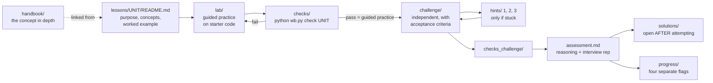

# Applied ML Engineering: an eight-week personal study program

A portable, local course for Berdakh Abibullaev: developing, evaluating and delivering ML models as
reliable software. Markdown lessons, runnable Python labs, automated checks, an original handbook,
and one time-series portfolio project.

**State of the material:** all 56 sessions (8 weeks x 7 days) have complete material: lessons, worked
examples, labs with checks, challenges, hints, assessments, solutions and 55 handbook sections. Every check
suite has been verified against its reference solution and against plausible wrong submissions.
[STATUS.md](STATUS.md) records what was executed, what was not, and the known limitations.

## Start here

### 1. Set up (about 10 minutes, once)

Requires Python 3.11 or newer. Check with `python3 --version`. Pop!_OS 22.04 ships 3.10; if that is
what you have, install a newer interpreter first (lesson w1d3 and handbook H2.1 explain the options).

```bash
git clone https://github.com/berdakh/mlengineering-.git
cd mlengineering-
python3 -m venv .venv
source .venv/bin/activate
python -m pip install --upgrade pip
python -m pip install -r requirements.txt
python wb.py status          # the whole course with your progress flags
```

### Study app (optional, recommended)

A local app for the program: today's session, the schedule, lessons with their diagrams and figures,
one-click checks, progress flags, notes and the handbook. It uses the same progress files as `wb.py`.

```bash
pip install -r requirements-app.txt
streamlit run app/study_app.py        # opens http://localhost:8501 (only on your machine)
```

### 2. First two sessions: the diagnostic

Open [diagnostic/README.md](diagnostic/README.md). It is time-boxed and unassisted.

* **Session 1 (about 2 h):** `a1_python`, `a2_sql`, `a3_cleaning`.
* **Session 2 (about 2 h):** `b1_baseline`, `b2_leakage`, `b3_testing_api`, `b4_explain`.

```bash
python wb.py check diagnostic/a1_python     # run a section's automated checks on your work
```

The starters fail their checks by design. Do not open `solutions/` before submitting.

**Deliverable to submit for feedback:** your edited `diagnostic/*/lab/` files and the completed
[diagnostic/SUBMISSION.md](diagnostic/SUBMISSION.md), committed and pushed (or pasted into a
session). The plan for Weeks 1-3 is adapted only after that submission has been reviewed; until
then nothing in this repository claims to know your results.

### 3. Then: one session a day

`python wb.py next` always names the next session and the file to open. The full plan with objectives,
deliverables and prerequisites is [roadmap/SCHEDULE.md](roadmap/SCHEDULE.md); the design behind it is
[ROADMAP.md](ROADMAP.md).

| Week | Theme | First session |
|---|---|---|
| 1 | From research code to software | [w1d3 script to package](lessons/w1d3_package_structure/README.md) (after the diagnostic) |
| 2 | SQL, pandas, data quality, features, baselines | [w2d1 SQL I](lessons/w2d1_sql_joins_grain/README.md) |
| 3 | Leakage, validation, selection, event metrics, uncertainty | [w3d1 leakage](lessons/w3d1_leakage/README.md) |
| 4 | Time-series detectors, neural comparison, tracking, model choice | [w4d1 time-series fundamentals](lessons/w4d1_timeseries_fundamentals/README.md) |
| 5 | Inference pipeline, artifacts, streaming, FastAPI, API tests | [w5d1 inference pipeline](lessons/w5d1_inference_pipeline/README.md) |
| 6 | Docker, CI, latency, AWS (gated), delivery and debugging | [w6d1 Docker basics](lessons/w6d1_docker_basics/README.md) |
| 7 | Logging, drift, delayed labels, updates, reliability | [w7d1 logging and metrics](lessons/w7d1_service_logging_metrics/README.md) |
| 8 | Reproduction audit, report, system design, interviews, final assessment | [w8d1 completion audit](lessons/w8d1_project_completion/README.md) |

Every seventh day is a lighter review day with a retrieval sheet and a timed interview set
([interview/README.md](interview/README.md)). Extra installs by week: Week 4's neural lesson needs
`pip install -r requirements-neural.txt`; Week 6 needs Docker Engine (lessons explain the install).

Each lesson has a 2-hour essential path, an optional extension of up to 1 hour, a worked example, a
guided lab with checks, an independent challenge with three levels of hints, and an assessment.



*How one unit's parts fit together.*

## Daily commands

```bash
python wb.py next                           # what to study next
python wb.py check w1d3                     # grade your guided lab
python wb.py check w1d3 --challenge         # grade your independent challenge
python wb.py mark w1d3 reading              # flags: reading | guided | independent | review
python wb.py mark w1d3 review off           # clear a flag
python wb.py note w1d3 "what I got wrong and why"
```

Progress is stored in `progress/` as plain files that you commit. The four flags are separate on
purpose: reading completed, guided practice completed, independent skill demonstrated, review needed.
Passing supplied checks is guided practice. Set `independent` only for work done without hints or solutions.

## Map of the repository

| Path | What it is |
|---|---|
| [ROADMAP.md](ROADMAP.md), [roadmap/SCHEDULE.md](roadmap/SCHEDULE.md) | Design of the eight weeks; all 56 sessions with objective, deliverable, prerequisites, status |
| [STATUS.md](STATUS.md) | Authored / reviewed / verified / planned, known limitations, next continuation step |
| `diagnostic/` | Practical diagnostic in seven sections, with its own synthetic business dataset |
| `lessons/<unit>/` | Lesson text, worked example, lab starter, challenge, hints, assessment, checks |
| `solutions/` | Reference solutions, model answers, scoring guidance, and the wrong submissions the checks are validated against. Open only after attempting |
| `handbook/` | The original handbook, by chapter; [index](handbook/README.md) |
| `project/` | Portfolio project brief, dataset provenance, download script |
| `interview/` | Recurring interview-practice plan |
| `progress/` | Your progress flags, notes and the skills ledger |
| `data/` | Synthetic lab data and its generator; downloaded data lands in `data/raw/` (git-ignored) |
| `app/` | The study app (`streamlit run app/study_app.py`) |
| `tools/`, `wb.py` | Small helpers: progress, running checks, verifying the checks themselves |
| `docs/` | Authoring conventions, tested versions |

## Ground rules of this course

* Running supplied code is not mastery. Evidence comes from independent challenges, timed work and
  project artifacts.
* Synthetic data is labelled as synthetic wherever it appears, together with what it cannot show.
* No secrets or cloud credentials in the repository. Nothing in the course creates paid cloud
  resources or exposes a service publicly without your explicit authorisation.
* The course makes no promise of job readiness. It produces artifacts and measured independent
  performance that you can show and explain.

## For whoever continues authoring

Read [docs/AUTHORING.md](docs/AUTHORING.md) and the last section of [STATUS.md](STATUS.md).
`python tools/verify_checks.py --all` must pass before any unit is called "Execution verified".
