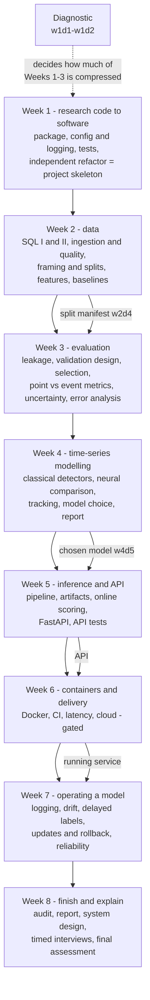

# Eight-week roadmap: applied machine learning as reliable software

The session-by-session table (objective, deliverable, prerequisites, status for all 56 sessions) is in
[roadmap/SCHEDULE.md](roadmap/SCHEDULE.md). This page explains the design behind it.

## What the course is for

Evidence, produced by you, that you can do each of these without step-by-step help:

| # | Target capability | Main evidence artifact | Weeks |
|---|---|---|---|
| 1 | Translate a practical problem into an ML task | Problem statement, label and split definitions | 2 |
| 2 | Build a reproducible data pipeline | `flowguard ingest` + feature pipeline with tests | 2 |
| 3 | Establish and evaluate meaningful baselines | Baseline table with intervals | 2-3 |
| 4 | Train, compare and analyse models correctly | Comparison report, error analysis, decision memo | 3-4 |
| 5 | Package preprocessing and inference consistently | Inference pipeline + parity tests | 5 |
| 6 | Write useful tests and maintainable code | Test suites graded by mutation; project history | 1 onward |
| 7 | Expose predictions through an API | FastAPI service with validation and tests | 5 |
| 8 | Containerise and deploy a small service | Image, CI, runbook, optional AWS deployment | 6 |
| 9 | Measure latency, failures and model behaviour | Load-test report, monitoring demonstration | 6-7 |
| 10 | Explain decisions, limitations and tradeoffs | Report, recorded walkthrough, design reps | 4, 8 |

The course does not promise job readiness. Progress is judged by independent performance on
challenges and by the artifacts above, never by time spent or lessons read.

## Rhythm

* **Six core days and one light day per week.** Day 7 is retrieval practice, one redo of something that
  failed, and a mixed interview set. It is also the catch-up buffer.
* **A core session = a 2-hour essential path + an optional extension of up to 1 hour.** The essential
  path is: read (20-30 min), worked example (15-20 min), guided lab (45-55 min), independent challenge
  start (15-20 min), assessment and reflection (10-15 min). Each lesson states its own budget.
* **One primary objective, one deliverable, explicit completion criteria** per session.
* **Four progress flags, kept separate:** reading completed, guided practice completed, independent
  skill demonstrated, review needed. Passing supplied checks earns "guided" at most.

### Adjusting the schedule

Sessions are ordinal (`w3d2`), not tied to calendar dates, so the plan survives missed days.

* Move the light day anywhere in the week; keep one per six core sessions.
* If a session overruns, stop at the 2-hour mark, mark `review`, and use day 7. Do not borrow from the
  next session's time: later units depend on deliverables, not on reading.
* If the diagnostic shows a topic is already solid, the matching lesson is replaced by its independent
  challenge only (30-45 min). The mapping is in `solutions/diagnostic/SCORING.md` and is applied only
  after your submission has been reviewed.
* To reorder or drop units, edit `tools/build_course.py` and rerun it. Respect the prerequisite column.

## Prerequisite structure

*Prerequisite structure. Labelled edges are the hard dependencies.*

```mermaid
gantt
    title Eight weeks, six core days and one light day each
    dateFormat X
    axisFormat Day %s
    section Foundations
    Week 1 research code to software    :w1, 0, 7
    section Data and evaluation
    Week 2 data and baselines           :w2, 7, 14
    Week 3 evaluation                   :w3, 14, 21
    Week 4 modelling and model choice   :w4, 21, 28
    section Delivery
    Week 5 inference and API            :w5, 28, 35
    Week 6 containers, CI, cloud        :w6, 35, 42
    Week 7 operating a model            :w7, 42, 49
    section Communicate
    Week 8 finish and explain           :w8, 49, 56
    section Project milestones
    Skeleton w1d6                       :milestone, 6, 0
    Evaluation report w4d6              :milestone, 27, 0
    API release candidate w5d6          :milestone, 34, 0
    Container and delivery w6d6         :milestone, 41, 0
    Monitoring demo w7d6                :milestone, 48, 0
```

*Sessions are ordinal, not calendar dates: "Day 27" is the 27th session you complete.*

Hard dependencies: nothing in Week 3 is meaningful before the split manifest of w2d4; nothing in
Week 5 before a chosen model (w4d5); Week 6 needs the API of Week 5; Week 7 needs a running service.

Assumed and not taught from scratch (verified by the diagnostic and challenges instead): Python
fluency, NumPy, PyTorch training loops, signal-processing basics, the mathematics of standard
classifiers. If the diagnostic contradicts an assumption, a targeted primer is added.

## The main project and the transfer exercise

One project runs through the course: **`flowguard`**, fault detection on the SKAB water-circulation
testbed recordings. The brief, provenance, licence, data dictionary and measured dataset facts are in
[project/README.md](project/README.md). In your terms: the *experiment* plays the role of the
*patient* (the independent unit across which generalisation is evaluated), the anomalous segment is an
*event* as an HFO or a seizure is, and point-level versus event-level scoring is the same distinction
you already handle in iEEG detection work. What is new is everything around the model.

Transfer is probed on tabular business data: in the diagnostic (synthetic), in w2d6 and in w3d6.

## Chosen stack, and what is deliberately left out

| Concern | Choice | Reason | Deferred / optional |
|---|---|---|---|
| Language, numerics | Python >= 3.11, NumPy, pandas | already yours | - |
| Classical ML | scikit-learn | pipelines make leakage prevention structural | - |
| Neural models | PyTorch on CPU, only in w4d3 | used where a comparison justifies it | GPU optional |
| SQL | SQLite via the standard library | zero installation, full window-function support | DuckDB as an optional extension |
| Tests | pytest | one tool for unit, API and integration tests | hypothesis as an optional extension |
| Config, logging | `tomllib`, dataclasses, `logging` | concepts before frameworks | Hydra, structlog |
| Tracking | run directories + a results table | you can see every moving part | MLflow as an optional extension in w4d4 |
| API | FastAPI + pydantic | validation and schema are first-class | - |
| Container | Docker | industry default | - |
| CI | GitHub Actions | the repository already lives on GitHub | - |
| Cloud | AWS, one container route | you named AWS as a development need | exact service chosen when Week 6 is authored |

Version-sensitive details (AWS service choice and commands, GitHub Actions versions, Docker base images,
FastAPI lifecycle APIs) are **not fixed yet**. They are checked against current official documentation
when the corresponding week is authored, and the sources opened are recorded in each handbook section.

## Cloud and cost policy

Every lab has a local path that costs nothing. The AWS session (w6d5) is authorisation-gated: nothing
is created and nothing is exposed publicly unless you explicitly approve it after reading that
session's cost and credential briefing. Credentials never enter the repository (`.gitignore` blocks
the common filenames; the lesson uses environment variables and short-lived credentials).

## Distinctions the course keeps returning to

| Do not confuse | With | First treated |
|---|---|---|
| Research experimentation | Production inference | w5d1 |
| Data validation (is the input well-formed?) | Model evaluation (is the model good?) | w2d3, w3d1 |
| Unit tests (code is correct) | Statistical performance checks (model is useful) | w1d5 |
| Data drift (inputs changed) | Measured performance degradation | w7d3 |
| A working demonstration | An operationally mature service | w6d6, w7d5 |

## What "complete" means for a unit

A unit is listed as *Execution verified* only when its example ran, its reference solution ran, and
`tools/verify_checks.py` showed that the checks accept the reference and reject every plausible wrong
submission kept in `solutions/.../mutants`. The current state of every unit is in [STATUS.md](STATUS.md).
