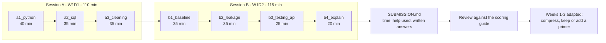

# Practical diagnostic

Purpose: find out what you can already do **independently**, so the first weeks spend time where it
is needed and skip what you have demonstrated. It is not an exam and produces no score - only a
per-skill evidence level (see `solutions/diagnostic/SCORING.md` *after* you finish).

Nothing about your results is known until you submit. The roadmap is adapted only after your actual
submissions are reviewed.

## Structure: two sessions, about two hours each

| Session | Section | Probes | Time box |
|---|---|---|---|
| A (W1D1) | [a1_python](a1_python/README.md) | debugging, refactoring, Python semantics | 40 min |
| A | [a2_sql](a2_sql/README.md) | joins, aggregation, NULLs, fan-out, window functions | 35 min |
| A | [a3_cleaning](a3_cleaning/README.md) | pandas data cleaning, date/time-zone handling, judgment | 35 min |
| B (W1D2) | [b1_baseline](b1_baseline/README.md) | problem framing, baselines, metrics under imbalance | 35 min |
| B | [b2_leakage](b2_leakage/README.md) | leakage, validation design | 35 min |
| B | [b3_testing_api](b3_testing_api/README.md) | writing tests, request validation, API concepts | 25 min |
| B | [b4_explain](b4_explain/README.md) | explaining and defending an ML decision | 20 min |

Session A totals 110 minutes, session B 115. Use the remaining minutes of each session to fill in
[`SUBMISSION.md`](SUBMISSION.md).



*The path through the diagnostic. Nothing is adapted until the submission has been reviewed.*

## Rules (they make the result useful to you)

1. **Time-box each section.** When the time is up, stop, note where you were, move on. An unfinished
   section is information; an untimed finished one is not.
2. **No AI assistants, no searching for the answer.** Official documentation of Python, SQLite,
   pandas, scikit-learn, pytest and pydantic is allowed - looking up an API is normal work.
   If you do use other help, record it in `SUBMISSION.md`; that section then counts as guided.
3. **Do not open `solutions/`** (or `b3_testing_api/checks/impls/`) until you have submitted.
4. You may run the checks as often as you like - they are your feedback loop, as tests are at work.
5. Work in each section's `lab/` directory. Commit after each section if you use Git:
   `git add -A && git commit -m "diagnostic a1"`.

## Commands

From the repository root:

```bash
python wb.py check diagnostic/a1_python                 # run one section's checks
python -m pytest diagnostic/a1_python/checks -q         # the same thing, directly
```

The starter code **fails** its checks in every section. That is the intended starting state.
Passing checks shows that the objectively checkable behaviour is right; the written parts and the
quality of the code are reviewed by reading your submission.

Requirements: Python >= 3.11 with numpy, pandas, scikit-learn, pytest and pydantic >= 2 (see the
repository `README.md` for environment setup).

## Data

All sections use one synthetic dataset, documented in [`data/README.md`](data/README.md). It is not
real; see that file for what cannot be concluded from it.

## After you finish

Fill in `SUBMISSION.md`, commit, and send back what it lists. Then (and only then) read
`solutions/diagnostic/` to compare. Feedback and any change to the roadmap follow from the submission.
