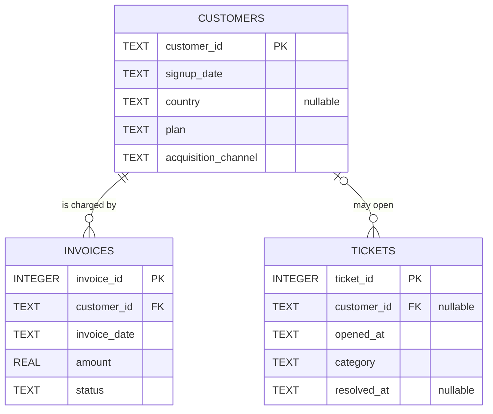

# Diagnostic data: "StreamBox" (SYNTHETIC)

All files in this directory are **simulated** by `make_data.py` from a fixed seed. StreamBox is a
fictional subscription video service. The data has planted properties (data-quality defects, join
traps, columns that leak the outcome) so that the diagnostic can observe how you work.

**What you cannot conclude from it:** anything about real customer churn, about which model family
is better, or about realistic effect sizes. Scores here measure only whether an evaluation was set up
correctly on this simulation.

```bash
python diagnostic/data/make_data.py            # regenerate every file
python diagnostic/data/make_data.py --check    # confirm the files on disk match the generator
```

Byte-identical regeneration was confirmed with the versions in `docs/maintainers/tested-versions.md`; other
NumPy/pandas versions may produce different random streams or float formatting. The committed files
are the reference.

## `streambox.db` (SQLite) - used by a2

Dates are ISO-8601 text.

**customers** - one row per customer (900)

| Column | Type | Notes |
|---|---|---|
| customer_id | TEXT, primary key | `C00001` ... |
| signup_date | TEXT `YYYY-MM-DD` | |
| country | TEXT, nullable | ISO alpha-2; NULL when not recorded |
| plan | TEXT | `basic` / `standard` / `premium` |
| acquisition_channel | TEXT | `organic` / `paid_search` / `referral` / `partner` |

**invoices** - one row per charge attempt (about 12,600)

| Column | Type | Notes |
|---|---|---|
| invoice_id | INTEGER, primary key | increases with time of creation |
| customer_id | TEXT, foreign key | |
| invoice_date | TEXT `YYYY-MM-DD` | charges are attempted on the 1st of a month; a failed charge may be retried the same day as a new invoice |
| amount | REAL | USD |
| status | TEXT | `paid` / `failed` / `refunded` |

**tickets** - one row per support ticket (about 1,000)

| Column | Type | Notes |
|---|---|---|
| ticket_id | INTEGER, primary key | |
| customer_id | TEXT, nullable | NULL for tickets opened without logging in |
| opened_at | TEXT `YYYY-MM-DD HH:MM:SS` | |
| category | TEXT | `billing` / `playback` / `account` / `other` |
| resolved_at | TEXT, nullable | NULL while open |



*Tables in `streambox.db` (SYNTHETIC). One customer has many invoices and may have tickets; a ticket may have no customer.*

## `signups_dirty.csv` - used by a3

A raw CRM export; described in `../a3_cleaning/README.md`. Uncleaned on purpose.

## Churn snapshot files - used by b1 and b2

One row per **customer per monthly snapshot** (the 1st of each month of 2025, for customers active on
that day). A customer therefore appears in up to 12 rows, and stops appearing after churning.

| Column | Meaning |
|---|---|
| customer_id | customer key |
| snapshot_date | the 1st of a month; the day the prediction would be made |
| plan, country, acquisition_channel | customer attributes (country may be missing) |
| tenure_days | days since signup, as of snapshot_date |
| monthly_price | price in force on snapshot_date (USD) |
| sessions_30d | viewing sessions in the 30 days before snapshot_date |
| avg_session_min | mean session length in those 30 days (sometimes missing) |
| tickets_90d | support tickets opened in the 90 days before snapshot_date |
| failed_payments_90d | failed charges in the 90 days before snapshot_date |
| discount_active | 1 if a discount is active on snapshot_date |
| **churned_30d** | **label**: 1 if the customer cancelled within 30 days after snapshot_date |

* `churn_train.csv`, `churn_test.csv` (b1): the columns above, already split by the data team.
* `churn_export_full.csv` (b2): all snapshots in one file, plus two further columns exactly as they
  arrive from other systems:

| Column | Source system's description |
|---|---|
| retention_offer_sent | "1 if the retention team sent this customer a save-offer in the cycle" (retention tooling) |
| last_invoice_offset_days | "date of the customer's last invoice in the billing system minus snapshot_date, in days" (billing export, generated at export time) |
