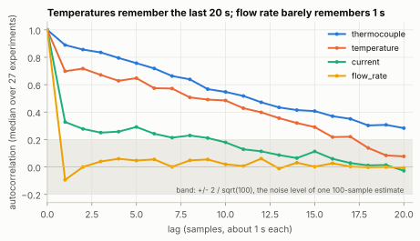
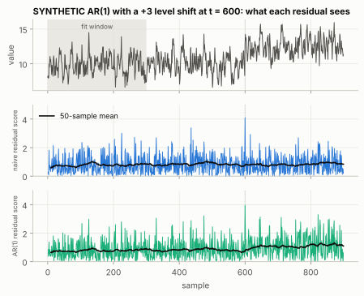
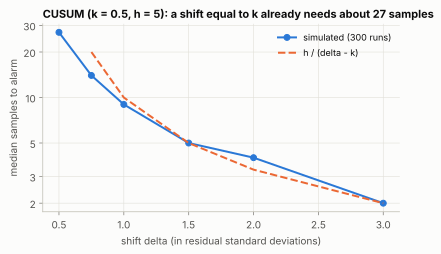
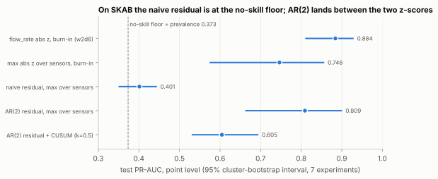
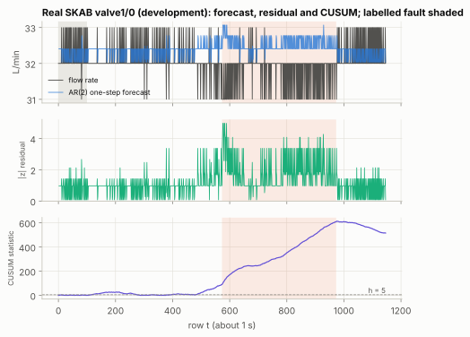

<!-- GENERATED by tools/nbpages.py from notebooks/. Do not edit. -->

# 19 · Time-series fundamentals and forecast-residual detectors
{: .no_toc }

[Run it in Colab](https://colab.research.google.com/github/berdakh/mlengineering/blob/main/advanced/notebooks/19_timeseries_fundamentals.ipynb){: .btn .btn-primary .mr-2 target=_blank }
[View the .ipynb](https://github.com/berdakh/mlengineering/blob/main/advanced/notebooks/19_timeseries_fundamentals.ipynb){: .btn target=_blank }

{: .note }
> You are reading this notebook. To **run** it, open it in Colab with the button above - no install, no GPU needed for most of them - or clone the repository and open it in Jupyter.

1. TOC
{:toc}

---

**Week 4 · day 1 · 2 h essential path + up to 1 h optional** · lab files: [`labs/w4d1_timeseries_fundamentals/`](https://github.com/berdakh/mlengineering/blob/main/labs/w4d1_timeseries_fundamentals/)

**Objective.** Reason about autocorrelation, non-stationarity and windowing; build naive, seasonal-naive and autoregressive forecasters and use their residuals as anomaly scores.

```python
# --- Setup: works on your laptop AND in Google Colab ----------------------------
# In Colab this clones the course repository and installs the requirements (about a
# minute, first run only). On your own machine it just finds the repository. Every
# command in this notebook runs from the repository root. Safe to re-run.
import os
import subprocess
import sys
from pathlib import Path

if "google.colab" in sys.modules:
    if not Path("/content/mlengineering").exists():
        subprocess.run(["git", "clone", "--depth", "1",
                        "https://github.com/berdakh/mlengineering.git",
                        "/content/mlengineering"], check=True)
    os.chdir("/content/mlengineering")
    subprocess.run([sys.executable, "-m", "pip", "install", "-q",
                    "-r", "requirements.txt"], check=True)

REPO_ROOT = next(p for p in [Path.cwd(), *Path.cwd().parents]
                 if (p / "src" / "mlcourse").is_dir())
os.chdir(REPO_ROOT)
sys.path.insert(0, str(REPO_ROOT / "src"))
print("repo root:", REPO_ROOT)
```

Unit id `w4d1_timeseries_fundamentals` · Week 4, day 1 · Handbook: [H7.4](../../handbook/ch07_timeseries_grouped_modeling/h7_4_forecast_residual_detection.html)
(and [H7.1](../../handbook/ch07_timeseries_grouped_modeling/h7_1_windowing_and_causality.html) for windowing)
· Content status: see [STATUS.md](../../guides/status.html)

## 1. Purpose

**Objective.** Reason about autocorrelation and non-stationarity in sensor data, build naive,
seasonal-naive and autoregressive one-step forecasters, and use their standardised residuals (and a
CUSUM control chart on them) as anomaly scores evaluated with the Week 3 protocol.

**Why an applied ML engineer needs it.** Most monitoring data is a time series, and the first
question in any detection or forecasting design review is "what does normal look like one step
ahead?". Forecast residuals and control charts are what many plants, payment systems and SRE teams
actually run, because they are cheap, explainable, and need no labels. You also need the vocabulary
(autocorrelation, stationarity, effective sample size, ARL) to explain why a random split or a
row-level interval is wrong on such data, which is a frequent interview probe.

**Deliverable.** A tested `flowguard.forecast` module, and `lab/FORECAST_NOTES.md`: the SKAB
comparison of forecast-residual detectors against the w2d6 z-score, with intervals, and four short
answers explaining the result.

**Completion criteria.**

* `python wb.py check w4d1` passes (guided practice).
* `lab/FORECAST_NOTES.md` contains your real-data table and the four answers.
* Independent skill: `python wb.py check w4d1 --challenge` passes and `challenge/DECISION.md` is
  written without hints.

**Prerequisites.** Week 3, in particular the frozen split manifest from
[w3d1](13_leakage.html), event-level metrics from [w3d4](16_point_vs_event_evaluation.html)
and the cluster bootstrap from [w3d5](17_uncertainty.html). The lab ships snapshots of all
three, plus the w2d6 baselines. Assumed: you know least squares; autoregressive models are introduced
here.

**Time budget (2 h essential).**

| Activity | Minutes |
|---|---|
| Read section 2, run the worked example (section 3) | 40 |
| Guided lab: implement `flowguard.forecast` (Tasks 1-5) | 45 |
| Guided lab: run the SKAB comparison, write `FORECAST_NOTES.md` (Task 6) | 15 |
| Independent challenge: start | 10 |
| Assessment and reflection | 10 |
| *Optional extension: finish the challenge; EWMA chart; an AR order chosen per sensor* | *up to 60* |

Data needed for the real-data steps: `python project/get_skab.py` (once). Checks need no download.

## 2. Conceptual explanation

### 2.1 Why rows of a time series are not samples

In a time series the value at `t` carries information about the value at `t + 1`. The
**autocorrelation function** makes that precise. For a stationary series with mean `μ` and variance
`σ_x²`, the lag-`k` autocorrelation is

```
ρ_k = Cov(x_t, x_{t-k}) / σ_x²
```

and its usual estimate is `r_k = Σ_{t=k}^{n-1} (x_t − x̄)(x_{t−k} − x̄) / Σ_t (x_t − x̄)²`. Using one
denominator for every lag (rather than `n − k` terms each) gives a slightly biased but positive
semi-definite sequence, which is what statistical software reports. Under white noise, `r_k` is
approximately normal with standard deviation `1/√n`, so `±2/√n` is the band within which an
autocorrelation is indistinguishable from zero.

The **partial autocorrelation** at lag `k` is the correlation between `x_t` and `x_{t−k}` after
removing what lags `1..k−1` explain. It equals the last coefficient of an AR(`k`) fit. Rules of thumb:
an AR(`p`) process has a PACF that cuts off after lag `p` and an ACF that decays; a moving-average
process is the reverse.

Two practical consequences:

* **Effective sample size.** For the mean of an AR(1) series with coefficient `φ`,
  `Var(x̄) ≈ σ_x² / n · (1 + φ) / (1 − φ)`, so the series is worth `n_eff = n (1 − φ)/(1 + φ)`
  independent observations. With `φ = 0.9`, 300 samples are worth about 16. More generally
  `n_eff ≈ n / (1 + 2 Σ_k ρ_k)`. This is why a row-level bootstrap or a random K-fold split is
  over-confident on sensor data (w3d2, w3d5): the rows are not the independent unit.
* **Window length.** A window shorter than the decorrelation time of a sensor averages correlated
  values and reduces noise less than `1/√w` suggests (H7.1). On SKAB (figure 1) the two temperatures
  stay correlated beyond 20 s, the current for a few seconds, and the flow rate and accelerometers
  hardly at all.



*Figure 1 (REAL SKAB, first 100 rows of each development experiment).* The memory of each sensor
differs by an order of magnitude. A single window length or a single forecaster order for all eight
sensors is a compromise, not a neutral default.

### 2.2 Stationarity and how it breaks

A series is (weakly) **stationary** when its mean, variance and autocovariances do not depend on
time. Forecasters and control limits fitted on one stretch of data are only valid on another stretch
if that holds. It breaks in recognisable ways:

| Departure | Looks like | Usual remedy |
|---|---|---|
| Trend | mean drifts steadily | differencing (`x_t − x_{t−1}`), detrending, or a model with a trend term |
| Level shift | mean jumps and stays | that is often the anomaly; otherwise re-baseline after a known change |
| Seasonality | repeating pattern with period `s` | seasonal differencing (`x_t − x_{t−s}`), seasonal terms |
| Variance change | spread changes | model the scale (rolling sigma), transform (log) |
| Regime / operating point | several stable states | condition on the regime, or fit per regime |

For anomaly detection there is a tension: the fault you want to find *is* a non-stationarity. A model
that adapts too readily (a naive forecast, a short rolling baseline) absorbs the fault into "normal"
within a few samples; a model that never adapts raises alarms forever after a benign change (a
recalibration, a new product line). Section 2.4 makes this concrete.

### 2.3 One-step-ahead forecasting as a model of normal behaviour

Fit a forecaster on data you believe is normal, predict each value from the values before it, and
call the standardised prediction error the anomaly score:

```
x̂_t = f(x_{t−1}, x_{t−2}, …)        e_t = x_t − x̂_t        z_t = e_t / σ̂_e
```

`σ̂_e` is the standard deviation of the one-step residuals **on the fit data**, not of the series.
For a persistent sensor (temperature, `r_1 ≈ 0.7-0.9`) the series spread is two to three times the
one-step error; dividing by the wrong one silently changes the meaning of every threshold.

Three forecasters, in increasing order of assumptions:

* **Naive:** `x̂_t = x_{t−1}`. The residual is the first difference. No parameters; optimal for a
  random walk.
* **Seasonal naive:** `x̂_t = x_{t−s}`. The value one cycle ago (a week for daily retail data).
* **AR(p) with intercept,** fitted by ordinary least squares:

  ```
  x_t = c + φ_1 x_{t−1} + … + φ_p x_{t−p} + ε_t,       mean μ = c / (1 − Σ φ_k)
  ```

  Stack the rows `t = p … n−1` into a design matrix `X = [1, x_{t−1}, …, x_{t−p}]` and solve
  `min ‖x_{p:} − Xβ‖²`. Leaving out the intercept is a classic error: for a series with a non-zero
  level, the least-squares coefficients then absorb the mean and drift towards a unit root.

For several sensors the natural generalisation is a **vector autoregression** (VAR),
`x_t = c + A_1 x_{t−1} + … + ε_t` with matrix coefficients, whose residual covariance lets a
Mahalanobis distance on residuals catch broken cross-sensor relationships. The lab fits one AR per
sensor and takes the maximum standardised residual: simpler, fewer parameters (`8(p+1)` instead of
`8 + 64p`, which matters with 100 burn-in rows), and blind to cross-sensor structure. w4d2 handles
cross-sensor structure with PCA instead.

### 2.4 What a residual can see

The forecaster you choose decides which kind of anomaly its residual can see.

* After a sustained level shift of size `Δ`, the **naive** residual is `Δ` at the step and back to
  noise one sample later: it detects *changes*, not *states*.
* The **AR(p)** forecast pulls towards the fitted mean `μ`. After the shift the residual keeps an
  offset of about `(1 − Σφ_k) Δ` for as long as the shift lasts. A strongly persistent fitted process
  (`Σφ` close to 1) behaves almost like the naive forecaster.



*Figure 2 (SYNTHETIC).* The naive residual sees the step at `t = 600` and nothing after it. The AR(1)
residual (fitted `φ = 0.67`) keeps about a third of the offset, which is why its 50-sample mean stays
raised. A per-sample threshold on that small offset rarely fires; accumulating it does.

### 2.5 Alarm rules: thresholds, CUSUM and EWMA

A **per-sample threshold** (`|z_t| > 3`) is good at spikes and poor at small persistent offsets.
Control charts accumulate evidence.

**Two-sided tabular CUSUM** on standardised residuals:

```
S⁺_t = max(0, S⁺_{t−1} + z_t − k)        S⁻_t = max(0, S⁻_{t−1} − z_t − k)        alarm if max(S⁺_t, S⁻_t) > h
```

`k` is the reference value (half the shift you want to detect fastest is the classical choice) and
`h` the decision interval. The floor at zero is what makes it a detector: it forgets evidence against
a shift instead of letting it cancel later evidence for one. After a shift of `δ` residual standard
deviations the statistic grows by about `δ − k` per sample, so the detection delay is roughly
`h / (δ − k)` samples.

**EWMA chart:** `w_t = λ z_t + (1 − λ) w_{t−1}`, alarm when `|w_t|` exceeds `L σ_w` with
`σ_w = sqrt(λ/(2 − λ))` in steady state. Small `λ` gives long memory and detects small shifts slowly.

**Average run length.** `ARL₀` is the expected number of samples between false alarms on in-control
data; `ARL₁` the expected delay after a shift. For the two-sided CUSUM with `k = 0.5, h = 5` on
independent standard-normal input, `ARL₀` is about 460 samples (mean of 300 simulated runs in the
authoring session; median 330). At 1 Hz that is **a false alarm every six to eight minutes** — the chart parameters only make sense with a stated alarm budget (w3d4).
`ARL₀` tables assume independent, correctly standardised residuals; autocorrelated residuals or a
wrong `σ̂_e` make the real false-alarm rate much higher.



*Figure 3 (SYNTHETIC, 300 runs per point).* `h/(δ − k)` is a good guide above `δ ≈ 1`; at `δ = k`
the formula breaks down and the simulated median delay is 27 samples.

### 2.6 Why forecasting serves detection here

SKAB's labels mark anomalous *segments*, not future values to predict. Nobody downstream consumes the
forecast; it exists to define "expected". That has consequences: the forecaster is judged by
detection metrics on held-out experiments, not by forecast error, and a forecaster with worse RMSE
can be the better detector (the AR model in figure 2 forecasts the shifted series worse than the naive
one, and that is exactly why it detects the shift). Do not frame this project as forecasting: the
labels and the stakeholder need do not support it (w2d4).

### 2.7 Connection to other domains

AR models are standard in signal processing and econometrics: AR spectral estimation, AR coefficients as
features for classification, and prediction-error methods for detecting onsets (in biomedical signals,
speech, seismology). Two differences matter here. First, such models are often
refitted continuously on sliding windows, which turns the detector into a change detector (the naive
case above). Second, the clinical question is often onset, where change detection is what you want;
the plant reliability question is often state ("is it still faulty?"), where the model must not adapt.

### 2.8 Industry example

Statistical process control is the oldest monitoring discipline in manufacturing: Shewhart charts on
a measured dimension, CUSUM and EWMA charts for small drifts, with limits set from an in-control
period and a documented response when a chart alarms. Modern versions run the same charts on model
residuals (a forecast of expected temperature given load, for example) rather than on raw sensors,
because raw sensors move with the operating point. A typical failure: limits estimated on a few days
of autocorrelated data, a false alarm every hour, and operators who learn to ignore the chart.

### 2.9 Misconceptions

* "A lower forecast error means a better detector." Not for detection (section 2.6).
* "The residual of a good model is white, so I can use i.i.d. control limits." Only if the model is
  correctly specified *and* the process has not changed since fitting; check the residual ACF.
* "Differencing makes everything stationary." It removes a unit root or a trend and also removes the
  level, which may be the signal.
* "CUSUM detects any shift." Shifts well below `k` accumulate very slowly; the chart is tuned to a
  shift size.
* "Fit the forecaster on the whole recording." Then the fault is part of "normal" and the score is
  computed with information from the future (w2d5).

## 3. Worked example

`example/ar_residuals_tour.py` uses SYNTHETIC series so every quantity has a known true value. It runs
on the reference implementation in `solutions/` (set `FORECAST_SRC=labs/w4d1_timeseries_fundamentals/lab/src`
to run it on yours once the lab is done).

```python
!python labs/w4d1_timeseries_fundamentals/example/ar_residuals_tour.py
```

Output from the authoring run:

```
1. AR(2) with phi = (0.60, 0.25), mean 20, 5000 samples
   ACF  lags 1-5: [0.8  0.73 0.64 0.57 0.5 ]
   PACF lags 1-5: [ 0.8   0.25 -0.01  0.01 -0.01]

2. Effective sample size for the mean of an AR(1): n_eff = n (1 - phi) / (1 + phi)
   phi = 0.0: Var(mean) simulated 0.00340, i.i.d. formula 0.00333, n_eff = 300 of 300
   phi = 0.5: Var(mean) simulated 0.01439, i.i.d. formula 0.00444, n_eff = 100 of 300
   phi = 0.9: Var(mean) simulated 0.34683, i.i.d. formula 0.01754, n_eff = 16 of 300

3. Level shift of +3.0 at t = 600 (series SD 1.4, innovation SD 1.0)
   AR(1) fitted: phi = 0.67, c = 3.24, implied mean 9.86, sigma = 1.00
   naive  residual score: before 0.82, at the shift 4.10, mean over t = 610-900 0.82
   AR(1)  residual score: before 0.80, at the shift 3.96, mean over t = 610-900 1.10
   ...
4. Small shift of +1.5 at t = 600; the AR(1) residual keeps an offset of about (1 - phi) * 1.5
   residual offset after the shift: mean z = 0.48 (before: +0.03)
   |z| > 3 (per sample)   alarm episodes in the 300 normal samples before: 1; first alarm 224 samples after the shift
   CUSUM k = 0.25, h = 5  alarm episodes in the 300 normal samples before: 6; first alarm 16 samples after the shift
   CUSUM k = 0.5, h = 5   alarm episodes in the 300 normal samples before: 0; first alarm 23 samples after the shift
```

**Reading it.**

1. The ACF decays slowly while the PACF cuts off after lag 2 (0.80, 0.25, then about 0): the
   identification rule for an AR(2). Note that PACF(1) equals ACF(1), and PACF(2) recovers `φ_2`.
2. The simulated variance of the mean is about 3.2 times (φ = 0.5) and 20 times (φ = 0.9) the
   value an i.i.d. formula gives, matching `(1 + φ)/(1 − φ)` = 3 and 19 within simulation error.
3. Least squares recovers the mean (9.86 against a true 10) and the innovation scale (1.00). The naive
   score after the shift is back at its old average (0.82); the AR(1) score stays raised (1.10).
4. The design trade-off of a control chart in one table: `k = 0.25` detects fastest and pays with six
   false alarm episodes in 300 normal samples; `k = 0.5` is quiet before the shift and detects after
   23 samples; the per-sample threshold needs 224. Expect the numbers to vary with the seed; the
   ordering is robust (try a few seeds).

## 4. Guided lab

Work in `lab/src/flowguard/forecast.py`. Everything else in `lab/src/flowguard/` is a snapshot from
earlier lessons; you do not need to edit it. Checks: `python wb.py check w4d1` (or
`python -m pytest labs/w4d1_timeseries_fundamentals/checks -q`). The starter fails all of them.



**Task 1 — `acf(x, nlags)` (8 min).** Mean-removed, one denominator for all lags. *Checkpoint:*
`test_acf_*` pass; on an AR(1) with mean 40 the estimate must still be close to `0.8^k`.

**Task 2 — `NaiveForecaster.predict`, `SeasonalNaiveForecaster.predict` (5 min).** Entry `i` is the
forecast of `x[i]` from `x[:i]`; NaN where there is no history. `fit` is given (it only sets `sigma_`).

**Task 3 — `ARForecaster.fit` and `predict` (15 min).** Use the given `_design` helper (column `k−1`
holds `x_{t−k}` for `t = p … n−1`), prepend a column of ones, solve with `np.linalg.lstsq`, then call
`self._set_sigma(x)`. *Checkpoint:* `test_ar_recovers_coefficients_and_intercept` and
`test_predictions_never_use_the_present_or_future`.
*Debugging:* residuals that are almost exactly zero mean the present value is in your design matrix
(an off-by-one in the lag slicing). Coefficients that sum to about 1 on a series with a large mean
mean the intercept is missing.

**Task 4 — `residual_scores` (2 min).** `|x − x̂| / sigma_`. The scale-invariance check fits on
`1000·x + 3`; your scores must not change.

**Task 5 — `cusum(z, k)` (10 min).** Two sums floored at zero; skip NaN inputs (carry the statistic
forward). *Checkpoint:* the known-answer test, `[0, 0, 3, 3, 0, −3]` with `k = 0.5` gives
`[0, 0, 2.5, 5.0, 4.5, 2.5]`.

**Task 6 — the SKAB comparison (15 min including writing).**

```python
!python project/get_skab.py
!python labs/w4d1_timeseries_fundamentals/lab/forecast_vs_z.py
```

The script (complete; it uses your module) prints the burn-in autocorrelations, chooses the AR order
on the development experiments, and evaluates five detectors on the 7 test experiments of the frozen
w3d1 manifest. Copy its tables into `lab/FORECAST_NOTES.md` and answer the four questions there.
Output from the authoring run (reference implementation; yours should match to the printed precision):

```
2. AR order chosen by development PR-AUC (max over sensors of |residual|/sigma)
   p = 1: development PR-AUC 0.763
   p = 2: development PR-AUC 0.777
   p = 3: development PR-AUC 0.775
   p = 5: development PR-AUC 0.763
   chosen p = 2
```

| detector | test PR-AUC [95% CI] | events detected | false alarms / h | median delay (s) |
|---|---|---|---|---|
| flow_rate abs z, burn-in (w2d6) | 0.884 [0.811, 0.928] | 7/7 | 238.6 | 4 |
| max abs z over sensors, burn-in | 0.746 [0.576, 0.855] | 6/7 | 178.5 | 5 |
| naive residual, max over sensors | 0.401 [0.351, 0.443] | 1/7 | 5.8 | inf |
| AR(2) residual, max over sensors | 0.809 [0.664, 0.899] | 6/7 | 222.9 | 2 |
| AR(2) residual + CUSUM (k=0.5) | 0.605 [0.532, 0.693] | 4/7 | 3.3 | 111 |



*Figure 4 (REAL SKAB, 7 test experiments, frozen v2 manifest).* Intervals come from resampling the
7 experiments with the models and thresholds held fixed (w3d5).

**Interpretation (what the authoring run supports).**

* The naive residual is at the no-skill floor (0.401 against a prevalence of 0.373) and detects 1 of
  7 events. SKAB faults are sustained states; a first difference sees them once, if at all
  (section 2.4).
* The AR(2) residual (0.809) is far better than naive and in the same range as the z-scores; its
  interval overlaps both. Nothing here shows that it beats the single flow-rate z-score, which was
  itself chosen on development data in w2d6.
* CUSUM changes the operating point rather than the ranking: 3.3 false alarms per hour instead of
  over 200, at the cost of 4 of 7 events and a median delay of 111 s. Its point-level PR-AUC is lower
  because the statistic stays high after a fault ends and rises slowly at its start. Which row is
  "best" depends on the alarm budget, not on PR-AUC.
* False alarm rates of 180-240 per hour at the best-F1 threshold are not deployable. The best-F1
  threshold is a development convenience; w3d4 showed how to choose an operating point from a budget.
* Seven test experiments: the intervals are wide and the ranking of the three middle detectors is not
  established.



*Figure 5 (REAL SKAB, development experiment valve1/0, flow rate only).* Two things the table hides:
the flow rate is coarsely quantised (it moves in steps of about 1 L/min), so the residual takes few
distinct values; and the CUSUM crosses `h` well before the labelled fault (around `t = 150-250`), a
false alarm a per-row metric reports as a scattering of false positives.

**If the lab runs long.** Skip writing answers 3-4 in `FORECAST_NOTES.md`; do them on the review day.

```python
# Run the automated checks on your guided lab.
# A fresh starter is expected to FAIL; passing means guided practice, not mastery.
from mlcourse.checks import check

check("w4d1")
```

## 5. Independent challenge

[challenge/README.md](https://github.com/berdakh/mlengineering/blob/main/labs/w4d1_timeseries_fundamentals/challenge/README.md): detect promotions in SYNTHETIC daily sales of ten stores
with a weekly pattern, choosing between a seasonal-naive and an AR residual detector on development
weeks only. Transfer: different sampling (daily), seasonality, a benign level change, and a
one-sided anomaly. Graded on fresh generator seeds.


### The challenge brief


No walkthrough. Hints are in `../hints/`; try without them first.

#### Situation

A retail analytics team wants an automatic flag for "this store's sales are unusually high today",
to catch promotions that were run without being registered in the planning system. You have two years
of daily unit sales for ten stores (`data/sales.csv`, SYNTHETIC, generated by `data/make_sales.py`;
read its docstring for what the generator does). The `promo` column marks registered promotions and
serves as the label. Development period: dates before `2025-07-01`; test period: from `2025-07-01`.

This is a transfer of today's lab: daily instead of 1 Hz data, a weekly pattern, ten independent
series, and a business question instead of a plant one.

#### Task

Implement the three functions in `sales_detector.py` (keep the signatures):

* `store_scores(df, method, fit_end)` — one score per row, per store in date order, for
  `method in ("seasonal_naive", "ar")`. Any parameter (including the residual scale) is learned from
  dates `< fit_end`; a score may use the current and earlier dates only. Higher = more likely a
  promotion day.
* `choose(df, dev_end)` — pick the method and a threshold **using development dates only**. Fit on
  the first half of the development dates and choose on the second half (or another scheme you can
  defend in `DECISION.md`).
* `evaluate(df, dev_end, choice)` — refit on all development dates, score the test dates once, and
  return day-level `precision`, `recall`, `f1`.

Then write `DECISION.md` (template in this directory).

#### Acceptance criteria

Automated (`python wb.py check w4d1 --challenge`); the checks generate fresh data with new seeds:

* scores at a date never change when sales on later dates change, whether the change is after the
  fit window or after a fit window that ends early;
* `choose` returns the same method and threshold when every test-period value and label is replaced
  by garbage;
* `evaluate` agrees with `store_scores` and the chosen threshold;
* test F1 is at least 0.75 on each of three fresh generator seeds.

Rubric (`DECISION.md`, self-scored against `solutions/.../challenge/DECISION.md` after you finish):
the choice of score (and its sign) is justified from how promotions and the forecasters interact; the
effect of the benign level changes in three stores is discussed; the claim about test performance
states the unit of evaluation and what was not established.

#### Time

60-90 minutes. Start in the session, finish in the optional extension or on the review day.

```python
# Run the automated checks on your independent challenge.
# A fresh starter is expected to FAIL; passing means guided practice, not mastery.
from mlcourse.checks import check

check("w4d1", challenge=True)
```

## 6. Progressive hints

Try without them first. [Hint 1: concept](https://github.com/berdakh/mlengineering/blob/main/labs/w4d1_timeseries_fundamentals/hints/hint1_concept.md) ·
[Hint 2: approach](https://github.com/berdakh/mlengineering/blob/main/labs/w4d1_timeseries_fundamentals/hints/hint2_approach.md) · [Hint 3: partial implementation](https://github.com/berdakh/mlengineering/blob/main/labs/w4d1_timeseries_fundamentals/hints/hint3_partial.md)


Open one hint at a time, only after a real attempt.

<details>
<summary><b>Hint 1 concept</b></summary>


**Lab.** Every function in `forecast.py` answers one question: "what would I have expected at row `i`,
knowing only rows before `i`?" Write that down for each forecaster as an index expression before
coding. For AR(p), the row of the design matrix that predicts `x_t` contains `1, x_{t-1}, ..., x_{t-p}`
— the value being predicted is never in its own row. `sigma_` is the spread of the one-step
*residuals* on the fit data.

**Challenge.** Think about what a promotion week does to the forecasts made *from* it. A seasonal-naive
forecaster predicts next Tuesday from this Tuesday; an AR forecaster with lag 1 predicts tomorrow from
today. For each one, sketch the residual on day 1 of a 5-day promotion, on day 3, and on the same
weekdays one week later. Which direction is each residual? Then ask which of those you want to alarm on.

</details>

<details>
<summary><b>Hint 2 approach</b></summary>


**Lab.**

* `acf`: `d = x - x.mean()`, `denom = d @ d`, then for each `k >= 1` the sum of `d[k:] * d[:-k]`.
* `ARForecaster.fit`: `lags = self._design(x)` has `n - p` rows; the target is `x[p:]`. Add a column of
  ones in front, solve with `np.linalg.lstsq`, split the solution into `intercept_` and `coef_`,
  then `self._set_sigma(x)` (it calls your `predict`).
* `predict`: allocate `np.full(len(x), np.nan)` and fill entries `p:` with `intercept_ + _design(x) @ coef_`.
* `cusum`: two running floats, a Python loop is fine at these sizes; skip non-finite inputs by
  writing the previous statistic again.

**Challenge.**

* Work on `np.log(sales)`; per store, sort by date; `n_fit = number of dates < fit_end`.
* Residual scale: standard deviation of residuals on the fit window only (ignore NaNs).
* Score = `max(0, residual / sigma)` (one-sided).
* `choose`: split the development dates at their median date; for each method fit on dates before it,
  scan thresholds on the validation dates, keep the method and threshold with the best F1.
* `evaluate`: call `store_scores(df, method, dev_end)` and compare with the labels on dates `>= dev_end`.

</details>

<details>
<summary><b>Hint 3 partial</b></summary>


Decisive lines are left as `...`.

##### Lab

```python
def acf(x, nlags):
    x = _as_series(x)
    if nlags < 0 or nlags >= len(x):
        raise ValueError("need 0 <= nlags < len(x)")
    d = ...
    denom = float(d @ d)
    if denom <= _EPS:
        raise ValueError("constant series")
    return np.array([1.0] + [float(d[k:] @ d[:-k]) / ... for k in range(1, nlags + 1)])


class ARForecaster(_Forecaster):
    def fit(self, x):
        x = _as_series(x)
        # validation: length and finiteness (ValueError)
        lags = self._design(x)
        design = np.column_stack([..., lags])
        beta, *_ = np.linalg.lstsq(design, ..., rcond=None)
        self.intercept_, self.coef_ = float(beta[0]), beta[1:]
        self._set_sigma(x)
        return self

    def predict(self, x):
        x = _as_series(x)
        pred = np.full(len(x), np.nan)
        if len(x) > self.p:
            pred[self.p:] = ...
        return pred


def cusum(z, k=0.5):
    z = _as_series(z)
    if k < 0:
        raise ValueError("k must be >= 0")
    up = down = 0.0
    out = np.empty(len(z))
    for i, v in enumerate(z):
        if np.isfinite(v):
            up = max(0.0, ...)
            down = max(0.0, ...)
        out[i] = max(up, down)
    return out
```

##### Challenge

```python
def store_scores(df, method, fit_end):
    out = np.full(len(df), np.nan)
    frame = df.reset_index(drop=True)
    for _, g in frame.groupby("store", sort=False):
        g = g.sort_values("date", kind="stable")
        x = np.log(g["sales"].to_numpy(dtype=float))
        n_fit = int((g["date"] < fit_end).sum())
        pred = np.full(len(x), np.nan)
        if method == "seasonal_naive":
            pred[7:] = ...
        else:
            ...                                   # AR(7) fitted on x[:n_fit], predicting every row
        resid = x - pred
        sigma = np.nanstd(resid[:n_fit], ddof=1)
        out[g.index.to_numpy()] = ...             # one-sided, standardised
    return out
```

</details>

## 7. Assessment

assessment.md (section 7 of this notebook): reasoning questions, one design-choice explanation, a rubric, and a
10-15 minute interview rep (time-series fundamentals). Answers in
`solutions/labs/w4d1_timeseries_fundamentals/assessment_answers.md` — write yours first.


### Assessment questions


Write answers before opening `solutions/labs/w4d1_timeseries_fundamentals/assessment_answers.md`.
Two to five sentences each unless stated.

#### Reasoning questions

**Q1.** A sensor's ACF is 0.95 at lag 1 and still 0.6 at lag 30. A colleague computes a 30-sample
rolling mean and says "averaging 30 samples cuts the noise by a factor of about 5.5". What is wrong,
and roughly how much does the rolling mean actually reduce the noise of the level estimate?

**Q2.** You fit an AR(3) on the first 100 rows of each SKAB experiment. On one experiment the fitted
coefficients sum to 0.99. What does that do to the residual score during a sustained fault, and why?

**Q3.** The PACF of a burn-in series is large at lags 1 and 2 and inside the `±2/√n` band after that;
the ACF decays slowly. Which model do you fit, and what would you check after fitting?

**Q4.** Two-sided CUSUM with `k = 0.5`, `h = 5` on standardised residuals at 1 Hz. The plant's alarm
budget is one false alarm per 8-hour shift. Is this chart within budget if the residuals are truly
independent? What if they have lag-1 autocorrelation 0.5? Give a qualitative answer for the second.

**Q5.** In the lab the naive residual scored near the no-skill floor on SKAB. Describe a monitoring
problem where it would be the *right* choice, and say why.

**Q6.** A team evaluates a forecasting-based detector by its forecast RMSE on held-out data and picks
the model with the lowest RMSE. Give a concrete way this choice can select the worse detector.

#### Design-choice explanation

**Q7.** (8-10 sentences.) The lab fits every forecaster on the first 100 rows of *each* experiment
(burn-in), rather than once on the fault-free reference recording or on pooled normal rows of the
development experiments. Defend this choice, name what it costs, and describe a situation in a real
plant where it would be the wrong choice.

#### Rubric (Q7 and open answers)

| Level | Description |
|---|---|
| Strong | Names the specific failure the choice avoids (the reference recording sits far from the operating point of most experiments, so a global model flags whole experiments); names the costs (100 rows per sensor is little data, especially for persistent sensors; assumes the first rows are normal; no learning across experiments); gives a realistic counter-case (a fault present at start-up, a sensor that only drifts slowly, or a fleet where one global model is cheaper to validate and govern). |
| Adequate | Correct direction with one of the three elements missing or vague. |
| Not yet | Restates the procedure, or argues from convenience only, or claims the choice has no cost. |

#### Interview rep (10-15 minutes, ML fundamentals: time series)

Timed, no notes. Speak the explanation part aloud.

1. (Explain, 3 minutes.) Why does random K-fold cross-validation overestimate performance on a single
   long autocorrelated series, and what would you use instead?
2. (Code, 10 minutes.) Write `effective_sample_size(x, max_lag)` returning
   `n / (1 + 2 * sum_{k=1}^{max_lag} r_k)` using the sample autocorrelation, clipped to `[1, n]`.
   Write two tests: white noise gives about `n`; an AR(1) with `φ = 0.8` gives about
   `n (1 − φ)/(1 + φ)` for a long series. State one reason the estimate is unreliable for short series.

A reference implementation with tests is in `solutions/labs/w4d1_timeseries_fundamentals/interview_rep/`.

## 8. Reflection and review

**You should now be able to, without notes:**

* read an ACF/PACF and say what it implies for window length, model order and effective sample size;
* fit an AR(p) with intercept by least squares and explain each failure the checks guard against;
* predict which kind of anomaly (change or state) a given forecaster's residual can see;
* set up a CUSUM chart and explain the roles of `k`, `h` and `ARL₀`;
* report a forecast-residual detector under the Week 3 protocol and interpret the result honestly.

**Reflection prompt** (5 minutes, in `progress/notes.md`). In a time-series model you have built or used,
did the model adapt continuously (sliding-window refits)? Which kind of event could they therefore not see, and did the
evaluation reveal it?

**Retrieval question for later** (review day): a sensor has lag-1 autocorrelation 0.8 and you have
600 normal samples to set control limits. Roughly how many independent samples is that, and name two
things that go wrong if you set a 3-sigma limit on the raw sensor rather than on AR residuals.

**Next.** [w4d2: classical detectors](20_classical_detectors.html) — PCA (T² and Q),
isolation forest and gradient-boosted trees under one protocol, including the question of whether the
labels support a supervised framing at all.

---

### Verification record

Executed on 2026-11-22 with Python 3.13.18, NumPy 2.5.3, pandas 3.0.5, scikit-learn 1.9.1,
matplotlib 3.11.2: the worked example; `lab/forecast_vs_z.py` with the reference implementation on the
real SKAB files (frozen v2 manifest, 2,000 bootstrap replicates); `figures/make_figures.py` (all five
figures inspected as rendered images); the reference challenge on the shipped data and on generator
seeds 11-13; `python tools/verify_checks.py labs/w4d1_timeseries_fundamentals` (reference passes
both parts; 5 lab and 4 challenge mutants rejected); the shipped starters fail their checks. Not
verified: Python 3.11/3.12; time boxes. The `ARL₀` quoted in section 2.5 is a simulated value (300 runs), not a table value.

## Record your progress

Tick only what is true. Passing the supplied checks is *guided practice*; mark *independent* only for work done without hints or solutions.

```python
from mlcourse.progress import mark, note

# mark("w4d1", "reading")
# mark("w4d1", "guided")
# mark("w4d1", "independent")
# note("w4d1", "what tripped me up today")
```
