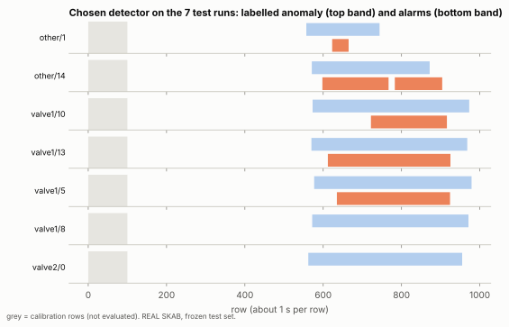

<!-- GENERATED by tools/nbpages.py from notebooks/. Do not edit. -->

# 24 · Project milestone 1: evaluation report
{: .no_toc }

[Run it in Colab](https://colab.research.google.com/github/berdakh/mlengineering/blob/main/advanced/notebooks/24_project_milestone_1.ipynb){: .btn .btn-primary .mr-2 target=_blank }
[View the .ipynb](https://github.com/berdakh/mlengineering/blob/main/advanced/notebooks/24_project_milestone_1.ipynb){: .btn target=_blank }

{: .note }
> You are reading this notebook. To **run** it, open it in Colab with the button above - no install, no GPU needed for most of them - or clone the repository and open it in Jupyter.

1. TOC
{:toc}

---

**Week 4 · day 6 · 2 h essential path + up to 1 h optional** · lab files: [`labs/w4d6_project_milestone_1/`](https://github.com/berdakh/mlengineering/blob/main/labs/w4d6_project_milestone_1/)

**Objective.** Assemble the model comparison and error analysis into a reproducible report generated by commands.

```python
# --- Setup: works on your laptop AND in Google Colab ----------------------------
# In Colab this clones the course repository and installs the requirements (about a
# minute, first run only). On your own machine it just finds the repository. Every
# command in this notebook runs from the repository root. Safe to re-run.
import os
import subprocess
import sys
from pathlib import Path

if "google.colab" in sys.modules:
    if not Path("/content/mlengineering").exists():
        subprocess.run(["git", "clone", "--depth", "1",
                        "https://github.com/berdakh/mlengineering.git",
                        "/content/mlengineering"], check=True)
    os.chdir("/content/mlengineering")
    subprocess.run([sys.executable, "-m", "pip", "install", "-q",
                    "-r", "requirements.txt"], check=True)

REPO_ROOT = next(p for p in [Path.cwd(), *Path.cwd().parents]
                 if (p / "src" / "mlcourse").is_dir())
os.chdir(REPO_ROOT)
sys.path.insert(0, str(REPO_ROOT / "src"))
print("repo root:", REPO_ROOT)
```

Unit id `w4d6_project_milestone_1` · Week 4, day 6 · Handbook:
[H16.1](../../handbook/ch16_system_design_communication/h16_1_decision_memos.html) (decision memos),
H8.1 reproducible experiments (planned) · Content status: see [STATUS.md](../../guides/status.html)

**This is an independent integration session.** Like [w1d6](06_notebook_to_package.html), it
gives a short checklist-driven lab instead of a walkthrough. You assemble what Weeks 2-4 built into
one pipeline and one report. The scaffolding is deliberately thin: the contract, a skeleton Makefile
and the snapshots you already know.

## 1. Purpose

**Objective.** Assemble the model comparison, the test look and the error analysis into a report that
one command regenerates from raw data and the frozen split manifest, with no number pasted by hand.

**Why an applied ML engineer needs it.** An evaluation that cannot be rebuilt cannot be trusted or
updated. In industry the report from three months ago gets re-run when the data, the code or a
library changes, often by someone else. If its numbers were copied from a notebook, nobody can tell
which ones are stale. This is the research-to-industry gap in miniature. A results section is usually
written by hand; the habit to add is that the results section is *generated*.

**Deliverable (milestone 1).**
* In your own flowguard repository: `make evaluate` builds `reports/evaluation.md` (with a figure)
  from `data/raw/skab/` and `splits/v2.json`.
* `challenge/SUBMISSION.md` filled in and pushed for review.

**Completion criteria.**
* `python wb.py check w4d6` passes: your Makefile and pipeline, run on a synthetic project, are
  reproducible and traceable.
* `make evaluate` works on the real data in your repository, and a clean rebuild is byte-identical.
* `python wb.py check w4d6 --challenge` passes, and the submission is sent for feedback.

**Prerequisites.**
* [w1d4](04_config_logging.html): run directories and provenance.
* [w3d4](16_point_vs_event_evaluation.html): event metrics and the operating point.
* [w3d5](17_uncertainty.html): intervals.
* [w3d6](18_error_analysis_transfer.html): error analysis.
* [w4d5](23_model_choice.html): the decision rule.

The lab ships snapshots of all of them. `make` must be installed: on Ubuntu and its derivatives it is part of
`build-essential` (`sudo apt install make`).

**Time budget (2 h essential).**

| Activity | Minutes |
|---|---|
| Read section 2; run the worked example | 20 |
| Lab: Makefile, `evaluate`, `render`, `provenance`; checks green | 70 |
| Run on the real data; clean rebuild; compare hashes | 15 |
| Submission checklist and self-review (the challenge) | 15 |
| *Optional extension: parameter stamp file, CI job that runs the checks, a second figure* | *up to 60* |

## 2. Conceptual explanation

### 2.1 What "reproducible report" means here

A report is reproducible when:

1. **One command** rebuilds every number, table and figure from the raw data and the frozen manifest.
2. **Nothing is typed by hand.** Every number shown is a value the pipeline stored. The rendering
   step *formats*; it does not compute.
3. **Rebuilding from the same inputs gives the same bytes.** That excludes wall-clock timestamps and
   anything that depends on the host, such as latency.
4. **The report says what it was built from:** hashes of the inputs, the code version, and the
   library versions.

Point 3 is stricter than "the numbers agree to two decimals", on purpose. Byte identity is cheap to
check (`sha256sum`), so a reviewer can confirm a rebuild in one second instead of reading two reports.
Host-dependent measurements such as latency are valuable, but they belong in a separate, labelled
artifact. The w4d5 decision memo is where they live.

### 2.2 Three stages, two files between them



Splitting "compute" from "format" buys three things:

* the report can be re-styled without re-running a slow evaluation;
* a reviewer can diff `results.json` between versions;
* the traceability rule becomes checkable: every number in the report must occur in the JSON.

### 2.3 Make in ten minutes

`make` rebuilds a **target** file when it is missing or older than any of its **prerequisites**,
by running the **recipe**. Recipe lines must start with a TAB character.

```make
results/results.json: data/interim/skab.csv splits/v2.json $(SRC)
	$(PY) -m flowguard evaluate --tidy data/interim/skab.csv --splits splits/v2.json --out $@
```

* `$@` is the target and `$<` is the first prerequisite.
* `.PHONY` names targets that are not files, such as `evaluate` and `clean`; they always run.
* `make -n` prints what *would* run without running it, and `make -q` exits 0 if everything is up to
  date.
* Variables set with `?=` can be overridden on the command line: `make evaluate N_BOOT=200`.

What make cannot do: it tracks file **timestamps**, not variable values or file contents.

* Changing `N_BOOT` on the command line does not make the results stale. The optional extension
  fixes this with a "stamp" file holding the parameters.
* A `git checkout` that changes a file's timestamp but not its content triggers a rebuild anyway.

Tools such as DVC or Snakemake track content hashes. Make is enough to learn the idea, and it is
installed everywhere.



### 2.4 The report's structure

There are eight sections, the same as a short technical report (H16.2, planned):

| Section | Contents |
|---|---|
| Problem | the stakeholder need and the budget |
| Data | counts, and where the provenance lives |
| Protocol | split, unit of resampling, calibration, bootstrap, MPID; "development chooses, test confirms" |
| Results | development comparison with intervals, a figure, the one test look |
| Error analysis | per-experiment test table; per-family development recall |
| Decision | the choice and the rule |
| Limitations | specific to this evidence |
| Provenance | hashes, code version, versions |

### 2.5 Connection to other domains

A paper's results section is regenerated by hand when the data change. Usually that means a script
prints numbers, someone copies them into LaTeX, and a figure is exported from a notebook. Every
copy step is a place where a stale number can survive a revision. Some research groups already use
`make` or `snakemake` for preprocessing data. The new step is to treat the *document* as a build
output too.

### 2.6 Industry example

A team's quarterly model-quality report was assembled from notebook outputs. A data fix changed the
evaluation set, the notebook was re-run, and two of the eleven numbers in the slide deck were never
updated. A model was promoted on a stale comparison. *(Illustrative composite, not a cited
incident.)* A generated report with an input hash makes that failure visible: the hash changes, and
the old report says which inputs it was built from.

### 2.7 Misconceptions

* **"Reproducible means I can rerun the notebook."** That works only if the cells are run in order, on
  the same data, with the same libraries, and someone copies the outputs correctly.
* **"A timestamp in the report is good provenance."** It makes every rebuild unique, so a rebuild can
  never be confirmed. Record the input hashes and the code version; when the run happened belongs in
  a log.
* **"`.PHONY` everything to be safe."** Then everything always reruns and `make` stops telling you
  what is stale.
* **"`make clean` should remove `data/`."** Raw data is an input, not a build output. Clean must never
  delete inputs.

## 3. Worked example: a two-step report in 15 lines of make

`example/` contains a Makefile, `summarise.py` (computes and stores every number) and `render.py`
(formats them). The input is the **SYNTHETIC** churn case from the w4d5 challenge
(`predictions.csv`: `customer_id, region, churned, score_a, score_b`). Real transcript:

```text
$ make
python summarise.py ../../w4d5_model_choice/challenge/case/predictions.csv build/summary.json
wrote build/summary.json
python render.py build/summary.json build/report.md
wrote build/report.md
$ make            # again
make: Nothing to be done for 'all'.
$ make -q; echo $?
0
$ touch render.py && make -n
python render.py build/summary.json build/report.md
$ make
python render.py build/summary.json build/report.md
wrote build/report.md
```

**Interpretation.**
* Changing `render.py` reruns only the render step. The expensive step is skipped because
  `summary.json` is still newer than its own prerequisites.
* The report (`build/report.md`) shows AUC 0.705 for A and 0.716 for B, and that B has the higher
  AUC in 30 of the 40 regions. All of these come from `summary.json`.
* `render.py` contains no arithmetic beyond formatting.

Run it yourself: `make -C labs/w4d6_project_milestone_1/example`, then `make ... clean`.

## 4. Lab (checklist; reduced scaffolding)

Work in `labs/w4d6_project_milestone_1/lab/`, then copy what you build into your own flowguard
repository.

**Given:**
* `src/flowguard/` with snapshots of everything up to w4d5;
* `svgplot.py`, a dependency-free and byte-reproducible SVG interval plot;
* `cli.py`, with the commands `ingest`, `evaluate` and `report` already wired;
* in `pipeline.py`, `ingest`, `read_tidy`, `sha256` and `write_results`.

**Yours:** the Makefile rules, and `provenance`, `evaluate` and `render` in `pipeline.py`. The module
docstring of `pipeline.py` is the contract.

1. [ ] **Makefile.** Write the three file rules and `clean`.
   * For each rule, ask: *which files, if changed, could change this output?* Those are its
     prerequisites: data, manifest and code.
   * Use `$(wildcard ...)` for the raw CSVs and the source files.
   * `clean` removes `data/interim`, `results` and `reports`, and nothing else.
2. [ ] **`provenance`.** Record the sha256 of the manifest and of the tidy CSV, the Python and package
   versions (`importlib.metadata.version`), and `git describe --always --dirty --abbrev=12`, or
   `"unknown"` outside a repository. No timestamps.
3. [ ] **`evaluate`.** Compute everything the report will show, in one dict:
   * **Development comparison.** The four w4d5 candidates. The supervised one is scored out-of-fold.
     For each: PR-AUC with its cluster-bootstrap interval, the paired difference to flow-rate |z|
     with its interval, and its reading against the MPID. Then the operating point for the alert
     budget, the events detected and the false-alarm rate at that point, the size, and the Pareto
     flag.
   * **Decision.** `decision.recommend`.
   * **The one test look.** For every candidate, PR-AUC with its interval and event recall with its
     Wilson interval.
   * **Error analysis.** Per-experiment test results for the chosen candidate, and per-family recall
     on development data.

   Borrow freely from `labs/w4d5_model_choice/lab/decision_table.py`. Store a missed event's
   delay as `None`, because JSON has no infinity.
4. [ ] **`render`.**
   * Write the eight sections, and draw `figures/dev_differences.svg` with `svgplot.interval_plot`.
   * Format numbers at the precision you store or round them in `render`. Never derive a new number
     there (no means, ratios or percentages).
   * Escape `|` in table cells, as in `flow-rate \|z\|`.
5. [ ] **Checks.** `python wb.py check w4d6` (about 15 s). The checks build a synthetic project from
   your Makefile and `src/`. Then they:
   * look for the sections and the intervals;
   * trace every table number to `results.json`;
   * delete the intermediate and rebuild, comparing bytes;
   * touch the manifest and ask `make -n` what would run;
   * change a number in the JSON and re-render.
6. [ ] **Real data.** In your repository, run `python project/get_skab.py`, then `make evaluate`
   (about 1 minute). Then:
   `sha256sum results/results.json reports/evaluation.md`, `make clean`, `make evaluate`, and
   compare the hashes.

*Debugging.*
* `make: *** missing separator`: a recipe line starts with spaces; it must start with a TAB.
* `No rule to make target 'splits/v2.json'`: run make from the project root, or check `SPLITS`.
* `test_every_table_number...` lists an orphan number: find where `render` computes it, and move
  that computation into `evaluate`.
* Rebuilds differ: diff the two `results.json` files and look for a timestamp, a set iterated in
  arbitrary order, or an unseeded random draw.

**What the finished report looks like on the real data.** The reference run reproduces the w4d5
development table exactly, because it uses the same operating-point grid, bootstrap size and seed.
For example, the logistic model's difference is 0.069 [0.022, 0.128], read as inconclusive, and the
chosen model detects 5 of 7 test events. Its figure, drawn by `svgplot` from the stored numbers:

![Interval plot of PR-AUC differences to flow-rate |z| on development data: Mahalanobis -0.060 [-0.212, +0.071], isolation forest -0.203 [-0.299, -0.120], logistic +0.069 [+0.022, +0.128], with the ±0.05 MPID band shaded](figures/dev_differences.svg)

*Figure 1 (real SKAB, development data; drawn by `flowguard.svgplot` from the reference
`results.json`).*

The error-analysis section is easier to write with the alarms in view:



*Figure 2 (real SKAB, frozen test set; `figures/make_figures.py`).*
* Five of seven faults are caught, each some time after onset.
* valve1/8 and valve2/0 raise no alarm at the strict operating point
  (threshold 7.24, alarms must last at least 30 rows).
* In other/14 the alarm breaks in two; the second part is "redundant" in w3d4's terms.

```python
# Run the automated checks on your guided lab.
# A fresh starter is expected to FAIL; passing means guided practice, not mastery.
from mlcourse.checks import check

check("w4d6")
```

## 5. Independent challenge

[challenge/README.md](https://github.com/berdakh/mlengineering/blob/main/labs/w4d6_project_milestone_1/challenge/README.md): fill in `challenge/SUBMISSION.md` for your own repository
(header fields, a 12-item checklist, a self-review against the rubric with evidence, and questions for
the reviewer). Then push it and send it for feedback. The checks confirm the structure only; the
reviewer judges the content.


### The challenge brief


**Conditions for "independent skill demonstrated":** your own repository, no hints, and a reviewer
(the course author or a peer) agrees with your self-review within one point on every row.

1. In your flowguard repository, make sure `make evaluate` builds the report from a fresh clone (after
   `python project/get_skab.py`). Commit, then build, so the provenance shows a commit without `-dirty`.
2. Fill in `labs/w4d6_project_milestone_1/challenge/SUBMISSION.md`:
   * the header fields;
   * every checklist item, ticked or marked n/a with a reason;
   * a self-review score (1-3) with evidence for each rubric row in `../assessment.md`;
   * at least one specific question for the reviewer.
3. `python wb.py check w4d6 --challenge` checks the structure only:
   * no TODOs;
   * a commit hash that is not dirty;
   * a complete checklist;
   * scores with evidence of at least one sentence;
   * a question.
4. Commit and push the submission (and your report), then send it for feedback. Expect comments on
   the evidence, not on the formatting.

What the reviewer looks at first:
* Does a clean rebuild reproduce your committed report byte for byte?
* Can every number in your Results tables be found in `results.json`?
* Does your Decision section follow from your table by the rule you stated?

```python
# Run the automated checks on your independent challenge.
# A fresh starter is expected to FAIL; passing means guided practice, not mastery.
from mlcourse.checks import check

check("w4d6", challenge=True)
```

## 6. Progressive hints

[hint 1, concept](https://github.com/berdakh/mlengineering/blob/main/labs/w4d6_project_milestone_1/hints/hint1_concept.md) · [hint 2, approach](https://github.com/berdakh/mlengineering/blob/main/labs/w4d6_project_milestone_1/hints/hint2_approach.md) ·
[hint 3, partial implementation](https://github.com/berdakh/mlengineering/blob/main/labs/w4d6_project_milestone_1/hints/hint3_partial.md). Reference solution, after you finish:
`solutions/labs/w4d6_project_milestone_1/` (including the reference report generated on real
data in `example_report/`).


Open one hint at a time, only after a real attempt.

<details>
<summary><b>Hint 1 concept</b></summary>


* A Makefile rule is a promise: "this output depends on exactly these inputs". List an input you do
  not use and you get needless rebuilds; omit one you do use and you get stale outputs.
* `evaluate` is the only place numbers are born. If `render` needs a number that is not in the dict,
  the fix is in `evaluate`.
* Byte-identical rebuilds need three things: seeded randomness, deterministic ordering (sort keys and
  lists), and no reading of the clock or the host.
* `provenance` answers "could someone else rebuild this exact file?": input hashes, code version,
  library versions.

</details>

<details>
<summary><b>Hint 2 approach</b></summary>


Makefile:

```make
SRC := $(wildcard src/flowguard/*.py)

$(TIDY): $(wildcard $(RAW)/*/*.csv) src/flowguard/data.py src/flowguard/pipeline.py
	$(PY) -m flowguard ingest --raw-dir $(RAW) --out $@

$(RESULTS): $(TIDY) $(SPLITS) $(SRC)
	$(PY) -m flowguard evaluate --tidy $(TIDY) --splits $(SPLITS) --out $@ --burn-in $(BURN_IN) --n-boot $(N_BOOT) --seed $(SEED)
```

The report rule is the same shape. `clean` is one `rm -rf` of three directories.

`evaluate`, in order:

1. Read the tidy CSV (`read_tidy`) and the manifest; validate.
2. Split into dev and test frames; map experiments to clusters (overlap groups).
3. For each candidate, compute out-of-fold dev scores, the per-cluster `(y, score)` pairs, and a
   cluster-bootstrap PR-AUC. Then the operating point (`choose_operating_point` on dev) and the size
   of the calibrated step.
4. Paired differences to the reference; `decision_table`; `recommend`.
5. Test: score every candidate once, apply its dev operating point, then `evaluate_experiments` and
   `wilson_interval`.
6. Per-experiment rows for the chosen candidate; per-family dev recall.
7. Return the dict with `provenance` and `protocol.test_experiments`.

`render`: one list of lines, appended section by section; `"\n".join(lines)`.

</details>

<details>
<summary><b>Hint 3 partial</b></summary>


```python
def provenance(splits_path, tidy_path):
    versions = {}
    for pkg in ("numpy", "pandas", "scikit-learn", "scipy"):
        try:
            versions[pkg] = metadata.version(pkg)
        except metadata.PackageNotFoundError:
            versions[pkg] = "not installed"
    try:
        out = subprocess.run(["git", "describe", "--always", "--dirty", "--abbrev=12"],
                             capture_output=True, text=True, cwd=Path(__file__).parent, timeout=5)
        code = out.stdout.strip() if out.returncode == 0 and out.stdout.strip() else "unknown"
    except (OSError, subprocess.SubprocessError):
        code = "unknown"
    return {"splits_file": Path(splits_path).name, "splits_sha256": sha256(splits_path),
            "tidy_sha256": sha256(tidy_path), "python": platform.python_version(),
            "packages": versions, "code_version": code}


def _n(x, d=3):
    if x is None:
        return "n/a"
    text = f"{x:.{d}f}"
    return text[1:] if text.startswith("-") and float(text) == 0 else text   # never "-0.000"


# one table row in render():
lines.append(f"| {r['name'].replace('|', chr(92) + '|')} | {_n(r['primary'])} "
             f"[{_n(r['primary_lo'])}, {_n(r['primary_hi'])}] | ... |")
```

For `evaluate`, `labs/w4d5_model_choice/lab/decision_table.py` already contains steps 2-5 of
hint 2 almost line for line. What changes is that the numbers go into a dict instead of `print`.

</details>

## 7. Assessment

assessment.md (section 7 of this notebook): reasoning questions, a design-choice explanation, the milestone
rubric, and an interview rep (a 5-minute evaluation walkthrough). Answers:
`solutions/labs/w4d6_project_milestone_1/assessment_answers.md`.


### Assessment questions


Answer in writing before opening `solutions/labs/w4d6_project_milestone_1/assessment_answers.md`.

#### Reasoning questions

1. Your `results.json` target lists `data/interim/skab.csv` and the source files, but not
   `splits/v2.json`. Describe the exact sequence of events in which this produces a wrong report
   that nobody notices.
2. Why is "every number in the report is a value in results.json" a stronger property than "the
   report is generated by a script"?
3. You run `make evaluate N_BOOT=500` right after a build with `N_BOOT=2000`. What happens, and why?
   How would you make the bootstrap size part of what make tracks?
4. Byte-identical rebuilds fail because `results.json` differs in one place:
   `"eligible": ["logistic (supervised)", "flow-rate |z|"]` against the reverse order. Name two likely
   causes.
5. Where should a p95 latency measurement live, if not in this report, and why?

#### Design choice (150-250 words)

The pipeline has three stages with two files between them (tidy CSV, results JSON). A colleague
proposes one command that goes from raw files straight to the markdown report: "fewer moving parts".
Argue for or against, in terms of rebuild cost, reviewability and failure diagnosis.

#### Milestone rubric (used for the challenge self-review and by the reviewer)

| Criterion | 1 (below) | 2 (meets) | 3 (exceeds) |
|---|---|---|---|
| One-command rebuild | Manual steps needed, or fails from a fresh clone | `make evaluate` from a fresh clone (after the data download) | Also `make -q` correct and intermediate files regenerate |
| Reproducibility | Rebuild changes numbers | Byte-identical rebuild; versions recorded | Also a lockfile or exact environment, and a CI job that checks it |
| Evaluation protocol | Test data used to choose anything | Frozen manifest, dev chooses, one test look, unit of resampling named | Protocol B (unseen family) or another stress test reported separately |
| Results and uncertainty | Point estimates | Intervals for the primary metric and the differences; Wilson for event counts | Also states what the intervals do not cover |
| Error analysis | None, or anecdotes | Per-experiment and per-slice tables tied to a next step | A figure that shows the failure mechanism |
| Decision and limitations | Decision not derivable from the table | Rule stated and applied; specific limitations | Change conditions and the cheapest resolving experiment |
| Code and repository hygiene | Notebook or untested code; data committed | Package code, tests, `.gitignore`, README rebuild instructions | Parameters tracked by make (stamp file), linted, small reviewed commits |

#### Interview rep (10-15 minutes, spoken, recorded)

> "Walk me through how you evaluated your anomaly detector. You have five minutes."

Week 4 fading rule: timed, no notes, self-score against the rubric in the answers file before
reading the worked answer.

## 8. Reflection and review

**You should now be able to, without notes:**
* write a Makefile whose dependencies match what can change each output;
* separate computing numbers from formatting them;
* make a pipeline rebuild byte for byte;
* state what make does not track.

**Reflection prompt (`progress/notes.md`).** Which number in your most recent paper would you be
least confident to reproduce today, and which of the four properties in section 2.1 is missing for it?

**Retrieval question for the review day.** A colleague adds `generated: 2026-11-22T10:31` to the
report header "for traceability". What breaks, and what would you record instead?

**Next.**
* [w4d7 review](https://github.com/berdakh/mlengineering/blob/main/labs/w4d7_review/README.md).
* Week 5 builds the inference pipeline and API around the detector chosen in w4d5. The report's
  operating point becomes the service's configuration.

## Verification record

Execution verified on 2026-11-22, Python 3.13.18, GNU Make 4.3:

| What | Outcome |
|---|---|
| Worked example (`make`, `make`, `make -q`, `touch`, `make -n`, `make`) | transcript above |
| `python tools/verify_checks.py labs/w4d6_project_milestone_1` | reference passes lab and challenge; 6 lab and 3 challenge wrong submissions rejected |
| Starter | lab: 12 errors (the skeleton Makefile exits 1); challenge: 5 failed |
| Reference `make evaluate` on real SKAB | about 55 s; `make -q` exits 0 afterwards; `make clean && make evaluate` gave byte-identical `results.json` and report; development table identical to w4d5's |
| Figures | `figures/make_figures.py`, rendered and inspected |

## Record your progress

Tick only what is true. Passing the supplied checks is *guided practice*; mark *independent* only for work done without hints or solutions.

```python
from mlcourse.progress import mark, note

# mark("w4d6", "reading")
# mark("w4d6", "guided")
# mark("w4d6", "independent")
# note("w4d6", "what tripped me up today")
```
