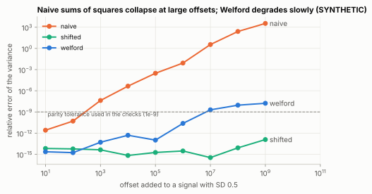
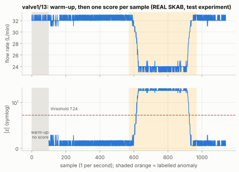
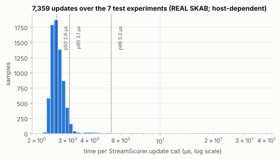
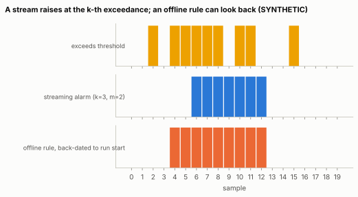

<!-- GENERATED by tools/nbpages.py from notebooks/. Do not edit. -->

# 27 · Online inference on streams: state, warm-up and parity
{: .no_toc }

[Run it in Colab](https://colab.research.google.com/github/berdakh/mlengineering/blob/main/advanced/notebooks/27_online_inference.ipynb){: .btn .btn-primary .mr-2 target=_blank }
[View the .ipynb](https://github.com/berdakh/mlengineering/blob/main/advanced/notebooks/27_online_inference.ipynb){: .btn target=_blank }

{: .note }
> You are reading this notebook. To **run** it, open it in Colab with the button above - no install, no GPU needed for most of them - or clone the repository and open it in Jupyter.

1. TOC
{:toc}

---

**Week 5 · day 3 · 2 h essential path + up to 1 h optional** · lab files: [`labs/w5d3_online_inference/`](https://github.com/berdakh/mlengineering/blob/main/labs/w5d3_online_inference/)

**Objective.** Implement stateful windowed scoring for one-sample-at-a-time input and prove parity with batch scoring.

```python
# --- Setup: works on your laptop AND in Google Colab ----------------------------
# In Colab this clones the course repository and installs the requirements (about a
# minute, first run only). On your own machine it just finds the repository. Every
# command in this notebook runs from the repository root. Safe to re-run.
import os
import subprocess
import sys
from pathlib import Path

if "google.colab" in sys.modules:
    if not Path("/content/mlengineering").exists():
        subprocess.run(["git", "clone", "--depth", "1",
                        "https://github.com/berdakh/mlengineering.git",
                        "/content/mlengineering"], check=True)
    os.chdir("/content/mlengineering")
    subprocess.run([sys.executable, "-m", "pip", "install", "-q",
                    "-r", "requirements.txt"], check=True)

REPO_ROOT = next(p for p in [Path.cwd(), *Path.cwd().parents]
                 if (p / "src" / "mlcourse").is_dir())
os.chdir(REPO_ROOT)
sys.path.insert(0, str(REPO_ROOT / "src"))
print("repo root:", REPO_ROOT)
```

**Status: Execution verified** (see the verification record at the end).

| | |
|---|---|
| **Primary objective** | Implement stateful scoring for one-sample-at-a-time input and prove that it computes the same function as batch scoring. |
| **Deliverable** | A tested `flowguard.streaming` module (`StreamScorer`, `StreamRegistry`) and a real-data replay showing parity and per-sample latency on the 7 frozen test experiments. |
| **Completion criteria** | `python wb.py check w5d3` passes; `replay_test.py` prints `PARITY OK`; you can explain, without notes, why the warm-up returns no score and what happens to a retried sample. |
| **Handbook** | [H10.3 Stateful online inference](../../handbook/ch10_batch_online_inference/h10_3_stateful_online_inference.html) |

---

## 1. Purpose

**What you will learn.** How a detector that was evaluated on whole recordings is turned into
something that receives one sample at a time from a machine and must answer immediately: what state
it has to carry, how to update it in O(1), what to say before it knows enough, what to do with late,
repeated or missing samples, and how to *prove* the streaming code computes the same function as the
batch code it replaces.

**Why an applied ML engineer needs it.** Most models are evaluated in batch (a table, a notebook, a
`score_batch` call) and served in streams (an HTTP request per reading, a message queue, an edge
gateway). The two code paths are written at different times, often by different people, and they
drift. The industry name for the result is *training/serving skew*: the offline numbers describe a
function that production does not compute. A parity test is the cheapest defence there is.

**Prerequisites.**
* [w5d1](25_inference_pipeline.html): one inference object for training and serving. This
  lab ships its own snapshot of `flowguard.inference.Detector` written to the w5d1 description, so you
  can do w5d3 even if w5d1 is unfinished.
* [w4d5](23_model_choice.html): the shipped model is the burn-in flow-rate |z| detector
  chosen there, with the alert-budget operating point.
* [w2d5](11_feature_pipeline.html): causal features and the burn-in convention.

**Time budget (2 h essential + optional extension up to 1 h).**

| Activity | Minutes |
|---|---|
| Read sections 2 and 3 | 25 |
| Run and read the worked example | 10 |
| Guided lab: implement `flowguard.streaming`, run the real replay | 65 |
| Start the independent challenge (alarm hysteresis) | 10 |
| Assessment questions and reflection | 10 |
| *Optional extension*: finish the challenge and its development report | up to 60 |

---

## 2. Conceptual explanation

### 2.1 Intuition: a batch function has a streaming twin, and the twin has state

`Detector.score_batch(run)` sees the whole recording at once. For the shipped model it computes the
mean `mu` and standard deviation `sigma` of the first `n_burn = 100` flow-rate values and returns
`|x_t - mu| / sigma` for every later sample, NaN before that.

A stream sees one sample, answers, and forgets the sample. To produce the same numbers it must keep,
between calls, exactly the information that the batch function would have read from earlier rows:

| Batch reads... | The stream must keep... | Size |
|---|---|---|
| the first 100 values, to compute `mu`, `sigma` | running accumulators during warm-up, then the frozen `mu`, `sigma` | 3-5 floats |
| the row order | the last accepted timestamp | 1 timestamp |
| nothing about retries (a table has no retries) | the last value and the last result, so a retry can be answered identically | 1 float + 1 result |
| (for windowed features) the last *w* rows | a ring buffer of length *w* | *w* floats |

The design rule that follows: **state is O(1) in the length of the stream**. A detector that monitors
a pump for a year must not hold a year of samples.



*Diagram 1. The life of one machine's stream. Rejections (invalid, out of order, conflicting
duplicate) never change the state; that is what makes a rejection safe to retry.*

### 2.2 Precise terms

* **Batch scoring**: a function of a whole recording, `scores = f(run)`.
* **Online (streaming) scoring**: a pair `(state, update)` with `state', y_t = update(state, x_t)`.
* **Parity**: for every run, feeding its rows in order to `update` yields `f(run)`, within a stated
  numerical tolerance. Here: `None` exactly where batch gives NaN, and otherwise
  `|stream - batch| <= 1e-9 + 1e-9 * |batch|`.
* **Warm-up**: the samples during which the model cannot yet produce a score. Here, the first 100.
* **Idempotent**: applying an operation twice has the same effect as applying it once. A retried
  sample must not count twice.
* **Out-of-order sample**: timestamp earlier than the last accepted one.
* **Gap**: more than `max_gap_s` seconds between consecutive accepted samples (5 s, as in the w2d3
  quality check).
* **Snapshot / checkpoint**: a serialisable copy of the state from which an identical scorer can be
  rebuilt, for restarts and for moving a stream to another process.

### 2.3 The mathematics: Welford's running mean and variance

The obvious one-pass formula keeps `n`, `S = Σx` and `Q = Σx²` and returns `Q/n - (S/n)²`. It is
algebraically correct and numerically terrible: when the mean is large compared with the standard
deviation, `Q/n` and `(S/n)²` are two huge, nearly equal numbers, and their difference loses most of
its significant digits (*catastrophic cancellation*). The relative error is at least of order
`ε·(μ/σ)²`, with `ε ≈ 1.1e-16` for float64, and grows further with the number of values summed; in
the worked example below (10,000 values) it is 8 to 20 times that bound.

Welford's recurrence keeps the running mean and `M2 = Σ(x - mean)²` instead:

```
n      <- n + 1
delta  <- x - mean_old
mean   <- mean_old + delta / n
M2     <- M2 + delta * (x - mean)          # uses the NEW mean
population variance = M2 / n               # sample variance = M2 / (n - 1)
```

Every quantity it subtracts is of the size of a deviation, not of the size of the data. It is not
perfect: the mean itself is accumulated with rounding error, so its accuracy also degrades as `|μ|/σ`
grows, but far more slowly. The worked example measures both (Figure 1). A cheap further improvement,
also measured there, is to subtract a constant `K` close to the mean (for example the first sample)
before accumulating.

The detector was calibrated with the **population** SD (`np.std`, `ddof=0`). Using the sample SD
(`ddof=1`, the default of `pandas.Series.std`) multiplies every score by `sqrt((n-1)/n)`: 0.5 % for
`n = 100`. Small, systematic, and invisible in a demo; it is exactly the kind of skew parity tests
exist for, and one of the mutants the checks are validated against.

### 2.4 Decisions a streaming scorer has to make explicitly

1. **What to return during warm-up.** `score = None` with `status = "warming_up"`. Never `0.0`:
   a fabricated number is indistinguishable from "measured and normal" for every consumer downstream
   (a dashboard, an alert rule, a monthly average).
2. **Late samples.** Reject with an error and leave the state unchanged. Re-sorting is possible only
   with a buffer and a waiting time (a watermark, in stream-processing terms); for one-second sensor
   data that is not worth the latency.
3. **Repeated samples.** Delivery systems retry: a client that timed out cannot know whether the
   server processed its request. If the timestamp and value equal the last accepted sample, return the
   previous answer again and change nothing. Same timestamp, different value: that is a conflict, and
   it is rejected.
4. **Gaps.** Two policies, both legitimate. `flag`: mark the result and keep scoring (batch parity
   holds, because `score_batch` ignores gaps). `reset`: start a new burn-in, because after a long
   stop the machine may have restarted at a different operating point (parity then holds against
   batch scoring of the segment after the gap). Which one is right is a domain question; the code
   must make it a visible parameter.
5. **Restarts.** A process that is redeployed must not forget a machine that is half-way through its
   burn-in. `snapshot()` returns plain JSON; `restore()` refuses a snapshot taken with a different
   model version, because combining one model's calibration with another model's threshold is silent
   nonsense.



*Diagram 2. The order of the rules in `update`. The order matters: an out-of-order sample that is
also invalid is reported as invalid, and a duplicate is never treated as a gap.*

### 2.5 Connection to other domains

Real-time signal processing has the same problem under a different name. An online decoder filters a signal with a causal
IIR filter whose internal state (`zi` in `scipy.signal.lfilter`) must be carried from one chunk to the
next; forgetting it produces a transient at every chunk boundary. The offline analysis that chose the
pipeline probably used zero-phase `filtfilt`, which a real-time system cannot run. The classic real-time bug
is a decoder that is excellent offline and worse online because the two paths compute different
features. Here the "filter" is a burn-in calibration and the "chunk" is one sample, but the
discipline is identical: carry state explicitly, and test the online path against the offline one.

What is new in industry: the input arrives through networks that duplicate, delay and reorder
messages, many streams share one process, and processes are restarted for every deployment.

### 2.6 An industry example

A predictive-maintenance team scores vibration readings on an edge gateway that forwards them over
MQTT with "at least once" delivery. During a network brown-out, the gateway re-sends a burst of
readings it had already delivered. The scoring service, written as "append every reading to the
burn-in buffer", counts the burst twice; the burn-in statistics of every machine that restarted
during the brown-out are skewed, and those machines alarm all afternoon. The fix is the one in this
lesson: idempotent handling of repeated `(machine, timestamp)` pairs, rejection of out-of-order
readings, and a parity test that replays recorded traffic, retries included, against batch scoring.
(Illustrative composite, not a cited incident.)

### 2.7 Limitations and common misconceptions

* *"Streaming is batch scoring with batch size 1."* Only if the model has no state. Calibration,
  windows, alarm logic and ordering all make it different.
* *"Float differences of 1e-12 do not matter."* They do not, except when a score lands within that
  distance of the threshold: then the exceedance decision can flip. Parity of *scores* within a
  tolerance does not guarantee parity of *decisions*; on the real replay below, the closest test score
  was 0.036 away from the threshold, so decisions matched exactly.
* *"Exactly-once delivery solves duplicates."* Systems offer at-most-once or at-least-once in
  practice; the receiver has to be idempotent either way.
* *"Snapshots are an optimisation."* They are what makes a restart correct.
* This lesson's detector needs only a burn-in. Windowed features (w2d5) add a ring buffer per window
  and per machine; the parity requirement is the same and the memory is still bounded.

---

## 3. Worked example: three running variances and a streaming z-score

`example/welford_demo.py` runs on SYNTHETIC data: 10,000 samples with standard deviation 0.5 on an
offset raised from 20 to 1e9, so the true variance is the same in every row. It compares three
one-pass estimators with the two-pass `np.var`, then checks a 30-line streaming z-scorer against its
batch twin.

```python
!python labs/w5d3_online_inference/example/welford_demo.py
```

Output of the authoring run:

```text
Running variance of 10,000 SYNTHETIC samples, true SD 0.5 (variance about 0.25):
offset  two-pass np.var  naive rel.err  shifted rel.err  welford rel.err
 2e+01            0.243       2.21e-12         5.59e-15         3.19e-15
 1e+04            0.243       4.51e-06         6.84e-16         4.97e-13
 1e+06            0.243        0.00841         2.96e-15         2.38e-11
 1e+08            0.243            250         8.21e-15         9.07e-09
 1e+09            0.243       3.45e+03         1.23e-13         1.69e-08

Streaming vs batch z on 2,000 samples at offset 1e6: same warm-up mask: True; max |diff| = 6.29e-10
```

**Code decisions worth noticing.**
* All estimators are pure Python loops over floats, so the comparison is about arithmetic, not about
  NumPy's pairwise summation (which `np.var` uses and which is itself more accurate than a loop).
* `StreamingZ` returns `None` during warm-up and uses `or 1.0` for a zero SD, mirroring the batch rule.

**Interpretation.**
* The naive formula is already off by 0.8 % at an offset of 1e6 and returns a variance 3,450 times
  too large at 1e9. At 1e8, 100 of 200 other noise draws give a *negative* variance (checked
  separately; not printed by the script). Sensors that
  report in raw counts or with a large bias live in this regime.
* Welford's error grows with the offset too (1.7e-8 at 1e9), just far more slowly.
* Shifting by the first sample before accumulating keeps the error at the 1e-13 level throughout.
* At offset 1e6 the streaming z differs from batch by 6.3e-10, inside the 1e-9 tolerance the checks
  use but not by much. Tolerances must be chosen with the data's scale in mind, and stated.



*Figure 1 (SYNTHETIC). The dashed line is the parity tolerance of the checks. In SKAB the burn-in mean of
flow rate lies between 23 and 128 L/min and its SD between 0.3 and 18, so the project sits far to the
left, where all three methods would pass; the lesson's checks also test an offset of 1e6.*

**Reproduce.** The data are seeded (`20261122`); the numbers are identical on every run with NumPy
2.x. The figure is regenerated by `python labs/w5d3_online_inference/figures/make_figures.py`.

---

## 4. Guided lab

Work in `labs/w5d3_online_inference/lab/`. The package `src/flowguard/` contains given snapshots
(`data`, `splits`, `evaluation`, `operating`, `inference`, `bundle`) and the module you write,
`streaming.py`. **Its docstring is the contract**: read it once completely before writing code.

The model you serve is committed as a bundle in `models/flowguard-z/1.0.0/` (plain JSON plus
checksums; no pickle). It was produced by `build_bundle.py`, which re-runs the w4d5 operating-point
choice on development data and reproduces it exactly: threshold 7.2441, `min_duration` 30,
`merge_gap` 10, 11 of 27 development events at zero false alarms per hour.

```bash
python -m pip install -e labs/w5d3_online_inference/lab     # or set PYTHONPATH to lab/src
python wb.py check w5d3                                       # all checks; they fail at first
python -m pytest labs/w5d3_online_inference/checks -q -k parity   # a subset while you work
```

**Task 1. Configuration and state (10 min).** Implement `StreamScorer.__init__`: validate
`gap_policy` and `max_gap_s`, and initialise the Welford accumulators (`count`, `mean`, `m2`), the
frozen `mu`/`sigma` (both `None` until the burn-in completes), `n_seen`, and the last
timestamp/value/result.

*Checkpoint:* `-k constructor` passes.

**Task 2. Warm-up and scoring (20 min).** Implement `update` for the happy path: parse the
timestamp and the value, run the Welford update while `mu is None`, freeze `mu` and `sigma` at the
`n_burn`-th value (population SD; 1.0 if it is 0), and score afterwards.

*Checkpoint:* `-k "parity or warm_up or exceeds"` passes (6 tests).

*Debugging.*
* All parity tests fail by about 0.5 %: you divided `M2` by `n - 1`.
* `test_parity_when_the_burn_in_is_constant` fails with a division by zero: apply the batch rule
  `sigma = 1` when the SD is 0.
* The first score appears one sample late or early: the `n_burn`-th sample *completes* the burn-in
  and still returns `None`; the next one is the first score.

**Task 3. Rejections and duplicates (15 min).** Add rules 1-3 of the contract, in order. Make sure
each rejection happens *before* any state is modified.

*Checkpoint:* `-k "invalid or out_of_order or duplicate"` passes.

*Debugging.* If the duplicate test fails with `n_seen` off by one, your duplicate branch updates the
counters before returning. If `test_invalid_samples...[bad4]` fails with a `ValueError` that is not an
`InvalidSampleError`, wrap the `float(...)` conversion.

**Task 4. Gaps (10 min).** Compute the gap in seconds from the timestamps, set `after_gap`, and for
`gap_policy="reset"` reset only the calibration (not `n_seen`, not the last timestamp).

*Checkpoint:* `-k gap` passes (3 tests).

**Task 5. Snapshot and restore (10 min).** Return plain JSON types (timestamps as ISO strings). Refuse
a snapshot whose `detector_version` differs. The memory test then checks that nothing grows.

*Checkpoint:* `-k "snapshot or restore or grow"` passes.

*Debugging.* If restoring at `cut=30` diverges but `cut=250` works, your snapshot is missing the
Welford accumulators: after the burn-in only `mu`/`sigma` matter, during it everything does.

**Task 6. The registry (5 min).** A dictionary of scorers keyed by machine id, with explicit
`register` (idempotent) and `UnknownMachineError` for everything else.

*Checkpoint:* `python wb.py check w5d3` passes completely (31 tests, under 1 s).

**Task 7. Replay the real test experiments (5 min).**

```python
!python project/get_skab.py
!python labs/w5d3_online_inference/lab/replay_test.py
```

This feeds every row of the 7 frozen test experiments, one at a time, to your scorer and compares
with `score_batch`. Nothing is tuned or chosen, so this does not spend the test set. The authoring run
of the reference solution printed:

```text
model flowguard-z-1.0.0: n_burn 100, threshold 7.2441
experiment    rows  warm-up same   max |diff|  gaps  exceed
other/1        745          True     3.38e-14     0      15
other/14       905          True     1.31e-12     0     127
valve1/10     1146          True     2.31e-14     0      80
valve1/13     1140          True     2.84e-14     0     313
valve1/5      1154          True     1.20e-14     0     150
valve1/8      1144          True     1.42e-14     0       1
valve2/0      1125          True     1.64e-14     0       0
update() latency over 7359 samples: p50 2.8 us, p95 3.2 us, p99 6.8 us, max 3457.8 us
PARITY OK
```

Your differences should be of the same order (1e-14 to 1e-12) and your latencies of the same order
of magnitude; latency depends on the host and on what else it is doing. A second run printed p50 2.6,
p95 3.2, p99 6.4 and max 904 us: the maximum is dominated by the operating system, not by your code.
None of the test experiments has a gap longer than 5 s, so the gap column is 0.



*Figure 2 (REAL SKAB, test experiment valve1/13, scored sample by sample).* The grey band is the
warm-up: no score exists there, and none is invented. 313 samples exceed the threshold.



*Figure 3 (REAL SKAB replay; host-dependent).* From a separate run of the figure script: p50 2.6 µs,
p95 3.1 µs, p99 5.3 µs. Per-sample cost is negligible against a one-second sampling interval; in a
service, the network and the HTTP framework (w5d4) will dominate.

---

```python
# Run the automated checks on your guided lab.
# A fresh starter is expected to FAIL; passing means guided practice, not mastery.
from mlcourse.checks import check

check("w5d3")
```

## 5. Independent challenge: alarm hysteresis

The batch operating point turns exceedances into alarms with `min_duration = 30` and `merge_gap = 10`
(w3d4, w4d5). Those parameters are applied to a whole recording *after the fact*: an alarm event that
lasts 30 rows is marked from its first row, and runs separated by short gaps are merged backwards. A
stream cannot look back. Its equivalent is **hysteresis**: raise the alarm after `k` consecutive
exceedances, clear it after `m` consecutive non-exceedances.

Work in `labs/w5d3_online_inference/challenge/` (a self-contained copy of the snapshots plus the
model bundle). Read `challenge/src/flowguard/hysteresis.py`: its docstring is the contract.

**Your tasks.**
1. Implement `AlarmHysteresis` (with `snapshot`/`restore`) and `hysteresis_batch`.
2. Write `challenge/evaluate_hysteresis.py`: on the **development** experiments of `splits/v2.json`,
   compare the batch rule from the bundle with a small grid of `(k, m)` at the model's threshold, using
   `flowguard.evaluation.evaluate_experiments` (event recall, alarm events, false alarms per hour,
   detection delay of detected events).
3. Fill in `challenge/DEV_REPORT.md`, including a recommendation of `(k, m)` for the streaming service.

**Acceptance criteria.**
* `python wb.py check w5d3 --challenge` passes.
* `hysteresis_batch` equals feeding the sequence to `AlarmHysteresis.update`, for any input.
* The report states the command you ran, has at least three rules in its table, and recommends a
  rule with reference to the alert budget (1 false alarm per 8 h) and the delay cost.
* The test experiments are not read.



*Figure 4 (SYNTHETIC illustration).* The streaming alarm (blue) starts two samples later than the
back-dated offline rule (orange) for the same exceedances.

---

```python
# Run the automated checks on your independent challenge.
# A fresh starter is expected to FAIL; passing means guided practice, not mastery.
from mlcourse.checks import check

check("w5d3", challenge=True)
```

## 6. Progressive hints

Open them one at a time, and only after a real attempt.

1. [Hint 1 - concept](https://github.com/berdakh/mlengineering/blob/main/labs/w5d3_online_inference/hints/hint1_concept.md)
2. [Hint 2 - approach](https://github.com/berdakh/mlengineering/blob/main/labs/w5d3_online_inference/hints/hint2_approach.md)
3. [Hint 3 - partial implementation](https://github.com/berdakh/mlengineering/blob/main/labs/w5d3_online_inference/hints/hint3_partial.md)

The full reference solutions are in `solutions/labs/w5d3_online_inference/` (lab, challenge, and the
plausible wrong submissions the checks were validated against). Do not open them before submitting.

---


Open one hint at a time, only after a real attempt.

<details>
<summary><b>Hint 1 concept</b></summary>


**Lab.** Ask, for every rule, "what would `score_batch` have known at this row?". During the burn-in
it knows the values so far and nothing else; after it, only `mu` and `sigma`. Your state is exactly
that, plus what you need to recognise a retry (the last timestamp, value and result). If you find
yourself appending to a list, ask which batch quantity the list stands for and keep a running version
of it instead.

Rejections are safe only if they happen before you touch the state. Write every check first and
every assignment last.

**Challenge.** Hysteresis is a two-counter state machine: the length of the current run of `True`
and the length of the current run of `False`. A `None` is "no evidence": it breaks both runs and
decides nothing. `hysteresis_batch` is not a second algorithm; it is the streaming one applied in a
loop. If you write it differently, you have to prove the two agree, and the point of the exercise is
that an offline formulation tends to look back.

</details>

<details>
<summary><b>Hint 2 approach</b></summary>


**Lab: shape of `update`.**

```text
ts, value = parse(row)                    # may raise InvalidSampleError
if there is a last timestamp:
    earlier  -> raise OutOfOrderError
    equal    -> same value: return last result with duplicate=True; else raise ConflictingDuplicateError
    gap      -> after_gap = True; if policy is "reset": reset the calibration accumulators only
if still calibrating:  Welford update; if count == n_burn: freeze mu, sigma; result = no score
else:                  score = |value - mu| / sigma
update n_seen, last_ts, last_value, last_result; return result
```

`dataclasses.replace(result, duplicate=True)` (or `ScoreResult(**{**asdict(r), "duplicate": True})`)
builds the duplicate answer without mutating the frozen original.

`snapshot()` must survive `json.loads(json.dumps(...))`: store timestamps as ISO strings and the last
result as a dict; rebuild both in `restore`.

**Challenge.** Keep `alarm`, `run_hi`, `run_lo`. For the dev evaluation: compute batch scores per
development experiment with `detector.score_batch`, turn them into `exceeds` with NaN for the warm-up,
run `hysteresis_batch` per experiment (never across experiment boundaries), and pass the 0/1 states to
`evaluate_experiments(dev, flagged, burn_in=detector.n_burn)` with the default `min_duration=1`.
For the batch rule, pass the raw exceedances with the bundle's `min_duration` and `merge_gap`.

</details>

<details>
<summary><b>Hint 3 partial</b></summary>


**Lab: the calibration part of `update`.**

```python
if self.mu is None:                                # still calibrating
    self.count += 1
    delta = value - self.mean
    self.mean += delta / self.count
    self.m2 += delta * (value - self.mean)         # new mean on purpose
    if self.count == self.detector.n_burn:
        self.mu = self.mean
        sd = math.sqrt(self.m2 / self.count)       # population SD, like np.std
        self.sigma = sd if sd > 0 else 1.0
    score, status, exceeds = None, "warming_up", None
else:
    score = abs(value - self.mu) / self.sigma
    status, exceeds = "ok", score >= self.detector.threshold
```

The duplicate branch, placed before any assignment:

```python
if ts == self.last_ts:
    if value == self.last_value:
        return dataclasses.replace(self.last_result, duplicate=True)
    raise ConflictingDuplicateError(...)
```

**Challenge: the core of `update`.**

```python
if exceeds is None:
    self._run_hi = self._run_lo = 0
elif exceeds:
    self._run_hi, self._run_lo = self._run_hi + 1, 0
    if not self._alarm and self._run_hi >= self.k_raise:
        self._alarm = True
else:
    ...  # the mirror image with m_clear
return self._alarm
```

</details>

## 7. Assessment

assessment.md (section 7 of this notebook): reasoning questions, a design-choice explanation, a rubric, and a
12-minute interview rep (Python: a sliding-window median over a stream).

---


### Assessment questions


Answer in writing (or aloud, recorded) before opening
`solutions/labs/w5d3_online_inference/assessment_answers.md`. 20-25 minutes in total.

#### Reasoning questions

1. A sensor reports pressure in pascals around 1.0e5 Pa with an SD of 3 Pa. Your colleague keeps
   `n`, `Σx`, `Σx²` per machine. Estimate the relative error of the variance in float64, and say
   whether it matters for a z-score detector with threshold 7.
2. Your streaming scorer returns `0.0` during the warm-up "so the dashboard has no gaps". Give two
   concrete downstream harms.
3. Why must a rejected sample leave the state unchanged? Describe a failure that happens if an
   out-of-order sample is rejected *after* the Welford update ran.
4. With `gap_policy="flag"`, streaming and batch scores agree. With `gap_policy="reset"` they do not
   agree with `score_batch(run)`. Is the reset policy therefore wrong? What does parity mean for it?
5. Parity of scores holds within 1e-9. Does that guarantee identical alarms? When could it fail, and
   how would you test for it?
6. A process restarts while machine `P07` is at sample 60 of its 100-sample burn-in. Without a
   snapshot, what happens to `P07`'s scores for the rest of the run? With a snapshot that stores only
   `mu` and `sigma`?

#### Explain a design choice (written, 150-250 words)

Defend the duplicate policy of this lesson: identical retry -> previous answer, same timestamp with a
different value -> error. Compare with two alternatives ("last write wins" and "always error") in
terms of correctness under at-least-once delivery, and what each tells the client.

#### Rubric for the open-ended answers

| Criterion | Strong | Adequate | Weak |
|---|---|---|---|
| Numerical reasoning (Q1) | estimates `ε(μ/σ)²`, gets the order of magnitude, relates it to the threshold | knows cancellation happens, no estimate | "float64 is precise enough" |
| Contract thinking (Q2-Q4) | names the consumer that is misled and the invariant that protects it | describes the bug | restates the rule |
| Scores vs decisions (Q5) | distinguishes score parity from decision parity, proposes a margin test | mentions thresholds | "1e-9 is negligible" |
| State and restarts (Q6) | traces both cases to concrete wrong scores | one case | no mechanism |
| Design choice | argues from delivery semantics and from what the client can do next | lists the options | asserts a preference |

#### Interview rep (12 minutes, Python, reduced assistance)

> Implement `SlidingMedian(w)` with `push(x) -> float | None`: the median of the last `w` values of
> a stream, `None` until `w` values have arrived. State the time per `push` and the memory. Then write
> two tests you would run before trusting it.

Time yourself. No hints for this one; compare afterwards with
`solutions/labs/w5d3_online_inference/interview_rep/` (reference with tests) and the rubric in the
answers file.

## 8. Reflection and review

**You should now be able to, without notes:**
* write Welford's update and say why it beats the sum-of-squares formula;
* list the state a streaming scorer must keep and argue that it is O(1);
* decide and implement what a stream returns during warm-up, on a retry, on a late sample and after
  a gap, and defend each decision to a colleague;
* write a parity test between a batch function and its streaming twin, with a stated tolerance.

**Reflection prompt (5 minutes, in `progress/notes.md`).** Think of a real-time system you have built or
used (a sensor loop, a live dashboard, an online detector). Which of the five decisions in section 2.4
did it make explicitly, which implicitly, and which would have failed on a network that duplicates and
reorders messages?

**Retrieval question for later (answer in w5d7 without looking).** A colleague's streaming scorer
returns scores that are consistently 0.5 % lower than batch scores on every machine. Name the most
likely cause and the one-line fix.

**Next.** [w5d4 - FastAPI I: endpoints, schemas and input validation](28_fastapi_validation.html)
puts this detector behind an HTTP API; its challenge exposes your `StreamRegistry` as a streaming
endpoint, where every exception you defined today becomes a status code.

---

## Verification record

Executed on 2026-11-22, Python 3.13.18, NumPy 2.5.3, pandas 3.0.5, scipy 1.18.1, matplotlib 3.11.2.

* `python labs/w5d3_online_inference/example/welford_demo.py`: output above.
* `python labs/w5d3_online_inference/lab/build_bundle.py`: reproduces the w4d5 operating point
  (threshold 7.2441, 30, 10; 11/27 development events, 0.00 false alarms per hour); the committed
  bundle is its output.
* `python solutions/labs/w5d3_online_inference/lab/replay_test.py`: output above (PARITY OK).
  Parity was also checked on all 35 SKAB experiments: largest relative difference 2.1e-13.
* `python tools/verify_checks.py labs/w5d3_online_inference`: the reference passes the lab (31
  checks) and the challenge (17 checks); all 6 lab and 4 challenge mutants are rejected. The shipped
  starters fail every check.
* `python solutions/labs/w5d3_online_inference/challenge/evaluate_hysteresis.py`: numbers in the
  reference report.
* Interview rep reference: 11 tests pass; an upper-median wrong answer fails 2.
* Not verified: Python 3.11 and 3.12 locally; the time budget.

## Record your progress

Tick only what is true. Passing the supplied checks is *guided practice*; mark *independent* only for work done without hints or solutions.

```python
from mlcourse.progress import mark, note

# mark("w5d3", "reading")
# mark("w5d3", "guided")
# mark("w5d3", "independent")
# note("w5d3", "what tripped me up today")
```
