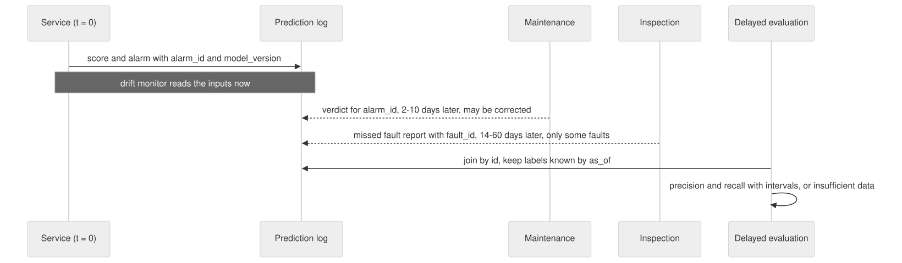
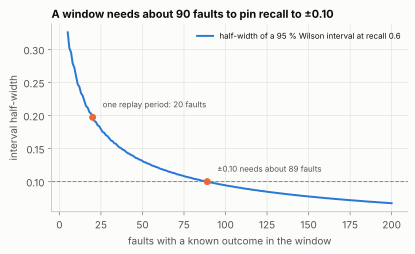
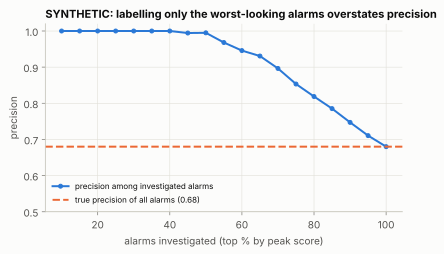
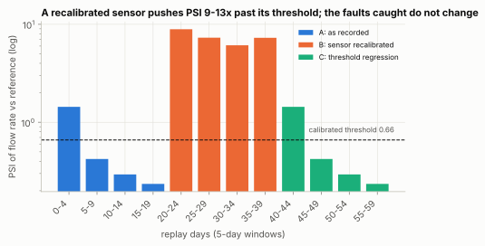
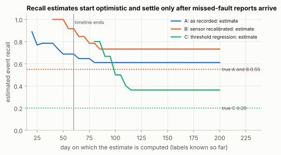

<!-- GENERATED by tools/nbpages.py from notebooks/. Do not edit. -->

# 39 · Drift is not degradation: delayed labels and measured performance
{: .no_toc }

[Run it in Colab](https://colab.research.google.com/github/berdakh/mlengineering/blob/main/advanced/notebooks/39_drift_vs_degradation.ipynb){: .btn .btn-primary .mr-2 target=_blank }
[View the .ipynb](https://github.com/berdakh/mlengineering/blob/main/advanced/notebooks/39_drift_vs_degradation.ipynb){: .btn target=_blank }

{: .note }
> You are reading this notebook. To **run** it, open it in Colab with the button above - no install, no GPU needed for most of them - or clone the repository and open it in Jupyter.

1. TOC
{:toc}

---

**Week 7 · day 3 · 2 h essential path + up to 1 h optional** · lab files: [`labs/w7d3_drift_vs_degradation/`](https://github.com/berdakh/mlengineering/blob/main/labs/w7d3_drift_vs_degradation/)

**Objective.** Separate input change from measured performance loss; design label backfill, proxy metrics and delayed evaluation.

```python
# --- Setup: works on your laptop AND in Google Colab ----------------------------
# In Colab this clones the course repository and installs the requirements (about a
# minute, first run only). On your own machine it just finds the repository. Every
# command in this notebook runs from the repository root. Safe to re-run.
import os
import subprocess
import sys
from pathlib import Path

if "google.colab" in sys.modules:
    if not Path("/content/mlengineering").exists():
        subprocess.run(["git", "clone", "--depth", "1",
                        "https://github.com/berdakh/mlengineering.git",
                        "/content/mlengineering"], check=True)
    os.chdir("/content/mlengineering")
    subprocess.run([sys.executable, "-m", "pip", "install", "-q",
                    "-r", "requirements.txt"], check=True)

REPO_ROOT = next(p for p in [Path.cwd(), *Path.cwd().parents]
                 if (p / "src" / "mlcourse").is_dir())
os.chdir(REPO_ROOT)
sys.path.insert(0, str(REPO_ROOT / "src"))
print("repo root:", REPO_ROOT)
```

**Status:** Execution verified (see the verification record at the end).
**Handbook:** [H15.4 Drift versus degradation, delayed labels](../../handbook/ch15_logging_monitoring_updates/h15_4_drift_vs_degradation_delayed_labels.html)
**Prerequisites:** [w7d2](38_input_monitoring_drift.html) (input monitoring and drift statistics; this lab ships its
own `flowguard.drift`), [w3d4](16_point_vs_event_evaluation.html) (event metrics),
[w3d5](17_uncertainty.html) (intervals), [w5d2](26_artifacts_versioning.html) (the shipped model).

---

## 1. Purpose

**What you will learn.** To answer two different monitoring questions with two different kinds of
evidence: *has the input changed?* (drift statistics, available immediately) and *is the model still
good?* (labels, which arrive late, partially and selectively). You will join late labels to logged
predictions, compute precision and recall only from what is known at a given date, attach intervals,
and refuse to report a number when there is not enough evidence for one.

**Why an applied ML engineer needs it.** Most production models are judged by labels that arrive
days to months after the prediction: maintenance confirms a fault, a customer churns, a chargeback
lands. A team that treats a drift alarm as "the model is broken", or a quiet dashboard as "the model
is fine", will retrain models that were working and keep models that were not. Interviewers probe
this directly: *"Your drift monitor fires. What do you do?"*

**Primary objective.** Implement `flowguard.delayed_eval` and use it with a drift monitor to show, on a
replay of real SKAB recordings, one case of drift without degradation and one of degradation without
drift.

**Deliverable.** A working `delayed_eval.py` that passes the checks, the replay report on real data,
and a monitoring and label-backfill plan (the challenge).

**Completion criteria.**
- `python wb.py check w7d3` passes (guided practice).
- You can state, for each replay period, what the drift monitor said, what the labels said on day 65
  and on day 150, and why those differ.
- `python wb.py check w7d3 --challenge` passes and your plan scores at least 12/16 on the rubric
  (independent skill).

| Activity | Essential (2 h) | Optional (≤ 1 h) |
|---|---|---|
| Read sections 2-3 and run the worked example | 30 min | |
| Guided lab, tasks 1-5 | 55 min | |
| Real-data replay and interpretation (task 6) | 15 min | change the label policy and re-run |
| Independent challenge (start) | 15 min | finish it |
| Assessment and reflection | 5 min | interview rep (15 min) |

---

## 2. Conceptual explanation

### 2.1 Intuition

A drift monitor compares *inputs* today with inputs from a reference period. It is fast, needs no
labels, and answers exactly one question: are the numbers arriving different from before? It cannot
say whether the model's decisions got worse. A model may be built to be indifferent to the change
(this project's detector normalises every run by its own burn-in), or the change may be in a direction
the model never uses. Conversely, a model can get worse while every input statistic stays put, because
what changed is the relationship between inputs and outcomes, or the pipeline around the model.

Performance needs labels. Labels in production arrive **late** (a fault is confirmed days after the
alarm), **partially** (missed faults are found only if someone inspects), and **selectively** (people
investigate the alarms that look worst). Each of these bends the numbers you can compute, always in a
known direction once you write down how labels are produced.



### 2.2 Precise terms

Write $$x$$ for the inputs, $$y$$ for the outcome (fault or not) and $$f$$ for the deployed model.

* **Covariate shift**: $$P(x)$$ changes, $$P(y \mid x)$$ does not. A recalibrated sensor, a new operating
  regime. The *right* model is unchanged; whether *your* model still performs depends on whether it
  extrapolates correctly into the new region of $$x$$.
* **Prior (label) shift**: $$P(y)$$ changes, $$P(x \mid y)$$ does not. More faults this season. Precision at
  a fixed threshold moves even though the model did not change: precision depends on prevalence (w2d6).
* **Concept shift**: $$P(y \mid x)$$ changes. A new fault mechanism that leaves the monitored sensor
  untouched, a new fraud pattern, or a change in what the plant *calls* a fault. Input statistics may
  not move at all.
* **Data drift** in monitoring tools usually means "some statistic of $$x$$ moved". It is a *symptom*.
  **Performance degradation** means a labelled metric of $$f$$ got worse. It is the *outcome* you care
  about. Neither implies the other.
* **Label delay**: time from prediction to the label's arrival. **Label coverage**: the fraction of
  predictions that will ever get a label. **Verification bias**: the labelled subset is chosen by a
  process correlated with the outcome (here, by peak score), so metrics on it are biased.
* **As-of evaluation**: a metric computed "as of day $$d$$" uses only labels with $$\text{label\_time} \le d$$.
  Back-testing a monitor without this rule lets it see the future.

### 2.3 The mathematics you need

**Precision from investigated alarms.** If only alarms in a set $$\mathcal{I}$$ are investigated, the
estimate $$\hat p = \frac{1}{|\mathcal I|}\sum_{a \in \mathcal I} y_a$$ estimates $$P(y = 1 \mid a \in \mathcal I)$$,
not $$P(y = 1 \mid \text{alarm})$$. When investigation is chosen by score and $$P(y=1 \mid \text{score})$$
increases with score, $$\hat p$$ is biased upward. With a known, random investigation rate the bias
vanishes; with a known score-dependent rate, inverse-probability weighting corrects it.

**Recall from inspections.** Let $$C$$ be faults confirmed by alarms, $$M$$ faults missed, and $$\rho$$ the
probability that a missed fault is ever reported. What you can compute is
$$\hat r = \frac{C}{C + M_{\text{reported}}}$$ with $$E[M_{\text{reported}}] = \rho M$$, so for $$\rho < 1$$,
$$\hat r$$ is biased *upward*; it is an upper bound on recall. Early in the label delay,
$$M_{\text{reported}}$$ is smaller still, so early estimates are even more optimistic.

**Power.** With $$n$$ faults of known outcome and recall near $$r$$, a 95 % Wilson interval has half-width
roughly $$1.96\sqrt{r(1-r)/n}$$. At $$r = 0.6$$ that is about ±0.20 at $$n = 20$$ and ±0.10 only at
$$n \approx 89$$. A window must contain enough *labelled events*, not enough samples.



*Figure 1 (arithmetic).* One replay period of this lab has 20 faults; pinning recall to ±0.10 takes about 89.



*Figure 2 (SYNTHETIC: 400 alarms, P(true) logistic in peak score).* Investigating the worst-looking half
of the alarms reports precision near 1.0 against a true 0.68.

### 2.4 Connection to other domains

Brain-computer-interface studies track accuracy across sessions only on calibration blocks where the
intended class is known; free-use periods have no labels, and signal amplitude changes between sessions
(sensor contact, drying gel) are covariate shift that a per-session normalisation can absorb. That is
this project's burn-in normalisation. Clinical evaluation has the classic case of verification bias: if only
patients with positive screening get the reference test, sensitivity is overestimated. Maintenance
investigating only alarmed segments is the same design.

### 2.5 An industry example

A card issuer's fraud model raises alerts that analysts review within a day; missed fraud surfaces
as chargebacks one to three months later. The worked example below simulates exactly this. When a
new fraud pattern appears that the model scores like normal traffic, the score distribution does not
move (PSI 0.001), recall halves, and the recall estimate computed a week after each week still reads
1.00 because no chargeback has arrived. The only fast signal is that, with a fixed number of alerts per
day, precision of the reviewed alerts falls (0.29 to 0.13): the alert budget is now filled by
legitimate transactions.

### 2.6 Limitations and common misconceptions

* *"PSI > 0.2 means retrain."* A folklore threshold, and drift is not degradation. Calibrate the
  threshold on stable reference windows (w7d2) and treat a flag as a reason to investigate the input.
* *"No labels yet, so precision is 0 (or 100 %)."* It is unknown. Report the count of pending labels.
* *"Recall from the labels we have is unbiased."* Missed events are found only by a separate process;
  recall from it is an upper bound, and early in the delay a very loose one.
* *"Monitor the model weekly."* Weekly windows may contain three labelled events. Derive the window from
  the label rate and the difference you need to detect.
* *"Drift detectors can replace labels."* Unsupervised performance estimation (e.g. confidence-based
  estimates of accuracy) assumes the model stays calibrated under the shift; under concept shift that
  assumption is exactly what fails.

---

## 3. Worked example: fraud alerts with late chargebacks (SYNTHETIC)

`example/fraud_label_delay.py` is self-contained (numpy and pandas only). It simulates 12 weeks of
4,000 transactions a day, 0.5 % fraud, the top 40 scores alerted and reviewed 1-3 days later, and
missed fraud charged back 30-90 days later for 90 % of cases. From week 7, half of the fraud scores like
legitimate traffic. The rules are stated in the file's docstring; nothing about real fraud follows.

```python
!python labs/w7d3_drift_vs_degradation/example/fraud_label_delay.py
```

Output (verbatim from the authoring run):

```
 week  psi_scores  true_recall  recall_est_+7d  precision_+7d  recall_est_+30d  recall_est_+120d
    1        0.00         0.51            1.00           0.27             0.97              0.52
    2        0.00         0.57            1.00           0.29             0.96              0.60
    ...
    6        0.00         0.59            1.00           0.28             0.94              0.63
    7        0.00         0.28            1.00           0.15             0.81              0.29
    ...
   12        0.00         0.21            1.00           0.10             0.82              0.23

mean true recall: weeks 1-6 0.55, weeks 7-12 0.27
max PSI of the score distribution, weeks 5-12: 0.001
mean precision of reviewed alerts (+7 d): weeks 1-6 0.29, weeks 7-12 0.13
```

**Important code decisions.** `known_metrics` filters by `verdict_day <= as_of` and
`chargeback_day <= as_of` before computing anything; drop that filter and every column becomes the
`+120d` column. PSI is computed on the *score* distribution, the best case for a drift monitor: it is
the quantity closest to the decision, and it still does not move because fraud is 0.5 % of traffic.

**Interpretation.** Recall halved in week 7. Drift said nothing. Recall estimated a week later said
1.00 in every week; a month later it was still 0.81-0.94; only at 120 days did it approach the truth.
The fast signal was precision under a fixed alert budget, a proxy that works here because the number of
alerts is fixed by design. With a fixed *threshold* instead, the same concept shift would show as fewer
alerts, not lower precision. Know which design you are monitoring.

**Reproduce.** Seeded (`default_rng(42)`); the numbers above are exact on NumPy 2.5.3 / pandas 3.0.5.

---

## 4. Guided lab

Work in `lab/`. The `flowguard` snapshot there is complete except `src/flowguard/delayed_eval.py`.
Given modules you will use: `replay` (builds a timeline, logs predictions and alarms, simulates label
arrival), `drift` (calibrated PSI/KS/Wasserstein monitor), `uncertainty.wilson_interval`, `models`
(the shipped detector).

Data the functions receive (all `pandas.DataFrame`):

| Table | Columns | Produced by |
|---|---|---|
| `alarms` | `alarm_id, run_id, experiment_id, start_time, end_time, peak_score, model_version` | the service at prediction time |
| `verdicts` | `alarm_id, verdict (bool), fault_id (or None), label_time, source` | maintenance, later; may repeat an alarm |
| `fault_reports` | `fault_id, run_id, experiment_id, start_time, end_time, label_time, source` | inspections, much later; missed faults only |

Run the checks after each task: `python wb.py check w7d3` (all fail at the start; that is expected).

**Task 1: `join_verdicts(alarms, verdicts, as_of=None)`.** Keep only verdicts with
`label_time <= as_of` (all of them if `as_of` is None). For each alarm keep the verdict with the
*latest* `label_time` (corrections supersede). Left-join onto the alarms, preserving their order; a
missing verdict is `<NA>` (use pandas' nullable `boolean` dtype). Return `(joined, report)` with
`n_alarms`, `n_labelled`, `n_pending`, `orphan_verdicts` (verdicts whose alarm id is unknown) and
`superseded` (known verdicts that lost to a later one).
*Checkpoint:* `test_latest_label_time_wins_even_when_rows_arrive_out_of_order` and
`test_labels_after_as_of_do_not_exist_yet` pass.
*Debugging:* a `TypeError` from `Series.map` on an empty frame is a pandas edge case; a left `merge`
avoids it.

**Task 2: `alarm_precision(joined, min_labelled=5, level=0.95)`.** Precision among labelled alarms
only. Return `status` (`"ok"` or `"insufficient_data"`), `estimate`, `low`, `high` (Wilson), `k`, `n`,
`n_pending`. Below `min_labelled`, estimate and interval are NaN.
*Checkpoint:* `test_verification_bias_known_answer` passes. Read it: your function reports 1.0 on 10
labelled alarms while the truth is 0.5. That is correct behaviour; the bias is in the labelling process,
and the report (`n_pending = 10`) is what lets a reader see it.

**Task 3: `recall_estimate(joined, fault_reports, as_of=None, min_events=5, level=0.95)`.** Caught =
distinct `fault_id` among alarms confirmed True. Missed = distinct `fault_id` in reports known at
`as_of`, minus the caught ones. Estimate `caught / (caught + missed)` with a Wilson interval and the
same insufficiency rule; also return `n_caught` and `n_missed_reported`.
*Checkpoint:* `test_recall_counts_distinct_faults_and_only_known_reports`.

**Task 4: `window_metrics(...)`.** Windows `[start + k*freq, start + (k+1)*freq)` up to `end`. An
alarm belongs to the window of its `start_time`, a reported fault to the window of its `start_time`:
**event time decides where a label counts; label time decides whether it is known yet.** One row per
window with the columns used in the checks (`n_alarms`, `n_labelled`, `n_pending`, `precision`,
`precision_low/high/status`, `n_caught`, `n_missed_reported`, `recall`, `recall_low/high/status`).
*Checkpoint:* `test_windows_use_event_time_and_as_of`.

**Task 5: `monitor_report(drift_result, window, baseline, margin=0.1)`.** Judge each metric that has a
baseline (None = not monitored):

* `"unknown"` if its status is insufficient;
* `"no"` if the estimate is more than `margin` below baseline *and* the interval's upper end is below
  the baseline;
* `"yes"` if the interval's lower end is within `margin` of the baseline;
* otherwise `"inconclusive"`.

Combine: any "no" → "no", else any "inconclusive" → "inconclusive", else any "yes" → "yes", else
"unknown". `input_changed` is `drift_result["drift"]` and nothing else. Map the pair to an action: drift
without measured degradation investigates the input; degradation without drift escalates; never
infer one answer from the other.
*Checkpoint:* all 17 checks pass.



**Task 6: replay on real data.** With your module in place:

```bash
python project/get_skab.py                                   # once
python labs/w7d3_drift_vs_degradation/lab/replay_report.py \
    --json labs/w7d3_drift_vs_degradation/lab/results/replay.json
```

The replay is a **construction from real parts**, stated in the script's docstring: the 20 labelled
valve recordings, one per day, three times. Period A as recorded; period B with the flow sensor
"recalibrated" to $$1.08x + 2.5$$ L/min; period C scored by a release whose configuration regression
doubled the threshold (14.49 instead of 7.24). Labels follow a simulated policy: every alarm
investigated (2-10 days), 60 % of missed faults reported (14-60 days), 10 % of verdicts duplicated and
half of those corrected. The drift monitor watches the flow rate with PSI, calibrated on the 16
development valve recordings of the frozen manifest v2 (99th percentile of 200 chunks: 0.660).

Reference output (authoring run):

```
67416 samples, 26 alarms, 60 faults; 29 verdict messages, 18 missed-fault reports
PSI threshold (99th percentile over 200 calibration chunks): 0.660
baseline recall (period A, all labels): 0.611
period A  day  65: drift 1/4, caught 11, missed reported 6, recall 0.65 [0.41, 0.83] (true 11/20) -> inconclusive
          day 150: drift 1/4, caught 11, missed reported 7, recall 0.61 [0.39, 0.80] (true 11/20) -> inconclusive
period B  day  65: drift 4/4, caught 11, missed reported 2, recall 0.85 [0.58, 0.96] (true 11/20) -> yes
          day 150: drift 4/4, caught 11, missed reported 4, recall 0.73 [0.48, 0.89] (true 11/20) -> inconclusive
period C  day  65: drift 1/4, caught  4, missed reported 0, recall  nan              (true  4/20) -> unknown
          day  90: drift 1/4, caught  4, missed reported 2, recall 0.67 [0.30, 0.90] (true  4/20) -> inconclusive
          day 150: drift 1/4, caught  4, missed reported 7, recall 0.36 [0.15, 0.65] (true  4/20) -> inconclusive
```



*Figure 3 (real recordings, constructed timeline).* The drift monitor flags all four windows of
period B. The first window of A and of C is flagged too (PSI 1.44): those five recordings
(valve1/0-4) run at a slightly different flow level from the reference, and they are also the five
whose faults the detector misses. The flag and the misses coincide; the level difference does not
cause the misses (the score is per-run normalised), which is exactly why a flag needs investigation
rather than a conclusion.



*Figure 4 (real recordings, simulated labels).* Estimates start optimistic and settle late; all
three settle above the truth (0.61 and 0.73 against 0.55; 0.36 against 0.20) because only 60 % of
missed faults are ever reported.

What the replay shows, as found:

* **Drift without degradation (period B).** The recalibration moves PSI 9-13x past its threshold.
  The detector caught exactly the same 11 faults as in period A, because $$|z|$$ is invariant to
  $$a x + b$$ with $$a > 0$$. One caveat found while building this: 198 samples score *exactly* at the
  threshold (the flow sensor is quantised, and the w4d5 operating point was chosen from score quantiles),
  so the $$10^{-14}$$ rounding from the recalibration flips their flags and changes one alarm's extent,
  not which faults are caught. Put thresholds between distinct score values.
* **Degradation without drift (period C).** Recall fell from 11/20 to 4/20; the inputs are identical to
  period A, so the drift monitor says exactly what it said for A. The labels show it, late: unknown on
  day 65 (no missed-fault report yet), 0.67 on day 90, 0.36 on day 150.
* **Statistical power is the binding constraint.** Even on day 150, period C's interval [0.15, 0.65]
  overlaps period A's baseline of 0.61, so the rule reports "inconclusive", not "no". With 20 faults per
  period that is the honest answer. Period B on day 65 shows the opposite failure: an early, optimistic
  "yes" (0.85) before the missed-fault reports had arrived.
* **Precision says nothing here.** All 26 alarms were true faults, in every period. At this operating
  point (zero false alarms on development data) precision cannot move; the report monitors recall only.

---

```python
# Run the automated checks on your guided lab.
# A fresh starter is expected to FAIL; passing means guided practice, not mastery.
from mlcourse.checks import check

check("w7d3")
```

## 5. Independent challenge

Write the monitoring and label-backfill plan for `flowguard`: [challenge/README.md](https://github.com/berdakh/mlengineering/blob/main/labs/w7d3_drift_vs_degradation/challenge/README.md).
No solution is given in this lesson; the rubric is in the solutions folder, to be opened after you
have written yours.

---


### The challenge brief


**Time:** 30-40 minutes of the essential path; finish in the optional extension if needed.
**Assistance:** none beyond this lesson, the handbook (H15.4) and your own lab results. The hints in
`../hints/` are for the guided lab; this challenge has none on purpose.

#### Task

Write the plan the reliability team would actually run for the shipped detector. Two files:

1. `monitoring_plan.toml`: the machine-readable plan. A starter with every required key is provided;
   replace each `TODO` and every placeholder number with a value you can defend.
2. `MONITORING_PLAN.md`: one page of prose that justifies the numbers. Keep the three headings in the
   template.

The plan must separate three questions and give each its own signal, window and action:
*is the input valid?* (contract checks at the boundary), *has the input changed?* (drift), and
*is the model still good?* (delayed labels).

#### Acceptance criteria (checked by `python wb.py check w7d3 --challenge`)

* The TOML parses and has the tables `context`, `input_drift`, `actions` and at least one entry in each
  of the arrays `input_validity`, `performance` and `label_sources`.
* Drift thresholds are calibrated on reference data (`threshold_method = "calibrated"`, with a
  `calibration_quantile` between 0.9 and 1, exclusive), never a fixed folklore number.
* Every performance metric names a label source that exists, has `min_labels >= 1`, reports
  `when_insufficient = "report_unknown"`, and has a window long enough to collect `min_labels` labels at
  the rate stated in `[context]`.
* Every performance metric is evaluated only after its labels can have arrived:
  `evaluate_after_days` is at least the upper end of its source's `expected_delay_days`.
* If `event_recall` is monitored, some label source covers missed faults (`covers = "missed_faults"`);
  otherwise recall is not measurable and must not be in the plan.
* Every label source has a `join_key` that exists in the prediction logs (`alarm_id`, `fault_id` or
  `prediction_id`) and a delay range with `0 <= low <= high`.
* Actions: drift alone never triggers retraining or rollback, and measured degradation never maps to
  `no_action`.
* `MONITORING_PLAN.md` keeps the headings "Three questions", "Label backfill" and "What this plan cannot
  detect", each followed by real text.

Passing the checks shows the plan is internally consistent. Whether the numbers are good is judged
with the rubric in `solutions/labs/w7d3_drift_vs_degradation/challenge/RUBRIC.md` (open it after
you have written your plan).

```python
# Run the automated checks on your independent challenge.
# A fresh starter is expected to FAIL; passing means guided practice, not mastery.
from mlcourse.checks import check

check("w7d3", challenge=True)
```

## 6. Progressive hints

Try each task for at least 10 minutes before opening a hint.

1. [Conceptual hint](https://github.com/berdakh/mlengineering/blob/main/labs/w7d3_drift_vs_degradation/hints/hint1_concept.md)
2. [Suggested approach](https://github.com/berdakh/mlengineering/blob/main/labs/w7d3_drift_vs_degradation/hints/hint2_approach.md)
3. [Partial implementation](https://github.com/berdakh/mlengineering/blob/main/labs/w7d3_drift_vs_degradation/hints/hint3_partial.md)

The full reference solution is in `solutions/labs/w7d3_drift_vs_degradation/lab/`.

---


Open one hint at a time, only after a real attempt.

<details>
<summary><b>Hint 1 concept</b></summary>


Every label has two times. **Event time** (when the alarm or the fault happened) decides which window
the label belongs to. **Label time** (when the label reached you) decides whether it exists yet. A
function that answers "as of day d" filters on label time first and only then groups by event time.

The second idea: a number computed from too few labels is not a small number, it is no number. Your
functions return a status next to every estimate, and NaN when the status is `insufficient_data`.

The third: `monitor_report` holds two independent verdicts. Write it so that changing
`drift_result["drift"]` can change `input_changed` and the action text, and nothing else.

</details>

<details>
<summary><b>Hint 2 approach</b></summary>


* **Task 1.** Filter verdicts by `label_time <= as_of`. Split them into known alarm ids and orphans
  (`isin`). Sort the known ones by `label_time` (stable sort), `drop_duplicates("alarm_id", keep="last")`,
  then left-merge onto the alarms on `alarm_id`. Convert `verdict` with `.astype("boolean")` so pending
  rows are `<NA>`. `superseded` = known non-orphan verdicts minus the number of rows kept.
* **Task 2.** `labelled = joined["verdict"].dropna()`; k = number of True, n = len(labelled). One helper
  `_proportion(k, n, min_n, level)` that returns the status dict serves tasks 2 and 3.
* **Task 3.** Use sets of `fault_id`. Caught: from rows whose verdict is True. Missed: from reports
  known at `as_of`, minus caught. Denominator: caught + missed.
* **Task 4.** Build the window edges with a loop (`edges.append(edges[-1] + pd.Timedelta(freq))` until
  past `end`). Join once with `as_of`, filter reports once by `as_of`, then slice both by `start_time`.
  Reuse tasks 2 and 3 on each slice.
* **Task 5.** Write a helper that judges one metric against its baseline and returns one of
  `not_monitored / unknown / no / yes / inconclusive`, then combine with a fixed priority.

</details>

<details>
<summary><b>Hint 3 partial</b></summary>


```python
def join_verdicts(alarms, verdicts, as_of=None):
    known = verdicts if as_of is None else verdicts[pd.to_datetime(verdicts["label_time"]) <= pd.Timestamp(as_of)]
    orphan = ~known["alarm_id"].isin(alarms["alarm_id"])
    latest = (known[~orphan].sort_values("label_time", kind="stable")
              .drop_duplicates("alarm_id", keep="last")[["alarm_id", "verdict", "fault_id", "label_time"]])
    joined = alarms.merge(latest, on="alarm_id", how="left")
    joined["verdict"] = joined["verdict"].astype("boolean")
    report = {...}   # five counts; see the docstring
    return joined, report


def _proportion(k, n, min_n, level):
    if n < min_n or n == 0:
        return {"status": INSUFFICIENT, "estimate": math.nan, "low": math.nan, "high": math.nan, "k": k, "n": n}
    low, high = wilson_interval(k, n, level)
    return {"status": OK, "estimate": k / n, "low": low, "high": high, "k": k, "n": n}


def _judge(estimate, low, high, status, baseline, margin):
    if baseline is None:
        return "not_monitored"
    if status != OK:
        return "unknown"
    # TODO: "no" when clearly worse, "yes" when clearly not worse, otherwise "inconclusive"
```

`window_metrics` and the action table of `monitor_report` are left to you.

</details>

## 7. Assessment

assessment.md (section 7 of this notebook): reasoning questions, a design-choice explanation, a rubric, and a
15-minute interview rep on delayed labels. Model answers are in the solutions folder.

---


### Assessment questions


Answer in writing before opening `solutions/labs/w7d3_drift_vs_degradation/assessment_answers.md`.

#### Reasoning questions

1. Give the definitions of covariate, prior and concept shift in terms of $$P(x)$$, $$P(y)$$, $$P(y \mid x)$$,
   $$P(x \mid y)$$. For each, name one change in the SKAB plant that would produce it.
2. In period B of the replay the drift monitor flagged every window and the detector caught exactly
   the same faults. Explain why, using the score's definition. Then describe a *different* detector for
   which the same recalibration would have degraded performance.
3. Period C's recall estimate was unknown on day 65, 0.67 on day 90 and 0.36 on day 150, against a true
   0.20. Explain each of the three numbers and why none of them equals 0.20.
4. Operators investigate only the 30 % of alarms with the highest peak score. In which direction is
   measured precision biased, and how would you obtain an unbiased estimate without investigating
   every alarm?
5. Your recall monitor needs a ±0.10 interval. Faults happen about twice a week, and missed-fault
   reports arrive up to 60 days late. How long is a window, and how stale is each answer?
6. Why does `window_metrics` place a label in a window by event time but decide whether it exists by
   label time? What goes wrong with each of the two other combinations?

#### Design-choice explanation (required)

7. `monitor_report` returns "inconclusive" when the interval straddles the baseline, instead of
   comparing the point estimate with `baseline - margin`. Defend this choice to a plant manager who
   wants a red/green light, and say what it costs.

#### Interview rep (15 minutes, timed, rubric only)

> "We ship a model that predicts whether a customer will cancel their subscription in the next 90
> days. It has been live for two months. The product team asks for a weekly dashboard showing that the
> model is still accurate. Design what you would show them."

Speak or write for at most 10 minutes, then score yourself with the rubric in the answers file.

#### Rubric for questions 2, 3, 7 and the interview rep

| Score | Meaning |
|---|---|
| 0 | Treats drift as degradation, or reports metrics without label delay or denominators |
| 1 | Separates the questions but cannot say how labels arrive or how many are needed |
| 2 | Separates the questions, states delay, coverage and the direction of each bias, sizes a window |
| 3 | All of 2, plus proposes a fast proxy with its failure mode and a concrete action per outcome |

## 8. Reflection and review

**You should now be able to, without notes:**
- distinguish covariate, prior and concept shift with $$P(x)$$, $$P(y)$$ and $$P(y \mid x)$$;
- explain why input drift neither implies nor is implied by performance loss, with one example each;
- compute precision and recall "as of" a date from late, duplicated, corrected labels;
- name the direction of the bias that verification and incomplete miss reporting introduce;
- size a monitoring window from the label rate and the difference you need to detect.

**Reflection prompt (5 minutes, in `progress/notes.md`).** Which dataset or system you have worked with had
labels you trusted but which were produced by a selective process (who got the reference test, which
sessions were annotated)? Which direction did that bias your reported numbers?

**Retrieval question for review day.** *A recall estimate for last month reads 0.95; a month ago, the
same month read 1.00. Labels for missed faults take 14-60 days. What can you say about recall, and
what must you not say?*

**Next.** [w7d4 — Model updates: retraining triggers, shadow and canary, rollback](40_model_updates_rollback.html)
uses these monitors to decide *when* a model should be replaced, and then replaces it safely.

---

## Verification record

Executed on 2026-11-22, Python 3.13.18, NumPy 2.5.3, pandas 3.0.5, SciPy 1.18.1, matplotlib 3.11.2.

| What | Command | Outcome |
|---|---|---|
| Worked example | `python example/fraud_label_delay.py` | output above, verbatim |
| Lab checks vs reference | `python tools/verify_checks.py labs/w7d3_drift_vs_degradation --part lab` | reference passes 17/17; 5 mutants rejected |
| Challenge checks vs reference | `... --part challenge` | reference passes 13/13; 5 mutants rejected |
| Shipped starters | `python -m pytest labs/w7d3_drift_vs_degradation/checks -q` | lab: 17 failed; challenge: 8 failed, 5 passed |
| Real-data replay | `python solutions/.../lab/replay_report.py` | output above, about 2 s |
| Recalibration invariance | scripted comparison in the authoring session | same 11 faults caught; 198 flags differ, all at a score exactly equal to the threshold; max score difference 3.9e-14 |
| Figures | `python figures/make_figures.py` | 4 SVGs + `figure_data.csv`, each viewed as PNG |

Not verified: Python 3.11/3.12 locally (CI covers the checks), the time budget, and any claim about
real plants' fault or label rates (the timeline and the label policy are constructions).

## Record your progress

Tick only what is true. Passing the supplied checks is *guided practice*; mark *independent* only for work done without hints or solutions.

```python
from mlcourse.progress import mark, note

# mark("w7d3", "reading")
# mark("w7d3", "guided")
# mark("w7d3", "independent")
# note("w7d3", "what tripped me up today")
```
