# Week 4 — Time-series models and choosing on evidence
{: .no_toc }

**Goal:** by the end of the week you can compare classical and neural detectors fairly, track experiments, and pick a model with a written decision.

1. TOC
{:toc}

---

Six core days of about **2 hours** each (plus an optional hour), and one lighter review day. Every core day is one notebook: read it on this site, run it in Colab, or open it in Jupyter.

## Schedule

| Day | Session | Notebook | Deliverable |
|---|---|---|---|
| 1 | **Time-series fundamentals and forecast-residual detectors** | [`19_timeseries_fundamentals`](../notebooks/19_timeseries_fundamentals.html) · [Colab](https://colab.research.google.com/github/berdakh/mlengineering/blob/main/notebooks/19_timeseries_fundamentals.ipynb) | Residual-based detector evaluated with the Week 3 protocol. |
| 2 | **Classical detectors: PCA/T2-Q, isolation forest, boosted trees on window features** | [`20_classical_detectors`](../notebooks/20_classical_detectors.html) · [Colab](https://colab.research.google.com/github/berdakh/mlengineering/blob/main/notebooks/20_classical_detectors.ipynb) | Comparison table with intervals; note on which framing the labels support. |
| 3 | **A neural comparison, where it is justified** | [`21_neural_comparison`](../notebooks/21_neural_comparison.html) · [Colab](https://colab.research.google.com/github/berdakh/mlengineering/blob/main/notebooks/21_neural_comparison.ipynb) | Neural result with seed variance in the comparison table; GPU optional. |
| 4 | **Experiment tracking and reproducibility at the experiment level** | [`22_experiment_tracking`](../notebooks/22_experiment_tracking.html) · [Colab](https://colab.research.google.com/github/berdakh/mlengineering/blob/main/notebooks/22_experiment_tracking.ipynb) | `flowguard sweep` + results table generated from run directories (MLflow as an optional extension). |
| 5 | **Choosing complexity on evidence** | [`23_model_choice`](../notebooks/23_model_choice.html) · [Colab](https://colab.research.google.com/github/berdakh/mlengineering/blob/main/notebooks/23_model_choice.ipynb) | One-page decision memo choosing the model to ship. |
| 6 | **Project milestone 1: evaluation report** | [`24_project_milestone_1`](../notebooks/24_project_milestone_1.html) · [Colab](https://colab.research.google.com/github/berdakh/mlengineering/blob/main/notebooks/24_project_milestone_1.ipynb) | `make evaluate` regenerates the comparison report; submit for review. |
| 7 | **Review and catch-up (light)** | [review below](#day-7--review-and-catch-up) | Week 4 retrieval sheet; interview set 4 (explain your evaluation in 5 minutes, recorded). |

## What each day is for

**Day 1 — Time-series fundamentals and forecast-residual detectors.** Reason about autocorrelation, non-stationarity and windowing; build naive, seasonal-naive and autoregressive forecasters and use their residuals as anomaly scores. *Prerequisites:* Week 3.

**Day 2 — Classical detectors: PCA/T2-Q, isolation forest, boosted trees on window features.** Fit methods to the label structure (semi-supervised vs supervised framing) and compare them under one protocol and compute budget. *Prerequisites:* w4d1.

**Day 3 — A neural comparison, where it is justified.** Train a small 1D-CNN or LSTM autoencoder (PyTorch, CPU) with a fair tuning budget and multiple seeds; report seed variance. *Prerequisites:* w4d2; PyTorch (demonstrated in research).

**Day 4 — Experiment tracking and reproducibility at the experiment level.** Manage many runs: sweep configs, registry of runs, aggregate results table, reproduce any row from its run id. *Prerequisites:* w1d4, w4d2.

**Day 5 — Choosing complexity on evidence.** Decide between candidates using effect size versus uncertainty, error costs, latency, size and maintenance burden. *Prerequisites:* w4d3, w4d4, w3d5.

**Day 6 — Project milestone 1: evaluation report.** Assemble the model comparison and error analysis into a reproducible report generated by commands. *Prerequisites:* w4d5.

## Day 7 — review and catch-up

A lighter day: retrieval practice from memory, one unassisted redo, and a timed interview set. It is also the buffer if a core day ran over.


**Time budget: 60-90 minutes.** No new material.

| Activity | Time |
|---|---|
| 1. Spaced-review items due today (from `w3d7`, and second misses from `w1d7`) | 5-10 min |
| 2. Retrieval sheet, from memory | 25 min |
| 3. Score it; choose what to redo | 10 min |
| 4. Redo one thing, cold and unassisted | 20-30 min |
| 5. Interview set 4 (timed, recorded) | 45 min, or the short form (25 min) |
| 6. Update progress flags and the spaced-review list | 5 min |

On a 60-minute day: activities 1-3, then the short form of 5 (the recorded walkthrough is the one
part not to skip this week), then 6.

### Purpose

Week 4 produced the modelling evidence of the project: time-series reasoning, classical detectors,
one neural comparison run fairly, a record of every run, a decision about which model to ship, and
a report regenerated by a command. It is also the half-way point. Two things are checked today:
whether you can retrieve the week's ideas, and whether you can **explain your evaluation to
someone else in five minutes**, which is the single most frequent task in interviews for model-
focused roles and the first project milestone's real test.

Units covered: `w4d1` time-series fundamentals and forecast-residual detectors, `w4d2` classical
detectors, `w4d3` neural comparison, `w4d4` experiment tracking, `w4d5` model choice, `w4d6` project
milestone 1 (evaluation report).

The week in one picture. Each arrow is a question the next lesson answers.



All real-data numbers in this week's lessons, and in the questions below, come from the frozen
manifest v2 (`w3d1`): **7 test and 27 development experiments**, test prevalence 0.373.

### 1. Spaced-review items due today (5-10 minutes)

Open the "Spaced review" list at the top of `progress/notes.md` and answer, closed book, every item
marked due `w4d7`. Two consecutive *solid* answers remove an item; otherwise it moves to `w6d7`.

### 2. Retrieval sheet (25 minutes, closed book)

Rules as before: no lessons, handbook, repository or search; two to five sentences each; if you
cannot answer, write what you would check; open the key only when all twelve have an attempt.

**Time-series fundamentals (w4d1)**

1. What is weak stationarity, and name three ways a pump sensor departs from it with the usual
   remedy for each. Why is the fault itself a non-stationarity, and what does that imply for how
   quickly a model of "normal" should adapt? For an AR(1) sensor with `φ = 0.9`, roughly how many
   independent observations are 300 rows worth?
2. After a sustained level shift of size `Δ`, what does the residual of a naive (last-value)
   forecaster do, and what does the residual of a fitted AR(p) with intercept do? On the 7 test
   experiments the naive residual scored PR-AUC 0.401 and AR(2) 0.809, with a no-skill floor of
   0.373. Explain both numbers, and why a forecaster with lower forecast error can be a worse detector.
3. Write the two-sided tabular CUSUM. What do `k` and `h` control, what is the approximate detection
   delay after a shift of `δ` residual standard deviations, and what does an in-control run length of
   about 460 samples mean at 1 Hz? On test, AR(2) + CUSUM gave 3.3 false alarms per hour (4 of 7 events,
   median delay 111 s) against about 223 per hour for the plain AR(2) residual at its best-F1
   threshold. What changed: the detector or the operating point?

**Classical detectors (w4d2)**

4. A PCA model is fitted on standardised normal rows with `k` components. Define T² and Q (SPE),
   say which kind of fault each sees, and how the lab sets their limits and chooses `k`. Which
   statistic was weakest on SKAB, and what does that suggest about how the faults move the sensors?
5. How does an isolation forest score a point? What does `contamination` change and what does it not
   change, and why is setting it from test prevalence a leak? Name one kind of anomaly its axis-aligned
   splits see poorly.
6. On the frozen test set (protocol A) the gradient-boosted trees had the best PR-AUC, 0.920. Trained
   on the valve families and scored on the unseen `other` family (protocol B) they fell to 0.636,
   while the isolation forest (0.831 to 0.783) and PCA T² (0.762 to 0.761) held. What question does
   each protocol answer, which framing do the SKAB labels support, and what would you ship?

**Neural comparison (w4d3)**

7. List what was held equal in the neural versus classical comparison and what was not. Five
   autoencoder seeds gave test PR-AUC 0.682 to 0.837 (mean 0.754, sd 0.068), Mahalanobis 0.768, and
   the paired difference for the median seed was −0.057 [−0.194, +0.104]. What do you conclude and
   report? The seed with the lowest validation loss had the lowest test score: what does that teach?

**Tracking and reproducibility (w4d4)**

8. What must a run directory record, how is the run id formed, and why must the configuration be
   serialised canonically? Why is `status.json` written last, and why is the index rebuilt from the
   directories instead of being the source of truth? What does `reproduce` have to do to count as
   evidence?
9. The Mahalanobis/isolation-forest sweep produced 12 runs on development data; the best row scored
   0.735. Which numbers from the sweep may appear in a report, why is 0.735 optimistic for its
   configuration, and how does the tooling keep test data out of sweeps?

**Model choice and the report (w4d5, w4d6)**

10. Define the MPID and the four readings of an interval for (candidate − reference). On development
    data, logistic regression beat the flow-rate z-score by +0.069 [+0.022, +0.128] with MPID 0.05.
    What is the reading, which model does the w4d5 rule choose and why? On its one test look the
    logistic model scored 0.901 against 0.884 for the chosen one: should you switch?
11. What does "the report is regenerated by `make evaluate`" guarantee, and what not? Why does the
    milestone report contain no timestamp and no latency figures, and what is the one thing `make`
    cannot detect as stale? Name three sections the report must have besides the results table.

**Delayed question from Week 3 (w3d5)**

12. Why is a bootstrap over rows wrong for this project, what is resampled instead on the 7 test
    experiments, and what remains doubtful about the resulting interval?

### 3. Score and choose (10 minutes)

Open [`solutions/labs/w4d7_review/retrieval_answers.md`](https://github.com/berdakh/mlengineering/blob/main/solutions/labs/w4d7_review/retrieval_answers.md)
(question 12's full key is answer 9 of `solutions/labs/w3d7_review/retrieval_answers.md`).
Mark each answer **solid**, **shaky** or **missing** and record the lists:

```bash
python wb.py note w4d7 "solid: ...; shaky: ...; missing: ..."
```

### 4. Redo one thing, unassisted (20-30 minutes)

Choose one, in this priority order:

1. a Week 4 lab or challenge whose checks did not pass, or that you passed only with hint 3 or a solution;
2. a **reproduction test** of your own project: pick one row of your comparison table, delete its
   outputs, and regenerate it from the run id and the recorded config in a fresh clone or worktree.
   Record whether the number matched and to how many digits. If it did not, finding out why is
   today's redo;
3. the task behind your weakest retrieval answer, for example: implement T² and Q for a PCA model
   from a blank file with a test that Q catches a correlation-breaking anomaly; write the seed-
   variance summary for a model from run directories.

Protocol (unchanged)

* Fresh directory or branch, blank file. No earlier attempt, hints, solutions or lesson text.
* Timer: 25 minutes. Run the unit's checks at most twice.
  ```bash
  python wb.py check w4d2 --challenge      # example
  ```
* Record the conditions, then set the flag the evidence supports:
  ```bash
  python wb.py note w4d4 "reproduction test: run 20261128-ab12 regenerated in clean worktree, PR-AUC equal to 6 digits"
  python wb.py mark w4d4 independent       # only if completion criteria were met under these conditions
  python wb.py mark w4d4 review            # otherwise
  ```

### 5. Interview set 4 (45 minutes, timed, recorded)

[`interview/set4_explain_evaluation.md`](https://github.com/berdakh/mlengineering/blob/main/interview/set4_explain_evaluation.md):

* **E1:** a five-minute recorded walkthrough of how you evaluated `flowguard` and how far the
  numbers can be trusted, self-scored against a tick-list while listening to the recording;
* **E2:** six of ten follow-up questions an interviewer would ask next;
* **T1, T2:** two time-series fundamentals;
* **C3:** one coding prompt (statistics over a time-based window, O(1) per update).

```bash
python -m pytest interview/set4_tests -q        # the coding prompt
```

Rubrics first (part A of `solutions/interview/set4.md`), worked answers (part B) only after a second
attempt. Keep the recording: `w5d7` asks for a second take, and `w8d5` builds the 20-minute version
from it.

In your notes, write the two things the rubric says you left out of the walkthrough. For most
people moving from research they are the same two: the independent unit, and the limitations.

### 6. Spaced review and progress flags (5 minutes)

**Spaced-review schedule.** Shaky and missing items from today are due on `w5d7` (one week), then
`w7d7`, then `w8d7`. Items carried from `w3d7` that were not solid today move to `w6d7`. An item
leaves the list after two consecutive solid answers.

```
## Spaced review
- w4d7 Q3 (T2 vs Q)                         - due w5d7
- w3d7 Q9 (cluster bootstrap, 7 clusters)   - due w6d7   (second miss)
```

**Flags.** Set each from evidence:

```bash
python wb.py status
python wb.py mark w4d1 reading
python wb.py mark w4d1 guided            # lab checks passed (hints allowed)
python wb.py mark w4d1 independent       # challenge or cold redo passed without hints or solutions
python wb.py mark w4d3 review            # shaky or missing today
python wb.py mark w4d7 guided            # this session done
```

**Half-way check (5 minutes, optional but recommended).** Run `python wb.py status` and count, over
Weeks 1-4, how many units have `independent` set versus only `guided`. That ratio, not the number of
units read, is the measure of progress this course uses. If fewer than a third are `independent`,
spend the next two light days on cold redos instead of interview sets.

Checklist

- [ ] Due spaced-review items answered before anything else
- [ ] Twelve retrieval answers attempted before opening the key
- [ ] solid / shaky / missing recorded with `wb.py note`
- [ ] One cold redo or reproduction test done and its conditions recorded
- [ ] Walkthrough recorded in one take and self-scored from the recording
- [ ] `review` flags and the spaced-review list updated
- [ ] Project check: milestone 1 report regenerates from a command; it names the split version, the
      resampling unit of every interval, and includes the elapsed-time baseline

**Next:** Week 5 starts with `w5d1` (research experimentation versus production inference: one inference
pipeline for training and serving): [w5d1](../notebooks/25_inference_pipeline.html).

---

*Content status and verification: see `STATUS.md`. Questions and answers were aligned with the final
Week 4 lessons on 2026-11-22; every number quoted is copied from those lessons' authoring runs on the
frozen v2 manifest. Interview set 4's coding reference was executed against its tests and deliberately
wrong answers were rejected (details in `solutions/interview/set4.md`).*

**Next session:** [w5d1_inference_pipeline](../notebooks/25_inference_pipeline.html).

