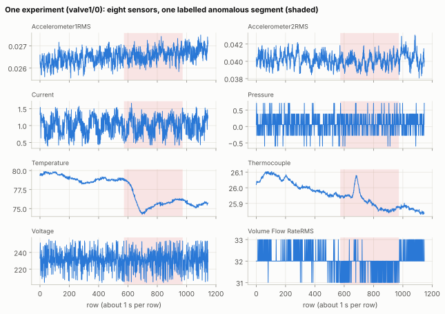
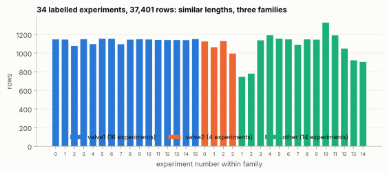
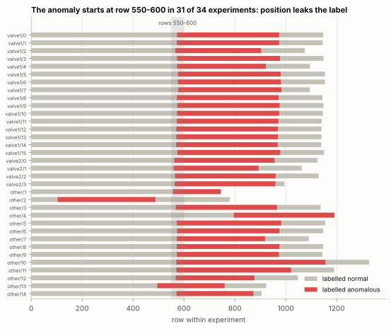

# Portfolio project: `flowguard` - fault detection on a water-circulation testbed

Status: **brief and dataset verified; every deliverable below has a lesson, and each milestone lesson
(w4d6, w5d6, w6d6, w7d6, w8d1-w8d2) has a verified reference implementation in `solutions/`.**
Everything below marked "decision" is a starting position you are expected to challenge in w2d4.

## Why this dataset

The project uses the **Skoltech Anomaly Benchmark (SKAB) v0.9**: multivariate sensor recordings from
a laboratory water-circulation testbed (pump, motor, valves, tank), one CSV per experiment.

It was chosen over the alternatives because it supports the *whole* workflow of this course on a CPU:

| Need | What SKAB provides |
|---|---|
| A grouped structure, so generalisation must be evaluated across independent units | 34 labelled experiments; the experiment is the unit, as the patient is in your EEG work |
| Temporal structure, so look-ahead leakage is possible and must be prevented | about 1 Hz multivariate series, 745-1,327 rows per experiment |
| Point *and* event labels | `anomaly` (per-sample) and `changepoint` (transition markers) columns |
| Distribution shift to study | three experiment families (`valve1`, `valve2`, `other`) with different fault mechanisms |
| Fault-free reference data | one `anomaly-free` recording (9,405 rows) |
| Small enough to iterate | 35 files, about 4.3 MB in total |

Alternatives considered: NASA C-MAPSS turbofan degradation (good grouped structure, but simulated
and remaining-useful-life regression does not exercise event-level detection); UCI hydraulic
condition monitoring (per-cycle classification, little temporal structure between cycles);
physiological datasets (too close to your existing expertise to demonstrate transfer).



*The project from raw data to a monitored service, with the week in which each stage is built.*

## Provenance and terms (verified 2026-11-21)

* Source: <https://github.com/waico/SKAB>, pinned to commit `b2c0d46c2971dcbfe71e26087b6d231998bb91c2`.
* Licence: **GPL-3.0** (upstream `LICENSE` file and README badge were opened and read).
  Consequence adopted here: the data is **not copied into this repository**. `project/get_skab.py`
  downloads it to `data/raw/skab/` (git-ignored) and writes `MANIFEST.json` with a SHA-256 per file.
  If you later publish derived data or redistribute files, re-read the licence yourself; this is not legal advice.
* Citation: Katser, I. D., Kozitsin, V. O. (2020). *Skoltech Anomaly Benchmark (SKAB)*. Kaggle.
  DOI 10.34740/KAGGLE/DSV/1693952.
* Fetch and verify:

  ```bash
  python project/get_skab.py            # executed 2026-11-21: 35 files downloaded
  python project/get_skab.py --verify   # executed: all files match MANIFEST.json
  ```

## Data dictionary (from the upstream README; units as stated there)

Files are semicolon-separated. One row per timestamp.

| Column | Meaning | Unit |
|---|---|---|
| `datetime` | time the value was written to the database | YYYY-MM-DD hh:mm:ss |
| `Accelerometer1RMS`, `Accelerometer2RMS` | vibration acceleration | g |
| `Current` | motor current | A |
| `Pressure` | pressure in the loop after the pump | bar |
| `Temperature` | motor body temperature | deg C |
| `Thermocouple` | fluid temperature in the loop | deg C |
| `Voltage` | motor voltage | V |
| `Volume Flow RateRMS` | circulation flow rate (the upstream README calls it `RateRMS`) | L/min |
| `anomaly` | 1 if the sample is labelled anomalous | 0/1, absent in `anomaly-free` |
| `changepoint` | 1 at labelled transition points | 0/1, absent in `anomaly-free` |

## Measured facts about the files (computed in the authoring session, 2026-11-21)

* 34 labelled experiments: `valve1` 16, `valve2` 4, `other` 14; 37,401 labelled rows in total.
* Every labelled experiment contains **exactly one contiguous anomalous segment**; 34 events in all.
* Mean per-file fraction of anomalous samples is about 0.35 (range 0.25-0.49). The positive class is
  therefore *not* rare at the sample level, unlike most production anomaly problems.
* 129 `changepoint` marks in total (2-4 per file).
* Median sampling interval 1 s. Six files contain a gap longer than 5 s, nine gaps in all (largest 247 s in
  `other/2.csv`). An earlier version of this page said seven files; `other/12` has a gap of exactly 5 s.
* No missing values in any column.
* Note: the upstream folder listing numbers files from 1, the actual files from 0 (`valve1/0.csv` ... `valve1/15.csv`).



*Real data, experiment `valve1/0`. Some sensors respond visibly to the valve closing (temperature, flow rate), others hardly at all, and two are quantised. Regenerate all figures on this page with `python project/figures/make_figures.py`.*



*Real data. Experiments are of similar length (745 to 1,327 rows), so no single experiment dominates a pooled metric by size alone.*

### Findings from the Week 1-2 lessons (verified on the files, 2026-11-21)

* **Rows are duplicated across files.** 1,290 rows are identical in all eight sensors and timestamp in two
  files, in five pairs: `anomaly-free`/`other/5` (572), `other/12`/`other/13` (349), `other/3`/`other/4`
  (228), `other/2`/`other/3` (120), `other/10`/`other/11` (21). In 235 of them the two files give
  **contradictory `anomaly` labels**. Consequences: experiments that share rows must stay on the same
  side of any split, and the fault-free reference overlaps a labelled experiment. The split manifest
  written in w2d4 does **not** yet enforce this; it is the first task of w3d1.
* **Elapsed time predicts the label.** In 31 of 34 experiments the anomaly starts at row 550-600, so a
  "detector" that scores by elapsed time reaches test F1 0.835 (w2d6), above every sensor baseline tried.
  Any feature that encodes position in the recording is a leak of the experimental protocol.
* **The fault-free recording is not a clean reference.** Its sensor levels sit far from the normal part of
  most labelled experiments (median max-|z| about 57 for normal and 59 for anomalous samples), so
  detectors normalised against it alone separate classes poorly; per-experiment burn-in normalisation
  works much better (w2d5, w2d6).
* First baseline numbers (w2d6, 9 test experiments, no intervals yet): point-level PR-AUC 0.373 for a
  constant score, 0.805 for a burn-in z-score on flow rate, 0.827 for supervised logistic regression.



*Real data; the plotted values are in `figures/anomaly_onsets.csv`. The anomalous segment starts at row 550-600 in 31 of 34 experiments. A model given elapsed time, or any feature that drifts with it, can learn the protocol instead of the fault.*

These facts drive design decisions. With 34 events, any event-level metric has wide uncertainty:
this project must report intervals (w3d5) and must not claim small differences between models.

## Starting decisions (to be revisited in w2d4)

1. **Stakeholder and need.** A plant reliability engineer wants an alert soon after abnormal operation
   begins, with few enough false alerts to be trusted. Educational prototype; no claim about any real plant.
2. **Task framing.** Per-timestamp anomaly scoring from past data only, turned into alerts by a threshold.
   Primary comparison: semi-supervised detectors fitted on normal data versus supervised window classifiers.
   Whether the labels support the supervised framing across fault families is itself a question to answer.
3. **Splits.** By experiment, never by row. A fixed test set of whole experiments; development by grouped
   cross-validation. A second protocol holds out the entire `other` family to measure generalisation to
   unseen fault mechanisms. Within an experiment only causal (past-only) features are allowed.
4. **Evaluation.** Point-level (precision/recall/PR-AUC) *and* event-level (event recall, detection delay,
   false alarms per hour of normal operation), with experiment-level bootstrap intervals.
5. **Not a forecasting project.** The labels are anomaly segments, not future values; forecasting models
   appear only as a means of producing residual scores.

## Deliverables checklist

| Deliverable | Session | Your progress |
|---|---|---|
| Problem statement and stakeholder needs | w2d4 | [ ] |
| Dataset provenance and data dictionary | this file, extended in w2d3 | [ ] |
| Versioned split definitions | w2d4 | [ ] |
| Reproducible preprocessing | w2d3, w2d5 | [ ] |
| Simple baseline | w2d6 | [ ] |
| Evidence-based model comparison | w4d2-w4d5 | [ ] |
| Error analysis | w3d6, w4d6 | [ ] |
| Training and evaluation commands | w4d4, w4d6 | [ ] |
| Packaged inference | w5d1-w5d3 | [ ] |
| Tests | from w1d6 onward | [ ] |
| Prediction API | w5d4-w5d5 | [ ] |
| Container | w6d1-w6d2 | [ ] |
| One deployment (authorisation-gated) | w6d5 | [ ] |
| Monitoring demonstration | w7d6 | [ ] |
| README, model limitations, short technical report | w8d1-w8d2 | [ ] |

## Transfer exercise (small, not a second capstone)

Two short sittings on an unfamiliar **tabular business** problem: baseline (w2d6) and a complete
leak-free evaluation in 90 minutes (w3d6). Candidate public dataset: UCI Bank Marketing. Its licence
and access have **not** been verified yet; that happens when w2d6 is authored. The diagnostic already
uses a synthetic business dataset so transfer can be probed from day one.
