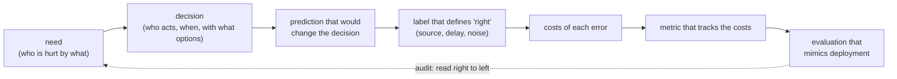
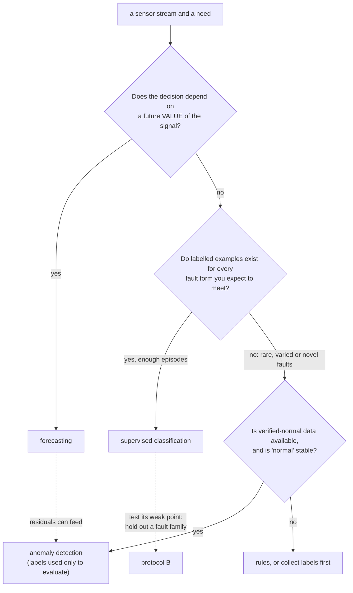

# H1.1 From stakeholder need to prediction target

**Status:** Reviewed (single authoring pass; sources and their verification state in H1.1.8)
**Used by:** [w2d4](../../../labs/w2d4_problem_framing_splits/README.md) · **Continues in:** [H1.2](h1_2_units_labels_costs_constraints.md)

## H1.1.1 Overview

A stakeholder never needs a model. They need something to happen less often, sooner, or more
cheaply. Problem formulation is the translation of that need into a *prediction target*: a quantity
that (a) can be computed from data available at a definite moment, (b) would change what someone
does, and (c) can be checked against an outcome later. This section gives a procedure for that
translation, the standard ways it goes wrong, and the test for whether ML is warranted at all.

The claim to hold on to: **the choice of target bounds the value of everything built afterwards.**
A superb model of the wrong target is worth less than a crude rule for the right one.

## H1.1.2 The decision comes first

Write one sentence:

> Because of the system's output, **[who]** will **[do what]** instead of **[what they do now]**,
> whenever **[condition on the output]**.

Everything else is derived from it.

| Element of the sentence | What it fixes |
|---|---|
| who | the user, hence the form of the output (a ranked list, an alert, a number with an interval) |
| do what | the *action space*; a prediction finer than the action space is wasted precision |
| instead of what | the status quo, hence the baseline and the value of improvement |
| condition | where the threshold or the top-k cut will sit, hence which part of the score range matters |

**The value of a prediction is the value of the changed decisions.** If the action is the same
whatever the model says, the prediction is worth nothing however accurate it is. A useful exercise
is the *perfect oracle test*: suppose the target were predicted perfectly. Describe concretely what
would be done with it and what that is worth. If the answer is vague with a perfect oracle, it will
not sharpen with a real model.

*Example.* A hospital asks for "a model predicting no-shows". Oracle test: if we knew exactly who
would not come, we would overbook those slots or phone those patients. Overbooking needs the
prediction two days ahead, per slot; phoning needs it a week ahead, per patient, and only helps for
patients who would respond to a call. These are two different targets with different horizons and
different labels of success. "Predict no-shows" was not yet a problem statement.




## H1.1.3 Choosing the task family

The same data usually admits several formulations.

| Family | Target | Needs | Typical decision |
|---|---|---|---|
| Regression / forecasting | a future or unobserved quantity | history of that quantity | plan capacity, set a level |
| Classification | membership in a defined class | labelled examples of each class | route, approve, flag |
| Ranking | relative order of candidates | outcomes for shown or acted-on items | choose the top k under limited capacity |
| Anomaly / novelty detection | deviation from a reference of normal | verified-normal data; a few faults to evaluate | inspect, alert |
| Changepoint detection | time at which behaviour changed | sequences with marked transitions | start an investigation, segment data |
| Survival / time-to-event | time until an event, with censoring | start times and event-or-censoring times | schedule maintenance, plan retention |

Three questions decide between them, in this order.

1. **What does the action need?** A value, a yes/no, an ordering, a time? Capacity-limited actions
   ("we can inspect ten") are ranking problems even when presented as classification.
2. **What labels exist, and for which cases?** Supervised classification needs positives *of the
   kinds that will occur*. If failures are rare or keep changing form, the labelled set describes
   the past's faults, and anomaly detection (learning normal) is the more honest framing; the price
   is alerts on harmless novelty.
3. **What is the sampling structure?** One long series from one system, many short series from many
   systems, irregular events? This limits both what can be learned and how it can be evaluated.

On the project data (SKAB): per-sample fault labels exist, so classification is possible; there is
one fault episode per recording across three families of mechanisms, so the open question is
generalisation to unseen mechanisms; a fault-free recording exists, so "normal" can be learned; no
decision uses a forecast value, so forecasting is at most a device for producing residuals.

**Reductions are legitimate.** Forecast-then-threshold-the-residual is anomaly detection built from
regression. Survival analysis can be reduced to classification at a fixed horizon ("fails within 30
days"), at the cost of discarding ordering information and of introducing censoring problems
(H1.2.3). State the reduction; do not let it be implicit.




## H1.1.4 Proxy targets and the metric chain

The quantity the stakeholder cares about is rarely the one you can train on.

```
business quantity          retained margin, undetected fault-hours, cost per delivery
      |  (not observable per example, or only after long delay / with intervention)
operational proxy          precision in the called 5 %, event recall at <= 1 false alert per hour
      |  (expensive to compute, threshold-dependent, few events)
development metric         average precision, log loss, point-level PR-AUC
```

Each arrow is an assumption that the lower quantity moves with the upper one. Write the assumption
down and, where possible, test it: do model versions that improve the development metric also
improve the operational proxy on held-out data? When they stop moving together, the lower metric
has been over-optimised (Goodhart's law: a measure that becomes a target ceases to be a good measure).

Three properties to check for any proxy target:

* **Validity:** does it measure the thing? "Clicked" is not "satisfied"; "flagged by a nurse" is not
  "deteriorated".
* **Actionability:** predicting who will churn is not the same as predicting who can be *retained by
  a call*. The second is a causal quantity (uplift) and needs randomised or carefully controlled data.
  Using the first as a proxy for the second is common and should be stated as a limitation.
* **Stability under use:** once the model drives actions, the actions change the outcomes. Customers
  who were called and stayed are recorded as non-churners; the next model trained on those labels
  learns that its own high-risk cases are safe. Plan a small untreated hold-out group from the
  start; it is the only clean source of labels after deployment.

## H1.1.5 Baselines, and the case for no model

Two baselines are compulsory.

1. **Do nothing / status quo.** Its error rate is the value available to capture. If the status quo
   already catches most cases, the ceiling for any model is low.
2. **The rule a domain expert would write in ten minutes.** "Pressure below 0.9 bar for 30 seconds";
   "fewer than three sessions in the first month". Often 80 % of the achievable value, with zero
   training data, full interpretability and no drift monitoring.

A learned model must beat the expert rule by more than the uncertainty of the comparison, and by
enough to pay for its upkeep (data pipelines, retraining, monitoring, on-call). Signs that ML is
*not* yet warranted: no decision changes with the output; the rule is nearly as good; labels cannot
be obtained even in principle; errors are intolerable and unverifiable; the process changes faster
than data accumulates.

## H1.1.6 Practical decisions and tradeoffs

* **Horizon: long versus short.** A longer horizon gives the user more lead time and more positives,
  but labels mature later (slower iteration, a larger unusable recent window) and the signal is
  weaker. Choose the shortest horizon that leaves time to act.
* **Granularity of the target.** Per-second scores for a decision made per episode waste effort and
  inflate apparent sample size. Predict at the granularity of the decision, or aggregate explicitly.
* **Precise target with few labels versus loose target with many.** "Confirmed bearing failure"
  (30 cases) versus "any maintenance ticket" (3,000). The loose target is learnable and wrong in
  known ways; sometimes pre-train or screen with the loose one and evaluate on the precise one.
* **One general model versus per-entity models.** Per-pump models need no cross-pump generalisation
  but cannot serve a new pump. This is a framing decision because it changes the unit of
  generalisation and so the split (H1.2.5).
* **Write assumptions as numbers.** "A missed fault costs about ten false alerts" can be challenged
  and corrected. "Both errors matter" cannot.

## H1.1.7 Common failure modes

| Failure | How it shows | Prevention |
|---|---|---|
| Target chosen because it is in the table | high offline score, no adoption | decision sentence and oracle test first |
| Prediction time unspecified | features from after the decision point (H1.2.2) | write the information cut-off before listing features |
| Proxy drift | development metric rises, business metric flat | track both; re-validate the chain periodically |
| Label is an artefact of the old process | model reproduces past human decisions (who was *inspected*, not who was faulty) | ask how each label came to exist |
| Model trained on outcomes it later influences | apparent degradation or self-confirmation | untreated hold-out group |
| Scope creep | detector asked to diagnose, forecast and explain | explicit out-of-scope section |
| Benchmark thinking | optimising a community metric nobody's decision uses | derive the metric from costs or capacity |

## Quick reference

1. Decision sentence: *who / does what / instead of what / when.*
2. Oracle test: with a perfect prediction, what exactly happens and what is it worth?
3. Task family from: action type → available labels → sampling structure.
4. Metric chain: business → operational → development; state each link's assumption.
5. Baselines: do nothing; expert rule. State the margin that justifies a model.
6. Check the proxy: valid? actionable (or only correlated)? stable once acted on?
7. Out of scope, in writing.

## H1.1.8 Sources and verification status

| Claim or content | Source | Status |
|---|---|---|
| SKAB structure used in the examples (labels, families, fault-free recording) | upstream README and data at commit `b2c0d46`; measured facts in `project/README.md` | opened and computed this session |
| Grouped and time-ordered data violate the i.i.d. assumption behind plain cross-validation | scikit-learn user guide, "Cross-validation" (`doc/modules/cross_validation.rst`, read from the GitHub source) | opened this session |
| Goodhart's law (phrasing commonly attributed to Strathern's restatement) | general knowledge | from memory, not re-verified |
| Uplift modelling as the causal target behind retention | standard marketing-analytics literature | from memory; no specific citation given deliberately |
| The no-show, delivery and churn examples | illustrative constructions, not documented cases | not empirical claims |

The procedure in this section is the author's synthesis of common practice, not a reproduction of a
single published framework.
