# H2.1 — Project structure and environments

**Chapter 2: Maintainable Python for ML** · Section id `H2.1`
**Used by:** lesson [`w1d3`](../../../labs/w1d3_package_structure/README.md) · **Next section:** H2.2 Configuration, logging and reproducible runs (lesson `w1d4`)
**Content status:** see `STATUS.md`; sources and what was actually checked are listed at the end of this section.

---

## Overview

Research code is usually organised around *where the author was standing when they ran
it*: a notebook's working directory, a `sys.path.append("..")`, a conda environment that
accreted over two years. Production code is organised around two questions that must
have the same answer on every machine:

1. **Which code runs when I write `import mypackage`?**
2. **Which versions of which dependencies does it run against?**

This section gives you the model behind both answers — Python's import search path,
distributions and installation, virtual environments, and the split between declared
dependencies and locked environments — and one conventional way of applying it:
a `src`-layout project described by `pyproject.toml`, installed in editable mode into a
virtual environment, exposing a console command.

None of this is ML-specific, which is exactly why it is easy to skip in a research career
and expensive to lack in an engineering one. Every later topic — tests that import your
code, an API that serves it, a container that ships it, CI that rebuilds it — assumes it.

---

## 1. How Python finds code

### 1.1 The search path

`import x` asks each entry of the list `sys.path`, in order, whether it can supply `x`;
the first that can, wins. The list is assembled at interpreter start-up:

| Order | Entry | Depends on |
|---|---|---|
| 1 | The directory containing the script, **or** the current working directory when there is no script file (REPL, `python -c`, `python -m`) | *how you launched Python and from where* |
| 2 | Directories listed in the `PYTHONPATH` environment variable | your shell |
| 3 | The standard library | the interpreter |
| 4 | `site-packages` of the active environment, plus anything named by `.pth` files found there | what has been installed |

Inspect it directly:

```bash
python -c "import sys; print(*sys.path, sep='\n')"
python -c "import numpy; print(numpy.__file__)"       # which copy did I get?
```

Three everyday failures follow from the table.

**Works from one directory only.** `python analysis/run.py` puts `analysis/` first, so
`import helpers` finds `analysis/helpers.py`. `python -m analysis.run` from the parent
puts the *parent* first, so the import must be `from analysis import helpers`. Neither
is wrong; they are different search paths. Code that only works under one of them is
relying on entry 1.

**Shadowing.** A file `signal.py`, `random.py`, `statistics.py` or `test.py` next to
your script is found at entry 1, before the standard library. The symptom is an
`AttributeError` on a module you were sure you knew (`module 'random' has no attribute
'seed'`). Check `module.__file__`.

**The path patch.** `sys.path.insert(0, "../src")` and `export PYTHONPATH=...` both add
entries by hand. They work until the working directory, the directory layout, or the
person changes. `PYTHONPATH` additionally leaks into *every* Python you start from that
shell, including other projects' environments.

Installing a package is the alternative to all three: it makes the code reachable
through entry 4, the only entry whose content is determined by a deliberate,
reproducible action.



*Search order for a top-level import. The first match wins, which is how a local file named like a library shadows it.*

### 1.2 Modules, import packages, distributions

Three words that are used loosely and mean different things:

- A **module** is a single importable file, `features.py`.
- An **import package** is a directory of modules, `pumpwatch/`, imported by that name.
  (`__init__.py` marks a regular package and runs on first import. Directories without
  it can become *namespace packages* — a feature for splitting one package across
  distributions, and a frequent source of confusing half-working imports when the file
  is simply forgotten. Always add `__init__.py` to your own packages.)
- A **distribution package** — "project" in everyday speech — is the installable,
  versioned unit: `pumpwatch 0.1.0`. It has metadata (name, version, dependencies, entry
  points) and contains one or more import packages. The two names need not match:
  you `pip install scikit-learn` and `import sklearn`; `pip install opencv-python` and
  `import cv2`.

When someone says "is the package installed?", the precise question is "is a
distribution that provides this import package present in *this interpreter's*
`site-packages`?" — `python -m pip show <distribution>` answers it.

### 1.3 What installation is

A **wheel** (`.whl`) is a zip archive with a fixed layout; installing it means unpacking
its import packages into `site-packages`, writing a `*.dist-info/` directory with the
metadata next to them, and generating launcher scripts for any console entry points.
A **source distribution** (sdist) is a tarball of the project that must first be *built*
into a wheel.

Building is done by a **build backend** (setuptools, hatchling, flit-core, …), a library
that knows how to turn a source tree into a wheel. You do not call it directly; a
**build frontend** (`pip`, `python -m build`, `uv`) reads the `[build-system]` table of
`pyproject.toml`, installs the named backend into a throw-away isolated environment, and
asks it to produce the wheel. That indirection is the reason you never need setuptools
installed in your own environment, and the reason a missing or wrong `[build-system]`
table shows up as a failure inside "Getting requirements to build wheel".

An **editable install** (`pip install -e .`) differs in one respect: instead of copying
your import packages, it installs something that makes Python find them *in your source
tree*. The dependencies, the metadata and the console-script launchers are installed as
usual. With setuptools the "something" is a `.pth` file in `site-packages` (a file whose
lines are added to `sys.path` at start-up) or, depending on the project, an import hook;
which one is an implementation detail you should not depend on.

What is and is not "live" in an editable install:

| Change | Takes effect |
|---|---|
| Edit an existing `.py` file | immediately (next interpreter start; a running process keeps what it imported) |
| Add a new module inside the package | immediately in the default (lenient) mode |
| Add or change a console script / entry point | **after reinstalling** |
| Add or change a dependency | **after reinstalling** |
| Change version or other metadata | **after reinstalling** |
| Non-Python data files | may be a snapshot from install time |

An editable install is a development device. Anything that is deployed, containerised,
or handed to someone else gets a regular install of a built artefact.

---

## 2. Laying out a project

### 2.1 Flat versus `src`

```
flat layout                        src layout
pumpwatch-project/                 pumpwatch-project/
├── pyproject.toml                 ├── pyproject.toml
├── README.md                      ├── README.md
├── pumpwatch/                     ├── src/
│   ├── __init__.py                │   └── pumpwatch/
│   └── features.py                │       ├── __init__.py
└── tests/                         │       └── features.py
                                   └── tests/
```

The behavioural differences, as stated in the Python Packaging User Guide:

- With the `src` layout the project **must be installed** before its code can be
  imported; with the flat layout it need not be.
- The `src` layout **prevents accidental use of the in-development copy**. Because the
  working directory is the first import-path entry in many launch modes, a flat layout
  lets `import pumpwatch` succeed from the project root regardless of what — if anything
  — is installed.
- The `src` layout keeps an editable install from exposing files that were never meant
  to be importable. In a flat layout the project root itself can end up on the import
  path, so `import tools` or `import noxfile` work in the editable install and fail in a
  regular one.

Why "you have to install it" is an advantage and not a tax: the installed distribution
is the thing other people and other machines get. A layout in which your tests can pass
*without* it means your tests are not about it. The classic outcome is a wheel that
lacks a subpackage (it had no `__init__.py`, or discovery was misconfigured) or a data
file, shipped by an author whose local test suite was green throughout.

The cost is small and one-off: `pip install -e .` after cloning, and a `where = ["src"]`
line (setuptools) telling the backend where to look.

**Decision.** Use `src` for anything that will be installed by another person, a
container build or CI — in this course, everything. A flat layout is acceptable for a
single-file tool or a throwaway analysis; the moment a second person or a second machine
is involved, convert.

### 2.2 What goes where

A conventional applied-ML project root, as it will look by the end of week 6:

```
project/
├── pyproject.toml          metadata, dependencies, tool configuration
├── README.md               what it is, how to install, how to run
├── src/<package>/          importable code only
├── tests/                  test code (imports the installed package)
├── configs/                run configuration files (H2.2)
├── scripts/ or tools/      thin operational scripts that call into the package
├── notebooks/              exploration; imports the package, defines no reusable logic
├── data/                   NOT in git beyond small samples; documented provenance
├── artifacts/ or runs/     outputs; git-ignored
├── Dockerfile, .github/    packaging and automation
└── requirements.lock       pinned environment (or uv.lock)
```

Inside the package, split by *reason to change*, and keep I/O at the edges:

| Module | Owns | Does not do |
|---|---|---|
| `io.py` | paths → validated in-memory data, and back | maths |
| `features.py` | arrays/frames → features. Pure functions. | file access, printing, global state |
| `split.py` | how rows are assigned to train/validation/test | model fitting |
| `model.py` | estimator construction, fit, evaluate | argument parsing |
| `cli.py` | arguments → function calls → exit code | anything worth unit-testing in isolation |

The rule that pays for itself fastest: **functions that compute take data and return
data; only the outermost layer touches the filesystem, the clock, the network, or
`sys.argv`.** A feature function that takes a NumPy array can be tested with a synthetic
sine wave in a millisecond and reused unchanged inside a batch job and an API handler.
A feature function that takes a file path can do neither.

A notebook remains the right tool for looking at data. The discipline is the direction
of dependency: notebooks import the package; the package never imports from a notebook,
and logic that a second notebook would need moves into the package.

---

## 3. `pyproject.toml`

One file, TOML syntax, four possible top-level tables: `[build-system]`, `[project]`,
`[dependency-groups]` and `[tool]`. A complete minimal example:

```toml
[build-system]
requires = ["setuptools>=68"]
build-backend = "setuptools.build_meta"

[project]
name = "pumpwatch"
version = "0.1.0"
description = "Window-level fault detection for pump vibration data."
requires-python = ">=3.11"
dependencies = [
    "numpy>=1.26",
    "pandas>=2.1",
    "scikit-learn>=1.4",
]

[project.optional-dependencies]
dev = ["pytest>=8"]

[project.scripts]
pumpwatch = "pumpwatch.cli:main"

[tool.setuptools.packages.find]
where = ["src"]
```

**`[build-system]`** — `requires` lists what the frontend must install to build
(the backend, with a version bound); `build-backend` names the backend's entry object.
Strongly recommended; without it tools fall back to legacy setuptools behaviour.

**`[project]`** — standardised metadata, the same for every backend.

- `name` is required and is the *distribution* name. `version` is required too, either
  written here or listed in `dynamic = ["version"]` and supplied by the backend (for
  instance from a git tag or from `__version__`).
- `requires-python` makes an unsupported interpreter fail at install time with a clear
  message, instead of at import time with a `SyntaxError` or a missing stdlib module.
  State a lower bound; think twice before an upper bound.
- `dependencies` are the runtime requirements: what the code imports, directly, with the
  loosest bounds you believe. Each entry is a requirement string
  (`"pandas>=2.1"`, `"scipy>=1.11,<2"`, `"torch>=2.2; platform_system != 'Darwin'"`).
- `[project.optional-dependencies]` defines named *extras* installed on request:
  `pip install -e ".[dev]"`. Extras are part of the published metadata, so they suit
  optional *features* (`pumpwatch[torch]`). Purely developmental tooling may instead go
  in the newer `[dependency-groups]` table, which is not published; support for it
  depends on your installer's version (see "Sources and verification status").
- `[project.scripts]` maps a command name to `"module.path:callable"`. Running the
  command is equivalent to `import sys; from module.path import callable;
  sys.exit(callable())` — the callable is invoked with no arguments and its return value
  becomes the exit status. Hence the conventional signature `def main(argv=None) -> int`.

**`[tool.*]`** — each tool's own configuration: where setuptools should look for
packages, pytest options, linter rules. One file instead of `setup.cfg`, `pytest.ini`,
`.flake8`, ….

### Entry points and exit codes

A command-line program communicates success to its caller (a shell script, a scheduler,
CI) through its **exit status**: 0 for success, non-zero for failure. Conventions worth
adopting now: 0 success; 1 unexpected failure (an unhandled exception gives 1
automatically); 2 usage or input error (argparse uses 2 for bad arguments). Diagnostics
go to **stderr**; **stdout** carries only the result, so that
`pumpwatch train … > metrics.json` produces a valid file and `… | jq .auc` works.

`python -m pumpwatch` is a separate mechanism from the console script: it executes
`pumpwatch/__main__.py`. Provide both if people may run your tool in environments where
the venv's `bin/` is not on `PATH`.

---



*From source tree to something importable. A regular install copies a built wheel; an editable install records where the source lives.*

## 4. Environments

### 4.1 What a virtual environment is

`python -m venv .venv` creates a directory containing a `pyvenv.cfg` file (recording the
base interpreter's location), a `bin/` with a `python` that refers to that base
interpreter, and an empty `lib/pythonX.Y/site-packages/`. When *that* `python` starts,
it sets `sys.prefix` to the venv directory, so entry 4 of the search path is the venv's
`site-packages` rather than the base installation's. That is the whole mechanism.

Properties, per the standard-library documentation: an environment is isolated from
other environments and from the system's packages by default; conventionally lives in
`.venv` in the project directory; is **not** committed to version control; is
**disposable** — deleting and recreating it should be routine; and is **not movable or
copyable** — the scripts in `bin/` contain absolute paths, so you recreate rather than
relocate.

*Activation* is optional. `source .venv/bin/activate` prepends `.venv/bin` to `PATH` (and
sets `VIRTUAL_ENV`); nothing else. `.venv/bin/python script.py` and `.venv/bin/pumpwatch`
work without it, which is how Dockerfiles, cron jobs and CI usually call things.

Test whether you are in one:

```bash
python -c "import sys; print(sys.prefix != sys.base_prefix, sys.executable)"
```

Use `python -m pip …` rather than bare `pip …`. `pip` on your `PATH` may belong to a
different interpreter than `python` on your `PATH`; `python -m pip` cannot.

### 4.2 Getting a newer interpreter (Pop!_OS / Ubuntu)

The course packages declare `requires-python = ">=3.11"` (they use `tomllib` from the
standard library). Pop!_OS 22.04, like Ubuntu 22.04, ships Python 3.10 as `python3`.
Never replace or upgrade the system interpreter — the OS depends on it. Add another one:

- **uv (shortest route).** uv downloads standalone CPython builds into your home
  directory and creates environments from them:

  ```bash
  uv python install 3.12
  uv venv --python 3.12 .venv
  source .venv/bin/activate
  uv pip install -e ".[dev]"        # or: python -m ensurepip && python -m pip install -e ".[dev]"
  ```

  A venv created by `uv venv` does not contain `pip` unless you ask (`uv venv --seed`);
  either use `uv pip …` or seed it.
- **Distribution packages.** A newer `python3.x` plus the matching `python3.x-venv`
  package from a PPA such as deadsnakes, then `python3.12 -m venv .venv`.
  (Not re-verified this session; check the PPA's page for supported releases.)
- **conda/mamba.** `conda create -n mlw python=3.12` gives you an interpreter; you can
  then use `pip install -e .` inside it exactly as in a venv.

If `python3 -m venv` fails mentioning `ensurepip`, the Debian/Ubuntu `python3-venv`
package is missing. If pip refuses with `externally-managed-environment`, you are
pointing it at a system interpreter that the distribution has marked as off-limits;
the remedy is a virtual environment, not `--break-system-packages`.



*Isolation first, then reproducibility: declared ranges say what may work; a lock records what was actually installed.*

### 4.3 Declared dependencies versus a locked environment

Two artefacts, two jobs:

| | Declared (abstract) | Locked (concrete) |
|---|---|---|
| Lives in | `pyproject.toml` `[project] dependencies` | `requirements.txt` / `requirements.lock`, `uv.lock`, a conda explicit spec |
| Contains | direct dependencies, loose bounds: `pandas>=2.1` | *every* package incl. transitive, exact: `pandas==2.2.3`, ideally with hashes |
| Answers | "what does this code need in order to work?" | "what exactly was installed when it did work?" |
| Read by | anyone installing the package | whoever rebuilds *this* environment: CI, Docker build, future you |
| Changes when | you start or stop importing something | you deliberately upgrade and re-test |

A *library* must keep its declared bounds loose, or it cannot be installed alongside
other libraries. An *application* (a training pipeline, a service) must lock, or its
behaviour changes whenever a dependency publishes a release. Your project is a package
that is also deployed as an application, so it needs both, generated in that order:
declare loosely → resolve → record the result.

Minimal lock with standard tools:

```bash
python -m pip install -e ".[dev]"
python -m pip freeze --exclude-editable > requirements.lock
# rebuild elsewhere:
python -m venv .venv && .venv/bin/python -m pip install -r requirements.lock && .venv/bin/python -m pip install -e . --no-deps
```

`pip freeze` records whatever is in the environment, including things you installed for
unrelated reasons, and is specific to your platform and Python version. Resolver-based
tools (`pip-compile` from pip-tools, `uv pip compile`, `uv lock`) compute the lock from
the declared dependencies instead, which is cleaner. The course introduces one of them
when the Docker image needs it (week 6); until then `pip freeze` plus the discipline of
a dedicated environment is sufficient.

Why this matters more in ML than elsewhere: numerical results depend on library
versions. A changed default (a solver, a tolerance, a random-number stream, a resampling
filter) moves metrics in the third decimal — which is the size of many reported
improvements. "Same code, same data, different numbers" is very often "different
`site-packages`".

---

## 5. Changing structure without changing behaviour

Packaging a script is a **refactoring**: a change of structure that should leave
observable behaviour alone. The engineering problem is being able to show that it did.

**Characterization (golden-master) testing.** Before the first edit, run the existing
code and save what it produces — printed metrics, an output table, a hash of an output
file. That record is not a statement of correctness; the script may be wrong. It is a
statement of *current behaviour*, against which each structural step is compared:

1. Capture the reference output. Run twice to detect non-determinism; if outputs differ,
   find the uncontrolled source (unseeded RNG, dictionary/set ordering, thread timing,
   wall-clock values) and pin or exclude it first.
2. Make one structural move (extract the feature code into a function).
3. Re-run; compare with the reference. Equal → continue. Not equal → the last move
   caused it; you have minutes of work to inspect, not a day's.
4. Repeat until the structure is where you want it.
5. *Then* make behaviour changes (bug fixes, improvements), one at a time, each with a
   recorded before/after and a reason.

Compare at the finest granularity you can afford. Final metrics are a weak check: many
different intermediate tables produce the same AUC. Comparing the intermediate feature
table element-wise (`np.allclose` with a tight tolerance, or exact equality where the
arithmetic is literally the same) catches what four summary numbers cannot.

For floating-point results decide the tolerance deliberately. If you only moved code,
expect bit-identical output. If you re-expressed arithmetic (vectorised a loop, changed
summation order), differences near machine precision (relative 1e-12 or smaller) are
expected and benign; differences of 1e-6 and up mean the computation changed.

**Why behaviour changes go last and alone.** If a fix is folded into a structural move
and the output changes, the change has two candidate causes. If the output does *not*
change, it is worse: you have no evidence the fix happened and no record of a decision.
Lesson `w1d3` contains exactly this case — moving a `StandardScaler` from "fitted on all
rows" to "fitted inside the training pipeline" changes the fitted model yet leaves
every printed metric identical on that dataset. The fix is justified by construction
(the evaluation can no longer be contaminated that way), and the unchanged number is
recorded as a limitation of the check, not as proof of harmlessness. Chapter 6 treats
leakage properly; the point here is procedural: *separate the two kinds of change so
that each can be verified by the method that suits it — equality for refactors,
reasoned before/after for fixes.*

---

## 6. Practical decisions and tradeoffs

### Environment and install tooling

| Option | Strengths | Costs | Use when |
|---|---|---|---|
| **`venv` + `pip`** (course baseline) | In the standard library; every tutorial, Dockerfile and CI recipe assumes it; nothing to learn twice | Slow resolver on large trees; no lock format of its own; does not supply interpreters | Default. Always know how to do the task this way. |
| **uv** | Very fast; installs Python versions; pip-compatible commands (`uv venv`, `uv pip install`, `uv pip compile`) and a project workflow with a lockfile (`uv init/add/sync/lock/run`) | A younger, fast-moving tool: re-check commands against current docs; teams may not have adopted it | You need a newer interpreter, or lock/resolve speed matters. A drop-in accelerator for the baseline. |
| **conda / mamba** | Installs non-Python binaries (CUDA toolkits, MKL, GDAL, compilers) and interpreters; familiar in research | Separate package ecosystem and metadata; mixing conda and pip installs in one environment is fragile; images are large; environment exports are platform-specific | You depend on binary libraries that have no usable wheels. Then: conda for the interpreter and those binaries, pip for everything Python. |

Whatever you choose, the *concepts* are the same — interpreter, `site-packages`,
declared versus locked — and so are the artefacts that matter (`pyproject.toml`, wheels).

### Build backend

| Backend | Notes |
|---|---|
| **setuptools** | The long-standing default; most existing projects use it; handles C extensions. Needs to be told about `src` (`[tool.setuptools.packages.find] where = ["src"]`) unless you rely on its automatic discovery, which does recognise a `src/` directory. |
| **hatchling** | Modern, small, good defaults for pure-Python projects; includes files based on VCS-style patterns. `requires = ["hatchling"]`, `build-backend = "hatchling.build"`. |
| flit-core, pdm-backend, uv-build, … | Equally valid for pure-Python packages. |

For a pure-Python ML package the choice barely matters; `[project]` is identical across
them. This course uses setuptools because you will meet it in almost every repository
you inherit. Do not spend time on this decision.

### Other recurring choices

- **One package or several?** One, until two parts need different release schedules or
  dependency sets (e.g. a light inference package and a heavy training package). Premature
  splitting multiplies packaging work.
- **Where does the version live?** Start static in `pyproject.toml`, mirrored by
  `__version__`. Move to a single source (`dynamic = ["version"]` with the backend
  reading an attribute or a git tag, or `importlib.metadata.version("pumpwatch")` at
  runtime) when the duplication first bites.
- **Lower bounds: how low?** The oldest version you have actually run against. An
  untested bound is a guess; CI with a "minimum versions" job turns it into a fact
  (week 6).
- **Should heavy optional stacks be dependencies?** If only training needs PyTorch and
  serving does not, make it an extra (`pumpwatch[train]`). Serving images get smaller
  and start faster.

---

## 7. Common failure modes

| Symptom | Mechanism | Remedy |
|---|---|---|
| `ModuleNotFoundError` for your own package from another directory | It was only ever found via the working directory | Install it; check `module.__file__` |
| Tests pass locally, installed wheel is missing a subpackage | Flat layout: tests imported the working tree. Subpackage lacked `__init__.py` or discovery excluded it | `src` layout; CI job that builds a wheel and tests the installed copy |
| "command not found" for a new console script | Entry points are generated at install time | Reinstall (`pip install -e .`) |
| `ImportError: cannot import name 'main'` from the console script | `[project.scripts]` names the wrong module or attribute; not validated at install | Fix the reference; add a smoke test that runs the command |
| Works for you, `ModuleNotFoundError: sklearn` for a colleague | Dependency imported but not declared; your environment had it by accident | Declare every direct import; test in a fresh environment |
| A change "has no effect" | A different copy is being imported (another checkout, an old non-editable install, a same-named package from another lab) | `python -m pip show -f <dist>`; print `module.__file__` |
| `AttributeError` on a stdlib module | A local file shadows it (`random.py`, `signal.py`, `types.py`) | Rename the file; delete stale `__pycache__` |
| Numbers differ between two machines | Different resolved dependency versions | Lock the environment; record versions with each run (H2.2) |
| Packages vanished / pip installs "succeed" but imports fail | `pip` and `python` refer to different interpreters | `python -m pip`; `which -a python pip` |
| `externally-managed-environment` | pip aimed at a distro-managed system Python | Use a venv |
| Environment breaks after moving or renaming the project folder | venvs are not relocatable (absolute paths in `bin/`) | Delete and recreate |
| conda env becomes unsolvable or imports segfault | The same library installed by both conda and pip | conda only for binaries and the interpreter; pip for the rest; rebuild rather than repair |
| Refactor "verified" by matching metrics, bug found later | Summary metrics are a coarse comparison | Compare intermediate artefacts element-wise |

---

## 8. Quick reference

```bash
# --- environment ------------------------------------------------------------
python3 -m venv .venv                      # create
source .venv/bin/activate                  # optional convenience (bash/zsh)
python -c "import sys; print(sys.prefix != sys.base_prefix, sys.executable)"
python -m pip install --upgrade pip
deactivate                                 # leave;   rm -rf .venv   to discard

# --- install your project -----------------------------------------------------
python -m pip install -e .                 # editable, runtime deps
python -m pip install -e ".[dev]"          # plus the "dev" extra
python -m pip show -f pumpwatch            # what is installed, and from where
python -c "import pumpwatch; print(pumpwatch.__file__)"
python -m pip uninstall pumpwatch

# --- reinstall needed after changing: dependencies, [project.scripts], version --

# --- snapshot / rebuild ---------------------------------------------------------
python -m pip freeze --exclude-editable > requirements.lock
python -m pip install -r requirements.lock

# --- debugging imports ----------------------------------------------------------
python -c "import sys; print(*sys.path, sep='\n')"
python -X importtime -c "import pumpwatch" 2>&1 | tail -5
which -a python pip

# --- uv equivalents (optional) ----------------------------------------------------
uv python install 3.12
uv venv --python 3.12 .venv
uv pip install -e ".[dev]"
```

**`pyproject.toml` skeleton:** section 3 above.

**Entry point contract:** `name = "pkg.module:func"` ⇒ `sys.exit(func())`.
Write `def main(argv: list[str] | None = None) -> int`.

**Refactoring checklist**

1. Capture reference output; confirm it is deterministic.
2. List problems; fix none yet.
3. One structural move → compare → repeat.
4. Compare intermediates, not only final metrics.
5. Behaviour changes afterwards, one at a time, logged with before/after and a reason.

**Launch mode → first `sys.path` entry**

| Command | `sys.path[0]` |
|---|---|
| `python dir/script.py` | `dir/` |
| `python -m pkg.mod` | current directory |
| `python -c "…"` / REPL | current directory |
| installed console script | the venv's `bin/` (the script's directory) — your package comes from `site-packages` |

---

## 9. Sources and verification status

Opened and read during authoring (2026-11-21). The rendered documentation sites were
not reachable from the authoring environment, so the **source files of the same
official documents** were read from their GitHub repositories:

| Claim area | Source consulted | Status |
|---|---|---|
| Flat vs `src` layout: definitions, the three behavioural differences, working directory first on the import path | Python Packaging User Guide, "src layout vs flat layout" — `pypa/packaging.python.org`, `source/discussions/src-layout-vs-flat-layout.rst` (rendered: packaging.python.org/en/latest/discussions/src-layout-vs-flat-layout/) | Verified against source text |
| `pyproject.toml`: four tables, `[build-system]` keys, `name`/`version` required, `dynamic`, `requires-python` (incl. caution on upper bounds), `dependencies`, `optional-dependencies`, `[project.scripts]` semantics (`sys.exit(main_cli())`, called with no arguments), backend snippets | PyPUG, "Writing your pyproject.toml" — `source/guides/writing-pyproject-toml.rst` and `source/shared/build-backend-tabs.rst` | Verified against source text |
| Editable installs: installs dependencies, metadata and script wrappers; `.pth` file or import hook; reinstall needed for new dependencies/entry points/metadata; non-Python files may be snapshots; lenient vs strict mode | setuptools user guide, "Development Mode (a.k.a. Editable Installs)" — `pypa/setuptools`, `docs/userguide/development_mode.rst` | Verified against source text |
| setuptools package discovery and `where = ["src"]`; automatic discovery recognises `src/` | setuptools user guide, "Package Discovery" — `docs/userguide/package_discovery.rst` | Verified against source text |
| `sys.path` initialisation order and first entry by launch mode; `PYTHONPATH` caveat | CPython 3.13 docs, "The initialization of the sys.path module search path" — `python/cpython`, `Doc/library/sys_path_init.rst` | Verified against source text |
| venv: creation command, `pyvenv.cfg`, `sys.prefix` vs `sys.base_prefix`, activation optional, disposable, not movable, not committed | CPython 3.13 docs, `venv` — `Doc/library/venv.rst` | Verified against source text |
| uv command names (`uv python install`, `uv venv`, `uv pip install/compile/sync`, `uv init/add/sync/lock/run`) | uv docs, "Features" — `astral-sh/uv`, `docs/getting-started/features.md`; plus `uv venv --help` / `uv python install --help` on uv 0.11.32 for `--python` and `--seed` | Verified (docs source + local CLI help). `uv python install 3.12` itself was **not executed** here. |
| Editable install of the reference package in a fresh venv; console script from another directory | Executed during authoring — see `STATUS.md` / `docs/maintainers/tested-versions.md` | Execution verified |

**Not re-verified this session (stated from prior knowledge — check before relying on them):**

- Pop!_OS 22.04 shipping Python 3.10 as the system interpreter; the `python3-venv`
  package requirement on Debian/Ubuntu; the deadsnakes PPA as a source of newer
  interpreters.
- The `externally-managed-environment` error (PEP 668) and on which distribution
  releases it is enforced.
- pip's level of support for the `[dependency-groups]` table (PEP 735) in the version
  you have installed.
- Behaviour of conda when mixed with pip (general, widely reported guidance; no primary
  source opened).
- hatchling's default file-inclusion behaviour.

**Further reading (optional; none required to do the lesson):**

- Python Packaging User Guide — tutorial "Packaging Python Projects" and the
  specifications section (packaging.python.org).
- PEP 517 / PEP 518 (build-system interface and `[build-system]`), PEP 621 (`[project]`
  metadata), PEP 660 (editable installs), PEP 735 (dependency groups) — the standards
  the guide summarises. Not opened this session.
- Michael Feathers, *Working Effectively with Legacy Code* (2004), for characterization
  tests. Cited from memory; not opened this session.
