# H2.3 Git workflow, linting and refactoring discipline

**Chapter 2: Maintainable Python for ML** · Used by: [w1d6](../../../labs/w1d6_notebook_to_package/README.md) ·
Previous: [H2.2 Configuration, logging, reproducible runs](h2_2_configuration_logging_runs.md)
**Status:** Reviewed (sources and what was executed are listed in H2.3.9)

---

## H2.3.1 Overview

Research code is usually versioned as a backup: commit when something works, with a message like
"updates". Engineering code is versioned as an **argument**: each commit is a claim ("this change
moves code and alters nothing", "this change fixes X and here is the test"), small enough to be
checked, and the sequence is the record of why the numbers are what they are.

This section covers three things that make that possible:

1. enough of Git's model to predict what a command will do (H2.3.2 to H2.3.5);
2. the discipline of changing structure and behaviour separately, with the tools for it:
   characterization tests, seams, function extraction (H2.3.6);
3. automatic linting and formatting, so that review time is spent on behaviour (H2.3.7).

The single idea underneath all of it: **a change you cannot attribute is a change you cannot
defend.** When a metric moves from 0.91 to 0.78 between two versions of an analysis, the question
"which change did that?" must have an answer that does not depend on anyone's memory.

---

## H2.3.2 Git's model in one page

### Three places a file's content can be

| Place | What it is | Shown by |
|---|---|---|
| Working tree | the files on disk | your editor; `git status` |
| Index (staging area) | the exact content of the *next* commit | `git diff --staged` |
| History | immutable commits; each is a full snapshot plus parent pointer(s) | `git log`, `git show` |

`git add` copies content from the working tree into the index. `git commit` turns the index into a
commit. Because the index is a separate place, you can stage half of your edits and commit them
while the other half stays in the working tree. That is the mechanism behind small commits; without
it, a commit is "whatever I happened to have changed".

`git diff` (no arguments) compares working tree to index: *what I have not staged*.
`git diff --staged` compares index to the last commit: *what I am about to commit*.
Reading the second one before every commit is the cheapest code review available.



*Three places a file's content can be, the commands that move it, and the two diffs that compare neighbours.*

### Commits are snapshots, addressed by content

A commit stores a snapshot of every tracked file (shared efficiently between commits), its parent
commit(s), author, date and message. Its identifier is a hash of all of that. Two consequences:

- Changing anything in a commit, including its message or its parent, produces a different commit
  with a different hash. "Editing history" always means creating new commits and moving a branch
  name to point at them.
- A file that was ever committed remains reachable from that commit. Deleting it in a later commit
  removes it from the newest snapshot only.

A **branch** is a movable name pointing at a commit. Creating one costs nothing and copies nothing.

### How Git decides a file has changed (and a real incident)

To avoid reading every file on every command, Git records filesystem metadata for each index entry
when it is staged and compares that first; if the recorded fields match, the file is taken to be
unchanged without looking at its content. Git's own technical note on the index lists the fields
compared: file type and executable bit, modification and change timestamps, owner, inode and size.

This usually stays invisible. While building the worked example for w1d6, a script copied successive
versions of a file into a repository **with their modification times preserved**. Two versions had
the same size and the same timestamp; Git treated the second as unchanged, `git add -A` staged
nothing for it, and a commit described as changing the expected output did not contain that change.
The tests passed, because they read the working tree. `git show --stat` on the commit exposed it.

Two lessons generalise. Tools that preserve timestamps (`cp -p`, `rsync -t`, archive extraction,
`shutil.copy2`) can defeat change detection; and a passing test suite says nothing about whether
your commit contains what you think. Read the commit.

---

## H2.3.3 Commit discipline

### What goes in one commit

One logical change, such that the project works after it. A practical test: the message is one
sentence and does not need the word "and".

| Good | Why | Bad | Why |
|---|---|---|---|
| `Extract load_experiment (no behaviour change)` | verifiable by unchanged output | `Refactor loading and fix ids` | two claims, neither verifiable |
| `Fix: experiment ids came from sort position (BEHAVIOUR CHANGE)` | names the cause; reviewer knows numbers move | `fix bug` | which, and did numbers move? |
| `Add test for files without label columns` | a test alone is a fine commit | `WIP` | a save point, not a claim |

Message conventions vary by team. What matters is the content: an imperative summary line of about
50 to 70 characters; then, if needed, a blank line and a body that says **why** (the diff already
says what). For ML code add one habit: if a commit changes any reported number, say so in the
summary line. Reviewers scan for it.

### Why every commit should pass the tests

`git bisect` finds the commit that introduced a change by binary search over history. With *n*
commits between a known-good and a known-bad state it needs about

$$\lceil \log_2 n \rceil$$

test runs: 7 for 100 commits, 10 for 1,000. It can be fully automatic (`git bisect run <command>`,
where exit code 0 means good, 1 to 127 except 125 means bad, and 125 means "cannot test this
commit, skip"). The search only works if intermediate commits are testable. A history with broken
intermediate states turns a ten-step search into reading diffs by hand.

Executed on the six-commit worked example of w1d6, asking "where did the fleet mean stop being 3.603?":

```
$ git bisect start HEAD <first commit>
Bisecting: 2 revisions left to test after this (roughly 1 step)
$ git bisect run sh -c 'python explore_meters.py | grep -q "fleet mean kwh per reading: 3.603"'
...
    Fix fleet mean: it used M2 rows only (BEHAVIOUR CHANGE)
bisect found first bad commit
```

The same procedure answers "which commit moved the validation metric?" provided the metric is
produced by a deterministic command (H2.2: seeds and run directories are what make that true).

### Reviewing your own diff

```bash
git status                  # what changed, what is untracked
git add -p                  # stage hunk by hunk: y / n / s (split) / q
git diff --staged           # read the future commit
python -m pytest -q         # does the staged state work?
git commit                  # message: what claim does this commit make?
```

`git add -p` is where you find the debugging `print`, the commented-out block, the hard-coded path
and the unrelated edit that belongs in another commit. To undo staging use `git restore --staged
<path>` (the index is restored from the last commit; your file is untouched). To discard working-tree
edits use `git restore <path>`, which is destructive.

To split a commit you just made: `git reset --soft HEAD~1` moves the branch back and leaves all its
changes staged; unstage, then stage and commit in two parts. To add a forgotten file to the last
commit: `git commit --amend`. Both rewrite history, so only do them to commits you have not pushed
or shared.

---

## H2.3.4 Branches, minimally

For a solo project or a small team, one pattern is enough:

```bash
git switch -c gaps          # create and switch to a branch for one piece of work
# ... small commits ...
git switch main
git merge gaps              # or open a pull request and merge there
git branch -d gaps
```

- **Short-lived.** A branch that lives for days diverges from `main` and becomes expensive to merge.
- **One purpose.** The branch name is the purpose (`gaps`, `fix-experiment-ids`).
- **`main` always works.** Tests pass on every commit of `main`; Week 6 automates that with CI.

Merge versus rebase is a tradeoff between recording what happened (merge keeps both lines of
history and a merge commit) and a linear, easy-to-bisect history (rebase replays your commits on top
of the new `main`, creating new commits). A workable rule: rebase your own unpublished branch to
tidy it; never rebase commits someone else may have based work on.

For experiments specifically, resist "one branch per experiment". Experiments differ by
configuration, and configuration is data (H2.2): one code version, many config files, many run
directories. Branches are for changes to the code.

---

## H2.3.5 Keeping things out: `.gitignore` and what to do after a mistake

### Pattern rules that matter in practice

From the `gitignore` documentation (see sources):

- A pattern **without a slash** in the beginning or middle matches at any depth: `__pycache__/`, `*.pyc`.
- A pattern **with** a slash at the beginning or in the middle is relative to the directory of the `.gitignore` file: `/data` or `data/raw` match only there.
- A **trailing slash** restricts the pattern to directories: `data/` matches a directory named `data`, not a file or a symbolic link with that name.
- `*` matches anything except `/`; `**` crosses directories (`logs/**/debug.log`).
- A leading `!` re-includes something an earlier pattern excluded, **but** a file cannot be re-included if its parent directory is excluded.
- `.gitignore` specifies *intentionally untracked* files. **Files already tracked are not affected.**

A starting point for an ML project:

```gitignore
# Python
__pycache__/
*.py[cod]
*.egg-info/
.venv/
.pytest_cache/
.ruff_cache/

# data and derived artifacts: reproduced by commands, never committed
data/
runs/
*.ckpt
*.pt

# notebooks
.ipynb_checkpoints/

# secrets
.env
.env.*
!.env.example
```

Write it **before the first `git add`**. Check a pattern with `git check-ignore -v <path>`, which
prints the file, line and pattern responsible.

### The tracked-file trap, executed

```
$ git add -A && git commit -m "Add everything"        # data/big.csv goes in
$ echo "data/" > .gitignore && git add .gitignore && git commit -m "Ignore data"
$ echo more >> data/big.csv && git status --short
 M data/big.csv                                         # still tracked, still reported
$ git check-ignore -v data/big.csv; echo "exit $?"
exit 1                                                  # tracked files are not "ignored"
$ git rm -r --cached data && git commit -m "Stop tracking data"
$ ls data
big.csv                                                 # the file on disk is untouched
$ git rev-list --objects --all | grep big
5e6052f67b6bf87c6862e3e17e1a646cf31cbe16 data/big.csv   # still in history
```

So there are three distinct states, with three distinct remedies:

| Situation | Remedy | What it does not do |
|---|---|---|
| Untracked file you never want tracked | add a pattern to `.gitignore` | - |
| File already tracked | `git rm --cached <path>` (removes from the index only, keeps the working file), plus the pattern | does not remove it from earlier commits |
| File in history that must not be there (large data, licence problem, secret) | rewrite history; the Git documentation itself recommends `git filter-repo` over `git filter-branch`. Then force-push and have every collaborator re-clone | does not un-leak anything: copies exist in every clone and possibly in caches |



*Deciding what belongs in the repository.*

### Secrets

A secret that was pushed is compromised from that moment, whether or not you later rewrite history.
The remedy is to **revoke and rotate the credential first**, then clean up. Prevention: secrets live
in environment variables or a secret manager, never in files the repository tracks; keep a
`.env.example` with names and no values; read `git diff --staged` before committing.

### What belongs in the repository, by kind

| Kind | In Git? | Reproduced or obtained by |
|---|---|---|
| Source code, tests, configs, small fixtures | yes | - |
| Split definitions, checksums, data dictionaries | yes (small text, and they define the experiment) | - |
| Raw data | no | a download script with pinned version and checksums |
| Derived data, features | no | a pipeline command |
| Model artifacts | no | a training command; stored in an artifact store (Week 5) |
| Run outputs, logs | no | re-running; long-lived results go in a results table |
| Notebooks | case by case | if kept, strip outputs before committing |

Notebook files deserve a note. An `.ipynb` is JSON containing code, outputs and execution counts;
its diffs are noisy, and rendered outputs can contain data that must not be shared (for clinical or
customer data this is a real incident category). Common practice is to strip outputs before
committing or to version a paired text representation. Tools exist for both (for example `nbstripout`
and `jupytext`; named here from memory, not exercised in this course).

---

## H2.3.6 Refactoring discipline

### Definitions

Let $$f$$ be the program before a change and $$f'$$ after.

- **Refactoring:** $$f'(x) = f(x)$$ for all inputs $$x$$ of interest. Only structure changes.
- **Behaviour change:** $$f'(x) \neq f(x)$$ for some $$x$$. A fix, a feature, or a regression.

They need different evidence, so they go in different commits:

| | Evidence that it is safe | What the reviewer checks |
|---|---|---|
| Refactoring | characterization output unchanged; tests unchanged and passing | that nothing but structure moved |
| Behaviour change | a test that failed before and passes after; the golden output's diff | that the new behaviour is the intended one |

### Characterization tests

A characterization test records what the code does now and fails when that changes. It makes no
claim that the current behaviour is right.

```python
def test_script_output_is_unchanged():
    result = subprocess.run([sys.executable, "explore_meters.py"], cwd=HERE, capture_output=True, text=True)
    assert result.stdout == (HERE / "tests" / "golden.txt").read_text()
```

How to use one well:

- **Pin before touching anything**, in its own commit.
- **Make the run deterministic first**: fix seeds, sort before printing, avoid timestamps in output.
- **Prefer pinning data to pinning text** where you can: a small table of intermediate values compared with a tolerance survives formatting changes and library upgrades.
- **When a deliberate behaviour change moves the output, update the golden file in the same commit.** Its diff is then the precise, reviewable statement of the effect.
- **Delete it when it has done its job.** Once unit tests state the intended behaviour, an exact-text golden test is mostly a source of false alarms.

When it is the wrong tool: when current output is not worth preserving (so wrong that matching it has
no value), when output is not deterministic, or when the inputs you can run do not reach the code you
are changing. Then construct small inputs with known answers and test those (H9.1), and document
disagreements with the old output explicitly.



*A characterization test is scaffolding: it pins what the code does, right or wrong, so structure can change safely.*

### Seams

A seam is a place where you can observe or replace behaviour without editing the surrounding code.
In analysis code, seams are where data changes hands:

```
path ──► one recording ──► all recordings ──► features ──► model input ──► metrics
```

Cut there. Each stage becomes a function whose inputs are its arguments and whose output is its
return value. A function that reads a global, prints, or opens a file whose path it was not given
has no seam: it can only be tested by running everything.

### Extract function, safely

1. Identify a block with a single purpose. Name the purpose; that is the function name.
2. List what the block **reads** (these become parameters) and what later code **uses** from it (the return value). In a notebook export, do this by reading every later use of each name. This is where hidden state is found.
3. Move the block into a function. Call it from the original place. Change nothing else.
4. Run the characterization test. Commit.
5. Only then improve the inside of the function, with its own tests.

Step 2 is the valuable one. If a block reads a variable that was assigned by an unrelated cell, you
have found order dependence. Make it an explicit parameter *even if that preserves a bug*: a bug with
a name (`mean_kwh(m2)` where the label says "fleet") is one line away from being fixed and is visible
in review. A bug hidden in which cell ran last is not.

### Removing hidden global state from notebook code

Typical forms and their replacements:

| In the notebook | Problem | In the package |
|---|---|---|
| `df` reassigned in many cells | meaning depends on execution order | distinct names; functions with parameters |
| `df.columns = [...]`, `df["x"] = ...` in place | re-running a cell changes the result | functions that return new frames |
| a path literal | works from one directory on one machine | a parameter; a config value (H2.2) |
| a loop variable used after the loop | holds the last item only | pass the item explicitly |
| identifiers from `enumerate` | meaning depends on list order | identifiers from the data itself (file name, key column) |
| `dropna()` / `drop_duplicates()` "to clean" | removes an unknown number of unknown rows | explicit rule, counted and reported (H4.1) |
| a print to check something | a fact with no enforcement | a test, or a data-quality check |
| `pd.set_option`, `np.random.seed` at the top | global effect on everything imported later | local options; a seeded `Generator` passed down |

### Operations that silently change meaning across groups

A class of error specific to data with independent units (recordings, subjects, machines, customers):
an operation that is correct within one unit and meaningless across the boundary between two.

| Operation | Within one recording | Across the concatenated table |
|---|---|---|
| sort by time | time order | interleaves recordings that overlap in time |
| `diff()` | sampling interval | includes the jump between recordings |
| rolling window | local statistic | mixes the end of one recording with the start of the next |
| row number | time index | arbitrary |
| normalisation | per-recording scale | pooled scale that hides between-recording shifts |

The remedy is structural: compute per group (`groupby(unit)`), and write a test whose input has two
units arranged so that the wrong version gives a different answer. In the SKAB data this is not
hypothetical: several recordings overlap in wall-clock time and share identical rows, so a global
sort interleaves them.

---

## H2.3.7 Linting and formatting (optional tool: ruff)

**Concept first.** A *formatter* rewrites code layout deterministically, so style is never a review
topic and diffs contain only meaningful changes. A *linter* reports patterns that are probably
mistakes: unused imports and variables, names used before assignment, shadowed builtins, mutable
default arguments, comparisons that are always true. Linters are cheap static checks that run in
milliseconds and catch a class of defect that tests often miss because the code path is never run.

For notebook-derived code the linter's unused-variable and undefined-name findings are particularly
informative: an unused variable is frequently a step someone forgot to connect.

**One tool.** `ruff` provides both: `ruff check` (lint, with `--fix` for safe automatic fixes) and
`ruff format` (formatter designed as a drop-in replacement for Black). Configuration lives in
`pyproject.toml`:

```toml
[tool.ruff]
line-length = 110

[tool.ruff.lint]
extend-select = ["B"]      # example: add flake8-bugbear rules to the defaults
```

```bash
ruff check .               # report
ruff check --fix .         # apply safe fixes
ruff format .              # rewrite layout
ruff format --check .      # CI mode: fail if anything would change
```

Rule selection is by code prefix (`F` Pyflakes, `E` pycodestyle, `B` bugbear, and so on). The default
rule set has changed between ruff versions; read the documentation for the version you install
rather than assuming. Start with the defaults, add rule families when a real mistake shows you need
one, and never spend review time on a rule that has not caught anything.

**Workflow rules that keep it useful**

- Run the formatter in **its own commit** the first time ("Apply ruff format, no behaviour change"). A formatting commit mixed with logic changes hides the logic.
- After that, format before every commit so there is never a formatting diff to review.
- Do not silence a finding without understanding it. `# noqa: <code>` with a reason is acceptable; a blanket ignore is not.
- A linter finding is a hypothesis, not a verdict. It knows nothing about your data.

In the w1d6 reference solution, `ruff check` (version 0.16.9) reported three issues on first run (two
of them unnecessary `int()` casts), all auto-fixable, and `ruff format` rewrote four of seven files.
None was a defect.
That is the typical yield on small, freshly written code; the value shows up on large, old code.

---

## H2.3.8 Practical decisions, failure modes, quick reference

### Decisions and tradeoffs

| Decision | Options | Guidance |
|---|---|---|
| Edit the notebook in place, or write the package fresh beside it | in place gives a characterization-tested path; fresh is faster when the notebook is mostly wrong | In place when its numbers are trusted and must be reproduced; fresh, with an explicit discrepancy table, when they are not. Decide after reading it, not before |
| Commit granularity | per function / per logical step / per day | Per logical step. If you cannot describe it in one sentence, split it |
| Squash before merging | keep all commits / squash to one | Keep the structure-versus-behaviour separation. Squash only noise ("typo", "wip") |
| Keep the notebook in the repository | yes / no | Keep the original export as the first commit (it is the thing being replaced), then stop editing it |
| Data in Git | never / small fixtures / data-versioning tool | Tiny synthetic fixtures yes. Real data no: script plus checksums. A data-versioning tool only when datasets change often enough to need it |
| Formatter and linter | none / in editor / enforced in CI | Editor from day one; CI enforcement in Week 6 |

### Common failure modes

| Failure | Symptom | Prevention |
|---|---|---|
| Refactor and fix in one commit | a metric moved and nobody can say why | separate commits; say BEHAVIOUR CHANGE in the message |
| Trusting the notebook's numbers | the package is "wrong" because it disagrees | treat the output as a claim; audit each disagreement |
| Data committed | repository of hundreds of MB; licence exposure | `.gitignore` first; `git status` before `git add -A` |
| `.gitignore` added too late | file still tracked | `git rm --cached` |
| Secret committed | credential in history | rotate first, then rewrite history |
| `git add -A` reflex | debug prints, scratch files, unrelated edits in history | `git add -p`, `git diff --staged` |
| Broken intermediate commits | `git bisect` unusable | run tests before each commit |
| Cross-group operation | plausible but meaningless statistics | per-group computation; two-unit test |
| Identifier from position | results attributed to the wrong recording | identifiers from the data |
| Giant "initial commit" | no history to reason from | commit the starting point untouched, then proceed in steps |
| Tests depend on local data or cwd | pass locally, fail in CI or elsewhere | tests construct their inputs in `tmp_path` |
| Commit does not contain what you think | tests pass, change missing from history | `git show --stat` after committing |

### Quick reference

```bash
# inspect
git status                       git log --oneline --stat
git diff                         git diff --staged
git show <commit>                git show --stat <commit>

# stage and commit deliberately
git add -p                       git restore --staged <path>     # unstage
git commit -m "..."              git commit --amend              # only if unpushed
git reset --soft HEAD~1          # undo last commit, keep changes staged (unpushed only)

# branches
git switch -c <name>             git switch main
git merge <name>                 git branch -d <name>

# ignoring and untracking
git check-ignore -v <path>       git rm --cached <path>          # stop tracking, keep file

# finding the commit that changed a result
git bisect start <bad> <good>    git bisect run <command>        # exit 0 good, 1-127 bad, 125 skip
git bisect reset

# lint and format (optional)
ruff check .    ruff check --fix .    ruff format .    ruff format --check .
```

**Refactoring loop:** pin output → extract one function (parameters = what it reads, return = what
is used) → run pinned test → commit "no behaviour change" → repeat → then fix one thing with one
test → commit "BEHAVIOUR CHANGE" with the golden diff.

**Before every commit:** Does `git diff --staged` contain only one idea? Do tests pass? Does the
message say whether any number changes?

---

## H2.3.9 Sources and verification status

**Opened in the authoring session (2026-11-21).** The rendered `git-scm.com` and `docs.astral.sh`
sites were not reachable; the same documents were read from their source repositories.

| Claim area | Source read |
|---|---|
| `.gitignore` pattern rules; tracked files unaffected | `git/git` `Documentation/gitignore.adoc` (PATTERN FORMAT, DESCRIPTION) |
| `git add -p` / `--patch` | `git/git` `Documentation/git-add.adoc` |
| `git rm --cached` | `git/git` `Documentation/git-rm.adoc` |
| `git restore --staged`, default source | `git/git` `Documentation/git-restore.adoc` |
| `git switch -c` | `git/git` `Documentation/git-switch.adoc` |
| `git bisect run` exit-code convention | `git/git` `Documentation/git-bisect.adoc` |
| `git filter-repo` recommended over `filter-branch` | `git/git` `Documentation/git-filter-branch.adoc` |
| Stat-based change detection, fields compared | `git/git` `Documentation/technical/racy-git.adoc` |
| `ruff check`, `--fix`, rule-code prefixes, `pyproject.toml` config | `astral-sh/ruff` `docs/linter.md`, `docs/configuration.md` |
| `ruff format` as Black-compatible formatter | `astral-sh/ruff` `docs/formatter.md` |

**Executed:** the `.gitignore` tracked-file transcript in H2.3.5 (scratch repository, Git 2.43.0);
the `git bisect run` transcript in H2.3.3 (on the replayed w1d6 example history); the timestamp
incident in H2.3.2 (occurred while building the example, then reproduced and fixed); `ruff check`
and `ruff format` on the w1d6 reference solution (ruff 0.16.9).

**From memory, not re-verified this session:**

- The terms *characterization test* and *seam* follow Michael Feathers, *Working Effectively with Legacy Code* (2004); *extract function* follows Martin Fowler, *Refactoring* (2nd ed., 2018). Neither book was opened; the procedures here are this handbook's own wording.
- The 50-to-70-character summary-line convention is common practice, not a Git requirement.
- `nbstripout` and `jupytext` are named as examples and were not installed or run.
- `git reset --soft`, `git commit --amend`, merge and rebase behaviour are described from long-standing documented behaviour; their manual pages were not re-read this session.
- The statement that ruff's default rule set has changed between versions is based on the development documentation read this session describing a category-based default selection that differs from earlier documented defaults; the exact defaults of ruff 0.16.9 were not enumerated.
