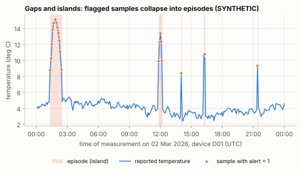
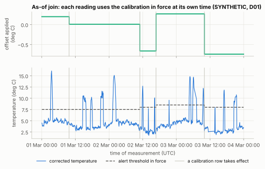

# H3.2 Window functions and time-series SQL

**Status:** Reviewed (sources and what was executed are listed in [H3.2.10](#h3210-sources-and-verification-status))
**Used by:** [w2d2](../../../labs/w2d2_sql_windows_timeseries/README.md) · **Builds on:** H3.1 (grain, joins, NULLs) · **Leads to:** H3.4 (deterministic feature pipelines), H6.1 (leakage), H7.1 (windowing and causality)

SQL examples marked `-- coldchain` run unchanged against
`labs/w2d2_sql_windows_timeseries/data/coldchain.db` (SYNTHETIC) and were executed while writing
this section.

---

## H3.2.1 Overview

Most tables an ML engineer queries are logs: one row per reading, event, transaction or status
change, with a timestamp and an entity key. The questions asked of logs are almost never "one
number per group". They are *relative to each row*: what was the previous value, what is the
average over the last half hour, which state was the device in at that moment, how many such
events had already happened. A plain `GROUP BY` cannot express "relative to each row". Window
functions can, and they do it without the self-joins that made this kind of query slow and
error-prone before they existed.

Four patterns cover nearly everything:

1. **Ranking within a group** — top-n, latest row, de-duplication.
2. **Running and moving statistics** — cumulative counts, time-windowed means.
3. **Run-length segmentation ("gaps and islands")** — flags to events, events to sessions.
4. **As-of joins** — attaching to each fact the state that was valid at the fact's time.

The fourth is where SQL meets model validity. A feature table is correct only if each feature was
computable at prediction time, and the join condition is where that is decided. This section
teaches the mechanics precisely enough that you can state, and test, that property.

If you come from signal processing, the concepts are familiar and the vocabulary is new:

| You say | SQL says |
|---|---|
| per subject / per channel | `PARTITION BY` |
| time axis | `ORDER BY` inside `OVER` |
| analysis window, causal | frame `... PRECEDING AND CURRENT ROW` |
| analysis window, centred | frame `... PRECEDING AND ... FOLLOWING` |
| sample-indexed window | `ROWS` |
| time-indexed window | `RANGE` with an offset |
| event extraction from a thresholded trace | gaps and islands |
| sample-and-hold of a slowly varying parameter | as-of join |

---

## H3.2.2 Anatomy and evaluation order

```sql
function(args) [FILTER (WHERE cond)] OVER (
    [PARTITION BY p1, p2, ...]
    [ORDER BY o1 [ASC|DESC], ...]
    [ROWS | RANGE | GROUPS  BETWEEN <start> AND <end>]
)
```

For each input row the engine takes the row's **partition** (rows with equal `PARTITION BY`
values; the whole input if omitted), orders it, selects a **frame** inside it relative to the
current row, and applies the function to the frame. The number of rows does not change.

A window that is used more than once can be named: `... OVER w ... WINDOW w AS (PARTITION BY ...)`.

**Logical evaluation order of a query block:**

```
FROM/JOIN -> WHERE -> GROUP BY -> HAVING -> window functions -> SELECT list, DISTINCT -> ORDER BY -> LIMIT
```

This single line explains most surprises:

- Window functions are allowed only in the `SELECT` list and in `ORDER BY`. To filter or group on
  a window result, compute it in an inner query (a CTE) and filter in the outer one.
- `WHERE` and `GROUP BY` have already happened. A window sees filtered, possibly aggregated rows.
  `LAG` after `WHERE alert = 1` returns the previous alerting row, not the previous row.
- Because windows come after aggregation, an aggregate may appear inside a window
  (`RANK() OVER (ORDER BY SUM(x) DESC)`), but not the other way round.
- The `ORDER BY` inside `OVER` orders rows *for the function*. It promises nothing about the order
  of the result set; add a final `ORDER BY` if order matters.

**Common table expressions.** `WITH name AS (SELECT ...)` names an intermediate result. Use CTEs
the way you use named variables: one transformation each, with a grain you can state. A query built
as `dedup -> gaps -> numbered -> summary` can be tested stage by stage by selecting from any CTE.
CTEs are a readability device; whether the engine materialises them or inlines them is an
optimiser detail that differs between engines and versions.




---

## H3.2.3 Frames, peers and the ranking functions

### Frame units

Let the partition be ordered, with row $$i$$ having ordering value $$k_i$$.

- `ROWS BETWEEN a PRECEDING AND b FOLLOWING`: the frame is the set of rows at positions
  $$\{\, j : i-a \le j \le i+b \,\}$$. Physical rows.
- `RANGE BETWEEN a PRECEDING AND b FOLLOWING`: the frame is $$\{\, j : k_i - a \le k_j \le k_i + b \,\}$$.
  Values of the ordering key. Requires exactly one ordering expression; numeric (or, in engines
  with interval arithmetic, a timestamp with an interval offset).
- `GROUPS BETWEEN a PRECEDING AND b FOLLOWING`: counts *peer groups* (sets of rows with equal
  ordering values) instead of rows. Rarely needed.

Bounds can also be `UNBOUNDED PRECEDING`, `CURRENT ROW`, `UNBOUNDED FOLLOWING`.

**Peers** are rows of the same partition with equal `ORDER BY` values. Under `RANGE` and `GROUPS`,
`CURRENT ROW` as a bound means "the current row's peer group": as a start bound, its first peer;
as an end bound, its last peer. Under `ROWS` it means the physical row.

### The default frame

| What you wrote | Frame you get |
|---|---|
| no `ORDER BY` in `OVER` | the whole partition |
| `ORDER BY`, no frame clause | `RANGE BETWEEN UNBOUNDED PRECEDING AND CURRENT ROW`: partition start through the current row's **last peer** |

So `SUM(x) OVER (PARTITION BY g ORDER BY t)` is a running total in which tied rows share the
value that includes all of them. With unique `t` this equals the row-wise running total, which is
why the difference goes unnoticed until the data contains ties. Two habits remove the problem:

1. make the ordering total by appending a unique tie-breaker (`ORDER BY t, id`);
2. write the frame you mean (`ROWS BETWEEN UNBOUNDED PRECEDING AND CURRENT ROW`).

Either alone suffices for a running total; do both, because the first also fixes `ROW_NUMBER`,
`LAG` and `FIRST_VALUE`, whose results are otherwise arbitrary among peers.

```sql
-- coldchain: rows where the default frame and the row-wise frame disagree (26 rows)
WITH both AS (
    SELECT reading_id,
           SUM(alert) OVER (PARTITION BY device_id ORDER BY ts_epoch) AS default_frame,
           SUM(alert) OVER (PARTITION BY device_id ORDER BY ts_epoch, reading_id
                            ROWS BETWEEN UNBOUNDED PRECEDING AND CURRENT ROW) AS rows_frame
    FROM sensor_readings
)
SELECT COUNT(*) AS n_different FROM both WHERE default_frame <> rows_frame;
```

### `ROWS` versus `RANGE` on a time axis

On a uniform grid with no missing samples, "the last $$n$$ rows" and "the last $$n\,\Delta t$$ seconds"
select the same rows. Real telemetry has jitter, drops and outages, and then they do not. With a
nominal 5-minute cadence, `ROWS BETWEEN 6 PRECEDING AND CURRENT ROW` and
`RANGE BETWEEN 1800 PRECEDING AND CURRENT ROW` gave different means on 2,929 of 4,707 readings of
the lesson's data. Decide which you mean:

- a statistic defined over a **duration** (mean over 30 minutes, events in the last 24 hours):
  `RANGE` with an offset on a numeric time key;
- a statistic defined over a **number of observations** (difference to the previous reading, last 5
  transactions): `ROWS`, with a total order.

A time-based moving mean is

$$\bar{x}_i = \frac{1}{|W_i|}\sum_{j \in W_i} x_j, \qquad W_i = \{\, j : t_i - w \le t_j \le t_i \,\}$$

and $$|W_i|$$ varies from row to row. Always select `COUNT(*)` over the same window next to the mean:
a mean of one sample after an outage is not comparable to a mean of seven.

### Ranking functions and ties

For ordering values 70, 55, 55, 40:

| Function | Result | Use when |
|---|---|---|
| `ROW_NUMBER()` | 1, 2, 3, 4 | the contract is "exactly one row" or "exactly $$n$$ rows"; needs a total order |
| `RANK()` | 1, 2, 2, 4 | ties should share a place and you want competition ranking |
| `DENSE_RANK()` | 1, 2, 2, 3 | you want "the $$n$$ highest distinct values" |
| `NTILE(n)` | bucket numbers | quantile buckets; ties may be split across buckets |

`ROW_NUMBER()` over a non-total order returns a valid numbering, but which of two peers gets which
number is unspecified and may change between executions. This is the dangerous case, because the
result *looks* deterministic.

### Offset and value functions

`LAG(x, n, default)` and `LEAD(x, n, default)` read the row $$n$$ positions before or after the
current row in the partition order. They do not use the frame. `FIRST_VALUE`, `LAST_VALUE` and
`NTH_VALUE` do use the frame, which makes `LAST_VALUE` with the default frame a classic trap: the
frame ends at the current row (and its peers), so `LAST_VALUE(x)` returns the current row's own
value. Either give the frame `ROWS BETWEEN UNBOUNDED PRECEDING AND UNBOUNDED FOLLOWING`, or use
`FIRST_VALUE` with the order reversed.

---

## H3.2.4 The core patterns

### Pattern 1: top-n per group, latest row, de-duplication

All three are "number the rows of each group in a meaningful order, keep the first $$n$$".

```sql
-- coldchain: one row per (device, timestamp); the transmission that arrived last wins
SELECT reading_id, device_id, ts, temperature, alert
FROM (
    SELECT r.*,
           ROW_NUMBER() OVER (PARTITION BY device_id, ts_epoch ORDER BY reading_id DESC) AS rn
    FROM sensor_readings AS r
)
WHERE rn = 1;
```

Three decisions hide in this query, and each should be written down: the **key** that defines a
duplicate (`device_id, ts_epoch`), the **survivor rule** (highest `reading_id`), and the fact that
non-key columns of the losers are discarded. `SELECT DISTINCT` removes only rows identical in every
selected column; it is not de-duplication by key.

Some engines provide `QUALIFY` to filter on a window result without a subquery. It is not part of
SQLite or PostgreSQL; the CTE form is portable.

### Pattern 2: running and moving statistics

```sql
-- coldchain: 30-minute time window, plus change and gap to the previous reading
SELECT reading_id, device_id, ts,
       AVG(temperature) OVER w30                   AS temp_mean_30m,
       COUNT(*)         OVER w30                   AS n_30m,
       temperature - LAG(temperature) OVER seq     AS delta_prev,
       ts_epoch    - LAG(ts_epoch)    OVER seq     AS gap_s
FROM readings_dedup
WINDOW
    seq AS (PARTITION BY device_id ORDER BY ts_epoch),
    w30 AS (PARTITION BY device_id ORDER BY ts_epoch RANGE BETWEEN 1800 PRECEDING AND CURRENT ROW);
```

The frame ends at `CURRENT ROW`, so every value is **causal**: it uses the present and the past of
that device only. A frame with `FOLLOWING` is a centred or look-ahead window. That is fine for a
report about the past and wrong for a feature that will be computed online.

Whether the current row belongs in the window is a modelling decision. For a feature about "the
recent past excluding now", end the frame one step earlier (`ROWS BETWEEN 6 PRECEDING AND 1
PRECEDING`). For a label-aligned feature the current row is usually included; for a *baseline* that
the current value will be compared against, it usually must not be, or the comparison is biased
towards zero.

### Pattern 3: events to intervals

A status log stores transitions. The interval a state occupies runs from its event to the entity's
next event:

```sql
-- coldchain: seconds per device and status; the last state is closed at the report horizon
WITH intervals AS (
    SELECT device_id, status, ts_epoch AS start_epoch,
           LEAD(ts_epoch, 1, 1772582400) OVER (PARTITION BY device_id ORDER BY ts_epoch, event_id) AS end_epoch
    FROM device_status_events
)
SELECT device_id, status, SUM(end_epoch - start_epoch) AS total_seconds
FROM intervals
GROUP BY device_id, status;
```

Decisions: where the open last interval ends (a horizon, "now", or left NULL and excluded), and
what happens before the first event (unknown, not zero). An invariant worth asserting in a test:
$$\sum_{\text{states}} \text{duration} = t_{\text{horizon}} - t_{\text{first event}}$$ per entity.

### Pattern 4: gaps and islands

Given an ordered sequence with a boolean $$f_i$$, an **island** is a maximal run of consecutive rows
with $$f_i = 1$$. Define the start mark and the island number as

$$s_i = \mathbb{1}[\,f_i = 1 \wedge f_{i-1} = 0\,] \quad (f_0 := 0), \qquad I_i = \sum_{j \le i} s_j .$$

On rows with $$f_i = 1$$, $$I_i$$ is constant within an island and increases by one from each island to
the next. Group by $$(\text{entity}, I)$$.

```sql
-- coldchain: alert episodes per device
WITH flagged AS (
    SELECT device_id, ts, ts_epoch, temperature, alert,
           CASE WHEN alert = 1
                 AND COALESCE(LAG(alert) OVER (PARTITION BY device_id ORDER BY ts_epoch), 0) = 0
                THEN 1 ELSE 0 END AS starts_episode
    FROM readings_dedup
),
numbered AS (
    SELECT *, SUM(starts_episode) OVER (PARTITION BY device_id ORDER BY ts_epoch
                                        ROWS BETWEEN UNBOUNDED PRECEDING AND CURRENT ROW) AS episode_no
    FROM flagged
)
SELECT device_id, episode_no, MIN(ts) AS start_ts, MAX(ts) AS end_ts,
       COUNT(*) AS n_samples, MAX(temperature) AS peak_temperature
FROM numbered
WHERE alert = 1
GROUP BY device_id, episode_no;
```

**The row-number-difference form.** Let $$r_i$$ be the row number among all rows and $$q_i$$ the row
number among flagged rows only. Inside a run both increase by one per row, so $$r_i - q_i$$ is
constant; between runs $$r$$ advances past unflagged rows while $$q$$ does not, so the difference
increases. Hence $$(\text{entity}, r_i - q_i)$$ identifies the island. It is compact; the start-mark
form is easier to modify.

**Variations by changing only the start condition:**

| Goal | A row starts a new group when ... |
|---|---|
| sessions by inactivity | `ts - LAG(ts) > :gap` or there is no previous row |
| collapse repeated states | `status <> LAG(status)` or there is no previous row |
| merge runs separated by short gaps | among flagged rows: distance to the previous flagged row exceeds the tolerance |
| streaks of consecutive days | `day - LAG(day) > 1` |

`NULL` needs explicit handling in every start condition: for the first row of a partition `LAG` is
NULL, and a comparison with NULL is not true.

**What "consecutive" means.** In the query above, consecutive means adjacent rows. A lost sample
between two flagged rows does not split an island, and a two-hour outage between them does not
either. If the definition should be in time, put time in the start condition. State the definition
next to the query; event counts are meaningless without it. (H6.5 and H7.3 return to this for
event-level evaluation: matching rules, merge gaps and minimum durations change recall and
false-alarm counts.)

Gaps and islands on real rows of the lesson database (device D01, one day; produced by the lab's
reference query):



*The shaded bands are the islands; everything between them is a gap. SYNTHETIC data; script:
`labs/w2d2_sql_windows_timeseries/figures/make_figures.py`.*


---

## H3.2.5 As-of joins and point-in-time correctness

### The join

A slowly changing table records, per entity, values with a validity start $$v_1 < v_2 < \dots$$.
The row applying at time $$t$$ is the one with the latest start not after $$t$$:

$$k^*(t) = \arg\max_k \{\, v_k : v_k \le t \,\}$$

Three equivalent ways to write it:

**(a) Range join, keep the latest.** Portable.

```sql
-- coldchain
WITH matched AS (
    SELECT r.reading_id, r.device_id, r.ts, r.temperature, c.offset_c, c.alert_threshold_c,
           ROW_NUMBER() OVER (PARTITION BY r.reading_id ORDER BY c.valid_from_epoch DESC) AS rn
    FROM readings_dedup AS r
    LEFT JOIN calibration AS c
           ON c.device_id = r.device_id AND c.valid_from_epoch <= r.ts_epoch
)
SELECT reading_id, device_id, ts, temperature + offset_c AS corrected_temperature, alert_threshold_c
FROM matched
WHERE rn = 1;
```

**(b) Convert the dimension to intervals, then join on containment.** Each fact matches at most one
row by construction, so there is nothing to discard afterwards.

```sql
-- coldchain
WITH cal AS (
    SELECT *, LEAD(valid_from_epoch) OVER (PARTITION BY device_id ORDER BY valid_from_epoch) AS valid_to_epoch
    FROM calibration
)
SELECT r.reading_id, r.device_id, r.ts, r.temperature + c.offset_c AS corrected_temperature, c.alert_threshold_c
FROM readings_dedup AS r
LEFT JOIN cal AS c
       ON c.device_id = r.device_id
      AND c.valid_from_epoch <= r.ts_epoch
      AND (c.valid_to_epoch IS NULL OR r.ts_epoch < c.valid_to_epoch);
```

Half-open intervals $$[v_k, v_{k+1})$$ tile the time axis without overlap. `BETWEEN` is closed at both
ends and would match a fact at exactly $$v_{k+1}$$ to two rows.

**(c) Correlated subquery** selecting the single latest row per fact
(`ORDER BY valid_from DESC LIMIT 1`). Clear for one column, awkward for several.

In all forms: use a `LEFT JOIN` so that facts earlier than the first dimension row survive with
NULLs, and decide deliberately whether the boundary is `<=` (the new value applies from its start
instant) or `<`.

### Point-in-time correctness

Let a label $$\ell$$ belong to entity $$e_\ell$$ and have prediction time $$t_\ell$$. A feature is
**point-in-time correct** if it is a function only of information available at $$t_\ell$$:

$$f_\ell = g\big(\{\, r : e_r = e_\ell,\ a_r \le t_\ell \,\}\big)$$

where $$a_r$$ is the time row $$r$$ became *available*. If rows are written as they occur and never
revised, $$a_r$$ equals the event timestamp and the condition is `r.ts <= l.label_ts`, placed in the
join condition of every source.

This definition gives a test that needs no reference answer. For each label, modify every source
row with timestamp greater than $$t_\ell$$ in any way; the label's features must be unchanged.
**Invariance to edits of the future** is necessary for correctness, cheap to automate, and catches
symmetric windows, nearest-neighbour matches and joins to "current" dimension rows alike.

It is not sufficient. Two situations escape it:

- **Late-arriving and corrected data.** A row with event time before $$t_\ell$$ may have been written
  or corrected after $$t_\ell$$. Training on the corrected value while serving on the first-reported
  value is leakage and also a training–serving skew. Handling it requires a second timestamp per
  row (ingestion or "knowledge" time) and the condition `ingested_at <= t`. Tables that keep both
  are called *bitemporal*. If your source overwrites rows in place, the past is not reconstructable
  and you should say so in the model's limitations.
- **Aggregates over fixed periods.** "Mean over the calendar month" attached to a label mid-month
  contains the rest of the month. So does any normalisation fitted on the full table. The rows used
  may each be individually dated, but the aggregate is not.

A related design question is the **lag between event and availability**. If readings reach the
warehouse an hour late, a feature "mean over the last hour" computed offline with `ts <= t` uses
data the online system would not have had. The honest offline condition is `ts <= t - delay`.

### Sessionisation and as-of joins are the same idea

Both attach to each row "the most recent thing before it". Sessionisation attaches the most recent
session start; an as-of join attaches the most recent dimension row. When facts and dimension rows
can be put in one ordered stream (a `UNION ALL` of both, ordered by time), a window function that
carries the last dimension value forward performs the as-of join in a single sort. Engines with
`IGNORE NULLS` support in `LAST_VALUE` make this convenient; SQLite does not support that option,
and the range-join forms above are simpler to read.



*An as-of join in one picture: the dimension (offset, threshold) is a step function of time, and each
fact row reads the step it falls on. SYNTHETIC data, device D01.*


---

## H3.2.6 Practical decisions and tradeoffs

**SQL or pandas?** Push to SQL what reduces data (filters, joins, aggregations) and what must be
shared with other consumers or with serving. Prototype and test in pandas. When a feature exists in
both, keep a test asserting they agree on a sample; boundary semantics differ (H3.2.7) and that is
exactly where bugs live.

**Cost model.** A window function needs its partition sorted by the window's order key. Windows
with the same `PARTITION BY`/`ORDER BY` share one sort; each distinct specification may add
another. An index on (partition key, order key) can provide the order. The range-join as-of pattern
(a) generates, per fact, one row per *earlier* dimension row of the same entity before discarding
all but one: cost grows with facts × dimension rows per entity. With a handful of calibration rows
per device this is negligible; against a long history it is not, and pattern (b) or a native
operator is the fix.

**Native as-of support.** Several analytical engines have a dedicated as-of join syntax, and
several have `QUALIFY`. Use them when you have them: the intent is explicit and the planner can do
a merge instead of a range join. Syntax differs between engines; check the documentation of yours.
(This paragraph is from general knowledge; no specific engine's syntax was verified for this
section.)

**Time types.** SQLite has no timestamp type; this chapter stores text for display and integer
epoch seconds for arithmetic. Warehouses have native timestamps and intervals
(`RANGE BETWEEN INTERVAL '30 minutes' PRECEDING AND CURRENT ROW`). Wherever you are, be explicit
about time zone and resolution, and never order by a text timestamp whose format is not
lexicographically sortable.

**Where should de-duplication live?** Once, upstream, as a named view or table with a documented
key and survivor rule, rather than inside every query. The lesson's `readings_dedup` view is that
decision made visible. H4.1 treats such rules as data-quality checks.

**Readability.** One CTE per step; a comment stating each CTE's grain; named windows when a window
is reused; explicit frames. Reviewers find window bugs by reading the `OVER` clause, so make it
easy to read.

---

## H3.2.7 pandas equivalents

| SQL | pandas | Notes |
|---|---|---|
| `ROW_NUMBER() OVER (PARTITION BY g ORDER BY k)` | `df.sort_values([g, k]).groupby(g).cumcount() + 1` | pandas numbers in current row order: sort first |
| `RANK()`, `DENSE_RANK()` | `groupby(g)[k].rank(method="min")`, `method="dense"` | default `method="average"` has no SQL counterpart |
| `LAG(x)`, `LEAD(x)` | `groupby(g)[x].shift(1)`, `shift(-1)` | ungrouped `shift` crosses entities |
| `x - LAG(x)` | `groupby(g)[x].diff()` | |
| running `SUM`, `ROWS` frame | `groupby(g)[x].cumsum()` | |
| `AVG(x) OVER (PARTITION BY g)` | `groupby(g)[x].transform("mean")` | |
| `ROWS BETWEEN n PRECEDING AND CURRENT ROW` | `groupby(g)[x].rolling(n + 1, min_periods=1)` | default `min_periods` equals the window size and yields NaN at the start |
| `RANGE BETWEEN w PRECEDING AND CURRENT ROW` (time) | `rolling("<w>s", closed="both")` on a `DatetimeIndex` | pandas' default `closed="right"` is $$(t-w, t]$$; SQL's frame is $$[t-w, t]$$ |
| top-1 per group | `sort_values(...).groupby(g).head(1)`, or `drop_duplicates(g, keep=...)` | |
| island number | `(start_mark).groupby(g).cumsum()` | compute the start mark with a grouped `shift` |
| as-of join | `pd.merge_asof(left, right, on=t, by=g, direction="backward")` | both inputs sorted by `on`; `allow_exact_matches=True` (default) is `<=` |
| interval containment | `merge_asof` then compare with `valid_to`, or `IntervalIndex` | |

Three boundary differences to remember:

1. **Window endpoints.** For time-based windows pandas defaults to a half-open window that excludes
   the left endpoint; SQL `RANGE` includes both ends. They disagree only when a row lies exactly on
   the boundary, so a naive port passes casual testing.
2. **Ties in time.** SQL `RANGE` includes all peers of the current row. pandas processes rows in
   their given order. If timestamps can tie, de-duplicate first or expect differences.
3. **`merge_asof` direction.** `"backward"` is the as-of join. `"nearest"` and `"forward"` read the
   future. `tolerance=` limits how stale a match may be, which SQL pattern (a) expresses with an
   extra lower bound on the join.

---

## H3.2.8 Common failure modes

| Failure | Symptom | Prevention |
|---|---|---|
| Default frame with tied order keys | running totals too high on some rows; last row correct | total order + explicit `ROWS` |
| `RANK() = 1` or `= MAX()` for "the latest" | several rows per entity; fan-out downstream | `ROW_NUMBER()` with tie-breaker; assert uniqueness |
| `ROW_NUMBER()` on a non-total order | results change between runs or engines | add a unique column to `ORDER BY` |
| `ROWS` frame for a duration | window spans variable time; wrong after gaps | `RANGE` on a numeric time key; report the count |
| Missing `PARTITION BY` | `LAG`/islands cross entities | review every `OVER` for its partition |
| Filter before window | `LAG` skips rows; windows shrink | compute in a CTE, filter outside |
| `LAST_VALUE` with default frame | returns the current row's value | full frame, or `FIRST_VALUE` with reversed order |
| NULL in a start condition | first island or session missing | `COALESCE` or `IS NULL OR ...` |
| Inner join in an as-of pattern | early facts silently dropped | `LEFT JOIN`; assert row count equals the fact count |
| Time bound in `WHERE` after `LEFT JOIN` | join becomes inner | put the bound in `ON` |
| Join to current dimension rows | history rewritten by today's values | as-of join |
| Symmetric or nearest matching for features | implausibly good offline metric | `<= t` in `ON`; future-invariance test |
| Fixed-period aggregates as features | mild, hard-to-see leak | trailing windows ending at $$t$$ |
| Late or corrected rows | offline better than online | keep ingestion time; bitemporal condition |
| Text timestamps compared or subtracted | wrong order or zero differences | numeric or native time types |

---

## H3.2.9 Quick reference

```sql
-- one row per entity: latest by time, deterministic
SELECT * FROM (
  SELECT t.*, ROW_NUMBER() OVER (PARTITION BY entity ORDER BY ts DESC, id DESC) AS rn FROM t
) WHERE rn = 1;

-- running total by rows
SUM(x) OVER (PARTITION BY entity ORDER BY ts, id ROWS BETWEEN UNBOUNDED PRECEDING AND CURRENT ROW)

-- trailing time window (numeric time key, both ends included)
AVG(x) OVER (PARTITION BY entity ORDER BY ts_epoch RANGE BETWEEN 1800 PRECEDING AND CURRENT ROW)

-- previous value, change, gap
LAG(x) OVER (PARTITION BY entity ORDER BY ts)

-- events to intervals
LEAD(ts, 1, :horizon) OVER (PARTITION BY entity ORDER BY ts, id)

-- islands: start mark, then running sum of start marks, then GROUP BY (entity, island)
CASE WHEN flag = 1 AND COALESCE(LAG(flag) OVER (PARTITION BY entity ORDER BY ts), 0) = 0 THEN 1 ELSE 0 END

-- as-of join
LEFT JOIN dim d ON d.entity = f.entity AND d.valid_from <= f.ts   -- then keep the latest per fact
```

Checklist before trusting a window query:

1. What is the grain of the result, and did the row count match it?
2. Is every `ORDER BY` inside `OVER` a total order?
3. Is every frame written out, and is `ROWS` versus `RANGE` deliberate?
4. Does every `OVER` have the partition it needs?
5. Did any `WHERE` run before a window that needed the removed rows?
6. For features: is there a `<= t` in the `ON` clause of every source, and does the future-invariance test pass?
7. Is the definition of "consecutive", "latest" and "duplicate" written next to the query?

---

## H3.2.10 Sources and verification status

**Executed (2026-11-21, SQLite 3.53.1 via Python 3.13.18, pandas 3.0.5).** Every block marked
`-- coldchain` was run against the lesson database. The numbers quoted (26 rows differing under
the default frame; 2,929 of 4,707 rows differing between `ROWS 6 PRECEDING` and `RANGE 1800
PRECEDING`) come from those runs. As-of forms (a) and (b) were checked to return identical tables.
SQLite's rejection of a window function in `WHERE` and its acceptance of an aggregate inside a
window in a grouped query were confirmed by execution.

**Sources opened.** The rendered documentation sites of SQLite and PostgreSQL were not reachable
from the authoring environment, so the PostgreSQL manual was read from its source in the
`postgres/postgres` repository on GitHub, and pandas from its repository and installed docstrings:

- PostgreSQL documentation source, `doc/src/sgml/syntax.sgml`, section on window function calls:
  frame modes, peers, the default framing option and its meaning with and without `ORDER BY`.
- PostgreSQL documentation source, `doc/src/sgml/advanced.sgml`, tutorial on window functions:
  where window functions are permitted and that they execute after `WHERE`, `GROUP BY`, `HAVING`
  and after non-window aggregates.
- pandas documentation source, `doc/source/user_guide/window.rst`: the `closed` parameter of
  time-based rolling windows and its default.
- Installed docstring of `pandas.merge_asof` (pandas 3.0.5): `direction`, `allow_exact_matches`,
  `tolerance`.

**From memory, not re-verified this session.**

- SQLite version history (window functions introduced in 3.25; frame features such as `RANGE` with
  an offset, `GROUPS`, `EXCLUDE` and the `FILTER` clause on window functions in 3.28). The lesson's
  stated minimum of 3.28 rests on this; only 3.53.1 was executed.
- That PostgreSQL lacks `QUALIFY`. (For SQLite 3.53.1, both `QUALIFY` and `IGNORE NULLS` were
  confirmed by execution to be syntax errors, and `LAST_VALUE` with the default frame was confirmed
  to return the current row's value.)
- Which engines provide native as-of joins or `QUALIFY`; no engine-specific syntax is given for that reason.
- The term "bitemporal" and the event-time / knowledge-time distinction are standard in the
  temporal-database literature; no specific reference was consulted.
- The claim that the SQL standard defines the semantics used here. PostgreSQL's manual was the
  reference actually read; SQLite's behaviour was observed to agree on every example executed.

**Optional further reading** (not needed for the lesson, links not click-tested): the SQLite
"Window Functions" page and the PostgreSQL manual chapters 3.5 and 4.2.8 for the reference
semantics; the pandas user guide "Windowing operations" and the `merge_asof` section of "Merge,
join, concatenate and compare".
