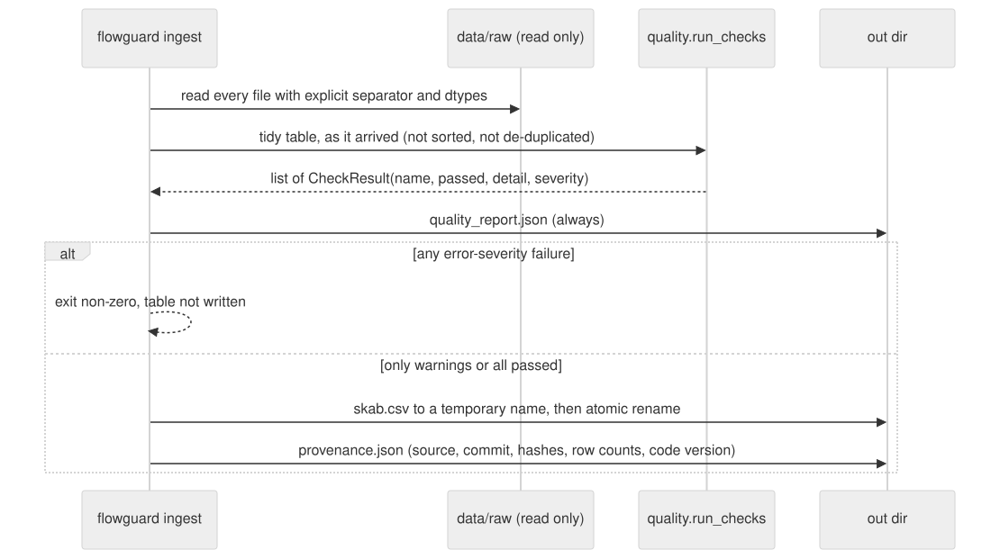

# H3.3 Ingestion and schemas

**Status:** Reviewed (code claims executed on pandas 3.0.5; see H3.3.9) · **Used by:** [w2d3](../../../labs/w2d3_data_quality_ingestion/README.md) · **Related:** [H4.1](../ch04_data_quality_eda/h4_1_quality_checks_and_eda.md), [H2.2](../ch02_maintainable_python/h2_2_configuration_logging_runs.md)

## H3.3.1 Overview

Ingestion is the step that turns what a source delivered into a table your code is allowed to
trust. It has four duties: parse with every decision explicit, bring the data into a declared
schema, refuse data that breaks the contract, and record where the result came from. It has one
prohibition: it does not improve the data quietly.

The step looks trivial (`pd.read_csv`) and is where a large share of production ML failures
originate, because its failure mode is success: a file that loads into the wrong types, a batch
appended twice, a column whose unit changed. Nothing raises; the numbers downstream are simply
different.

## H3.3.2 Layers and the direction of data flow

| Layer | Contents | Rule |
|---|---|---|
| raw | Bytes exactly as delivered, plus a manifest (source, version, hashes) | Immutable. Never edited, re-saved or "fixed". |
| interim | Parsed, validated, tidy tables in a declared schema | A pure function of raw and code. Disposable. |
| processed | Model-ready features tied to a split definition | A pure function of interim, code and configuration. Disposable. |

"Pure function" is the operative idea. If `interim = f(raw)`, then deleting interim is safe,
two people get the same table, and a change in the output is explained by a change in the input or
in `f` — both of which are versioned. Hand edits, appended batches and "I re-saved it from Excel"
all add hidden arguments to `f`.

Larger organisations name the layers differently (landing/staging/curated; bronze/silver/gold) and
store them in object storage or a warehouse. The contract between layers is the same.

**Tidy form.** One row per observation unit, one column per variable, one table per kind of unit.
For sensor recordings: one row per (experiment, timestamp). Identifiers that lived in file paths
(`valve1/3.csv`) become columns, because a path is not queryable and is lost at the first `concat`.




## H3.3.3 Parsing: the decisions a CSV forces on you

A CSV carries no types, no units, no encoding declaration and no time zone. The reader's defaults
are guesses. Each of the following was executed for this section.

**Separator and shape.** A semicolon-separated file read with the default separator yields a
one-column frame without error. Assert the column set immediately after reading.

**Decimal mark.** `"0,054"` read with `decimal="."` is a string. The column's dtype becomes text,
again without error.

**Type inference is per file and per column.** `id` values `007`, `010` are read as the integers
7 and 10: leading zeros, and with them the identity of the key, are gone. Identifier columns are
strings; say so with `dtype`.

**Missing-value tokens.** By default the reader converts a list of strings to NaN. Verified on
pandas 3.0.5: `NA`, `null`, `n/a`, `None`, `nan` all become NaN; `-` and `unknown` do not. So the
default both destroys information (a country code `NA`, Namibia, becomes missing) and fails to
recognise the tokens your source actually uses. Read as text with `keep_default_na=False`, then
map the source's documented missing codes yourself.

**Datetimes.** Three separate decisions: the *format*, the *day/month order*, and the *time zone*.
- With `parse_dates`, a column containing one unparseable value is returned as text, unaltered
  (verified; the pandas documentation states this). The failure is a dtype you did not expect.
- Parsing cell by cell without a format can read `03/04/2020` month-first and `13/04/2020`
  day-first in the same column (worked example of w2d3).
- Give a `format`. Use `errors="coerce"` and then *count the NaT*: a coerced value is only safe if
  something checks for it.

**Time zones.** A timestamp without an offset is a wall-clock reading, not an instant. Converting
it to an instant requires knowing the zone, and is not always possible: on 26 October 2025 in
`Europe/Berlin`, `02:30` happens twice and `tz_localize` refuses to guess (verified:
`ValueError: Cannot infer dst time`); on 30 March 2025, `00:30` to `23:30` is 22 hours, not 23.
Practical rules:

1. Store instants in UTC with the offset explicit.
2. If the source gives naive local time and you know the zone, localise once at ingestion,
   deciding explicitly what to do with ambiguous and non-existent times.
3. If you do not know the zone, keep the values naive and *document that they are naive*. Do not
   stamp them UTC. Naive values are safe for differences within one recording and unsafe for joins
   and for calendar aggregates.

**A robust reading pattern.**

```python
raw = pd.read_csv(path, sep=";", dtype=str, keep_default_na=False)   # nothing inferred
out = pd.DataFrame({
    "datetime": pd.to_datetime(raw["datetime"], format="%Y-%m-%d %H:%M:%S", errors="coerce"),
    "pressure": pd.to_numeric(raw["Pressure"], errors="coerce").astype("float64"),
})
# every NaN/NaT now present was produced by a failed conversion or an empty cell; count them
```

The cost is verbosity and speed; at tens of thousands of rows neither matters. For large files the
equivalent is to pass explicit `dtype`, `decimal`, `parse_dates` and `date_format` to the reader
and then verify the resulting dtypes, which keeps the fast path and still checks the outcome.

## H3.3.4 The schema as a contract

A schema here means more than column names and dtypes. It is the list of statements the rest of the
system may assume about the table:

| Part | Example for the project table |
|---|---|
| Columns and dtypes | `experiment_id: str`, eight sensors `float64`, labels `int64` |
| Key | `(experiment_id, datetime)` is unique |
| Order | sorted by `experiment_id`, then time |
| Domains | labels in {0, 1}; no missing values; sensors inside plausibility limits |
| Units and naming | canonical snake_case names; units in the data dictionary |
| Semantics that are *not* guaranteed | uniform sampling (it is not), time zone (naive) |

The last row matters as much as the others. A contract that is silent about sampling invites every
consumer to assume it is uniform.

Where a schema lives: in code (constants and checks), in a document a human can read (the data
dictionary), and in a test that fails when the two diverge. Changing the schema is a versioned
event with consumers to notify, not an edit.

**Contracts with upstream owners.** The same idea across a team boundary: the producer promises a
format and semantics; the consumer validates on arrival and reports violations in the producer's
terms (rule, count, example keys). A consumer that repairs silently teaches the producer nothing
and takes on an unbounded maintenance burden.

## H3.3.5 Idempotence, atomicity and provenance

**Idempotent**: applying the step again changes nothing. Formally, for the function from
(input, existing output state) to output state, $$F(x, F(x, s)) = F(x, s)$$, and for a pure step
$$F(x, s) = f(x)$$ regardless of $$s$$. In practice:

| Do | Avoid |
|---|---|
| Replace outputs wholesale | Append to an existing file or table |
| Iterate in sorted order | Directory order, set order |
| Fix serialisation: line terminator, date format, sorted JSON keys | Platform or library defaults |
| Keep the clock out of artefacts | `created_at` inside the file |
| Remove outputs that are no longer valid | Leaving yesterday's table beside today's failing report |

Test it with a hash: run twice into two directories, compare digests; run again into the first
directory, compare again.

**Atomicity.** A reader must never see a half-written table. Write to a temporary name in the same
directory and rename over the target (`os.replace` overwrites the destination in one step on POSIX
file systems). For tables in a database, load into a staging table and swap inside a transaction.
The w2d3 lab does not need this (a single user, a batch step); a service reading reference
statistics does.

**Provenance.** The minimum record that lets a table be traced and rebuilt:

```json
{"source": "...", "commit": "...", "licence": "...",
 "inputs": {"valve1/0": {"sha256": "...", "rows": 1147}, "...": {}},
 "output": {"file": "skab.csv", "sha256": "...", "rows": 46806},
 "code": {"flowguard": "0.2.0", "python": "3.13.18", "pandas": "3.0.5"}}
```

A content hash is a name for the data that cannot drift from the data. Row counts make the common
failures (a file missing, a file doubled) visible at a glance. Code and library versions bound the
claim: byte-identical regeneration is promised for the same environment only, since a different
library version may render a float differently.




## H3.3.6 Practical decisions and tradeoffs

| Decision | Options | Guidance |
|---|---|---|
| Storage format for interim | CSV; Parquet; SQLite/DuckDB | CSV: no dependency, diffable, loses dtypes and is slow at scale. Parquet: typed, columnar, compressed; needs `pyarrow`. A database: when several tables are joined. This course uses CSV until size forces a change, and re-declares dtypes on read. |
| Strict or lenient reader | raise on first bad cell; coerce and report | Coerce-and-report gives a complete, attributable picture; raising gives one traceback. Coercion is only safe with a check on the result. |
| Repair at ingestion | never; named transformations | Default to never. Adopt a repair only when its rule is knowable ("the logger rewrites the last sample on reconnect: keep the last") and count what it touched. |
| Sort on read | yes; no | No. Validate order, then rely on it. |
| Unknown extra columns | reject; ignore; warn | Warn and do not propagate. Rejecting breaks on every harmless upstream addition; ignoring hides a schema change. |
| Full reload or incremental | reprocess everything; process new files | Full reload while it takes seconds: it is trivially idempotent. Incremental needs a ledger of processed inputs (by hash) and is where double-counting bugs live. |

## H3.3.7 Common failure modes

- **The successful wrong read.** Wrong separator, decimal mark, encoding or date order; no exception.
- **Append-on-retry.** A job fails half-way, is retried, and writes its first half twice.
- **The helpful loader.** Sorts, de-duplicates and fills on read; quality checks downstream can never fail.
- **Key erosion.** Identifiers read as numbers (leading zeros, float `1.0e5`, precision loss on long ids).
- **Mixed conventions in one column.** Regional systems merged upstream: two date formats, two units.
- **Zone-naive joins.** Two sources, one in local time; events match the wrong rows around midnight.
- **Stale survivors.** An output from a previous successful run still present after a failed one.
- **Path-encoded metadata lost.** The subject, site or experiment id existed only in the filename.

## H3.3.8 Quick reference

```python
# read: nothing implicit
raw = pd.read_csv(p, sep=";", dtype=str, keep_default_na=False)
assert set(EXPECTED) <= set(raw.columns)

# convert: failures become countable
x  = pd.to_numeric(raw["x"], errors="coerce")
ts = pd.to_datetime(raw["ts"], format="%Y-%m-%d %H:%M:%S", errors="coerce")

# write: deterministic bytes, hashed before writing
buf = io.StringIO(); df.to_csv(buf, index=False, lineterminator="\n", date_format="%Y-%m-%d %H:%M:%S")
data = buf.getvalue().encode("utf-8"); digest = hashlib.sha256(data).hexdigest()

# publish atomically (when there are concurrent readers)
tmp.write_bytes(data); os.replace(tmp, target)

# record
json.dumps(provenance, indent=2, sort_keys=True)
```

Checklist for a new source: separator · decimal mark · encoding · header row · missing-value tokens ·
identifier dtypes · datetime format · time zone · key · expected row count · unit of every numeric
column · who owns the source and how to report a violation.

## H3.3.9 Sources and verification status

Executed in this session (pandas 3.0.5, Python 3.13.18): every reader behaviour described in
H3.3.3 (one-column read, string decimals, leading zeros, default NaN tokens, unaltered text column
on a failed `parse_dates`, mixed day/month reading, the two daylight-saving cases); the read/convert/
write pattern; byte-identical repeated ingestion of the 35 SKAB files (w2d3 lesson record).

Consulted: the installed docstrings of `pandas.read_csv` (parameters `decimal`, `keep_default_na`,
`parse_dates`, `date_format`) and `pandas.to_datetime` (`errors`, `dayfirst`, `format`), and
`os.replace`. The rendered pandas documentation site was not reachable from the authoring
environment; docstrings ship with the library and are the same text.

From general knowledge, not re-verified here: the layer names used elsewhere in industry
(landing/staging/curated, bronze/silver/gold); the statement that `os.replace` is atomic on POSIX
file systems (the docstring says only that it overwrites the destination); characteristics of
Parquet. The "tidy" form follows Wickham, *Tidy Data*, Journal of Statistical Software 59(10), 2014
(cited from memory; not opened this session).
