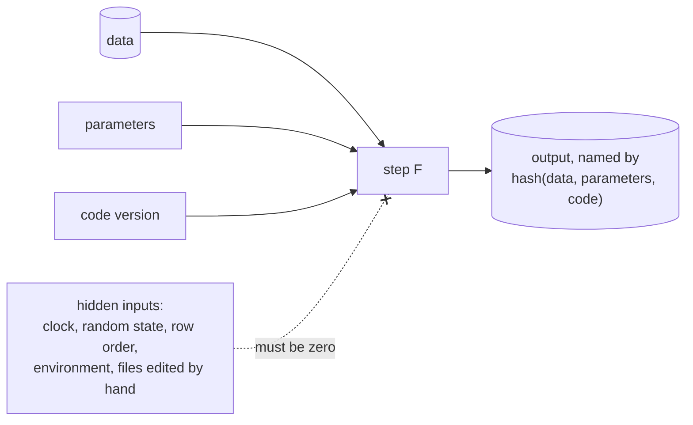
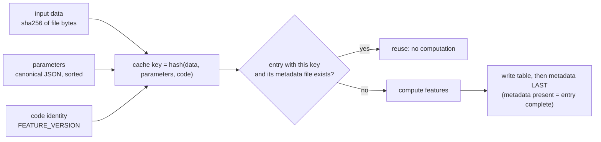
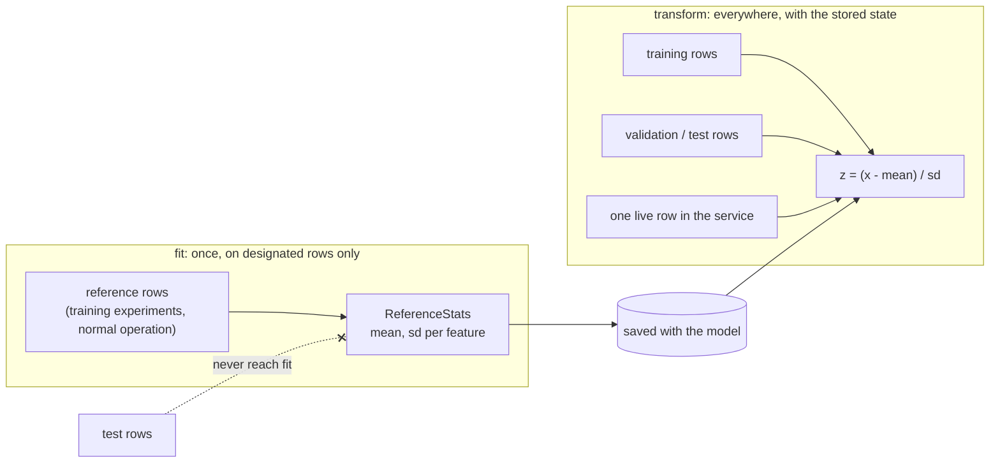

# H3.4 Deterministic feature pipelines

**Status:** Reviewed (mechanisms executed in the w2d5 lab; sources listed in H3.4.9) · **Used by:** [w2d5](../../../labs/w2d5_feature_pipeline/README.md)
**Related:** [H7.1 Windowing and causality](../ch07_timeseries_grouped_modeling/h7_1_windowing_and_causality.md) · [H2.2 Configuration, logging, reproducible runs](../ch02_maintainable_python/h2_2_configuration_logging_runs.md)

## H3.4.1 Overview

A feature pipeline turns raw records into the table a model is trained and scored on. In
research code it is usually a stretch of notebook cells run once. In a product it is run
again and again: on new data, after bug fixes, for backfills, inside the serving path. The
engineering goal is that every run is **explainable** (which data, code and parameters produced
this table?) and **repeatable** (the same three inputs give the same bytes).

This section treats a pipeline step as a pure function, gives its output an identity derived
from its inputs, separates fitted state from applied transformations, and describes the tests
and metadata that make the arrangement trustworthy. The examples use the course's `flowguard`
feature step; nothing here depends on a workflow framework.

## H3.4.2 A step is a function with three arguments

```
output = F(data, parameters, code)
```

*Data* is the input table (or tables). *Parameters* are every value that changes the result:
window lengths, gap tolerance, column list, random seed if any. *Code* is the implementation.
Anything else that can change the output is a hidden argument and a source of irreproducible
tables. Typical hidden arguments:

| Hidden argument | Example | Remedy |
|---|---|---|
| Wall-clock time | "last 30 days" relative to `now()` | pass an explicit as-of date |
| Ambient state | reading "the latest" file in a directory, a mutable database table | pass a path or snapshot id; hash it |
| Iteration order | `set` ordering, unsorted `groupby`, directory listing order | sort explicitly |
| Environment | library version changes a default (`ddof`, float formatting) | record versions; pin for releases |
| Randomness | sampling, random projections | seed as a parameter |
| Concurrency | parallel reduction order changes floating-point sums | fixed chunking and order, or accept and document a tolerance |

**Idempotence.** Running the step twice must leave the same state as running it once. Steps
that append to an output, or that write partially and then fail, are not idempotent. Write to
a location determined by the inputs, and make completion explicit.




## H3.4.3 Content-addressed outputs

Give the output a name computed from the inputs:

```
key = SHA256( canonical_json({ "data": <hash of input>, "params": <normalised>, "code": <version> }) )
path = <cache root>/<key prefix>/features.csv   +   meta.json
```

Consequences:

- **Currency is a comparison.** A model's metadata records the feature key; whether a table on
  disk is the one the model was trained on is a string equality.
- **Recomputation is skipped safely.** If the directory for the key exists and is complete, the
  work is done.
- **Nothing is overwritten.** Different parameters produce different directories, so an old
  model's features remain available until deliberately deleted.

Details that decide whether the scheme is sound:

*Canonical parameters.* The same request must serialise identically: sort keys, fix separators,
normalise collections whose order is irrelevant (`windows = sorted(set(windows))`), and decide
whether `30` and `30.0` are the same. Include **defaults explicitly**, so that changing a
default later changes the key.

*Data identity.* Hash the bytes of the input file, or for partitioned data hash a manifest of
partition hashes. Hashing a path or a modification time identifies a location, not content.
(For in-memory frames, `pandas.util.hash_pandas_object` gives element-wise hashes that can be
combined; file bytes are simpler when a file exists.)

*Code identity.* Three options:

| Option | Invalidates when | Risk |
|---|---|---|
| Hand-maintained version constant | you bump it | a semantic change without a bump serves stale output silently |
| Hash of the feature module's source | any edit to that file, including comments | misses changes in helper modules it imports |
| Git commit hash | every commit, anywhere | needless recomputation; uncommitted changes invisible; equal features get different keys |

A workable combination: version constant in the key, commit hash recorded in the metadata for
audit, and a small golden-output test that fails when feature values change without a version bump.

*Completion marker.* Write the data file first and the metadata last; treat "metadata present"
as "entry complete". For stronger guarantees write into a temporary directory and rename it.

*What the key does not cover.* The library versions. Two environments can produce different
bytes for the same key (float formatting, algorithm changes). Record versions in the metadata
and treat a cache as valid within one environment lock.




## H3.4.4 Fitted state is an artifact, not a side effect

Many feature steps contain estimated quantities: means and standard deviations, quantile bin
edges, a vocabulary, a PCA basis, coefficients of one sensor regressed on another. Each such
step has two operations.

```
state  = fit(rows chosen for fitting)            # once, on designated rows
output = transform(any rows, state)              # everywhere, including one row at a time
```

Rules that follow:

1. **`transform` must not estimate anything.** A useful test: transforming a row alone and
   transforming it inside a larger frame give the same result.
2. **The fitting rows are a parameter**, recorded with the state: which units, which period,
   which label filter. In a grouped, temporal problem the natural choices are training units
   only, and within a unit only data preceding the rows being transformed.
3. **State is serialisable** to plain data and travels with the model. A model without the
   statistics its features were standardised with cannot be served.
4. **Cross-validation refits state inside each fold.** Fitting once on all development data and
   then cross-validating is the classic preprocessing leak; scikit-learn pipelines exist to make
   the correct thing the default, and a hand-written feature step needs the same discipline.

This is the same separation as an EEG pipeline that estimates spatial filters or normalisation
on calibration data and then applies them, unchanged, to later sessions.




## H3.4.5 Point-in-time correctness and training/serving skew

A feature table row for entity *e* at time *t* is **point-in-time correct** if it equals what
would have been computed at *t* from data available at *t*. Three distinct things can break it:

- *Look-ahead in the computation* (centred windows, whole-series statistics): H7.1.
- *Late-arriving data.* A record with event time before *t* that was ingested after *t* was not
  available at *t*. Offline tables built from the final database include it; the service did
  not have it. Keep ingestion time as well as event time when the difference can matter.
- *Joins on current state.* Joining a transaction to the customer's **current** attributes
  instead of their attributes as of the transaction time.

**Training/serving skew** is any difference between the features a model saw in training and
those it receives in production. Causes, in rough order of frequency: two implementations (a
batch one and a streaming one) that disagree at boundaries; different handling of missing
values or warm-up; unit or type differences; point-in-time errors as above. Defences: one
implementation used in both paths where possible; otherwise a parity test that feeds the same
raw records through both and compares; logging served features so they can be compared with
the offline table later.

## H3.4.6 The feature table as an artifact with a schema

A feature table that other code depends on deserves an explicit contract:

- **Grain:** one row per what? (Here: experiment and timestamp.) State it; test uniqueness of the key.
- **Columns:** names generated by a function (so consumers do not rebuild strings by hand),
  dtypes, units where meaningful, allowed NaN (warm-up) and where.
- **Row alignment:** same rows, same order as the input, or an explicit key to join on. Silent
  row drops in a feature step misalign labels.
- **Metadata file** next to the table: key, input hash, parameters, code version, row count,
  column list, output hash, library versions, creation time.

Format is a practical decision. CSV is universal and dependency-free, but slow, large and
lossy in types (the project's 152-feature table is 111 MB as CSV at full precision, for 46,806
rows); float round-trips depend on formatting. Columnar formats such as Parquet are smaller,
typed and faster and add a dependency. Rounding floats to shrink a CSV changes values and
therefore the output hash, and must be part of the parameters if done.

## H3.4.7 Practical decisions and tradeoffs

- **Vectorised or looped.** Write the definition as a slow, obvious loop first; keep it as the
  test oracle; ship the vectorised version. On one SKAB experiment the vectorised step was
  about 40 times faster than the loop with agreement to 2e-14. The loop remains valuable as the
  specification.
- **Full recomputation or incremental.** Recomputing everything is simplest and obviously
  correct while it takes seconds. Incremental computation (only new data) needs carried state
  for windows and is where boundary bugs live; adopt it when cost forces it, with a test that
  incremental equals full.
- **Cache granularity.** One key per table is simple. One key per (unit, parameter set) lets
  new units be added without recomputing old ones, at the cost of more files and a manifest.
- **Fail or flag.** For rows that cannot be computed (warm-up, gaps), emitting NaN plus a reason
  column keeps the table aligned; dropping rows is simpler for the model and loses alignment.
- **A framework or not.** Orchestrators and feature stores automate scheduling, lineage and
  online/offline consistency. They implement the ideas above; they do not remove the need to
  define grain, causality, fitting rows and identity. Adopt one when several pipelines and
  people need coordination.

## H3.4.8 Common failure modes

1. Output path fixed (`features.csv`), overwritten by every run; nobody knows which parameters produced the current file.
2. Cache key omits a parameter, a default, or the code version: stale output served without error.
3. Key built from path or mtime: a re-downloaded identical file misses the cache, a changed file at the same path hits it.
4. Partial write after a crash treated as a complete entry.
5. `transform` that quietly re-estimates statistics on its input.
6. State fitted on all development data, then cross-validated.
7. Feature names rebuilt by string formatting in three places that drift apart.
8. Row drops in the feature step misaligning labels joined by position.
9. Non-deterministic order (directory listing, set iteration) producing tables equal as sets and different as bytes, so hashes never match.
10. Offline table computed from final data, service computing from data as it arrives.

## H3.4.9 Quick reference

```python
params = {"windows": sorted(set(windows)), "max_gap_s": float(max_gap_s), "columns": list(columns)}
payload = json.dumps({"data": sha256(file_bytes), "code": FEATURE_VERSION, "params": params},
                     sort_keys=True, separators=(",", ":"))
key = hashlib.sha256(payload.encode()).hexdigest()
out = cache_root / key[:16]
if (out / "meta.json").is_file():        # complete entry -> reuse
    ...
else:
    write features.csv, then meta.json   # metadata last
```

Tests worth having for any feature step:

| Property | Test |
|---|---|
| Causal in time | perturb or truncate the future; earlier features unchanged |
| Isolated between units | rewrite one unit; others unchanged |
| Correct | equals a slow reference; known-answer inputs (ramp, constant, step) |
| Deterministic | two computations byte-identical |
| Identity | same inputs same key; any parameter, data or version change gives a new key |
| No estimation in transform | one row alone equals the same row inside a frame |
| Aligned | output keys equal input keys, in order |
| Stable semantics | small golden table pinned; change requires a version bump |

### Sources and verification status

Executed in the authoring session (2026-11-21): the caching scheme, determinism (byte-identical
recomputation), the fit/transform separation and all tests in the table above except the golden
table, in `labs/w2d5_feature_pipeline` (reference solution passes; mutants omitting a
parameter from the key or re-estimating in `transform` are rejected). Timings and sizes quoted
are from that run on SKAB at the pinned commit.

Opened: pandas `window.rst` user-guide source (GitHub); installed docstring of
`pandas.util.hash_pandas_object` (pandas 3.0.5).

From memory, not verified against a source this session: the description of what orchestrators
and feature stores provide, the terminology "point-in-time correctness" and "training/serving
skew" as used in industry writing (for example in Google's "Rules of Machine Learning" by
M. Zinkevich, which discusses training-serving skew; the document was not opened), and the
general characterisation of Parquet. Treat those passages as orientation, and check current
tool documentation before adopting a specific product.
