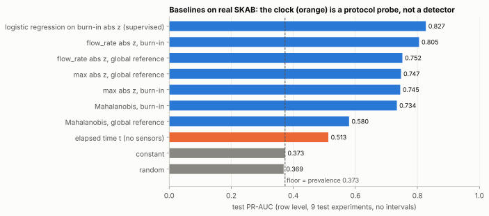
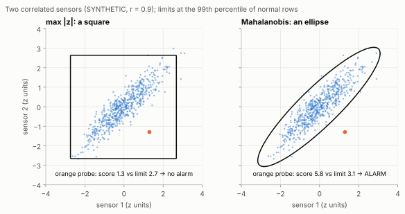

# H5.1 Trivial and linear baselines

Status: Reviewed against the sources listed in H5.1.8; examples executed (lesson
[w2d6](../../../labs/w2d6_baselines_metrics/README.md)). Related: [H5.2](h5_2_metrics_from_decisions.md),
[H6.2](../ch06_evaluation_leakage_uncertainty/h6_2_thresholds_imbalance_calibration.md).

## H5.1.1 Overview

A baseline is a model you are prepared to be embarrassed by. It is built before the model you want
to build, evaluated under exactly the same protocol, and kept in every later results table. This
section gives a ladder of baselines for tabular and sensor problems, the mathematics of the two
classical multivariate detectors (per-sensor z-scores and the Mahalanobis distance), and the practical
question that turns out to dominate on real sensor data: where the definition of "normal" comes from.

## H5.1.2 Three jobs of a baseline

| Job | Question | Typical members |
|---|---|---|
| Floor | What does the metric give for free? | constant, prevalence, random |
| Sanity probe | Is something other than the signal predictive? | row index, elapsed time, file name, shuffled labels |
| Bar | What would a competent person deploy this week? | one-variable rule, linear model, existing alarm limits |

Floors are computed, not assumed. The floor of average precision is the prevalence. The floor of
$$F_1$$ is $$2\pi/(1+\pi)$$, reached by flagging everything; at $$\pi = 0.37$$ that is 0.54. The floor of
accuracy is $$\max(\pi, 1-\pi)$$. The floor of ROC AUC is 0.5. A reported number is meaningless until
its floor is printed next to it.

Sanity probes are baselines that *should* sit at the floor. When one does not, you have learned
something about the data-generating process or the split. On the SKAB benchmark used in this course a
detector whose score is the elapsed time since the start of the experiment reaches a row-level test
$$F_1$$ of 0.835, above every sensor-based baseline in the same table, because 31 of the 34 experiments
start their fault between 550 and 600 seconds in. That single row changes how every later model on
the benchmark must be audited.

The bar should be the strongest *cheap* thing. Its purpose is to price complexity: if a gradient
boosted model beats logistic regression by less than the uncertainty of the comparison, the extra
operational cost bought nothing demonstrable.

## H5.1.3 The ladder for sensor and time-series detection

1. **Constant / random score.** Floors.
2. **Clock.** Score = elapsed time or position in the file. Probe for protocol regularities.
3. **Persistence.** Predict $$x_t$$ by $$x_{t-1}$$ (or by the value one season earlier); score the
   absolute residual. This is the floor for any forecasting-based detector, and on slowly varying
   signals it is hard to beat.
4. **One sensor, one limit.** $$|x_j - \mu_j| / \sigma_j$$ for the physically most relevant sensor.
   This is what a control room already has.
5. **All sensors, independent limits.** $$\max_j |z_j|$$.
6. **All sensors, jointly.** Mahalanobis distance; PCA reconstruction error is its close relative
   (H7.5, planned).
7. **Supervised linear model.** Logistic regression on simple features, when labelled faults exist.

For tabular business prediction the ladder is: prevalence; one-rule heuristics an analyst would write
("failed a payment in the last 90 days"); logistic regression with sensible preprocessing; then
tree ensembles.

*Climb only while each rung beats the previous one by more than its uncertainty. A clock that scores
well is a finding about the data, not a rung to beat.*

*The ladder measured on real SKAB in lesson w2d6 (row level, 9 test experiments, no intervals). The
elapsed-time clock reaches test F1 0.835, above every sensor baseline, because 31 of 34 anomalies
start at rows 550-600.*

## H5.1.4 Per-sensor z-scores

Estimate $$\mu_j, \sigma_j$$ on normal rows. The score

$$ s_{\max}(x) = \max_j |z_j|, \qquad z_j = \frac{x_j - \mu_j}{\sigma_j} $$

is invariant to the unit of each sensor and trivially explainable ("pressure is 6 standard deviations
above normal"). Its assumptions: each sensor's normal range is stationary; faults show up in at least
one sensor's marginal distribution. Under independence and Gaussianity the false-alarm rate at
threshold $$\tau$$ is $$1 - (2\Phi(\tau) - 1)^p$$, which grows with the number of sensors $$p$$: each
uninformative sensor adds false alarms and no detections. In the course's SKAB table one sensor
(`flow_rate`) outperforms the maximum over eight for this reason.

Robust variant: median and MAD ($$\hat\sigma = 1.4826 \cdot \text{MAD}$$ for Gaussian data) when the
"normal" data may contain unlabelled anomalies.

## H5.1.5 Mahalanobis distance and Hotelling's $$T^2$$

$$ d^2(x) = (x - \mu)^\top \Sigma^{-1} (x - \mu) $$

**Geometry.** Let $$\Sigma = V \Lambda V^\top$$. Then $$d^2 = \sum_k u_k^2 / \lambda_k$$ with
$$u = V^\top (x-\mu)$$: project onto the principal axes of normal data, scale each axis to unit
variance, take the squared Euclidean norm. Equivalently, whiten then measure length. In terms of
standardised variables $$z$$ and the correlation matrix $$R$$, $$d^2 = z^\top R^{-1} z$$.

**Why it sees what z-scores cannot.** Take two sensors with correlation $$\rho = 0.95$$ and a row at
$$z = (1.5, -1.5)$$. Each value is unremarkable. But
$$d^2 = z^\top R^{-1} z = \frac{z_1^2 - 2\rho z_1 z_2 + z_2^2}{1-\rho^2} = \frac{2.25 + 4.275 + 2.25}{0.0975} = 90$$,
a distance of 9.5. The row violates a relationship (the direction $$(1,-1)$$ has variance
$$2(1-\rho) = 0.1$$), and relationships between sensors are often exactly what a physical fault breaks:
current up while flow goes down.

**Distribution.** If normal rows are i.i.d. Gaussian with known parameters, $$d^2 \sim \chi^2_p$$. With
parameters estimated from $$n$$ rows, a new observation satisfies
$$d^2 \sim \frac{p(n+1)(n-1)}{n(n-p)} F_{p,\,n-p}$$ (the Hotelling $$T^2$$ control-chart limit; quoted from
memory, see H5.1.8). Neither holds for autocorrelated, non-Gaussian sensor streams, where nominal
false-alarm rates are typically far too optimistic. Use them to set an initial order of magnitude and
calibrate thresholds empirically on held-out normal data.

**Estimation and shrinkage.** The sample covariance has $$p(p+1)/2$$ free parameters. Its small
eigenvalues are biased downward and enter $$d^2$$ through $$1/\lambda_k$$, so estimation error is
amplified exactly where the detector is most sensitive. Singular cases are common in practice: a
sensor that was constant during the fitting window; duplicated or linearly dependent channels; fewer
rows than sensors. Shrinkage estimators blend the sample estimate with a well-conditioned target:

$$ \Sigma_\alpha = (1-\alpha)\,\hat\Sigma + \alpha\,\frac{\operatorname{tr}\hat\Sigma}{p}\,I $$

This is the form implemented by scikit-learn's `ShrunkCovariance`; `LedoitWolf` chooses $$\alpha$$ by a
closed-form estimate that minimises expected squared error. Shrinking the *correlation* matrix
towards $$I$$ (as the course's reference scorer does) is the unit-free variant; at $$\alpha = 1$$ it
reduces to the Euclidean norm of $$z$$, which never fails and never sees a relationship. Other options:
drop directions with $$\lambda_k$$ below a floor (truncated PCA: the discarded directions are then
unmonitored, or monitored separately as the Q/SPE statistic), or use a robust estimator (minimum
covariance determinant) when the fitting data is contaminated.

*SYNTHETIC, r = 0.9, both limits at the 99th percentile of normal rows. The probe is in range on
each axis (max |z| 1.3 < 2.7) but off the correlation (Mahalanobis 5.8 > 3.1). The ellipse's narrow
axis is the low-variance direction whose $$1/\lambda_k$$ weight makes this work, and the same weight is
why that direction needs shrinkage when data are few.*

**Bridge from EEG.** This is the same object as the spatial covariance used for whitening before
CSP or in Riemannian pipelines, with the same regularisation issue when trials are few relative to
channels. The difference in monitoring is the direction of interest: there you look for discriminative
directions, here deviations along *low-variance* directions are the alarm.

## H5.1.6 Where "normal" comes from

| Regime | Fit on | Assumes | Fails when |
|---|---|---|---|
| Global reference | a designated fault-free recording | normal operation is one regime, stable across units and time | units or sessions run at different set-points; sensors are recalibrated |
| Pooled normal rows | normal rows of many training units | between-unit variation is part of "normal" | between-unit spread dwarfs the fault effect, so detectors lose sensitivity |
| Per-unit burn-in | first rows of each unit or session | the unit starts healthy; a calibration period is acceptable | restart during a fault; legitimate set-point change after burn-in |
| Rolling window | the recent past | faults are abrupt relative to the window | slow degradation is absorbed into the baseline |

On SKAB the designated fault-free file was recorded in a different operating regime from the labelled
experiments (flow rate about 125 L/min with standard deviation 1.6, against about 63 with standard
deviation about 42 for the normal rows of the labelled experiments). Detectors fitted on it mostly
measure regime distance; a threshold tuned on development experiments flagged every row of the test
experiments for the Mahalanobis scorer. Per-experiment burn-in removes the offset. The same pattern
is familiar as per-subject or per-session normalisation, and it carries the same caveat: rows used
for calibration cannot be evaluated, and the method silently assumes a healthy start.

**Industry example.** A fleet of compressors reports vibration and temperatures. A global model
alarms constantly on the two units installed at altitude. Per-unit baselines fix the alarm flood and
introduce a new failure: a unit recommissioned after a bad repair learns its damaged state as normal.
The deployed design keeps both: a per-unit relative detector and wide absolute limits from the fleet.

## H5.1.7 Supervised linear baselines

When labelled positives exist, regularised logistic regression is the default bar:

$$ \min_{w,b}\; -\sum_i \big[ y_i \log\sigma(w^\top x_i + b) + (1-y_i)\log(1-\sigma(w^\top x_i+b)) \big] + \frac{\lambda}{2}\lVert w\rVert^2 $$

Practical decisions: put preprocessing (imputation, scaling, encoding) inside one pipeline so it is
fitted on training rows only; scale features, since the penalty is not scale-invariant; leave the
intercept unpenalised (scikit-learn does); do not reweight classes unless you also recalibrate
(H6.2.5). For detection problems, be explicit that a supervised model estimates "resemblance to
labelled faults" and test it on fault types held out entirely.

**Tradeoffs.**

| | Semi-supervised (normal only) | Supervised |
|---|---|---|
| Needs | clean normal data | labelled faults, representative of future ones |
| Detects | anything unlike normal, including harmless novelty | faults like those seen |
| Typical failure | false alarms on legitimate new regimes | misses on new fault types |

## H5.1.8 Failure modes, quick reference, sources

**Common failure modes.**

* Baseline evaluated under a looser or stricter protocol than the model (different rows, different
  threshold rule, different split).
* No floor in the table; a metric quoted above 0.5 is assumed to be good.
* Statistics for standardisation computed on the data being scored (H6.1 preprocessing leakage; it
  also makes online scoring impossible).
* Score sign convention mixed up: scikit-learn outlier detectors return *larger = more normal* from
  `score_samples` and `decision_function`; this course uses larger = more anomalous everywhere.
* Singular covariance from a constant channel; fixed by dropping the row of data instead of the cause.
* Dropping the baseline rows from the table once the model beats them.

**Quick reference.**

| Need | Do |
|---|---|
| Floor of AP / F1 / accuracy / ROC AUC | $$\pi$$; $$2\pi/(1+\pi)$$; $$\max(\pi,1-\pi)$$; 0.5 |
| Unit-free multivariate distance | Mahalanobis on z-scores with a shrunk correlation matrix |
| Conditioning check | `np.linalg.cond(R)`; eigenvalues near zero |
| Shrinkage coefficient without tuning | `sklearn.covariance.LedoitWolf` |
| Robust location/scale | median, 1.4826 x MAD |
| Rule of thumb for rows needed | several times $$p(p+1)/2$$ effective (not autocorrelated) rows for a full covariance |

**Sources and verification status.**

* scikit-learn documentation sources, branch `1.9.X`, read from GitHub on 2026-11-21:
  `doc/modules/covariance.rst` (shrunk covariance formula, Ledoit-Wolf description) and
  `doc/modules/outlier_detection.rst` (sign conventions of `score_samples` / `decision_function`).
* Executed in this course: the correlation example's logic (check
  `test_mahalanobis_catches_a_broken_correlation`), the SKAB baseline table and the regime statistics.
* From memory, not re-opened this session: Mahalanobis (1936); Hotelling (1947) on multivariate
  quality control and the $$F$$-distribution limit quoted in H5.1.5; Ledoit and Wolf (2004), "A
  well-conditioned estimator for large-dimensional covariance matrices"; the MAD constant 1.4826;
  the false-alarm formula for independent Gaussian limits (elementary). The compressor example is
  illustrative, not a documented case.
