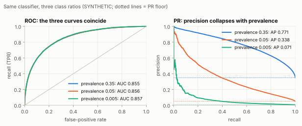
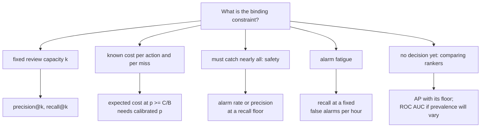

# H5.2 Metrics from decisions

Status: Reviewed against the sources listed in H5.2.8; numerical examples executed (lesson
[w2d6](../../../labs/w2d6_baselines_metrics/README.md)). Related: [H5.1](h5_1_trivial_and_linear_baselines.md),
[H6.2](../ch06_evaluation_leakage_uncertainty/h6_2_thresholds_imbalance_calibration.md).

## H5.2.1 Overview

A metric is a model of what matters. Research communities fix it by convention; an engineering team
has to derive it from an action somebody will take. This section defines the standard binary metrics
precisely, shows how each responds to class prevalence, and gives a procedure for going from a
decision to a metric. Thresholds and calibration are treated in H6.2; event-level evaluation for
detection in H6.5 (planned).

## H5.2.2 The confusion matrix and its rates

A scorer $$s(x)$$ and a threshold $$\tau$$ flag a row when $$s(x) \ge \tau$$.

| | actual positive | actual negative |
|---|---|---|
| flagged | TP | FP |
| not flagged | FN | TN |

$$ \text{recall (TPR)} = \frac{TP}{TP+FN} \quad \text{FPR} = \frac{FP}{FP+TN} \quad
\text{precision (PPV)} = \frac{TP}{TP+FP} \quad F_\beta = \frac{(1+\beta^2)\,TP}{(1+\beta^2)\,TP + \beta^2 FN + FP} $$

Recall and FPR condition on the *true* class: they are properties of the scorer and threshold, and
they do not change if you resample the classes. Precision conditions on the *decision*, and by Bayes'
rule

$$ \text{precision} = \frac{\pi\,\text{TPR}}{\pi\,\text{TPR} + (1-\pi)\,\text{FPR}} $$

where $$\pi$$ is the prevalence. Every statement about "metrics under imbalance" follows from this
split into within-class rates and across-class quantities. $$F_1$$ is the harmonic mean of precision and
recall, so it inherits precision's dependence on $$\pi$$ and has the floor $$2\pi/(1+\pi)$$ (flag
everything). Accuracy is $$\pi\,\text{TPR} + (1-\pi)(1-\text{FPR})$$: at small $$\pi$$ it is essentially
$$1-\text{FPR}$$ and says nothing about positives.

Edge conventions must be stated, because libraries differ: precision when nothing is flagged
(this course: 0), recall when there are no positives (this course: 0), whether the comparison is
$$\ge$$ or $$>$$.

## H5.2.3 Threshold-free summaries

**ROC curve and AUC.** Plot TPR against FPR over all thresholds. The area equals
$$P(s(x^+) > s(x^-))$$ for a random positive and negative (ties counted half): the Mann-Whitney
statistic. It depends only on the two class-conditional score distributions, so it is invariant to
prevalence and to any monotone transformation of the score.

**Precision-recall curve and average precision.** Plot precision against recall. scikit-learn's
`average_precision_score` summarises it as

$$ \text{AP} = \sum_k (R_k - R_{k-1})\,P_k $$

over the distinct thresholds, in order of decreasing score. It is a step function sum. Joining PR
points by straight lines (trapezoidal `auc` on the PR curve) is optimistic, because precision does not
vary linearly with recall between two operating points. Tied scores form one step. With a constant or
random score $$\text{AP} \approx \pi$$.

**What the worked example shows** (synthetic scores, negatives $$N(0,1)$$, positives $$N(1.5,1)$$,
executed in lesson w2d6):

| Prevalence | ROC AUC | AP | AP floor | Precision at recall 0.8 | Accuracy of never flagging |
|---|---|---|---|---|---|
| 0.35 | 0.855 | 0.771 | 0.35 | 0.627 | 0.650 |
| 0.05 | 0.856 | 0.338 | 0.05 | 0.143 | 0.950 |
| 0.005 | 0.857 | 0.071 | 0.005 | 0.015 | 0.995 |

The classifier is identical in all three rows. ROC AUC reports that; it does not report that at
0.5 % prevalence an operator would see about 65 false alarms per true one.

**Choosing between them.**

| Use ROC AUC when | Use AP / PR when |
|---|---|
| comparing rankers across populations with different prevalence | positives are rare and each flag costs attention |
| prevalence at deployment is unknown or will drift | the deployment prevalence is known and is the one you evaluated at |
| both error types matter in proportion to class sizes | you would never operate at high FPR anyway |

Two cautions. AP values are not comparable across datasets, slices or time periods with different
$$\pi$$: report the floor, or the ratio AP/$$\pi$$ ("lift"). And both summaries average over operating
points you will never use; when the operating region is known, report the metric there.

*SYNTHETIC: negatives N(0,1), positives N(1.5,1), 400,000 rows per prevalence. ROC AUC 0.855-0.857
throughout; AP 0.771, 0.338 and 0.071 at prevalence 0.35, 0.05 and 0.005, each against its own floor
(dotted).*

## H5.2.4 Metrics at an operating point

* **Precision@k / recall@k**: flag the $$k$$ highest scores. Matches a fixed capacity (reviews per
  day, calls per month). Needs a tie rule.
* **Recall at fixed FPR** (or at a fixed number of false alarms per hour or per unit): matches an
  alarm-fatigue budget. For time series the budget must be per unit of *time*, not per row; a row
  FPR of 1 % at 1 Hz is 36 false alarms an hour.
* **Precision at a recall floor**: safety-style requirements ("miss at most 5 %").
* **Expected cost / net value**: when costs are known (H5.2.5).

## H5.2.5 From costs to a decision rule and a metric

Let acting on a row cost $$C$$ and produce benefit $$B$$ if the row is truly positive. With a calibrated
probability $$\hat p$$, acting has expected value $$\hat p B - C$$, so

$$ \text{act} \iff \hat p \ge \frac{C}{B} $$

In confusion-matrix terms, with false-positive cost $$c_{FP}$$ and false-negative cost $$c_{FN}$$ (correct
decisions costing 0), the rule is $$\hat p \ge c_{FP}/(c_{FP}+c_{FN})$$; the two forms agree with
$$c_{FP} = C$$, $$c_{FN} = B - C$$. Three consequences:

1. The threshold comes from economics, not from a search over validation data, *provided* $$\hat p$$ is
   calibrated (H6.2.4). If it is only a score, choose the threshold empirically by maximising net
   value on validation data.
2. $$B$$ is the benefit of the *action*, which includes the probability that the action works. A
   retention offer that saves a quarter of would-be churners has $$B = 0.25 \times$$ customer value.
   Forgetting this factor is the most common error in cost-based rules.
3. Costs can vary per row (customer value, asset criticality). Then so does the threshold, and no
   single-threshold metric such as $$F_1$$ describes the policy. Evaluate the policy's total value and
   compare it with the two trivial policies, act on nobody and act on everybody.

In the course's transfer exercise (synthetic data) the base-rate forecast lies below every customer's
break-even probability, so without a model the right campaign is no campaign; the model's policy
contacts 3.7 % of customers. Its value changes sign when the assumed success rate is halved. That is
typical: the conclusion is more sensitive to an assumed business parameter than to the model.

**Prediction is not intervention.** A cost rule built on $$P(\text{event})$$ assumes the benefit of
acting is the same for everyone at a given risk. What the decision needs is the *effect* of the
action per unit (uplift), which only randomised or carefully designed observational data can estimate.
State this limitation whenever a risk model drives an intervention.

## H5.2.6 A procedure

1. Name the action, who takes it, and how often.
2. List what a false alarm and a miss cost, in the units the stakeholder uses. If unknown, record the
   range.
3. Identify the binding constraint: capacity, cost, safety floor, or alarm budget.
4. Pick the operating-point metric that expresses it (H5.2.4); pick one threshold-free summary for
   model comparison during development; print floors for both.
5. Fix the unit of evaluation (row, event, customer, day) and the unit of independence (H6.6, planned).
6. Decide where the threshold comes from (H6.2.2) before looking at test data.
7. Write the sentence a stakeholder can check: "at 2 false alarms per pump-month we detect x % of
   faults within y minutes".

**Industry example (illustrative numbers).** A card-fraud team can review 2,000 of 4 million daily
transactions; fraud is about 0.1 %. The agreed metric is value-weighted recall within the daily
review budget. An offline ROC AUC improvement from 0.971 to 0.975 could not be translated into
anything; recall@2000 could.

## H5.2.7 Common failure modes

* Reporting accuracy on imbalanced data; reporting any PR metric without its floor.
* Comparing AP or $$F_1$$ between test sets with different prevalence (including across cross-validation
  folds of grouped data and across fault families).
* Passing hard predictions to a ranking metric (`predict` instead of scores): the curve has one point.
* Mixing score sign conventions (larger = more normal).
* Optimising $$F_1$$ because it is "balanced", when the real costs are 50:1.
* Row-level metrics for event detection: long events dominate, early and late detection look alike
  (H6.5, planned).
* Treating rows as independent when computing uncertainty; in grouped or autocorrelated data the
  effective sample size is the number of groups or events.

## H5.2.8 Quick reference, sources and verification status

| Quantity | Formula | Depends on prevalence? | Floor |
|---|---|---|---|
| Recall / TPR | TP/(TP+FN) | no | 0 |
| FPR | FP/(FP+TN) | no | 0 |
| Precision | TP/(TP+FP) | yes | $$\pi$$ when flagging everything |
| $$F_1$$ | 2TP/(2TP+FP+FN) | yes | $$2\pi/(1+\pi)$$ |
| Accuracy | (TP+TN)/n | yes | $$\max(\pi, 1-\pi)$$ |
| ROC AUC | $$P(s^+ > s^-)$$ | no | 0.5 |
| Average precision | $$\sum_k (R_k-R_{k-1})P_k$$ | yes | $$\pi$$ |
| Cost threshold | $$\hat p \ge C/B$$ | needs calibrated $$\hat p$$ | - |

**Sources.**

* scikit-learn documentation source `doc/modules/model_evaluation.rst`, branch `1.9.X`, read from
  GitHub on 2026-11-21: the definition of average precision as $$\sum_n (R_n - R_{n-1})P_n$$, the
  statement that AP of random predictions equals the fraction of positives, and the remark (citing
  Davis and Goadrich 2006, Flach and Kull 2015) that linear interpolation of the PR curve is
  overly optimistic and that `average_precision_score` implements no interpolated variant.
* Executed in this course: the prevalence table above; agreement of a from-scratch AP with
  `average_precision_score` on random inputs with ties (lesson checks).
* From memory, not re-opened this session: Davis and Goadrich (2006), "The relationship between
  precision-recall and ROC curves"; Saito and Rehmsmeier (2015) on PR plots for imbalanced data;
  Elkan (2001), "The foundations of cost-sensitive learning" (the threshold $$c_{FP}/(c_{FP}+c_{FN})$$);
  the Mann-Whitney interpretation of ROC AUC. The fraud example is illustrative.
