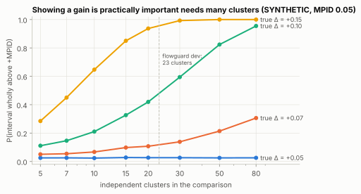
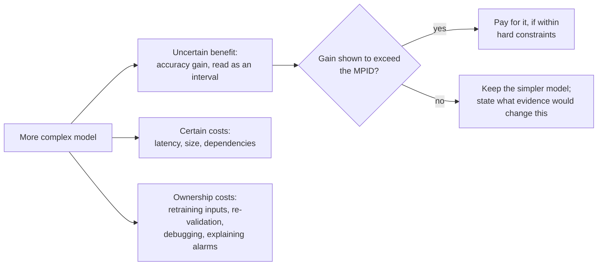
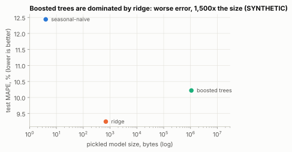

# H5.4 Complexity versus evidence

Status: Reviewed (see H5.4.8 for what was executed and what is from memory).
Used by: [w4d5](../../../labs/w4d5_model_choice/README.md). Related:
[H5.1 trivial and linear baselines](h5_1_trivial_and_linear_baselines.md),
[H6.4 selection and nested validation](../ch06_evaluation_leakage_uncertainty/h6_4_selection_and_nested_validation.md),
[H6.6 bootstrap and paired comparisons](../ch06_evaluation_leakage_uncertainty/h6_6_bootstrap_and_paired_comparisons.md),
[H16.1 decision memos](../ch16_system_design_communication/h16_1_decision_memos.md).

## H5.4.1 Overview

A more complex model must earn its place twice: once in accuracy, and once in everything it costs
to run and own. This section turns "use the simplest model that works" from a slogan into a
procedure:

1. **Commit in advance:** state the minimum practically important difference (MPID), the hard
   constraints and a complexity ranking before looking at results.
2. **Measure accuracy as a difference with an interval**, on the unit that is independent, paired
   across candidates (H6.6).
3. **Measure the costs:** tail latency, size, retraining inputs, dependencies, interpretability.
4. **Remove dominated candidates** (the Pareto front).
5. **Apply the rule:** among candidates meeting the hard constraints, take the simplest one shown
   practically better than the reference; if none is, take the simplest one not shown worse.
6. **Confirm once** on the untouched test set, and write it down (H16.1).

## H5.4.2 Effect size, uncertainty and practical importance

For two candidates evaluated on the same `G` independent clusters, let `d_g` be the per-cluster
difference in the metric (candidate minus reference, higher is better). With `d̄` the mean
difference and `s_d` the standard deviation of the `d_g`, the usual large-sample interval is

```
d̄ ± t(0.975, G-1) · s_d / √G
```

The paired cluster bootstrap estimates the same interval without the normality assumption and works
for pooled metrics such as PR-AUC, where "mean of per-cluster differences" is not the estimand (H6.6).

Three numbers have to be kept apart:

| Quantity | Answers | Controlled by |
|---|---|---|
| Effect size `d̄` | How large is the difference in this sample? | the models |
| Uncertainty (interval width, about `2 t s_d / √G`) | How much would `d̄` move with other clusters? | the number of independent clusters, and how much they disagree |
| MPID | How large must a difference be to change what we do? | the decision, fixed before the data |

Reading the interval `[lo, hi]` against `±MPID` gives four outcomes: **better** (`lo > MPID`),
**worse** (`hi < −MPID`), **equivalent** (`−MPID < lo` and `hi < MPID`), and **inconclusive**
(otherwise). This is the logic of equivalence and non-inferiority testing (the "two one-sided tests"
procedure): "equivalent" at the 95 % level corresponds to a 90 % two-sided interval inside the band.
The course uses the 95 % interval throughout, which makes "equivalent" slightly harder to reach; the
stricter choice keeps one interval in every table.

**How many clusters does it take?** The figure below simulates per-cluster differences with a
between-cluster spread of 0.12 (similar to the flowguard development data). It plots the probability
that the interval lands wholly above an MPID of 0.05.



*Figure H5.4-1 (SYNTHETIC; `../figures/h5_4/power_for_mpid.csv`).*
* With 20 clusters (flowguard's development data has 23), a true gain of +0.07 is shown to be
  practically better only about 11 % of the time, and +0.10 only about 42 % of the time.
* With 80 clusters these rise to 31 % and 95 %.
* When the true difference *equals* the MPID, the interval is wholly above it only about 3 % of the
  time, at any number of clusters.

The practical consequence: "inconclusive" is the normal outcome of a small comparison, and the
honest remedy is more independent data, not a looser reading.

## H5.4.3 What complexity costs

Accuracy is the only benefit; the costs come in many currencies. A useful inventory:

| Cost | Measure | Typical trap |
|---|---|---|
| Tail latency | p95 / p99 of the production call, warm-up excluded, single-threaded or production thread settings, host stated | the mean of a hot loop |
| Size and memory | bytes of the serialised artifact; resident memory after loading | `sys.getsizeof`, which counts only the object header |
| Retraining inputs | what data a retrain needs, and how often it arrives | "retraining takes 2 minutes" while the labels take 3 months |
| Retraining risk | how much a retrain can change behaviour; whether a retrain needs re-validation | nobody owns the re-validation |
| Dependencies | new packages, services, hardware, licences | a GPU node pool for a 0.01 gain |
| Interpretability | whether the person acting on the output can see *why* | dashboards that show a score and nothing else |
| Failure modes | what happens on bad input, missing sensors, drift | silent degradation |
| People | who can debug it at night | the one person who built it |

Most of these are certain, while the accuracy gain is uncertain. That asymmetry is what justifies
defaulting to the simpler option when the evidence is inconclusive.



## H5.4.4 Dominance and the Pareto front

With objectives oriented so that larger is better, candidate `j` **dominates** `i` when
`v_j ≥ v_i` on every objective and `v_j > v_i` on at least one. The non-dominated set is the
**Pareto front**. Properties worth remembering:

* Adding an objective tends to enlarge the front. It can push a candidate off only if that candidate
  was exactly tied with another on every earlier objective. With many objectives almost everything
  is on the front, so keep the list to the three or four that matter.
* Ties: two identical candidates do not dominate each other, so both stay.
* Uncertainty is ignored. A candidate can be "dominated" by a difference far inside the noise. Use
  the front to *remove* options, then apply the MPID rule to the survivors.



*Figure H5.4-2 (SYNTHETIC; the w4d5 worked example; `../figures/h5_4/forecast_front.csv`).* Boosted
trees are dominated by ridge, which has a lower error and a model about 1,500 times smaller. The front
keeps seasonal-naive and ridge. The MPID rule picks ridge, because its gain over the rule is
shown to exceed 1 point of MAPE.

## H5.4.5 Practical decisions and tradeoffs

* **Who sets the MPID?** The person who owns the decision, from the consequences: offers changed,
  faults caught, stock-outs avoided. Translate it into the metric's units with the data scientist,
  before results. If nobody can state it, the comparison is not yet decision-ready.
* **Hard constraints or soft costs?** Make something a hard constraint only when violating it breaks
  the product, for example a latency budget on a request path. Everything else belongs in the table
  and the memo.
* **The reference.** Use the simplest credible candidate, usually today's system or the baseline from
  H5.1, so that "better" means "better than what we would do anyway".
* **Development versus test.** Choose on development data with cross-validation or out-of-fold
  scores. The test set confirms the chosen candidate once (H6.4). Printing the others' test numbers
  "for the record" is fine if the decision is already fixed and recorded.
* **"Inconclusive" is not a failure.** It tells you the next useful investment: more independent
  clusters, more labels, or a cheaper experiment (shadow deployment, Week 7).

## H5.4.6 Common failure modes

* Leaderboard choice: highest point estimate wins.
* Significance mistaken for importance: "p < 0.05" with an interval reaching below the MPID.
* The MPID set or moved after the results.
* Comparing two separate intervals ("they overlap, so no difference") instead of a paired interval.
* Latency measured as a mean, with warm-up included, on an unloaded laptop, or with default thread
  settings on a shared host. In the w4d5 example, default OpenMP threading on a loaded 4-core host
  gave a p95 of 8,153 ms; one thread gave 3.5 ms.
* Complexity ranked by parameter count only, ignoring where retraining labels come from.
* Re-deciding after the test look.

## H5.4.7 Quick reference

```text
Before results:  MPID (metric units) · hard constraints · complexity ranking · reference candidate
Evidence:        paired cluster-bootstrap interval for (candidate - reference) on development data
Reading:         better: lo > MPID · worse: hi < -MPID · equivalent: -MPID < lo and hi < MPID · else inconclusive
Front:           j dominates i  <=>  all(v_j >= v_i) and any(v_j > v_i)   (objectives oriented "larger is better")
Rule:            constraints -> simplest "better" -> else simplest "not worse" -> one test look -> memo
Latency:         perf_counter, warm-up discarded, p50/p95/p99, production batch size and threads, host named
Size:            serialise the deployed artifact and measure the file
```

## H5.4.8 Sources and verification status

Executed in the authoring session (2026-11-22; Python 3.13.18, NumPy 2.5.3, SciPy 1.18.1,
scikit-learn 1.9.1):

* Figure H5.4-1: `handbook/figures/h5_4/make_figures.py` (SYNTHETIC simulation, 4,000 replicates per
  cell; values in the CSV).
* Figure H5.4-2 and the OpenMP latency numbers: `labs/w4d5_model_choice/example/forecast_choice.py`.
  The 8,153 ms figure came from a run with default threading on a host with a load average of about
  11. It is a property of that host and load, and is quoted only as an illustration of the failure mode.
* flowguard numbers: `labs/w4d5_model_choice/lab/decision_table.py` (reference solution).

From memory, not re-verified this session:

* Schuirmann, D. J. (1987), "A comparison of the two one-sided tests procedure and the power approach
  for assessing the equivalence of average bioavailability", *Journal of Pharmacokinetics and
  Biopharmaceutics*: the TOST procedure and its correspondence to a 90 % interval.
* Sculley, D. et al. (2015), "Hidden technical debt in machine learning systems", *NeurIPS*: the
  general argument that ML systems carry maintenance costs beyond the model.
* The Pareto-dominance definitions are standard in multi-objective optimisation; no specific source
  was consulted.
