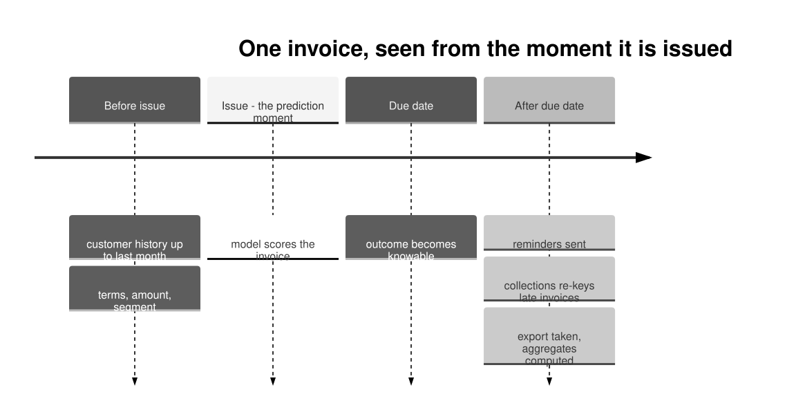
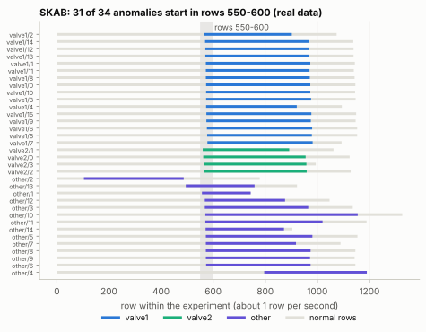
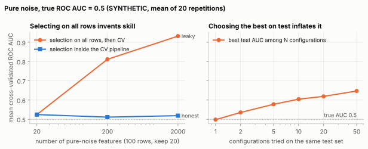

# H6.1 Leakage: a taxonomy, detection probes and prevention by construction

Lesson: [w3d1](../../../labs/w3d1_leakage/README.md). Related: [H6.3 Group and temporal
validation](h6_3_group_and_temporal_validation.md), [H6.4 Selection and nested
validation](h6_4_selection_and_nested_validation.md), [H7.1 Windowing and causality](../ch07_timeseries_grouped_modeling/h7_1_windowing_and_causality.md).

## H6.1.1 Overview

Leakage is information used in training or evaluation that will not be available, or not in that form,
when the model makes its predictions. It produces a model that relies on something that will not be
there, an estimate that will not be met, or both. Leakage is the commonest reason for the gap between an
offline result and production, and it rarely looks like a bug: every step is reasonable in isolation.

The working method this section teaches has three parts: **define the prediction moment**; **classify**
every column, row assignment, fitted step and choice against it; **construct** the evaluation so that
the correct behaviour is the default and violations raise errors.

## H6.1.2 The prediction moment

Every leakage judgement is relative to a moment: the time at which, in deployment, the model receives
its input and must produce a prediction. Draw it before anything else.



A feature is legitimate if its value, **as it will be computed in production**, is known at the
prediction moment. That requires two facts, and data exports usually record neither: when the
underlying event happened, and when the system recorded it. Back-filled fields (a diagnosis code
entered after discharge, a maintenance log completed at the end of the week) have an event time before
the prediction moment and a record time after it. In production they are empty.

## H6.1.3 Taxonomy

Eight kinds, grouped by where the information enters.

| Where | Kind | Mechanism | Typical examples |
|---|---|---|---|
| Feature | **Target / proxy** | a column that is a consequence or a copy of the label | reminders sent, chargeback filed, "follow-up scheduled", diagnosis code |
| Feature | **Temporal aggregate** | a statistic over the entity's history computed with rows at or after the prediction | customer late rate over the whole export; mean sensor value over the whole recording; target encoding without out-of-fold fitting |
| Feature | **Shortcut / protocol** | an identifier, ordering, batch or acquisition artefact that correlates with the label only in this dataset | ledger number ranges, file order, elapsed time when faults are injected on a schedule, EEG session/site/amplifier, image scanner model |
| Rows | **Group** | the same unit (patient, customer, machine, experiment) on both sides | row-wise split of per-subject windows; customers with several contracts |
| Rows | **Duplicate** | the same event twice, exact or near | re-issued invoices, copied files, overlapping windows, augmented copies split apart |
| Rows | **Temporal** | training rows later than evaluation rows; windows or labels that cross the split boundary | random split of a forecasting problem; label horizon not purged (H7.2) |
| Fitted step | **Preprocessing** | a statistic fitted on rows that include evaluation rows | scaler, imputer, PCA, vocabulary, **feature selection**, resampling (SMOTE) before splitting |
| Choice | **Selection** | decisions made by looking at test results | best of N configurations on test; threshold tuned on test; early stopping on test; repeated test looks |

Two kinds deserve a second look because they are easy to dismiss.

**Protocol leakage** is the most common in research data. A classic example from EEG studies: label and
acquisition are confounded (all patients recorded on one amplifier, all controls on another; vigilance
labels confounded with time-on-task). The model learns the protocol. In the course project the anomaly
starts in rows 550-600 in 31 of 34 experiments, so elapsed time is a strong "detector":



*Real SKAB data. Any feature monotone in time (a cumulative counter, a slowly drifting temperature)
inherits the clock's apparent skill.*

**Selection leakage** corrupts only the estimate, never the model, and so survives every code-level
check. It is treated quantitatively in H6.4.

## H6.1.4 How much does a leak inflate? Two calculations

**Target leakage** needs no calculation: a column equal to the label with probability $$q$$ gives the
model accuracy about $$q$$.

**Supervised selection on all rows.** Take $$p$$ features independent of a binary label, $$n$$ rows. Each
sample correlation $$r_j$$ with the label is approximately $$\mathcal{N}(0, 1/n)$$. Keeping the $$k$$ largest
$$|r_j|$$ keeps correlations of order

$$|r|_{(k)} \approx \sqrt{\frac{2 \ln (p/k)}{n}} .$$

These correlations exist *in the sample*, including the rows later used for validation, so a model on
the selected features scores above chance on those rows. The inflation grows with $$\ln(p/k)$$ and shrinks
with $$n$$. Simulated means (true AUC 0.5, keep 20, 20 repetitions): 0.812 at $$n = 100, p = 200$$;
0.932 at $$p = 2{,}000$$; 0.691 at $$n = 1{,}000, p = 2{,}000$$. Inside a pipeline: 0.49-0.52.

**Best of N on test.** If $$N$$ configurations have independent test scores $$\hat{a}_i = a + \varepsilon_i$$
with $$\varepsilon_i \sim \mathcal{N}(0, \sigma^2)$$ and equal true value $$a$$,

$$\mathbb{E}\Big[\max_i \hat{a}_i\Big] \approx a + \sigma \sqrt{2 \ln N} \quad (N \text{ large}),$$

and less when the estimates are positively correlated, as they are when configurations are similar.



*SYNTHETIC, true AUC 0.5. Every point above the dotted line is manufactured by the procedure.*

## H6.1.5 Detection probes

| Probe | What it finds | How |
|---|---|---|
| Too good to be true | any strong leak | compare with human difficulty, published results, a simple baseline |
| Single-feature probe | target, proxy, shortcut columns | validation score of each column alone; investigate any column that nearly solves the task |
| Availability audit | target, temporal aggregate | for each feature: producing system, event time, record time, relative to the prediction moment |
| Point-in-time recomputation | temporal aggregate | recompute the feature from history before each row; compare |
| Shuffled-label run | pipeline-induced leaks (selection, cross-side duplicates) | permute labels, rerun the whole pipeline; result must be at chance |
| Clock / order probe | protocol leakage | score by elapsed time, row order, file order, session id |
| Monotone-with-time test | clocks in disguise | within-unit rank correlation of each feature with time |
| Cross-side duplicate search | duplicates, group leakage | hash rows; nearest-neighbour distance from test rows to training rows |
| Perturbation test | preprocessing leakage | change evaluation rows; nothing fitted may change |
| Split comparison | group and temporal leakage | grouped vs random, forward vs random; a large gap means dependence (H6.3) |
| Test-look count | selection leakage | log every evaluation on test; more than one look needs an explicit correction or a fresh hold-out |

None proves absence. The availability audit is the only general defence, and it requires talking to the
people who produce the data.

## H6.1.6 Prevention by construction



Practical rules that make the correct version the default:

1. **Write the feature contract.** One line per feature: source system, event time, record time,
   transformation. Features without a line do not enter the model. `audit_features` enforces the
   forbidden names automatically; the contract covers the rest.
2. **Split first, by the unit and time the deployment uses**, and persist the split as a manifest that
   is validated against the data on every load (w2d4, w3d1).
3. **One estimator object.** Every fitted transformation lives in the `Pipeline`. Then
   cross-validation, grid search and serving all apply it correctly, and a single `fit` call cannot see
   test rows. The scikit-learn documentation gives this as its main recommendation (source below).
4. **Freeze, then open the test set once.** Selection uses validation folds; the test result is
   reported whatever it is.
5. **Make probes part of the pipeline,** not a one-off: the clock probe and the duplicate check run in
   tests, so a new data delivery that reintroduces a leak fails loudly.

## H6.1.7 Practical decisions and tradeoffs

* **Drop or fix a leaky feature?** Fix if a point-in-time version exists and is cheap (`prior_late_rate`
  instead of `customer_late_rate`). Drop if no available version exists. Never "keep it because it helps".
* **Group the duplicates or delete them?** Group: deleting copies hides label conflicts and leaves
  dependent recordings on both sides. Delete only exact technical copies of one event, *before* splitting,
  and report how many.
* **Protocol confounds you cannot remove.** If the label is confounded with acquisition (SKAB's onset
  time), you cannot fix the data. Forbid the confounding variables as features, test that engineered
  features are not proxies of them, and say in the limitations that the evaluation cannot exclude
  remaining protocol effects.
* **Cost of strictness.** A strict time split and grouping reduce the training data and make estimates
  noisier. That is the price of an estimate that means something; report the uncertainty (H6.6) rather
  than relaxing the split.

## H6.1.8 Common failure modes

* Dropping the label column and assuming target leakage is handled.
* Target encoding, frequency encoding or "customer average" features computed on the full table.
* SMOTE or other resampling before cross-validation (synthetic points interpolate between rows that end
  up on both sides).
* Augmented copies of one recording placed in different folds.
* Normalising each test batch by its own statistics in `predict`: scores then depend on the batch, and a
  single request cannot be scored.
* Early stopping on the test set, or choosing the epoch with the best test score.
* Re-running the "final" evaluation after a disappointing result and keeping the better one.
* Treating a clean result on one probe as proof of absence of leakage.

## H6.1.9 Quick reference

```text
Question for every column / row / step / choice:
    would this exist, in this form, at the prediction moment?

Feature kinds:   target/proxy | temporal aggregate | shortcut/protocol
Row kinds:       group | duplicate | temporal
Step kind:       preprocessing (supervised steps leak most)
Choice kind:     selection (affects the estimate, not the model)

Cheap probes:    single-feature | shuffled labels | clock/order | cross-side duplicates | perturb test rows
Defaults:        feature contract -> split first (manifest, validated) -> Pipeline -> choose on validation -> test once

Inflation:       selection on all rows ~ sqrt(2 ln(p/k) / n) spurious correlation
                 best of N on test     ~ + sigma * sqrt(2 ln N)
```

## H6.1.10 Sources and verification status

| Source | Used for | Status |
|---|---|---|
| scikit-learn documentation, "Common pitfalls and recommended practices", section "Data leakage" (`doc/common_pitfalls.rst`, read from the scikit-learn GitHub repository, main branch, 2026-11-22) | definition ("information that would not be available at prediction time"), the rule "never call fit on the test data", pipelines as the recommended prevention, the feature-selection example | opened and read |
| scikit-learn documentation, cross-validation guide (`doc/modules/cross_validation.rst`, same date) | grouped cross-validation as the remedy for group dependence | opened and read |
| Kaufman, Rosset, Perlich (2012), "Leakage in data mining: formulation, detection, and avoidance", ACM TKDD | the general framing of leakage as a formal property relative to prediction time | from memory, not re-opened this session |
| Kapoor, Narayanan (2023), "Leakage and the reproducibility crisis in machine-learning-based science", Patterns | prevalence of leakage in published applied ML; a taxonomy close to this one | from memory, not re-opened |
| Ambroise, McLachlan (2002), "Selection bias in gene extraction on the basis of microarray gene-expression data", PNAS | feature selection outside cross-validation as a documented source of optimistic error rates | from memory, not re-opened |
| Simulated numbers in H6.1.4 | inflation magnitudes | executed: `labs/w3d1_leakage/example/selection_leak_demo.py`, Python 3.13.18, scikit-learn 1.9.1 |
| SKAB facts (onsets, duplicated rows) | project examples | executed on the downloaded files: `labs/w3d1_leakage/example/skab_leaks.py` |
| Expected-maximum approximation $$\sigma\sqrt{2\ln N}$$ | best-of-N | standard extreme-value result for Gaussian maxima, stated from memory; checked only against the simulation's order of magnitude |

The invoice timeline and industry examples are illustrative constructions, not documented cases.
