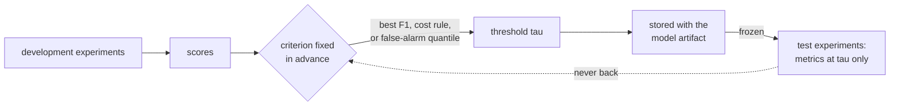
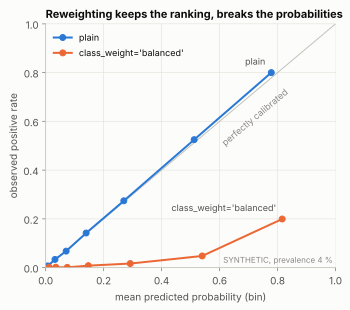

# H6.2 Thresholds, imbalance and calibration

Status: Reviewed against the sources listed in H6.2.8; numerical examples executed (lesson
[w2d6](../../../labs/w2d6_baselines_metrics/README.md)). Related:
[H5.1](../ch05_classical_ml_baselines/h5_1_trivial_and_linear_baselines.md),
[H5.2](../ch05_classical_ml_baselines/h5_2_metrics_from_decisions.md).

## H6.2.1 Overview

A deployed model emits decisions, and a decision is a score plus a threshold. The threshold is a
fitted parameter with its own data requirements. Class imbalance is a property of the problem that
mostly belongs in the metric and the threshold, not in the training set. Calibration is the property
that lets a score be read as a probability, and it is needed exactly when the score is compared with
costs or combined with other quantities. This section treats the three together because the common
mistakes come from treating them separately.

## H6.2.2 The threshold is a parameter: where it may come from

Selecting $$\tau$$ to maximise a metric on a dataset and reporting that metric on the same dataset
reports $$\max_\tau \hat M(\tau)$$. Since each $$\hat M(\tau)$$ is a noisy estimate, the maximum is biased
upward, more so with small or autocorrelated samples. It is the same selection effect as
hyperparameter tuning on the test set (H6.4, planned), and it is easy to commit because a call like
"best F1" looks like evaluation rather than fitting.

| Source of the threshold | Valid when | Risk |
|---|---|---|
| Validation data, criterion fixed in advance | validation resembles deployment | noisy with few events; optimistic if validation was also used for model selection |
| Cost rule $$\hat p \ge C/B$$ | probabilities are calibrated on the deployment population | silently wrong after prior shift or reweighting |
| Quantile of scores on normal data (target false-alarm rate) | normal behaviour is stable | alarm rate drifts with regime changes |
| Nominal distribution ($$\chi^2$$, Gaussian tails) | almost never for real sensor data | false-alarm rates off by orders of magnitude |

**Transfer across units.** A threshold transfers only if the distribution of scores for normal data
is the same where it is applied as where it was chosen. In this course's SKAB baseline table a
Mahalanobis detector fitted on a global fault-free recording had a development PR-AUC of 0.66, and
its development-selected threshold flagged *every* row of the test experiments: the experiments sit
at different distances from the reference, so the score has no common scale across them. Pooled
ranking metrics hide this. Diagnostics: per-unit score distributions on normal data; per-unit alarm
rate at the chosen threshold; the spread of per-unit optimal thresholds.

**Reporting discipline.** Freeze the threshold before test rows are scored; store it with the model
artifact; report threshold-dependent metrics only at that value; when you also show the best
achievable test value, label it as an oracle.

## H6.2.3 Imbalance: what it changes and what it does not

Imbalance does not make a classifier's within-class behaviour worse. It changes the *consequences*:
precision at a given (TPR, FPR) falls as $$\pi/(\pi + (1-\pi)\,\text{FPR}/\text{TPR})$$, and estimates
of anything about the positive class rest on few examples. It also means that 0.5 is rarely a
sensible threshold for a probability, since few rows have $$\hat p > 0.5$$ when $$\pi$$ is small.

What to do, in order of preference:

1. **Fit normally; move the threshold.** Keep the probabilities meaningful and choose the operating
   point from costs or capacity.
2. **Stratify or group splits** so every fold contains positives, and report the number of positive
   *events*, which is your real sample size.
3. **Downsample negatives for compute**, then correct. Keeping each negative with probability
   $$\beta$$ multiplies the odds by $$1/\beta$$; for logistic models that is an intercept shift of
   $$\log(1/\beta)$$, undone by $$p = \beta p_s / (\beta p_s + 1 - p_s)$$.
4. **Reweight or oversample only with recalibration** (H6.2.5), or when you will use the scores for
   ranking alone.

Reweighting changes what the model believes the prior is. In the lesson's worked example (synthetic,
4 % positives), `class_weight="balanced"` left ROC AUC and average precision unchanged to three
decimals and moved the mean predicted probability from 0.040 to 0.327.

## H6.2.4 Calibration

**Definition.** $$\hat p$$ is calibrated if $$P(Y=1 \mid \hat p = q) = q$$ for all $$q$$. Calibration *in
the large* is the weaker condition $$E[\hat p] = E[Y]$$. Calibration is a property of a model on a
population: change the population and it can break while discrimination survives.

**Instruments.**

* *Reliability table or curve.* Bin by $$\hat p$$; compare mean prediction with observed rate per bin.
  With skewed predictions use equal-count bins; show bin sizes; a bin with 25 rows has a standard
  error near 0.08 on a rate of 0.2.
* *Brier score* $$\text{BS} = \frac1n \sum_i (\hat p_i - y_i)^2$$, with reference value $$\pi(1-\pi)$$ for
  the constant forecast $$\pi$$. For forecasts grouped into bins $$k$$ with size $$n_k$$, forecast $$q_k$$
  and observed rate $$\bar y_k$$ (Murphy's decomposition, exact when forecasts within a bin are equal):

$$ \text{BS} = \underbrace{\tfrac1n\sum_k n_k (q_k - \bar y_k)^2}_{\text{reliability}} -
   \underbrace{\tfrac1n\sum_k n_k (\bar y_k - \bar y)^2}_{\text{resolution}} +
   \underbrace{\bar y (1-\bar y)}_{\text{uncertainty}} $$

  A lower Brier score can therefore come from better discrimination with unchanged or worse
  calibration. Do not use it alone to claim calibration improved.
* *Log loss* punishes confident errors without bound; same caveat.

**Which models are calibrated out of the box.** Unpenalised logistic regression with an intercept
satisfies $$\sum_i \hat p_i = \sum_i y_i$$ on its training data (the "balance property" of the
canonical link), and is usually close to calibrated when roughly well specified. Strong
regularisation pulls predictions towards the mean. Margin-based models, naive Bayes, boosted trees
and modern neural networks are often miscalibrated in characteristic ways. Any model trained with
class weights or resampling is miscalibrated by construction.

**Example from the course.** Two logistic regressions with identical ranking; a rule "act if
$$\hat p \ge 5/60$$":

| Model | Mean $$\hat p$$ (prevalence 0.040) | Brier | Acted on | Net value per 1,000 rows |
|---|---|---|---|---|
| unweighted | 0.040 | 0.0330 | 12.7 % | +813 |
| `class_weight="balanced"` | 0.327 | 0.1575 | 80.5 % | -1,641 |
| constant forecast $$\pi$$ | 0.040 | 0.0384 | 0 % | 0 |

The reweighted model's Brier score is four times worse than the constant forecast's.

*The same two models as reliability curves (SYNTHETIC, prevalence 4 %). The unweighted model follows
the diagonal; the reweighted one predicts 0.82 in a bin where 20 % are positive.*

## H6.2.5 Recalibration and prior shift

**Post-hoc calibration** fits a monotone map from score to probability on held-out data:

* *Platt scaling*: $$p = \sigma(a s + b)$$; two parameters, suitable for small calibration sets.
* *Isotonic regression*: non-parametric and monotone; needs more data (hundreds of positives) and can
  overfit; produces ties.

Use data not used for fitting the model, and group- or time-aware splits where the main evaluation
uses them. Recalibration does not change the ranking (up to ties), so AP and ROC AUC stay put.

**Prior shift.** If only the base rate changes between training ($$\pi_0$$) and deployment ($$\pi_1$$)
while $$P(x \mid y)$$ stays fixed, the corrected odds are

$$ \frac{p_1}{1-p_1} = \frac{p_0}{1-p_0} \cdot \frac{\pi_1/(1-\pi_1)}{\pi_0/(1-\pi_0)} $$

an intercept shift on the logit scale. The course's transfer exercise (synthetic churn data) shows
the symptom: the model is calibrated on the validation months (mean prediction 0.057, observed
0.060) and under-predicts in every bin on the later test months (0.061 against 0.089) because the
churn rate rose. Temporal validation could not reveal it, since the shift came afterwards; only
monitoring mean prediction against delayed labels can (H15.4, planned).

**When calibration is needed.** Decision rules that compare $$\hat p$$ with a cost ratio; expected-loss
or expected-value computations; combining model output with other probabilities or with human
judgement; communicating risk to people. **When it is not:** pure ranking under a capacity
constraint; thresholds chosen empirically on the score for the same population.

## H6.2.6 Bridges and an industry example

In seizure or HFO detection you tuned a detection threshold per patient or on held-out patients and
reported sensitivity against false detections per hour; that is the "quantile of scores on normal
data" row of the table in H6.2.2, with the same transfer problem between patients that SKAB shows
between experiments. Where the analogy breaks: in a business setting the threshold is often a per-row
function of value, the base rate drifts with seasons and product changes, and labels arrive weeks
late, so calibration has to be monitored and maintained after deployment.

**Industry example (illustrative).** A lender scores applicants for default and prices loans from
$$\hat p$$. A model update trained on a rebalanced sample improves AUC by 0.01 and is deployed; approval
volume collapses within a day because every applicant's predicted default probability tripled. The
ranking was better and every decision was wrong. The release checklist afterwards includes mean
prediction against base rate on a recent out-of-time sample.

## H6.2.7 Common failure modes

* "Best F1" or "best threshold" computed on test data and reported as test performance.
* A threshold tuned on pooled data that transfers to no individual unit.
* `class_weight="balanced"`, SMOTE or downsampling followed by a probability threshold.
* Calibration assessed on training data, or with ten equal-width bins of which eight are empty.
* Brier score used as a calibration measure; Brier or log loss compared across datasets with
  different prevalence.
* Calibrating on a random split when the deployment split is temporal or grouped.
* Assuming calibration is permanent: it is the first thing to break under drift.

## H6.2.8 Quick reference, sources and verification status

| Task | Tool |
|---|---|
| Is $$\hat p$$ a probability? | mean $$\hat p$$ vs observed rate; reliability table with equal-count bins |
| Reference Brier score | $$\pi(1-\pi)$$ |
| Threshold from costs | $$\hat p \ge C/B = c_{FP}/(c_{FP}+c_{FN})$$ |
| Undo negative downsampling at rate $$\beta$$ | $$p = \beta p_s/(\beta p_s + 1 - p_s)$$ |
| Base rate moved from $$\pi_0$$ to $$\pi_1$$ | multiply odds by $$\frac{\pi_1/(1-\pi_1)}{\pi_0/(1-\pi_0)}$$ |
| Recalibrate with little data / much data | Platt scaling / isotonic regression (`CalibratedClassifierCV`) |
| Threshold for a target false-alarm rate | quantile of scores on held-out normal data, per unit if scales differ |

**Sources.**

* scikit-learn documentation source `doc/modules/calibration.rst`, branch `1.9.X`, read from GitHub on
  2026-11-21: the definition of a well-calibrated classifier; the note that Brier score and log loss
  assess calibration and discrimination together (Murphy decomposition) and that a lower Brier loss
  does not necessarily mean better calibration; the statement that unpenalised logistic regression
  has the balance property.
* Executed in this course: the negative-downsampling correction (intercept shift of log 10 and corrected mean probability reproduced numerically on synthetic data); the two-model calibration table; the reliability tables in the lesson; the
  validation-versus-test calibration figures of the transfer exercise (synthetic data).
* From memory, not re-opened this session: Brier (1950); Murphy (1973) for the decomposition as
  written above; Platt (1999); Zadrozny and Elkan (2002) on isotonic calibration; Niculescu-Mizil and
  Caruana (2005) on which model families are miscalibrated; King and Zeng (2001) and Elkan (2001) for
  the sampling and prior corrections; the statement about modern neural networks (Guo et al., 2017).
  The lender example is illustrative, not a documented case.
