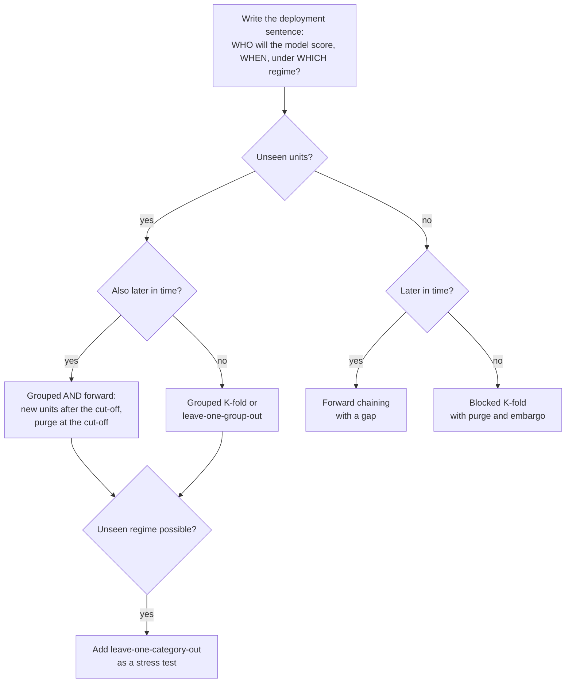
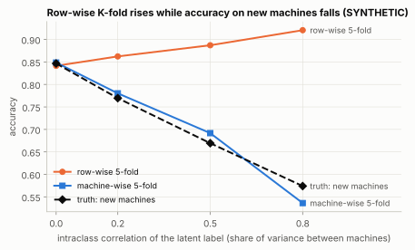
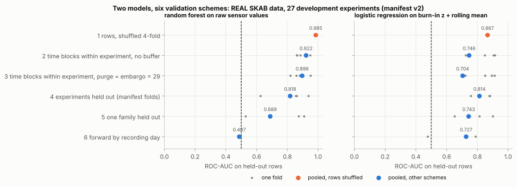

# H6.3 Group-aware and temporal validation

Lesson: [w3d2](../../../labs/w3d2_group_temporal_validation/README.md). Related: [H6.1 Leakage](h6_1_leakage_taxonomy.md),
[H7.2 Purging and embargo](../ch07_timeseries_grouped_modeling/h7_2_purging_and_embargo.md),
[H6.4 Selection and nested validation](h6_4_selection_and_nested_validation.md).

## H6.3.1 Overview

A validation scheme is an **estimator**: it produces a number meant to predict performance in
deployment. Which deployment is the first decision, and it determines the scheme. The common answers are
new units (patients, machines, customers), the future of known units, a regime never seen, and the
combination "new units, later". Row-wise K-fold answers none of them when rows are dependent; it answers
"new rows from recordings already seen", which deployment never asks.

## H6.3.2 Choosing a scheme from the deployment sentence



| Deployment question | Must be unseen | Scheme | scikit-learn |
|---|---|---|---|
| New units, same population | whole groups | grouped K-fold; leave-one-group-out for few groups | `GroupKFold`, `StratifiedGroupKFold`, `LeaveOneGroupOut` |
| Future of known units | later time | forward chaining (expanding or rolling origin) with a gap | `TimeSeriesSplit(gap=..., max_train_size=...)` |
| Another stretch of a known unit, not forecasting | a contiguous block plus a buffer | blocked K-fold with purge and embargo | none built in (H7.2) |
| A regime never seen | a whole category of units | leave-one-category-out | `LeaveOneGroupOut` with the category as group |
| New units, later | both | grouped and forward together | none built in; compose masks |

## H6.3.3 Why dependence breaks i.i.d. K-fold

**Optimism of the point estimate.** Let the outcome depend on a group effect $$u_g$$ (variance
$$\sigma_u^2$$) and on everything else (variance $$\sigma_e^2$$). The intraclass correlation

$$\rho = \frac{\sigma_u^2}{\sigma_u^2 + \sigma_e^2}$$

measures how much of the variation is "which group". Under a row split, a flexible model can recover
$$u_g$$ from the group's training rows; on a new group it cannot. The optimism grows with $$\rho$$ and with
the model's ability to identify groups (raw sensor offsets, device fingerprints, a patient's anatomy).
More rows per group do not help: they make identification easier.



*SYNTHETIC (lesson w3d2, `example/group_dependence.py`): 20 machines x 100 rows, random forest, truth
measured on 300 unseen machines.*

**Overconfidence of the interval.** With $$G$$ groups of $$m$$ rows and within-group correlation $$\rho_e$$ of
the per-row error, the variance of a row-averaged metric is inflated by the design effect

$$\mathrm{deff} = 1 + (m-1)\rho_e, \qquad n_{\mathrm{eff}} = \frac{Gm}{\mathrm{deff}} .$$

For $$m = 1{,}000$$ and $$\rho_e = 0.1$$, deff is about 100. The lesson's simulation matches the formula
(design effect 6.3 measured against 6.0 predicted at $$\rho_e = 0.05$$, $$m = 100$$; 20.5 against 20.8 at
$$\rho_e = 0.2$$). Intervals must resample groups, not rows (H6.6).

**Few groups.** With $$G$$ validated groups and between-group standard deviation $$s$$ of the per-group
metric, the standard error of the mean is about $$s/\sqrt{G}$$. No scheme creates independent groups that
the data do not contain.

## H6.3.4 Temporal schemes

* **Expanding origin** (`TimeSeriesSplit`): fold $$k$$ trains on blocks $$0..k$$, validates on block $$k+1$$.
  Early folds train on little data and are pessimistic for the final model.
* **Rolling origin** (`max_train_size`): fixed-length training window; use when old data stop being
  representative (concept drift, policy change).
* **Gap:** rows between training and validation dropped because their labels or features reach across
  the boundary (H7.2). The scikit-learn guide notes that `TimeSeriesSplit` assumes samples observed at
  fixed time intervals, so that folds represent equal durations; irregular sampling or several
  interleaved series require building the folds from timestamps yourself.
* **Seasonality:** a validation period must contain the conditions deployment will meet. A summer-only
  validation of a demand model says little about winter peaks.

## H6.3.5 The same model under six schemes: the project



*Real SKAB data, 27 development experiments of manifest v2. Large dots: pooled ROC-AUC; small dots:
per fold.* For the random forest on raw sensors: rows shuffled 0.985, time blocks 0.922 (0.896 with a
29-row buffer), experiments held out 0.818, one family held out 0.689, forward by recording day 0.487.
For the burn-in-normalised logistic regression the row-to-experiment gap is only 0.05 (0.867 to 0.814),
because normalising each experiment by its own first rows removes much of what identifies it. Reading
such a table:

* 1 versus 4 measures group leakage for that model;
* 4 versus 5 measures dependence on the regime, here confounded with recording day;
* the spread of per-fold values measures how little 27 experiments can resolve;
* pooled metrics combine scores from differently trained models and can fall below every fold's value
  when folds have different class balance. Prefer per-fold summaries or calibrate before pooling.

## H6.3.6 Practical decisions and tradeoffs

* **Frozen folds in a manifest** make every comparison paired and keep overlap groups together.
  Re-drawing folds adds variance you then have to average away.
* **K for few groups.** With fewer than about 20 groups, leave-one-group-out uses the data best but
  gives noisy, sometimes undefined per-fold metrics (one class only). With more, 4-10 folds suffice.
* **Stratify by category** when categories have very different difficulty or prevalence, so that each
  fold is a comparable mixture. With few groups, stratification is approximate.
* **Report the scheme with the number.** "ROC-AUC 0.82 on held-out experiments (4 folds, 27
  experiments)" is a result; "ROC-AUC 0.82" is not.
* **Do not choose the scheme by its number.** Choose it from the deployment sentence before running it.

## H6.3.7 Common failure modes

* Grouping by the wrong variable: by patient when the device or the hospital is what varies in deployment.
* Nested groupings ignored: sessions within subjects within sites, and only sessions grouped.
* `shuffle=True` in a temporal split.
* `TimeSeriesSplit` on a table that interleaves many units: "blocks" then mix units at the same time.
* Validating on a period whose labels were not yet observable at the training cut-off (label delay).
* Treating repeated `GroupShuffleSplit` draws as independent estimates.
* Comparing schemes as if they were ranked by "conservativeness".

## H6.3.8 Quick reference

```text
deployment sentence -> what is unseen -> scheme
  new units                -> GroupKFold / LeaveOneGroupOut (folds by unit, frozen in a manifest)
  future of known units    -> forward chaining, gap = purge (H7.2)
  new units, later         -> both masks at once; report known and new separately
  unseen regime            -> leave-one-category-out, as a stress test
design effect              deff = 1 + (m - 1) * rho_e ;  n_eff = n / deff
few groups                 SE ~ s / sqrt(G): differences below ~2 SE are not resolvable
```

## H6.3.9 Sources and verification status

| Source | Used for | Status |
|---|---|---|
| scikit-learn user guide, "Cross-validation: evaluating estimator performance" (`doc/modules/cross_validation.rst`, scikit-learn GitHub repository, main branch, read 2026-11-22): sections on grouped data, `GroupKFold`, `StratifiedGroupKFold`, `TimeSeriesSplit` | splitter behaviour; fixed-interval assumption of `TimeSeriesSplit`; `gap` and `max_train_size` parameters | opened and read |
| Kish, L. (1965), *Survey Sampling* | design effect $$1 + (m-1)\rho$$ | from memory, not re-opened; the formula was checked by simulation in the lesson |
| Roberts, D. R. et al. (2017), "Cross-validation strategies for data with temporal, spatial, hierarchical, or phylogenetic structure", *Ecography* | blocking and grouping as general remedies for dependent data | from memory, not re-opened |
| Bergmeir, C., Hyndman, R. J., Koo, B. (2018), "A note on the validity of cross-validation for evaluating autoregressive time series prediction", *Computational Statistics & Data Analysis* | when blocked K-fold is acceptable for time series | from memory, not re-opened |
| Lesson w3d2 scripts (`group_dependence.py`, `compare_schemes.py`) | all numbers and figures in this section | executed 2026-11-22, Python 3.13.18, scikit-learn 1.9.1 |
