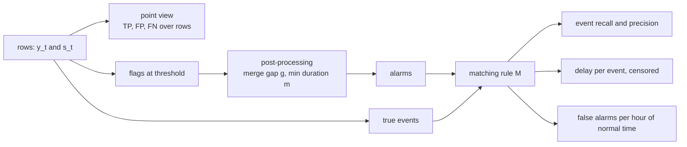
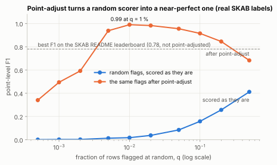
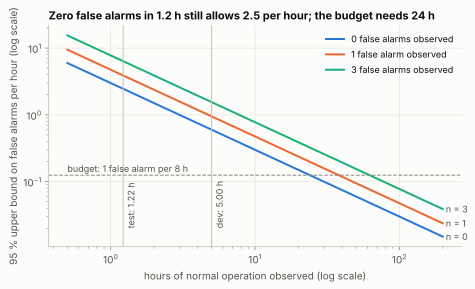

# H6.5 Point-level versus event-level evaluation

Status: Reviewed (author's check against own executed runs; see 6.5.9). Lesson: [w3d4](../../../labs/w3d4_point_vs_event_evaluation/README.md).
Companion section: [H7.3 Event matching](../ch07_timeseries_grouped_modeling/h7_3_event_matching.md).

## 6.5.1 Overview

A detector produces a score per time step. Its consumer acts on *alarms*. Point-level metrics
(precision, recall, F1, PR-AUC computed over rows) evaluate the scores as a classifier of rows.
Event-level metrics evaluate the alarms as a sequence of decisions: which faults were announced, how
late, and how many announcements were wrong. When anomalies are contiguous segments, the two can rank
detectors differently, and only the event view corresponds to what the operator experiences. This
section defines both, shows where the point view misleads, explains why the popular "point-adjust"
protocol is uninformative, and gives a reporting standard.

## 6.5.2 The two views, formally

Let `y_t ∈ {0,1}` be labels and `ŷ_t = 1[s_t ≥ τ]` flags for rows `t = 1..N`.

Point view:

* `TP = Σ y_t ŷ_t`, `FP = Σ (1-y_t) ŷ_t`, `FN = Σ y_t (1-ŷ_t)`
* `P = TP/(TP+FP)`, `R = TP/(TP+FN)`, `F1 = 2PR/(P+R)`; PR-AUC integrates P over R as τ varies.

Event view. True events `E = {(a_k, b_k)}` are the maximal runs of `y = 1` (half-open). Alarms
`A = {(c_j, d_j)}` are the runs of `ŷ = 1` after post-processing (merge gaps ≤ g, drop runs shorter
than m). A matching rule `M` (H7.3) labels each alarm *hit*, *redundant* or *false alarm* and gives each
event at most one hit with raise time `r_k`. Then

* event recall `R_E = |{k : event k has a hit}| / |E|`
* event precision `P_E = hits / (hits + false alarms)` (redundant alarms excluded)
* delay `δ_k = max(0, time(r_k) − time(a_k))`, and `δ_k = ∞` if missed; summarise by the median and an
  upper percentile over all `k`
* false-alarm rate `λ̂ = FA / H`, where `H` is hours of normal operation computed from timestamps.



## 6.5.3 How the point view misleads

Point recall is a length-weighted event recall: `R = Σ_k |covered rows of k| / Σ_k |k|`. Three
consequences:

1. **Length weighting.** One long event dominates. In the w3d4 toy recording one event holds 82 % of
   anomalous rows; finding only it gives point recall 0.82 and event recall 0.10.
2. **Timing blindness.** Covering the last 80 % of every event (late) beats covering the first five rows
   of every event (early) on F1: 0.89 against 0.07 in the toy. For alarms the early detector is better.
3. **Fragmentation blindness.** Flags on every other row of an event keep point precision at 1.0 and
   produce hundreds of alarms. On real SKAB a single-sensor z-score has point precision 0.840 on the test
   experiments and raises 469 alarms (290 false) for seven faults.

Ranking reversals follow. On the seven SKAB test experiments of the frozen w3d1 manifest, elapsed time
with no sensor input has the highest point F1 in the table (0.842) but finds 3/7 events, against 7/7 for
the single-sensor z-score (0.826); and after the same post-processing, Mahalanobis, last of the sensor
detectors on point F1 (0.729), finds the most events (5/7) with the fewest false alarms (lesson w3d4,
run 2026-11-22). With seven events no close ordering is established; the point is that point F1 does
not predict the event ordering.

## 6.5.4 Point-adjust

Point-adjust replaces `ŷ` by `ŷ'` where every row of event `k` is set to 1 if any row of `k` is flagged,
then computes point metrics on `ŷ'`. For an event of length `L` and a detector that flags each row
independently with probability `q`, the event is "fully detected" with probability `1 − (1−q)^L`. For
`L = 400, q = 0.01` that is 0.98. Every row of the event then counts as a true positive, so a random
detector achieves near-perfect recall at almost no cost in precision.



*Random flags on the real SKAB labels (34 experiments).* Raw F1 stays near zero; point-adjusted F1 peaks
near 0.98-0.99 at 1 % of rows flagged, above the best non-adjusted F1 on the SKAB leaderboard (0.78).

Rule: never report point-adjusted metrics. If a paper does, ask for the score of a random detector with
the same flag rate under the same protocol.

## 6.5.5 Exposure and false alarms

False alarms are counts over an exposure `H`. Under a Poisson model with constant rate λ, the exact
one-sided `1−α` upper bound for `n` observed false alarms is

`λ_U = χ²_{1−α}(2(n+1)) / (2H)`,

which for `n = 0` reduces to `−ln α / H ≈ 3/H` at 95 %. Consequences for small benchmarks:

| normal hours `H` | zero false alarms: 95 % upper bound per hour | budget it can certify |
|---|---|---|
| 1.22 (SKAB test) | 2.46 | none tighter than ~2.5 per hour |
| 5.00 (SKAB dev) | 0.60 | ~1 per 1.7 h |
| 24 | 0.125 | 1 per 8 h |



*Analytical (no data); the marked exposures are the measured normal hours of the frozen v2 split.
Regenerate with `python handbook/figures/h6_5/make_figures.py`.*

(Rows 1-2 from w3d4's runs; row 3 from the formula.) The constant-rate assumption is itself
optimistic: on SKAB the same operating point raised 0 false alarms in 4.59 dev hours and 4 in the 2.74 h
fault-free recording, a different operating regime.

## 6.5.6 Practical decisions and tradeoffs

| Decision | Options | Recommendation |
|---|---|---|
| Primary metric family | point / event | event metrics for alarms; point PR-AUC as a secondary threshold-free ranking |
| What to report per protocol | recall only; recall + FA rate; full set | events found (k/n), false alarms and hours, median delay over all events, each with intervals |
| Delay summary | mean of detected; median of all | median of all, missed = ∞; add p90 only with enough events |
| Hours | rows × nominal period; wall clock; capped gaps | wall clock from timestamps; state the gap policy |
| Post-processing | none; fixed; tuned | tuned on dev with the threshold, reported as part of the detector |
| Operating point | best F1; alert budget | from the consumer's budget, using the upper bound, on dev |

The fundamental tradeoff is recall and delay against false-alarm rate; plot it (w3d4, figure 4) and pick
from it, rather than summarising it in one number. NAB-style scores (Numenta Anomaly Benchmark: weighted
rewards for early detection within a window, penalties for false positives, with application profiles)
collapse the tradeoff into one number with stated weights; they are useful for leaderboards and hide the
operating point from the consumer.

## 6.5.7 Common failure modes

* Reporting point F1 or point-adjusted F1 as detection quality.
* Delay averaged over detected events only (censoring ignored).
* False-alarm rate without its exposure, or exposure computed from row counts across logging gaps.
* Post-processing or matching tolerance tuned after seeing test results.
* Event recall used to argue "no leakage": the SKAB clock detector finds 3/7 test events within 14 s (7/7 under any-overlap).
* p90 delay quoted from seven events (it is the worst case).

## 6.5.8 Quick reference

```text
events  = runs of 1s, half-open (start, end)
alarms  = runs of flags -> merge gaps <= g -> drop runs < m rows   (merge, then filter)
match   = start-based (H7.3); first hit per event, later ones redundant
recall_E = detected / events          precision_E = hits / (hits + FA)
delay_k  = max(0, t(raise_k) - t(onset_k)),  inf if missed;  raise = alarm start + (m - 1) rows
FA rate  = FA / normal hours (timestamps);  95 % upper bound = chi2.ppf(.95, 2(n+1)) / (2H);  n=0: 3/H
never:   point-adjust; mean delay of detected only; hours from rows
```

## 6.5.9 Sources and verification status

* All SKAB numbers: executed in lesson w3d4 (`event_table.py`, `point_adjust_random.py`,
  `budget_report.py`) on 2026-11-22, SKAB commit `b2c0d46`.
* SKAB leaderboard F1 0.78: read from the SKAB README at the pinned commit.
* Poisson exact bound and the rule of three: standard results (Garwood intervals); the formula was
  checked numerically against `scipy.stats.chi2` in the lesson's challenge checks. Textbook reference not
  re-opened this session.
* Point-adjust critique: Kim, S. et al. (2022), "Towards a Rigorous Evaluation of Time-Series Anomaly
  Detection", AAAI. **From memory, not re-opened.**
* NAB: Lavin, A. & Ahmad, S. (2015), "Evaluating Real-time Anomaly Detection Algorithms - the Numenta
  Anomaly Benchmark". **From memory, not re-opened;** the description above is deliberately general.
