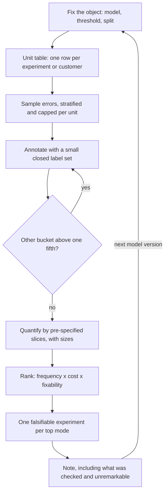
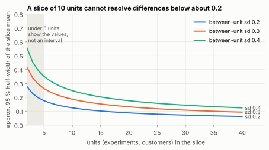
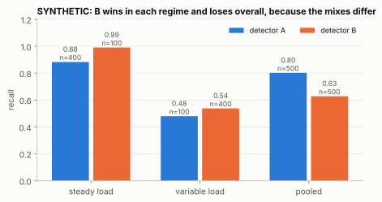

# H6.7 Error analysis

Status: Reviewed (see H6.7.9 for what was executed and what is from memory).
Used by: [w3d6](../../../labs/w3d6_error_analysis_transfer/README.md).
Related: [H6.2 thresholds, imbalance, calibration](h6_2_thresholds_imbalance_calibration.md),
[H5.2 metrics from decisions](../ch05_classical_ml_baselines/h5_2_metrics_from_decisions.md),
[H1.2 units, labels, costs](../ch01_problem_formulation/h1_2_units_labels_costs_constraints.md).
[H6.6 bootstrap and paired comparisons](h6_6_bootstrap_and_paired_comparisons.md). H6.5 (point versus
event evaluation) is being written; the parts needed here are restated.

## H6.7.1 Overview

An aggregate metric tells you how much is wrong. Error analysis tells you *what* is wrong, in a form
that selects the next piece of work. Its output is a short ranked list of failure modes, each with a
size, a suspected cause and a proposed experiment, plus an explicit list of what was looked at and
found unremarkable.

Three properties separate it from looking at bad examples:

1. **It generates hypotheses and does not confirm them.** Anything found by searching the errors of
   one model on one dataset is a candidate. It becomes a finding when it survives data that played no
   part in finding it.
2. **It is quantified.** "The model struggles on the `other` family" is an impression. "Mean recall
   0.64 over 10 experiments (range 0.01-0.99) against 0.68 over 12" is a statement someone can check,
   and in this case it says the impression is not supported.
3. **It runs on development data.** Once you have read test errors and changed the model, the test
   set has been used for model selection and its number is optimistic by an unknown amount.

## H6.7.2 The workflow



**Step 0. Fix the object of study.** One model, one threshold, one dataset split, written down. Error
analysis of a moving target produces a list that describes no system.

**Step 1. Build the unit table.** One row per independent unit (experiment, customer, machine,
recording, subject) with counts and the metrics you care about. Everything later is a group-by on
this table. The unit is the one you split by, for the same reason: rows within a unit are not
independent evidence.

**Step 2. Sample errors systematically.** Take a random sample of errors, stratified so that rare
kinds are represented (false positives and false negatives separately; each unit capped so one bad
unit does not fill the sample). Fifty to a hundred annotated cases usually stabilise the ranking of
the top categories. Do not start from the worst-scoring examples: they over-represent label errors
and corrupted inputs, and they tell you about the tail, not the mass.

**Step 3. Annotate with a small closed label set.** Five to eight categories, written before you
start, with an "other/unclear" bucket and a rule that any case may be revisited. Typical sets:

| Detector on a time series | Classifier on a business table |
|---|---|
| missed event | label wrong or ambiguous |
| late detection | feature missing or stale at prediction time |
| alarm before onset | population the model never saw (new product, new region) |
| fragmented alarm (drops out mid-event) | behaviour changed after training period |
| boundary disagreement (a few rows at onset/end) | correct given inputs; outcome was unpredictable |
| alarm with no event (artefact, regime change) | data-quality defect in input |

If the "other" bucket exceeds about a fifth, the categories are wrong; revise them and re-annotate.

**Step 4. Quantify by slice.** For each candidate explanation, define the slice by a rule that can be
computed without looking at model output, and report the metric per slice **with its size**.

**Step 5. Rank.** For each failure mode estimate

$$\text{priority} \;\propto\; \underbrace{\text{frequency}}_{\text{share of errors}} \times \underbrace{\text{cost}}_{\text{per error, in the decision's units}} \times \underbrace{\text{fixability}}_{P(\text{a known change removes it})}$$

The three factors are rough, and writing them down is the point: it stops the most *interesting*
failure from winning over the most *expensive* one. Frequency also gives a ceiling: if a mode is 12 %
of the errors, eliminating it entirely moves the error count by at most 12 %.

**Step 6. Choose one experiment per top mode,** stated so that it can fail: the change, the metric
expected to move, the direction, and what result would mean the hypothesis was wrong.

**Step 7. Write the note** (H6.7.6).

## H6.7.3 Slices and their arithmetic

### Unit-level versus row-pooled metrics

For a slice $$S$$ containing units $$u$$ with $$n_u$$ rows and per-unit metric $$m_u$$:

$$\bar m_S = \frac{1}{|S|}\sum_{u \in S} m_u \qquad\text{versus}\qquad m^{\text{pooled}}_S = \frac{\sum_u \text{TP}_u}{\sum_u (\text{TP}_u + \text{FN}_u)}$$

The pooled form weights each unit by its number of positive rows. One long, easy recording can then
hide several short failed ones. In the planted example of the w3d6 checks, a slice has one experiment
with 600 anomalous rows all detected and three with 30 anomalous rows all missed: pooled recall is
$$600/690 = 0.87$$, the mean over experiments is $$0.25$$, and three of four experiments failed.
Neither number is "the" recall; they answer different questions (what fraction of anomalous *time* is
flagged, versus how a *typical experiment* fares). For error analysis the unit mean is the default,
because the question is which units fail. Report both when they disagree; the disagreement is itself
a finding about heterogeneity.

### Undefined is not zero

Recall is undefined for a unit with no positives; precision is undefined when nothing is flagged.
scikit-learn's `zero_division` argument defaults to a warning that acts like 0, and also accepts 0, 1
or `np.nan`. In a unit table 0 invents a failure and 1 invents a success, and both enter slice means.
Keep `NaN`, report
`n_defined` next to `n_units`, and let an empty slice show as empty.

### Uncertainty of a slice metric

With $$k$$ units in a slice and between-unit standard deviation $$s$$, the standard error of the slice
mean is about $$s/\sqrt{k}$$. Per-experiment recalls in a detection problem commonly have $s \approx
0.3$. Then:

| units in slice | standard error | approximate 95 % half-width |
|---|---|---|
| 3 | 0.17 | not worth computing; show the values |
| 5 | 0.13 | 0.26 |
| 10 | 0.09 | 0.19 |
| 25 | 0.06 | 0.12 |



*Arithmetic, no data: $$1.96\,s/\sqrt{k}$$. Read off the half-width for your slice size before
interpreting any slice difference.*

A difference of 0.05 between two slices of 10 units is noise. The practical rule used in the lab:
with fewer than five units print the minimum and maximum instead of an interval; from five upward
use a percentile bootstrap **resampling units** (not rows). Resampling rows treats 400 correlated
samples from one experiment as 400 independent observations and produces intervals that are too
narrow by a factor of roughly $$\sqrt{1 + (\bar n - 1)\rho}$$, where $$\rho$$ is the within-unit
correlation of the per-row outcome (the design effect; Kish's formula, cited from memory).

### Simpson's paradox

A comparison can reverse when a slicing variable is ignored. In the worked example of w3d6 detector
B has higher recall than A in both operating regimes (0.990 vs 0.882 and 0.537 vs 0.480) and lower
recall overall (0.628 vs 0.802), because B was evaluated mostly on the hard regime (400 of 500
events) and A mostly on the easy one. Standardising both to the same regime mix gives B 0.764, A
0.681.



*SYNTHETIC counts from `slice_traps.py`. Look at the `n` under each bar: the pooled bars compare
different mixes of easy and hard events.*

Consequences:

* Never compare two models on different evaluation sets, however similar they look.
* When a pooled comparison and every within-slice comparison disagree, the mix differs. Report the
  within-slice results and a standardised overall figure, with the mix you standardised to.
* The paradox is not resolved by arithmetic alone. Which table to believe depends on whether the
  slicing variable is something the deployment will also see in that mix.

### Slice hunting is multiple testing

If you examine $$m$$ slices and there is no real slice effect, the smallest of the $$m$$ slice metrics
is still well below average. With 24 machines of identical true recall 0.80 and 40 arbitrary binary
attributes, the w3d6 example found a "worst slice" at 0.729 against an overall 0.804; repeating the
whole search 2,000 times on data with no effect gave a median minimum of 0.733, so the observed
minimum is typical of nothing happening. Three defences, in order of strength:

1. **Pre-specify** the slices you will examine and why, before computing anything. A handful of
   slices chosen from domain knowledge is not a search.
2. **Calibrate the search**: simulate or permute to get the distribution of the minimum under no
   effect, as the example does. A permutation version shuffles the unit-to-slice assignment.
3. **Confirm on held-out units.** Split the development units in two, hunt on one half, test the
   single best candidate on the other. This is the only defence that also covers flexible,
   after-the-fact slice definitions.

A Bonferroni-style correction ($$\alpha/m$$) is available but assumes you know $$m$$; in exploratory
slicing the real number of comparisons includes those you tried and discarded.

## H6.7.4 Label noise versus model error

Some errors belong to the labels. Signs: the same input appears with different labels; errors
concentrate within a few rows of label boundaries; high-confidence "errors" look correct on
inspection; annotators or sources disagree systematically.

SKAB gives a clean instance. 235 distinct measurements (identical timestamp and all eight sensor
values) occur in two files with opposite `anomaly` labels (`other/12` versus `other/13`: 178;
`other/3` versus `other/4`: 57). Any detector that is a function of the sensor values alone is wrong
on exactly one copy of each. That is an **irreducible** error of 235 rows on those four experiments,
and no modelling work should be aimed at it.

What to do with label noise:

* **Measure it** where you can (duplicates, double annotation, a small relabelled sample), and state
  the implied ceiling on the metric.
* **Do not silently delete** contradictory rows from evaluation; that changes the benchmark. Report
  the metric with and without them.
* **Tolerant matching at boundaries.** If onset times are uncertain by a few seconds, scoring a
  detection 3 rows early as a false alarm punishes the model for the annotator's rounding. Event-level
  metrics with a tolerance window (H6.5) are the principled fix; in point-level analysis,
  classify short edge-touching error runs separately as *boundary* errors so they are not mixed with
  genuine misses and false alarms.

A caution in the other direction: "the labels are noisy" is also the most comfortable explanation
for a weak model. Require evidence of noise that does not come from the model's own disagreements.

## H6.7.5 Error types for detectors

Point-level counts (FN, FP) erase the temporal structure of errors. Group consecutive wrong rows
into segments and classify each relative to the labelled event:

```
labels   0 0 0 0 0 0 1 1 1 1 1 1 1 1 1 1 0 0 0 0 0
flags    0 1 1 0 0 0 0 0 1 1 0 0 1 1 1 1 1 0 0 1 1
           ^^^           ^^^     ^^^         ^     ^^^
        pre-onset     boundary  fragment  boundary post-event
                      or late             (lingering)
```

| Kind | Definition | Usual cause | Usual remedy |
|---|---|---|---|
| miss | no row of the event is flagged | signal absent from the features | different sensor or feature; not a threshold problem |
| late | first flag more than a tolerance after onset | slow statistic, long window, high threshold | shorter window, change-sensitive feature, lower threshold with persistence |
| boundary | short run at the event's edge | label timing uncertainty, filter delay | tolerance in evaluation; nothing in the model |
| fragment | alarm drops out after first detection | per-sample threshold on a noisy score | hysteresis (two thresholds), minimum hold time, smoothing |
| pre-onset | alarm before the event | regime drift, start-up transient, or a genuine precursor | better normalisation; check whether it is a precursor before "fixing" it |
| post-event | alarm after the event | slow recovery, reference no longer valid | re-baselining after events |
| false alarm | alarm in a recording with no event | artefact, sensor fault, unmodelled operating mode | input validation, mode-aware reference |

Two observations follow from the table. Remedies conflict: smoothing removes fragments and adds
delay, so the fragment/late balance is a design parameter and belongs in the decision memo. And the
operational cost differs by kind: one fragmented event produces many alert notifications from a
single fault, which is an alert-fatigue problem and not a detection problem.

Parallels in EEG/iEEG work are direct. Per-subject accuracy tables are unit tables. Channel- or
montage-wise breakdowns are slices. Muscle and movement artefacts producing high-frequency power
are the "alarm with no event" category, and the standard question "is this detector finding HFOs or
finding sharp artefacts?" is error analysis by annotation. Where the analogy breaks: in research the
annotated event is usually treated as ground truth, while maintenance-log labels in industry are
often late, coarse and written for a different purpose.

## H6.7.6 Reporting without plots, and the note

A residual plot is a table read quickly. Where plotting is unavailable or the result must go into a
text review, three tables carry most of the information:

1. the unit table sorted by the metric, worst first, with onset, delay and a covariate or two;
2. slice tables with sizes and ranges;
3. the failure-kind frequency table (segments, rows, units affected) and the dozen largest segments.

A text "strip" per unit (one character per fixed number of rows: `.` correct, `m` missed, `f` false
alarm) is a serviceable substitute for a time plot.

The error-analysis note fits on one page:

| Section | Content |
|---|---|
| Object | model, threshold, data split, date, commit |
| Headline | the metric and its unit-level spread |
| Failure modes, ranked | for each: definition, size (segments / rows / units), evidence, suspected cause, cost, fixability |
| Checked and unremarkable | slices examined that showed nothing, with sizes |
| Label issues | what is known about label noise and the ceiling it implies |
| Next experiments | one per top mode, each falsifiable |
| Limits | what was not examined; which claims rest on few units; what would change the ranking |

"Checked and unremarkable" is the section most often omitted and the one a reviewer trusts most: it
shows the search was wider than the findings and gives the number of comparisons.

## H6.7.7 Practical decisions and common failure modes

| Decision | Options | Guidance |
|---|---|---|
| Which data | development / validation / test | development or out-of-fold predictions. Test only for a final, non-iterated description |
| Which threshold | tuned on the analysed data / out-of-fold | a single tuned threshold is a mild optimism; say so. For many parameters use out-of-fold scores |
| Unit of the table | row / event / experiment / customer | the unit you split by |
| How many slices | few pre-specified / broad search | pre-specify; if you search, calibrate the minimum or confirm on held-out units |
| Slices defined using labels | allowed? | as explanation of past errors, yes; they cannot be used at prediction time and should be marked |
| Annotation sample | worst cases / random stratified | random stratified, capped per unit |

Failure modes of the analysis itself:

* **Storytelling.** A plausible cause attached to a slice difference that is within noise.
* **Iterating on test.** Each look is cheap; the cumulative effect is a tuned test set.
* **Pooled metrics hiding units,** and its mirror image, a unit mean dominated by tiny units with
  two positives each. Report sizes and both figures.
* **Zero-filled undefined metrics** entering means.
* **Fixing the interesting error.** The largest category is often dull (a threshold artefact).
* **Treating a slice found post hoc as a feature.** If a slice is predictive, the model will usually
  use it once it is an input; the question is whether it is available and stable at prediction time.
* **Aggregating away the decision.** Analysing point errors when the cost is per event or per alert.

## H6.7.8 Quick reference

```python
# unit table -> slices -> segments   (flowguard.erroranalysis, w3d6)
table = per_experiment_table(scores, labels, threshold, tidy, burn_in=100)
table = table.merge(unit_attributes, on="experiment_id")       # slicing columns, computed without scores
slice_metrics(table, by="family", metric="recall")             # value = mean over experiments; n always shown
segments = error_segments(scores, labels, threshold, tidy, late_after=30, burn_in=100)
summarise_segments(segments)                                    # kind, n_segments, n_rows, n_experiments
```

* Unit mean versus pooled: $$\frac{1}{|S|}\sum m_u$$ versus $$\sum \text{TP}_u / \sum(\text{TP}_u+\text{FN}_u)$$. Report sizes with either.
* Standard error of a slice mean: $$s/\sqrt{k}$$ with $$k$$ units. Under five units: show values.
* Minimum of $$m$$ slice metrics under no effect is low by construction: simulate it or hold units out.
* Priority $$\propto$$ frequency $$\times$$ cost $$\times$$ fixability; frequency caps the possible gain.
* Undefined stays `NaN`; empty slices are shown as empty.
* Analyse development data. The test set is described once, at the end.

## H6.7.9 Sources and verification status

Executed in the authoring session (2026-11-21; Python 3.13.18, NumPy 2.5.3, pandas 3.0.5):

* All SKAB figures: `labs/w3d6_error_analysis_transfer/example/label_conflicts_skab.py` and
  `solutions/labs/w3d6_error_analysis_transfer/lab/error_report.py` on SKAB v0.9 at commit `b2c0d46`.
* The Simpson's-paradox and slice-hunting figures: `labs/w3d6_error_analysis_transfer/example/slice_traps.py`
  (synthetic; they show the arithmetic only).
* The pooled-versus-mean example: the planted frames in `labs/w3d6_error_analysis_transfer/checks/test_slice_metrics.py`.
* Figures: `handbook/figures/h6_7/make_figures.py` regenerates both SVGs; the Simpson figure uses the
  same random draw as the lesson example.
* The standard-error table is arithmetic from $$s = 0.3$$; the half-width column is $$1.96\,s/\sqrt{k}$$
  and ignores the heavier tails appropriate for small $$k$$.

Sources opened this session: the installed docstring of `sklearn.metrics.precision_recall_fscore_support`
(for the `zero_division` behaviour, scikit-learn 1.9.1).

From memory, not re-verified this session (rendered documentation and publisher sites were not reachable):

* Simpson, E. H. (1951), "The interpretation of interaction in contingency tables", *JRSS B*. The
  paradox itself is elementary and is reproduced numerically above.
* Kish, L. (1965), *Survey Sampling*, for the design effect $$1 + (\bar n - 1)\rho$$.
* The practice of annotating a sample of development-set errors into categories and ranking by share
  is described in Andrew Ng's *Machine Learning Yearning* (draft, 2018); the frequency $$\times$$ cost
  $$\times$$ fixability product is this handbook's formulation, not a quotation.
* Tolerance-window event matching is standard in anomaly-detection and seizure/HFO-detection
  evaluation; specific references are deferred to H6.5.
