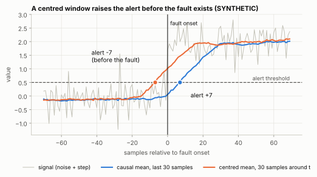
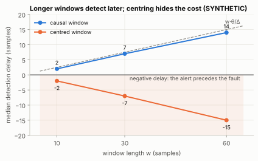

# H7.1 Windowing and causality

**Status:** Reviewed (numerical claims executed; sources listed in H7.1.8) · **Used by:** [w2d5](../../../labs/w2d5_feature_pipeline/README.md)
**Related:** [H3.4 Deterministic feature pipelines](../ch03_sql_data_pipelines/h3_4_deterministic_feature_pipelines.md)

## H7.1.1 Overview

Almost every model of a time series is fed *windows*: summaries of a recent stretch of the
signal. Two properties of a window decide whether a model evaluated offline corresponds to
anything that can run online.

1. **Causality.** The summary used at time *t* depends only on samples at or before *t*.
2. **Group integrity.** The window contains samples from one independent unit only (one
   machine, one experiment, one patient, one session) and from one continuous stretch of time.

Violating the first is temporal leakage; violating the second is group leakage. Both produce
optimistic offline results, and both are invisible in a plot of the feature. This section
gives the definitions, the arithmetic of the delay–noise tradeoff, the boundary cases, and a
test that turns causality from an intention into a checked property.

## H7.1.2 Windows as filters

A rolling statistic is a filter applied to the series. For the rolling mean of length *w*,

```
y[t] = (1/w) · Σ_{k=0}^{w-1} x[t-k]                       trailing (causal)
y[t] = (1/w) · Σ_{k=-(w-1)/2}^{(w-1)/2} x[t-k]            centred (non-causal, w odd)
```

Three facts about the trailing mean organise most practical decisions.

**Delay.** It is a symmetric FIR filter, so it delays every frequency component by the same
amount, `(w−1)/2` samples. A centred mean is the same filter advanced by `(w−1)/2`: zero delay,
bought by reading `(w−1)/2` future samples. Forward-backward ("zero-phase") filtering, as in
`scipy.signal.filtfilt`, achieves zero phase the same way: by running over the signal in both
directions, which requires the whole signal.

**Noise suppression.** For uncorrelated noise of variance σ², `Var(y) = σ²/w`. For stationary
noise with autocorrelation ρ(k),

```
Var(y) = (σ²/w) · [ 1 + 2 Σ_{k=1}^{w-1} (1 − k/w) ρ(k) ]
```

For AR(1) noise, ρ(k) = φ^k, and for *w* large relative to the correlation length the bracket
tends to `(1+φ)/(1−φ)`. The window contains about `w(1−φ)/(1+φ)` effective independent
samples. With φ = 0.9 that is `w/19`. A simulation in the w2d5 worked example gives rolling-mean
standard deviations of 0.853, 0.667, 0.517 for *w* = 10, 30, 60 on unit-variance AR(1) noise,
against 0.316, 0.183, 0.129 predicted by `1/√w`.

**Response to a step.** After a step of height Δ at *t₀*, the trailing mean rises linearly and
reaches Δ after *w* samples: `E[y[t₀+k]] = Δ·(k+1)/w` for `0 ≤ k < w`. With an alert threshold θ,

```
expected detection delay ≈ w · θ/Δ     samples
```

The same simulation gives median delays of 2, 7, 14 samples for *w* = 10, 30, 60 at θ = Δ/4
(predicted 2.5, 7.5, 15), and −2, −7, −15 for the centred mean: the predicted values minus `w/2`.

Putting the last two together: for white noise, halving the false-alert threshold in noise
units requires four times the window and therefore four times the delay. Under positive
autocorrelation the exchange rate is worse, because the delay still grows with *w* while the
noise falls more slowly.

### Other window statistics

| Statistic | Detects | Noise behaviour (white noise) | Note |
|---|---|---|---|
| Mean | level shifts | variance σ²/w | least noisy; slowest to see short events |
| Standard deviation | variance changes, intermittent bursts | relative s.d. ≈ 1/√(2(w−1)) for Gaussian data | a level shift inside the window also inflates it |
| Min / max, range | spikes, saturation | driven by tails, not reduced by averaging | extreme-value statistics: grow with *w* even without a fault |
| Slope (OLS on index) | drifts | variance 12σ²/(w(w²−1)) | needs long windows; closed form from rolling sums below |
| First difference | abrupt changes | variance 2σ² | amplifies noise; usually smoothed afterwards |
| EWMA, span *s* | level shifts | variance σ²·α/(2−α), α = 2/(s+1) | O(1) state, no hard edge |

**Slope from rolling sums.** With `k = 0..w−1`, `S = Σ x`, `K = Σ k·x` over the window,
`slope = (K − k̄·S) / Σ(k−k̄)²` where `k̄ = (w−1)/2` and `Σ(k−k̄)² = w(w²−1)/12`. `K` for a
trailing window can be obtained from a rolling sum of `position × x` minus
`(position_of_window_start) × S`, which keeps the computation vectorised.

**EWMA and the moving average.** The recursive form `y[t] = α·x[t] + (1−α)·y[t−1]` with
`α = 2/(s+1)` has mean lag `(1−α)/α = (s−1)/2` and white-noise variance `σ²·α/(2−α) = σ²/s`:
the same delay and the same noise suppression as a moving average of length *s* (checked
numerically for *s* = 30: lag 14.5, variance factor 0.0333). The differences are the shape of
the response (geometric approach to a step: fraction `1−(1−α)^k` after *k* samples, never
exactly complete) and the state needed to update it online (one number per signal instead of
a buffer of *w*).

```text
 time →            t-5  t-4  t-3  t-2  t-1   t   t+1  t+2  t+3
 causal, w = 5           [ ■    ■    ■    ■    ■ ]                      uses rows ≤ t: buildable online
 centred, w = 5                    [ ■    ■    ■    ■    ■ ]            uses t+1, t+2: exists only offline
 warm-up (first rows)    fewer than w rows exist → NaN (min_periods = w), never a silently shorter window
 gap or new experiment   ··· ■ ■ ║ ■ ■ ···    the window must not reach across ║ (reset, or define it in seconds)
```



*SYNTHETIC data. A window is a filter; a centred window is the same filter with its output moved into
the past, so its "response" begins before the stimulus.*



*SYNTHETIC data, 400 simulated series per window length. Script:
`labs/w2d5_feature_pipeline/figures/make_figures.py`.*


## H7.1.3 Where non-causal operations hide

Offline code rarely says "use the future". The future arrives through convenient defaults.

| Operation | Why it is non-causal | Causal replacement |
|---|---|---|
| `rolling(w, center=True)` | window extends `w/2` ahead | `rolling(w)` and accept the delay |
| Zero-phase filtering (`filtfilt`, `sosfiltfilt`) | backward pass reads the whole series | single-pass `lfilter`/`sosfilt` with state carried between chunks |
| Whole-recording standardisation or detrending | statistics include later samples | statistics from a calibration period, an expanding window, or training recordings |
| Interpolating missing samples | uses the next valid sample | hold last value, or flag the gap |
| `bfill`, `shift(-k)` | by definition | `ffill`, `shift(+k)` |
| Resampling with a centred or right-labelled bin misread | bin label may refer to its end while containing later samples | be explicit about `label` and `closed`; test by truncation |
| Global decompositions fitted on everything (PCA, ICA, dictionary learning) | basis depends on later data | fit on training period/units, then apply |
| Smoothing the *labels* or scores before evaluation | post-processing that looks ahead | causal debouncing (k-of-n rule over past samples) |

Biomedical signal analysis has direct correspondences. In EEG, for example: zero-phase band-pass
filtering before epoching, ICA fitted on a full session and then used to "clean" that session's test trials, baseline correction with
a post-stimulus interval. Each has an online counterpart with a cost in delay or quality.
Reporting the offline variant is legitimate for offline science; reporting it as the expected
performance of a real-time system is not.

## H7.1.4 Boundaries

### Warm-up

For the first `w−1` samples of a continuous stretch no full trailing window exists.

| Policy | Consequence |
|---|---|
| NaN until full (`min_periods=w`) | honest; a share of rows has no feature; consumers must decide what to do |
| Partial windows (`min_periods=1`) | every row has a value; early values have variance σ²/n with n < w, so thresholds tuned on full windows misfire |
| Partial with variance correction | scale the deviation by √(n/w); more code, always answers |
| Pad with the first value or zeros | invents data; zeros after standardisation mean "exactly normal" |

Whichever is chosen must be identical in training and serving. In pandas, note that integer
windows default to `min_periods = window`, while time-based windows default to `min_periods = 1`.

### Gaps and irregular sampling

A window of *n* rows spans *n* sampling intervals only if sampling is regular. Check
`timestamp.diff()` before choosing a design.

- *Occasional gaps in regular data:* start a new segment when the gap exceeds a tolerance and
  restart the windows. Expose the reset (segment id, rows since reset) so downstream code can
  see it.
- *Irregular sampling:* define windows in time, `(t − w, t]`, and decide separately what "enough
  data" means (minimum count, or minimum age of the segment). Endpoint conventions matter:
  in pandas, offset-based rolling windows are closed on the right by default, so an observation
  exactly *w* old is excluded.
- *Do not* resample to a regular grid with interpolation before computing features unless the
  interpolation itself is causal.

### Units

When a table stacks several recordings, every windowed operation must be computed within a
recording. The failure is silent: a global rolling window produces *fewer* NaNs, which looks
like an improvement. A useful habit is to make the unit key a required argument of feature
functions, so that a call without it does not exist.

## H7.1.5 Testing causality

Causality can be stated as an invariance and tested without knowing what the features mean.

**Perturbation test.** Compute features on a series. Change every input value after index *t*
(add a large constant). Recompute. Features at indices ≤ *t* must be identical, and features
after *t* must have changed (otherwise the test is vacuous).

**Truncation test.** Delete all rows after *t* and recompute. Features at the remaining rows
must be identical. This is stronger: it also catches dependence on the *existence or timing* of
future rows (next-interval features, centred time windows, regridding).

**Group test.** Rewrite one unit's rows completely. All other units' features must be identical.

**Reference test.** Compare with a deliberately slow implementation that follows the
definition row by row. This catches features that are causal and wrong (a row-count window used
where a time window was specified passes every causality test).

Run the first three at several cut points, including one just after a boundary. They cost
milliseconds and belong in the unit-test suite of the feature module.

What these tests do not cover: statistics fitted on future rows, selection of windows or
thresholds using test results, and upstream preprocessing. Those are evaluation-protocol
questions (chapter 6).

## H7.1.6 Practical decisions and tradeoffs

- **Window lengths.** Start from the decision: what delay is acceptable, and how large is the
  smallest change worth detecting relative to the noise? Equation `delay ≈ w·θ/Δ` and the
  noise formula give a first range. Estimate the autocorrelation before trusting `σ/√w`.
  Several lengths at once give a model both fast and quiet views, at the cost of strongly
  collinear features.
- **Row-count versus time windows.** Row counts are simpler and faster and correct for regular
  sampling with rare gaps. Time windows are necessary for event-driven or irregular data.
- **Rolling window versus EWMA.** Equal delay and noise at matched span. Prefer EWMA when
  online state must be small or restarts are frequent; prefer finite windows when a statistic
  must forget a past event completely after *w* samples (an outlier leaves a finite window; it
  decays geometrically in an EWMA).
- **Where to standardise.** Against statistics from training units, from a per-unit calibration
  period, or from an expanding window. The first needs units to share an operating point; the
  second needs a normal start; the third absorbs slow faults. On the course's project data the
  shipped fault-free recording differs from the normal part of most labelled experiments by
  tens of standard deviations in several sensors, so the choice is not a formality.
- **Offline convenience versus parity.** If two implementations exist (vectorised for training,
  streaming for serving), a parity test between them is mandatory (Week 5).

## H7.1.7 Common failure modes

1. Centred smoothing copied from plotting code into the feature step.
2. `df[col].rolling(w)` on a concatenated table: windows cross units.
3. Per-unit standardisation with whole-unit statistics (`groupby(...).transform(zscore)`):
   causal across units, non-causal in time, and it normalises the anomaly with itself.
4. Row-count windows on data with outages: "30-second slope" across a four-minute hole.
5. Thresholds derived from `σ/√w` on autocorrelated data: constant false alerts.
6. Filling warm-up NaNs with zeros or back-filling.
7. Reporting only sample-level ranking metrics, which are nearly insensitive to a half-window
   shift, and concluding that the leak "does not matter".
8. Min/max features compared across different window lengths as if on one scale.

## H7.1.8 Quick reference

```
trailing window at i:            rows i-w+1 .. i
delay of a trailing mean:        (w-1)/2 samples (all frequencies)
step detection delay:            ≈ w·θ/Δ
noise of mean, white:            σ/√w
noise of mean, AR(1):            ≈ σ/√w · √((1+φ)/(1-φ))      effective n ≈ w(1-φ)/(1+φ)
slope variance, white:           12σ² / (w(w²-1))
EWMA:                            α = 2/(span+1); lag (span-1)/2; variance σ²/span
```

```python
# causal, per unit, with gap resets (pandas)
seg = (g["datetime"].diff().dt.total_seconds() > max_gap_s).cumsum()        # within one unit
feat = g.groupby(seg)[cols].rolling(w, min_periods=w).mean()

# time-based window on irregular data: (t - w, t]
s.rolling(pd.Timedelta(seconds=w)).mean()        # needs a monotonic DatetimeIndex; min_periods defaults to 1

# perturbation test
after = f(x.assign(v=x.v.where(x.t <= cut, x.v + 1e3)))
assert same(before[x.t <= cut], after[x.t <= cut])
```

Checklist before trusting a windowed feature: unit key used · gaps handled · warm-up policy
stated · no `center`, `bfill`, negative shift, zero-phase filter · statistics fitted elsewhere ·
perturbation, truncation and group tests in the suite · training and serving use the same code
or a parity test.

## H7.1.9 Sources and verification status

Opened or executed in the authoring session (2026-11-21):

- pandas user guide, "Windowing operations" (`doc/source/user_guide/window.rst`, read from the
  pandas GitHub repository): `min_periods` defaults, `center`, `closed` endpoints for
  offset windows, `ewm` with `adjust=False`, definition of span.
- `scipy.signal.filtfilt` docstring (SciPy 1.18.1, installed): forward-backward application,
  zero phase.
- Numerical claims in H7.1.2 (delays, rolling-mean standard deviations under AR(1), EWMA lag
  and variance at span 30) were computed in the session; the simulation is
  `labs/w2d5_feature_pipeline/example/lookahead_demo.py`.
- The statement about the project dataset in H7.1.6 comes from
  `labs/w2d5_feature_pipeline/example/centred_vs_causal_skab.py`, run on SKAB at the pinned commit.

Written from memory and then checked numerically in the session, not against a text: the
AR(1) limit of the variance of a mean (exact covariance sum for w = 40, φ = 0.8 gives a factor
2.83 in standard deviation against the limiting 3), the relative standard deviation of a sample
standard deviation (simulated: 0.239 and 0.092 for w = 10 and 60 against 0.236 and 0.092), and
the OLS slope variance (simulated values within 1 % of the formula). The general variance
formula for the mean of a stationary sequence is a standard result quoted from memory. For further reading on
these, a standard time-series text (for example Box, Jenkins, Reinsel and Ljung, *Time Series
Analysis: Forecasting and Control*) and a signal-processing text (Oppenheim and Schafer,
*Discrete-Time Signal Processing*) cover the material; neither was consulted while writing.
