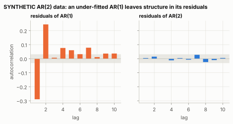

# H7.4 Forecast-residual detection

**Status:** Reviewed (numerical claims executed; sources listed in H7.4.9) · **Used by:** [w4d1](../../../labs/w4d1_timeseries_fundamentals/README.md)
**Related:** [H7.1 Windowing and causality](h7_1_windowing_and_causality.md) ·
[H6.5 Point versus event evaluation](../ch06_evaluation_leakage_uncertainty/h6_5_point_vs_event_evaluation.md) ·
[H6.6 Bootstrap and paired comparisons](../ch06_evaluation_leakage_uncertainty/h6_6_bootstrap_and_paired_comparisons.md)

## H7.4.1 Overview

A forecast-residual detector answers "is this value surprising, given what came before?" in three
steps: a model of normal one-step-ahead behaviour, a standardised residual, and an alarm rule that
turns residuals into decisions. It needs no labels, is cheap to run on a stream, and is easy to
explain to an operator ("we expected 32.4, we saw 29.1, that is four typical errors away"). Its
weaknesses are just as specific: the residual sees only what the forecaster does not already absorb,
and the alarm rule's false-alarm rate depends on assumptions (independent, correctly scaled residuals)
that real data rarely meets. This section collects the definitions, the equations needed to reason
about both, and the decisions that matter in practice.


## H7.4.2 Autocorrelation and what it implies

For a weakly stationary series, `ρ_k = Cov(x_t, x_{t−k}) / Var(x_t)`. The standard estimate

```
r_k = Σ_{t=k}^{n−1} (x_t − x̄)(x_{t−k} − x̄)  /  Σ_{t=0}^{n−1} (x_t − x̄)²
```

uses one denominator for all lags; the resulting sequence is positive semi-definite. Under white
noise `r_k ≈ N(0, 1/n)`, which gives the familiar `±2/√n` band. The **partial autocorrelation**
`α_k` is the coefficient of `x_{t−k}` in the best linear predictor of `x_t` from `x_{t−1}, …, x_{t−k}`
— in practice, the last coefficient of an AR(`k`) fit. The pattern of the two identifies simple
models: AR(`p`) has a decaying ACF and a PACF that cuts off after lag `p`; MA(`q`) the reverse.

Three consequences used throughout the course:

1. **Effective sample size.** `Var(x̄) = (σ²/n) [1 + 2 Σ_{k=1}^{n−1} (1 − k/n) ρ_k]`. For an AR(1)
   with large `n` this is `(σ²/n)(1 + φ)/(1 − φ)`, so `n_eff = n (1 − φ)/(1 + φ)`: 300 samples with
   `φ = 0.9` are worth about 16 (simulated in w4d1). For short windows use the exact sum; the
   large-`n` formula can even fall below 1.
2. **Window length.** A rolling statistic only averages noise away over windows that span several
   decorrelation times (H7.1.2).
3. **Validation.** Random row-level splits and row-level bootstraps treat correlated rows as
   independent and are optimistic (H6.3, H6.6).

## H7.4.3 Stationarity

A series is weakly stationary when its mean and autocovariances do not change over time. Common
departures and their signatures: trend (mean drifts), level shift (mean jumps and stays), seasonality
(pattern repeats with period `s`), variance change, and switching between operating regimes.
**Differencing** (`∇x_t = x_t − x_{t−1}`) removes a unit root or a linear trend; **seasonal
differencing** (`x_t − x_{t−s}`) removes a stable seasonal pattern. Both also remove the level, which
for anomaly detection may be the signal. Formal tests exist (augmented Dickey–Fuller for a unit root,
KPSS for stationarity around a level), but for detection the practical question is narrower: is the
fit window representative of the normal data the model will be applied to?

## H7.4.4 Forecasters

| Forecaster | `x̂_t` | Parameters | Residual responds to |
|---|---|---|---|
| Naive | `x_{t−1}` | none | changes (residual = first difference) |
| Seasonal naive | `x_{t−s}` | period `s` | changes relative to one cycle ago; echoes anomalies one period later |
| Moving average of the last `w` | `(1/w) Σ_{k=1}^{w} x_{t−k}` | `w` | deviations from the recent level, adapting over about `w` samples |
| AR(`p`) with intercept | `c + Σ_{k=1}^{p} φ_k x_{t−k}` | `p + 1` | deviations from the fitted dynamics and level |
| VAR(`p`) | `c + Σ A_k x_{t−k}` (vectors) | `d + p d²` | also broken cross-variable relations |

**Least-squares AR fit.** With `X` the `(n − p) × (p + 1)` matrix whose rows are
`[1, x_{t−1}, …, x_{t−p}]` for `t = p … n−1` and `y = x_{p:}`, the estimate is
`β̂ = argmin ‖y − Xβ‖²`, solved stably with a QR- or SVD-based routine (`np.linalg.lstsq`), not by
forming `(XᵀX)⁻¹`. The implied mean is `μ = c / (1 − Σφ_k)`; it is defined only for a stationary fit.
Omitting the intercept biases the coefficients towards a unit root for any series with a non-zero
mean, because the lag terms must then reproduce the level.

**Order selection.** Information criteria (AIC `= n log σ̂² + 2(p+1)`, BIC with `log n` instead of 2)
or, for a detector, the detection metric on development units. Check the residual ACF either way.



*Figure H7.4-1 (SYNTHETIC, `φ = (0.5, 0.35)`, n = 4,000).* An under-fitted model leaves predictable
structure in its residuals. Residuals that are not white invalidate i.i.d. alarm limits (H7.4.6).

## H7.4.5 Which anomalies a residual can see

Let a sustained level shift of size `Δ` start at `t₀`. Ignoring noise:

* naive: `e_{t₀} = Δ`, then `e_t = 0` for `t > t₀`;
* AR(1) fitted with mean `μ`: `e_t = (1 − φ) Δ` for every `t > t₀` (the forecast keeps pulling toward
  `μ`);
* AR(`p`): `e_t = (1 − Σφ_k) Δ` once `p` samples have passed;
* seasonal naive: `e_t = Δ` for one period, then 0 — and the *end* of the shift produces `−Δ` one
  period after it ends.

So the closer the fitted process is to a unit root (`Σφ → 1`), the more the AR detector behaves like
a change detector. A spike of size `A` at a single sample is seen by every forecaster at `t₀`; the
naive and AR forecasters then produce an echo at `t₀ + 1` (of size `−A` and `−φA`), the seasonal-naive
at `t₀ + s`. One-sided scores and robust references (median of several past cycles) suppress echoes.

## H7.4.6 Alarm rules and their run lengths

**Threshold.** Alarm when `|z_t| > L`. With independent standard-normal residuals the false-alarm
probability per sample is `2(1 − Φ(L))`: 0.0027 at `L = 3`, a false alarm every 370 samples on
average.

**CUSUM** (two-sided, tabular):

```
S⁺_t = max(0, S⁺_{t−1} + z_t − k),   S⁻_t = max(0, S⁻_{t−1} − z_t − k),   S_0 = 0,
alarm when max(S⁺_t, S⁻_t) > h.
```

It is the sequential likelihood-ratio test for a mean shift of `2k` (in residual SD units), restarted
whenever the evidence turns against a shift. After a shift `δ > k` the statistic drifts upward at
about `δ − k` per sample: delay ≈ `h/(δ − k)`.

**EWMA:** `w_t = λ z_t + (1 − λ) w_{t−1}`; steady-state `Var(w_t) = λ/(2 − λ)` for independent unit
residuals; alarm when `|w_t| > L √(λ/(2 − λ))`.

**Run lengths.** `ARL₀` is the mean number of samples to a false alarm when nothing has changed,
`ARL₁(δ)` the mean delay after a shift. They trade against each other through `h` (or `L`, `λ`):


*Figure H7.4-2 (SYNTHETIC, 200 runs per point, independent standard-normal residuals).* Each step up in
`h` roughly triples the time between false alarms and adds about two samples of delay. The `h = 6`
value is a lower bound (6 of 200 runs reached the 6,000-sample simulation limit). Values from the
authoring run: `h = 4`: 190 and 8.8; `h = 5`: 438 and 10.8.

Always convert run lengths into alarms per shift or per day at the actual sampling rate: at 1 Hz an
`ARL₀` of 440 samples is about 65 false alarms per 8-hour shift. Run-length figures assume
independent residuals with the assumed scale; autocorrelated residuals or a `σ_e` estimated from a
short window make the real false-alarm rate higher, often by a large factor. Calibrate `h` by
simulation from the fitted model, or on development data against the alarm budget.

## H7.4.7 Practical decisions and tradeoffs

* **What to fit on.** A reference period (global model) is cheaper to validate and govern; a per-run
  burn-in adapts to each operating point but assumes the start is normal and has little data. On SKAB
  the reference recording is far from most experiments' operating points, so the course uses
  per-experiment burn-in (w2d5, w2d6, w4d1).
* **Adaptation rate.** Never refitting raises alarms forever after a benign change; refitting on a
  sliding window absorbs sustained faults. A common compromise: refit on a schedule, only on periods
  without alarms, with human confirmation for changes in the normal level.
* **Scale.** Standardise by the one-step residual SD on fit data. Quantised or nearly constant sensors
  produce tiny or zero scales; cap scores or floor the scale, and say so.
* **Many sensors.** Max over per-sensor scores is simple and interpretable but ignores cross-sensor
  structure and inflates false alarms with the number of sensors (each one gets its own chances). A
  joint residual (VAR or PCA, H7.5) is the alternative.
* **One- or two-sided.** If only one direction matters (sales spikes, temperature rises), a one-sided
  score halves the false alarms from noise and removes echoes.

## H7.4.8 Common failure modes

| Failure | Symptom | Fix |
|---|---|---|
| Present value in the design matrix (off-by-one lag) | near-zero residuals in development, useless online | causality test: perturb `x[j:]`, forecasts up to `j` unchanged |
| No intercept | coefficients sum to about 1; drifting forecasts | include the constant column |
| Scale from series SD, not residual SD | thresholds mean different things per sensor | `σ_e` from one-step residuals on fit data |
| Fit on data containing the anomaly | fault absorbed into "normal"; future information | fit window strictly before what is scored, and normal |
| i.i.d. limits on autocorrelated residuals | many more false alarms than `ARL₀` predicts | better model, simulate limits, or calibrate on data |
| Model chosen by forecast RMSE | adaptive model selected, blind to sustained faults | select by detection metrics on held-out units |
| Seasonal-naive echo | second alarm one period after each anomaly | one-sided scores, robust multi-cycle reference |

## Quick reference

```
r_k      = Σ (x_t − x̄)(x_{t−k} − x̄) / Σ (x_t − x̄)²            white-noise band ±2/√n
n_eff    ≈ n (1 − φ)/(1 + φ)          (AR(1), large n)
AR(p)    x_t = c + Σ φ_k x_{t−k} + ε_t,   μ = c / (1 − Σ φ_k);   fit: lstsq on [1, lags]
z_t      = (x_t − x̂_t) / σ_e           σ_e = SD of one-step residuals on the fit data
CUSUM    S⁺ = max(0, S⁺ + z − k),  S⁻ = max(0, S⁻ − z − k);  alarm max > h;  delay ≈ h/(δ − k)
EWMA     w = λ z + (1 − λ) w;   σ_w = √(λ/(2 − λ))
Threshold |z| > 3: false alarm every ~370 samples for independent unit-normal residuals
Two-sided CUSUM k = 0.5, h = 5: ARL₀ ≈ 440-460 samples (simulated), delay ≈ 11 samples at δ = 1
```

## H7.4.9 Sources and verification status

* Executed in the authoring session (2026-11-22): every number in this section quoted from the
  w4d1 example, the w4d1 lab, and `handbook/figures/h7_4/make_figures.py` (two runs of the ARL
  simulation with different seeds gave `ARL₀` of 457 and 438 for `h = 5`).
* From memory, not re-opened this session: the identification rules for ACF/PACF (Box, Jenkins,
  Reinsel & Ljung, *Time Series Analysis: Forecasting and Control*); the CUSUM as a sequential
  likelihood-ratio test (Page, 1954, *Biometrika*); EWMA chart variance and run-length tables
  (Montgomery, *Introduction to Statistical Quality Control*); AIC/BIC definitions; ADF and KPSS
  tests. The quantitative claims that matter for the course (run lengths, effective sample size,
  coefficient recovery) were checked by simulation rather than taken from these sources.
* Not verified: behaviour of these charts on the real SKAB residuals beyond what the w4d1 table
  shows; VAR models were not fitted.
