# H7.5 Multivariate detectors: PCA, Hotelling's T² and Q

**Status:** Reviewed (numerical claims executed; sources listed in H7.5.8) · **Used by:** [w4d2](../../../labs/w4d2_classical_detectors/README.md)
**Related:** [H5.1 Trivial and linear baselines (Mahalanobis)](../ch05_classical_ml_baselines/h5_1_trivial_and_linear_baselines.md) ·
[H5.3 Trees, ensembles and isolation forests](../ch05_classical_ml_baselines/h5_3_trees_ensembles_iforest_pca.md) ·
[H7.4 Forecast-residual detection](h7_4_forecast_residual_detection.md)

## H7.5.1 Overview

Monitoring one sensor at a time misses faults that are only visible as a change in how sensors move
*together*, and raises many false alarms when every sensor gets its own threshold. Multivariate
statistical process control models the joint normal behaviour, usually with PCA, and splits every row
into two parts: where it sits inside the space normal data occupies (Hotelling's T²) and how far it is
from that space (Q, the squared prediction error). The split is useful because the two parts catch
different faults and suggest different explanations.



## H7.5.2 From Mahalanobis distance to T² and Q

For standardised data with correlation matrix `R = V Λ Vᵀ` (eigenvectors `V`, eigenvalues `Λ`), the
squared Mahalanobis distance is

```
D² = xᵀ R⁻¹ x = Σ_{j=1}^{d} (x v_j)² / λ_j
```

The last terms divide by small eigenvalues, so `D²` is dominated by noise in poorly estimated directions
(H5.1 uses shrinkage for this reason). PCA splits the sum at `k`:

```
T² = Σ_{j=1}^{k} (x v_j)² / λ_j                    (retained directions, properly scaled)
Q  = Σ_{j=k+1}^{d} (x v_j)²  = ‖x − x P Pᵀ‖²        (discarded directions, NOT scaled by λ_j)
```

with `P = [v_1 … v_k]`. Not dividing the discarded directions by their small variances is what makes Q
robust: it measures the size of what the model cannot explain, in the original (standardised) units.

**Control limits.** Under multivariate normality and an in-control process, a new observation's T²
follows `k(n²−1) / (n(n−k)) · F(k, n−k)`; for Q the usual approximations are Jackson and Mudholkar's
(based on the discarded eigenvalues) or Box's scaled χ² `g χ²_h` with `g = θ₂/θ₁`, `h = θ₁²/θ₂`,
`θ_i = Σ_{j>k} λ_j^i`. On autocorrelated, non-normal sensor data these limits are guides at best; the
course uses **empirical 99th percentiles on normal fit rows** and sets operating thresholds on
development data.

## H7.5.3 Choosing the number of components

`k` decides which faults land in which statistic. Too small: normal variation spills into Q and Q
raises false alarms. Too large: the subspace absorbs the directions a fault moves in; Q goes blind and
T² (dividing by the now-retained small eigenvalues) takes over, noisily.


*Figure H7.5-1 (SYNTHETIC, same plant and fault B as the w4d2 worked example).* At `k = 2` (the true
number of factors, 98.1% of the variance) Q catches the fault almost perfectly. From `k = 4` on, the
fault direction is retained and T² sees it instead; with all six components Q is numerical noise.
Common rules — a variance share (80-95%), the "elbow" of the eigenvalue plot, cross-validated
reconstruction error — are starting points; the deciding criterion is detection performance on
development units, as in the w4d2 lab.

## H7.5.4 Contributions: which sensor is to blame

For a Q alarm, the contribution of sensor `i` is its squared residual `(x_i − x̂_i)²`; for T², a common
definition is `Σ_j (t_j / λ_j) v_{ij} x_i` over retained components. Contributions are not root causes
(a fault in one sensor spreads through the reconstruction to others — "smearing"), but they point an
engineer at where to look.


*Figure H7.5-2 (REAL SKAB, PCA with `k = 6` of 8 burn-in z-scores, 80% variance rule).* The two faults
break different relationships: the valve fault mainly decouples motor current and voltage from the rest,
the `other/14` fault (increased water temperature, per the dataset's README) shows up in vibration. The
burn-in z-scores of SKAB's sensors are only weakly correlated, so 6 of 8 components are needed for 80%
of the variance — a sign that PCA has less structure to exploit here than in a tightly coupled plant,
consistent with Q's weak result in the w4d2 comparison.

## H7.5.5 Time and PCA

PCA treats rows as independent. Two standard extensions bring time in:

* **Dynamic PCA:** augment each row with lagged copies (`[x_t, x_{t−1}, …, x_{t−L}]`) so components can
  capture auto- and cross-correlation; the dimension grows `L + 1` times.
* **PCA on residuals or windows:** apply PCA to forecast residuals (H7.4) or to window features (the
  w4d2 lab uses 40 causal window features), so slow dynamics are already summarised.

A VAR model (H7.4.4) with a Mahalanobis distance on its residual vector is the forecasting-side
counterpart: it models the dynamics explicitly and measures surprise jointly.

## H7.5.6 Practical decisions and tradeoffs

* **What is "normal" data?** Fit on rows known to be normal and representative of all operating points.
  A single reference recording far from the deployment operating point (SKAB's `anomaly-free` file)
  makes everything look anomalous; per-unit burn-in normalisation is one remedy (w2d5).
* **Operating points:** with a few distinct regimes, one PCA model per regime (or regime as a feature in
  a different model) beats a single model whose first component is "which regime".
* **Robustness:** a few faulty rows in the fit data rotate the components towards them. Clean the fit
  data, or use robust PCA/covariance estimators.
* **T² or Q or both?** Report both; combining them (for example each divided by its limit and summed)
  hides which kind of fault occurred.
* **Versus isolation forest and supervised models:** PCA is linear and explainable through
  contributions; isolation forest handles non-linear normal regions but struggles with oblique
  directions; supervised models are sharper on known faults (w4d2).

## H7.5.7 Common failure modes

| Failure | Symptom | Fix |
|---|---|---|
| Standardising with the scored batch | a batch of faulty rows looks normal | fit-time mean and SD only |
| `k` chosen by a high variance share | Q blind to small relationship faults | choose `k` by detection on development units |
| Fit data contains faults or one regime only | many false alarms or rotated components | clean, representative normal data; models per regime |
| Q computed from retained scores | no response to broken correlations | Q is the norm of the residual `x − tPᵀ` |
| Theoretical limits on autocorrelated data | false-alarm rate far above nominal | empirical limits, thresholds from development data |
| Contributions read as root cause | wrong sensor replaced | treat as a pointer; check smearing |

## Quick reference

```
standardise     x = (raw − mean_fit) / sd_fit
PCA             R = V Λ Vᵀ;  P = V[:, :k];  t = x P
T²              Σ_{j≤k} t_j² / λ_j                       inside the model
Q (SPE)         ‖x − t Pᵀ‖² = Σ_{j>k} (x v_j)²           outside the model
Mahalanobis     D² = T² + Σ_{j>k} (x v_j)² / λ_j
limits          empirical 99th percentile on normal fit rows (or F for T², Box/Jackson-Mudholkar for Q)
contributions   Q: (x_i − x̂_i)²
```

## H7.5.8 Sources and verification status

* Executed in the authoring session (2026-11-22): figures H7.5-1 and H7.5-2 and their CSVs
  (`handbook/figures/h7_5/make_figures.py`, using the w4d2 reference `PCADetector`); the identity
  `D² = T² + Σ_{j>k}(x v_j)²/λ_j` follows from the eigen-decomposition and is what the reference code
  implements for T² and Q. The description of `other/14` ("water supply of increased temperature")
  is from the SKAB data README opened in the first authoring session.
* From memory, not re-opened this session: the F-distribution limit for T² (Tracy, Young & Mason);
  Jackson & Mudholkar (1979) and Box (1954) approximations for Q; the T² contribution formula; dynamic
  PCA (Ku, Storer & Georgakis, 1995). No code in the course depends on these.
