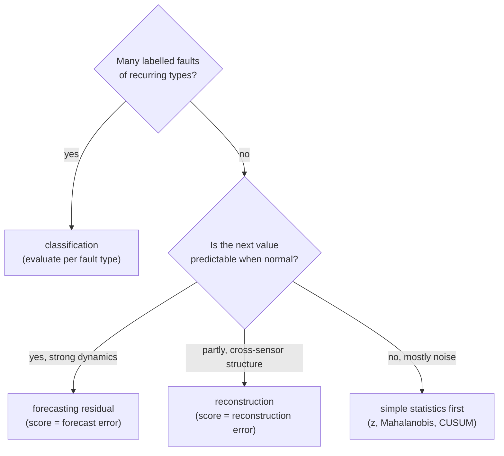
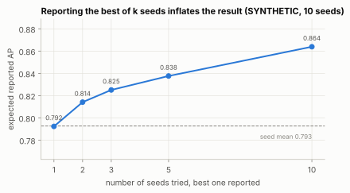

# H7.6 Neural sequence models, fairly compared

Status: Reviewed (sources and verification at the end). Lesson: [w4d3](../../../labs/w4d3_neural_comparison/README.md).

## H7.6.1 Overview

A neural sequence model is one candidate among several, and the engineering question is not how to
build it but how to show whether it is worth its cost. That needs four things: an objective that fits the
labels, inputs that respect causality and training-only statistics, a comparison protocol that holds
everything else equal, and a report that separates seed variation from test-set uncertainty. This
section covers each and ends with the cost side, which in production usually decides.

## H7.6.2 Choosing the objective from the labels

Let `x_t` be the multivariate input at time `t` and `W_t = (x_{t-w+1}, ..., x_t)` the causal window.

| Objective | Loss | Anomaly score | Needs |
|---|---|---|---|
| Reconstruction (autoencoder) | `||W_t - g(f(W_t))||^2` on normal windows | reconstruction error of `W_t` | normal data; labels only to exclude faults |
| Forecasting | `||x_{t+h} - F(W_t)||^2` on normal data | forecast error at `t + h` (known only at `t + h`) | normal data; a horizon |
| Classification | cross-entropy of `p(y_t | W_t)` | `p(anomaly | W_t)` | many labelled faults of the types you expect |
| Contrastive / self-supervised | e.g. distinguish real from shuffled windows | learned representation + any detector | lots of unlabelled data |



Two facts drive the choice. The *number of independent fault instances* (not rows) limits what a
classifier can learn; on SKAB it is 27 in development across three families. And the semi-supervised
objectives answer the question deployments usually ask, "is this unlike normal operation?", which
includes faults no one has labelled yet.

**The autoencoder's capacity problem.** Reconstruction detects faults only if the model reconstructs
normal windows *better* than faulty ones. A model with enough capacity reconstructs everything; the
bottleneck width, weight decay, noise injection and early stopping are what keep it specific to normal
behaviour. Validation loss on normal windows therefore does not rank detectors: in w4d3 the seed with
the lowest validation loss had the lowest test PR-AUC.

## H7.6.3 Windows, causality and normalisation

A causal window for row `t` uses rows `t-w+1 .. t`, with the rows before the series start padded (edge
padding repeats the first row; zero padding adds an artificial step). Everything upstream must also be
causal: rolling or burn-in statistics computed from the past, no whole-series normalisation, no
bidirectional recurrent layers, no centred convolutions across the window's end at scoring time. A
centred window of length `w` sees `floor((w-1)/2)` future rows; in the w4d3 example a 16-row centred
window began reacting to a step 7 rows before it happened.

Window length is a delay/variance trade-off. If the score averages errors over the window, a step of
size `Δ` contributes `Δ·k/w` after `k` rows, reaching full effect after `w` rows, while the noise in the
score falls roughly as `1/w` for independent errors (less for autocorrelated ones). Short faults (`L < w`)
are diluted to `L/w` of their effect.

Normalisation statistics are parameters and must be fitted on training rows only, exactly like a scaler
inside a cross-validation pipeline. Two layers are common in grouped sensor data: per-unit calibration
from a causal burn-in (handles unit-to-unit offsets) and a global normaliser fitted on the training rows
(keeps the network's inputs on a unit scale).

## H7.6.4 A fair comparison protocol

Write the protocol before the first neural run:

1. **Splits** by the independent unit (experiment, machine, patient), frozen in a manifest; the test set
   read once.
2. **Rows scored** identical for all detectors (warm-up and calibration rows excluded for everyone).
3. **Preprocessing** identical where possible, so the comparison is about the model.
4. **Tuning budget** declared per family: number of configurations, which hyperparameters, chosen on
   validation data only. An unequal budget favours the family that got more.
5. **Stopping rule** on validation data (early stopping is a hyperparameter search over epochs).
6. **Seeds**: at least 5 for stochastic models; all reported.
7. **Metric and uncertainty**: a threshold-free metric (PR-AUC) and/or the deployment metric at a fixed
   operating rule; a cluster-bootstrap interval over test units; a paired comparison (H6.6).
8. **Cost**: training time, inference latency, model size, dependencies, retraining.

What cannot be held equal (inputs the classical model does not use, capacity) must be stated as a
limitation of the claim. The supported claim is always conditional: "this architecture, this budget,
this data".

## H7.6.5 Seed variance and the best-of-k trap

For a stochastic training procedure the test metric is a random variable `M_s` over seeds `s`. With `k`
seeds, report `mean ± sd` (sample sd, `ddof = 1`) and the range. Reporting `max_s M_s` instead adds an
optimism that grows with `k`; for roughly normal `M_s` with sd `σ`, the expected maximum of `k` draws is
about `μ + σ·c_k` with `c_2 ≈ 0.56`, `c_5 ≈ 1.16`, `c_10 ≈ 1.54` (the expected maximum of `k` standard
normals; checked by a 400,000-draw simulation: 0.566, 1.162, 1.538).



*Figure H7.6-1 (SYNTHETIC, w4d3 worked example).* Ten seeds of the same autoencoder; the expected
value of "best of k seeds" over random subsets. With ten seeds the reported number is 0.07 above what a
randomly chosen run delivers.

Seed spread and test-set uncertainty answer different questions (H6.6): the first is about retraining
the *method*; the second is about generalising one *fitted model* to other units. A conservative verdict
requires the difference in seed means to exceed both `2·sqrt(sd_a²/n_a + sd_b²/n_b)` and the half-width
of the paired test interval. An ensemble over seeds (averaging scores) removes much of the seed
lottery at `k` times the inference cost.

## H7.6.6 Determinism and its limits

Seed the weight initialisation (`torch.manual_seed` before constructing the model), the data order (a
seeded `torch.Generator`), and any data-loader workers (a `worker_init_fn` that seeds NumPy and Python
in each worker). This gives bitwise reproducibility only for the same hardware, library versions and
thread settings. Multi-threaded reductions change floating-point summation order; on GPUs some kernels
are non-deterministic unless `torch.use_deterministic_algorithms(True)` is set (with a speed cost and
some operations raising errors) and cuDNN autotuning is disabled. Record seed, threads, device and
versions with every run (H8.1) and treat cross-machine differences as noise to be measured, not
eliminated.

For small models on CPU, thread count is also a performance setting: in w4d3 a 6-epoch fit took 1.6 s on
one thread and 94.5 s on four on the same container. Measure before assuming more threads is faster.

## H7.6.7 Cost and when a neural model is justified

| Cost | Questions to answer |
|---|---|
| Training | Minutes or hours per run? How many runs per retrain (seeds, tuning)? Hardware? |
| Inference | Latency per row or window, batchability, memory; CPU or GPU at the edge? |
| Dependencies | A deep-learning framework in the serving image (size, security updates). |
| Numerics | Results that differ across hardware; tolerance-based tests instead of exact ones. |
| Operations | Weights to version, retraining pipeline, monitoring of a model nobody can inspect directly. |
| Explanation | Can an operator be told *why* an alarm fired? |

Justified when the data have structure that features miss (raw high-rate waveforms, long lags,
interactions across many channels), there are enough independent units to fit it, and the protocol shows
a difference larger than both uncertainties. Not justified because "it is the modern approach".

## H7.6.8 Common failure modes

* Random split of overlapping windows into train and validation: validation loss collapses, nothing
  generalises.
* Anomalous rows left in the training data of an "anomaly detector".
* Windows that cross unit boundaries after concatenating units.
* Normaliser fitted on all data, or refitted on the scored batch.
* Early stopping or model choice on the test set; reporting the best seed.
* `state_dict()` saved without a copy, so the "best" checkpoint is the last.
* Comparing a tuned neural model with an untuned baseline.
* Validation reconstruction loss used as the model-selection metric for detection.

## H7.6.9 Quick reference

```python
torch.manual_seed(seed)                       # before building the model
g = torch.Generator().manual_seed(seed)       # data order
torch.set_num_threads(n)                      # record it; measure speed
best_state = copy.deepcopy(model.state_dict())
model.load_state_dict(best_state)             # after early stopping
model.eval(); torch.no_grad()                 # scoring
```

Report: protocol, budget, `mean ± sd` over seeds, range, paired test interval, cost table, the claim and
its conditions.

## H7.6.10 Sources and verification status

* PyTorch reproducibility notes (`docs/source/notes/randomness.rst` in the pytorch repository), as read for
  H2.2 in an earlier session: seeding, `use_deterministic_algorithms`, cuDNN flags, DataLoader workers.
  Not re-opened for this section; the CPU thread observations are from runs made for w4d3.
* Measured in w4d3 on the authoring container (torch 2.15.0+cu132 on CPU): thread-count effects on time
  and on results; seed spread; best-of-k values; step reaction of causal and centred windows.
* Expected maxima of standard normal samples (`c_k`): verified by simulation (400,000 draws per `k`,
  seed 0: 0.566, 1.162, 1.538). Figure H7.6-1 is a different quantity (subsets of 10 fixed seeds), so its
  values are not expected to match `μ + σ·c_k` exactly.
* The over-complete autoencoder problem and the role of the bottleneck: standard material (e.g. Goodfellow,
  Bengio and Courville, *Deep Learning*, 2016, chapter 14), cited from memory.
