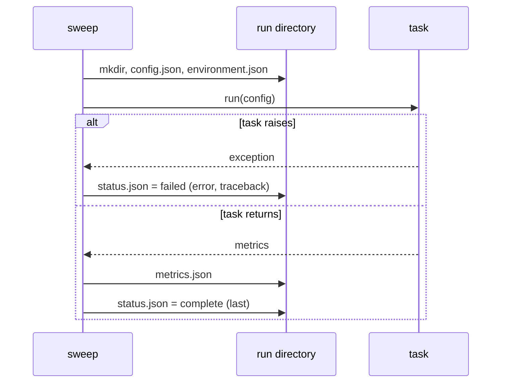
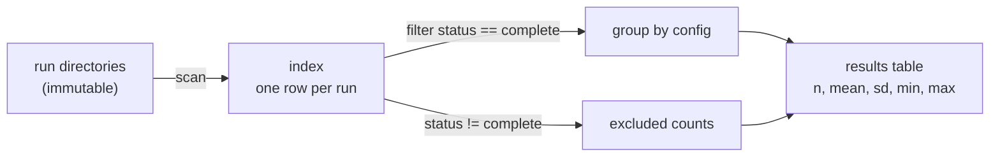

# H8.1 Run registries and sweeps

Status: Reviewed (sources and verification at the end). Lesson: [w4d4](../../../labs/w4d4_experiment_tracking/README.md).
Builds on [H2.2](../ch02_maintainable_python/h2_2_configuration_logging_runs.md) (configuration, logging, run directories).

## H8.1.1 Overview

An experiment registry answers three questions about every number you report: *what produced it*,
*did it finish*, and *can it be produced again*. It consists of an identity scheme for runs, an
immutable record per run, a sweep mechanism that turns a search definition into concrete runs, and
derived views (an index and results tables). Commercial and open-source trackers implement these with
different storage choices; the requirements are the same.

## H8.1.2 What a run record contains

| Field | Content | Failure it prevents |
|---|---|---|
| Resolved config | every value the code read, after defaults, files and overrides are merged; including seed | "which settings produced this?" |
| Code version | commit hash plus a dirty flag; package version | silent edits between runs |
| Data fingerprint | hash of the files used, or of a download manifest; split manifest hash | "same path, different data" |
| Environment | interpreter and library versions, platform, threads/device for numerical work | version-dependent numerics |
| Metrics | the task's outputs | - |
| Status | complete / failed (with error) / partial | crashed runs counted as results |
| Artifacts | models, predictions, figures (by reference if large) | results that cannot be inspected or served |
| Timing | start, end, duration | cost accounting; detecting hangs |

The test of completeness: given only the record and access to the referenced code and data, someone
else can regenerate the metrics within a stated tolerance.

## H8.1.3 Identity and immutability

A **content-addressed** id is a hash of the canonical serialisation of the resolved config:

```text
run_id = sha256( json.dumps(config, sort_keys=True, separators=(",", ":")) )[:12]
```

Canonical means: keys sorted at every level, fixed separators, a fixed representation for numbers and
types. Properties: the same config always maps to the same id (idempotent sweeps); any change, including
the seed, gives a new id; ids can be recomputed anywhere. Twelve hex characters (48 bits) make an
accidental collision among `n` runs roughly `n²/2^49`: about 2 x 10⁻⁷ for ten thousand runs, but about
0.2% for a million. A registry expected to hold millions of runs should keep 16 or more characters.

The alternative is a **random or sequential id** (MLflow run ids, timestamps). It allows two runs of the
same config (useful to measure non-determinism) but loses idempotence: a sweep rerun duplicates
everything unless the tracker searches for an existing run with the same parameters.

Either way, a **completed run is immutable**. Corrections are new runs. A run that is partial or failed may
be retried; the record of the failure should be kept (in the new run's log or a failure table), because
failures that depend on the configuration are results.

## H8.1.4 Completion: write the status last, atomically



Each file is written to a temporary name and renamed into place (`os.replace`), which is atomic on POSIX
filesystems for a rename within one filesystem, so a reader sees either the old file or the new one,
never half of it. A missing `status.json` therefore always means "did not finish".

## H8.1.5 Sweeps

A sweep definition is data: a base config, the parameters that vary, the seeds, and a search mode.

* **Grid**: the Cartesian product of value lists. Exhaustive and easy to read; the number of runs is the
  product of list lengths times seeds, so it explodes with dimension.
* **Random**: `n` draws from declared distributions (uniform, log-uniform for scale parameters, choice),
  with their own seed so the set of configurations is reproducible. For the same budget it explores
  more distinct values of each important parameter (H6.4).
* **Adaptive** (Bayesian optimisation, successive halving): each new configuration depends on earlier
  results. The registry must then also record the search state, or the sweep cannot be replayed.

Expansion must be deterministic (sorted keys, defined order, seeds innermost) so that the run list itself
can be regenerated and compared.

## H8.1.6 The index and aggregation

The index is a table with one row per run: identity, status, flattened parameters, metrics. Two designs:

| | Directories are the truth, index rebuilt | Database is the truth (e.g. MLflow backend store) |
|---|---|---|
| Infrastructure | none | a server or a database file |
| Merging results from several machines | copy directories | export/import or a shared server |
| Repair by hand | edit or delete a directory | database operations |
| Scale | thousands of runs | millions, concurrent writers |
| Typical failure | inconsistent copies on different machines | database and artifact store drifting apart |

Aggregation over seeds groups complete runs by configuration and reports `n`, mean, sample sd, min, max,
and the number of excluded (failed or partial) runs. When different sweeps have different parameters,
each run is missing values in the other sweeps' columns; grouping must treat "missing" as a value or the
rows vanish (pandas `groupby` drops NaN keys by default).



## H8.1.7 Reproducing a row

Reproduction re-executes the stored config with the current code and data, then compares metrics with
a tolerance (`|a - b| <= atol + rtol·|b|`). Interpretation:

* match: the record is sufficient (for this machine and environment);
* mismatch with the same commit and data hashes: uncontrolled non-determinism or an environment
  difference; record more (threads, device, versions) or treat the metric as noisy and compare
  distributions;
* mismatch with different hashes: the code or data changed; the stored run describes the old state.

A reproduction that reads the stored metrics instead of re-running proves nothing.

## H8.1.8 Practical decisions

* **What belongs in the config versus the environment**: anything you set on purpose goes in the config
  (it changes the id); anything that merely describes where the run happened goes in the environment.
  Thread count is a judgement call: put it in the config when it changes results (H7.6).
* **Test metrics do not belong in sweep runs.** A sweep is a selection procedure on development data
  (H6.4); the chosen configuration is evaluated on the test set once, as its own recorded run.
* **Artifacts**: store small ones in the run directory, large ones in an artifact store referenced by
  hash.
* **Adopting a tool**: once more than one person runs experiments, or runs span machines, a tracker with
  a server (MLflow, Weights & Biases, others) usually pays for itself. Check that it can record the fields
  in H8.1.2, that runs are immutable, and that you can export everything.

## H8.1.9 Common failure modes

* Hash over a non-canonical serialisation (key order): duplicate runs under different ids.
* Seed excluded from the id: seeds collapse into one run.
* `metrics.json` taken as completion: crashed runs averaged in.
* Reading the index back as truth: deleted or added runs invisible.
* NaN group keys: configurations silently missing from the table.
* Config mutated after the run (editing `config.json` by hand), or a shared base dict mutated during
  expansion.
* Test-set metrics logged in every sweep run, inviting selection on test.

## H8.1.10 Quick reference

```text
expand  : spec -> [config]            deterministic order, deep copies, seed/task/sweep added
identity: sha256(canonical json)[:12]
execute : skip complete; write config, environment; run; metrics; status LAST (atomic)
index   : scan directories -> one row per run (never read back)
table   : complete only; group by sweep + all params (NaN as a value); n, mean, sd(ddof=1), excluded
repro   : re-run stored config; math.isclose per metric
```

## H8.1.11 Sources and verification status

* Behaviour of the reference implementation (identity, idempotent re-execution, partial and failed runs,
  NaN group keys, reproduction) was executed in w4d4 on Python 3.13.18 / pandas 3.0.5.
* `os.replace` atomicity: Python documentation for `os.replace` ("if successful, the renaming will be an
  atomic operation (this is a POSIX requirement)"), as read for H3.3 in an earlier session; not re-opened.
* pandas `groupby` dropping NaN keys by default and the `dropna=False` option: observed in the w4d4 worked
  example with pandas 3.0.5.
* MLflow's design (backend store plus artifact store, run statuses): from memory of the MLflow
  documentation; not re-verified in this session, and its API differs between major versions.
* Collision estimate: birthday bound `n²/2^(b+1)` for `b`-bit ids, computed here for `b = 48`.
