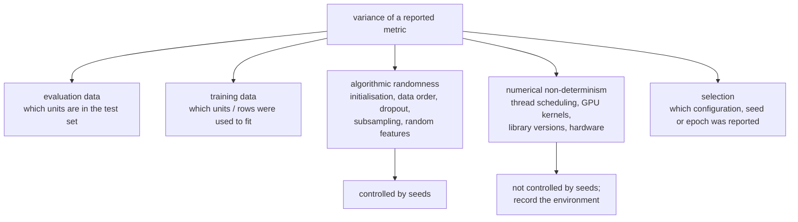
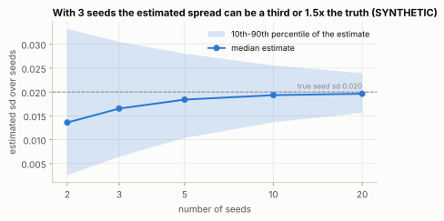

# H8.2 Seeds and variance

Status: Reviewed (sources and verification at the end). Lessons: [w4d3](../../../labs/w4d3_neural_comparison/README.md),
[w4d4](../../../labs/w4d4_experiment_tracking/README.md). Related: [H6.6](../ch06_evaluation_leakage_uncertainty/h6_6_bootstrap_and_paired_comparisons.md), [H7.6](../ch07_timeseries_grouped_modeling/h7_6_neural_sequence_models.md).

## H8.2.1 Overview

A reported metric is one draw from a distribution shaped by several sources of randomness. Seeds make
some of them repeatable, which is necessary for debugging and auditing, but repeatability is not the same
as stability: a result that holds for seed 0 and fails for seed 1 is not a result. This section separates
the sources, shows how to estimate their size, and gives rules for how many seeds to run and how to
report them.

## H8.2.2 Sources of variation



| Source | Repeatable with a seed? | Measured by |
|---|---|---|
| Evaluation sample | not a seed question | bootstrap over test units (H6.6) |
| Training sample | yes, if the split/subsample is seeded | refitting on resampled or rotated training units (cross-validation) |
| Algorithmic randomness | yes | repeating training with several seeds |
| Numerical non-determinism | no | repeating the same seed under the conditions that vary |
| Selection | no | nested validation (H6.4); reporting all runs |

A seed is a *label* for one draw of the algorithmic randomness. It must be recorded (H8.1) and it must
not be chosen by looking at results.

## H8.2.3 Seeding in practice

* NumPy: pass a `numpy.random.Generator` (`np.random.default_rng(seed)`) explicitly instead of using the
  global state; derive independent streams for components (`np.random.SeedSequence(seed).spawn(k)`).
* scikit-learn: `random_state` on every estimator and splitter that has one. With an integer, repeated
  `fit` calls are identical; with a `Generator`/`RandomState` instance, successive calls differ.
* PyTorch: `torch.manual_seed` before constructing the model; a seeded `torch.Generator` for data order;
  worker seeding for `DataLoader` workers; record threads and device (H7.6).
* Python's `hash` of strings is salted per process (`PYTHONHASHSEED`), so iteration over sets of strings
  can change order between runs; sort before iterating when order matters.

Nested structure can make seeds informative across configurations: in scikit-learn 1.9.1 an
`IsolationForest` with 200 trees and `random_state = s` contains the 50-tree forest with the same `s` as
its first 50 trees (checked in w4d4), so comparisons paired on the seed isolate the extra trees.

## H8.2.4 How many seeds?

With `n` seeds the sample standard deviation `s` estimates the seed sd `σ` poorly when `n` is small. For
normal draws, `(n-1)s²/σ²` follows a chi-square distribution with `n-1` degrees of freedom, so `s` is biased
low and highly variable at small `n`.



*Figure H8.2-1 (SYNTHETIC, 20,000 simulations per n, true sd 0.020).* Median estimate 0.0136 at n = 2,
0.0165 at n = 3, 0.0184 at n = 5, 0.0196 at n = 20; the middle 80% of 3-seed estimates spans 0.006 to
0.031.

Rules of thumb that follow:

| Goal | Seeds |
|---|---|
| Show that single runs are unreliable | 3-5 |
| Report a rough seed sd | at least 5 |
| Compare two methods whose difference is near the seed sd | 10 or more, paired if the seed controls shared randomness |
| Estimate a mean to within `δ` | `n ≈ (2σ/δ)²` for a 95% interval of half-width `δ` |

Often the cheaper improvement is elsewhere: when the test-set interval (bounded by the number of test
units) is wider than the seed spread, as in w4d3 (test interval about 0.31 wide, seed range 0.16), more
seeds do not change the conclusion.

## H8.2.5 Decomposing variance

With a grid of `S` seeds x `F` folds (or resamples), a two-way layout separates the components:
`Var(metric) ≈ σ²_fold + σ²_seed + σ²_interaction`. The fold component (which units were held out) is
usually the larger one for grouped data with few units; the seed component dominates for unstable
training procedures. A practical estimate: the mean over seeds of the across-fold variance, and the mean
over folds of the across-seed variance. Report which components an interval contains; a single
mean ± sd over seeds on one fixed split says nothing about the fold component.

## H8.2.6 Reporting

* Report every seed that was run, or mean ± sd (ddof 1), min and max, with `n`.
* Never report the best seed as the result; if one model must be shipped, choose it by a pre-declared
  rule on development data (the median seed, or an ensemble of all seeds).
* Keep seed variance and test-set uncertainty separate, and say which question each answers.
* For comparisons, use paired differences when runs share seeds that control shared randomness, and the
  verdict rule in H7.6 (difference larger than both `2·SE_seeds` and the test half-width).
* Record seeds in the run id (H8.1) so that "seed 3" in a table is a specific, reproducible run.

## H8.2.7 Common failure modes

* One run per configuration, compared to the third decimal.
* Seed chosen after looking at results ("seed 42 worked best").
* Global random state used implicitly, so adding a print statement or a new random call changes results.
* `random_state=None` left in a splitter, making the split itself unrepeatable.
* Interpreting a small sample sd from three seeds as evidence of stability.
* Treating bitwise reproducibility on one machine as evidence that a result generalises.

## H8.2.8 Quick reference

```python
rng = np.random.default_rng(seed)                      # pass rng explicitly
child_rngs = [np.random.default_rng(s) for s in np.random.SeedSequence(seed).spawn(3)]
Estimator(random_state=seed); GroupKFold / GroupShuffleSplit(random_state=seed) where applicable
torch.manual_seed(seed); torch.Generator().manual_seed(seed)
statistics.stdev(values)                               # ddof = 1
```

## H8.2.9 Sources and verification status

* Simulation of the sd estimate (Figure H8.2-1): executed for this section, seed 0, 20,000 replications
  per `n` (`labs/w4d4_experiment_tracking/figures/make_figures.py`).
* scikit-learn `random_state` semantics (integer versus instance): scikit-learn glossary
  (`doc/glossary.rst`), as read for H2.2 in an earlier session; not re-opened.
* NumPy `Generator` and `SeedSequence.spawn`: NumPy random documentation, as read for H2.2; not re-opened.
* PyTorch seeding and worker seeding: PyTorch reproducibility notes, as read for H2.2; not re-opened.
* `PYTHONHASHSEED` and string hash randomisation: Python documentation, from memory.
* Isolation-forest nesting: executed with scikit-learn 1.9.1 (50 of 50 first trees identical).
* The chi-square sampling distribution of the sample variance under normality: standard result, from
  memory.
