# H10.1 One pipeline for training and serving

Status: Reviewed (see "Sources and verification status"). Lesson: [w5d1](../../../labs/w5d1_inference_pipeline/README.md).
Next section: [H10.2 Model artifacts and versioning](h10_2_artifacts_and_versioning.md).

## H10.1.1 Overview

A trained model is not a file of weights. It is a **function** from the raw inputs that production
will send to the decisions production will take. Weights are one part of it. The rest is everything
around them: parsing, validation, preprocessing statistics, feature construction and order, defaults
for missing values, post-processing and the threshold. Offline evaluation measures one particular
implementation of that function. Production is trustworthy only if it runs the same implementation,
or one that is proven equal within numerical noise.

The engineering answer is structural: **define the function once, as one object, and have both the
evaluation code and the serving code call it.** Then test that they still agree.

## H10.1.2 Research experimentation versus production inference

| Aspect | Research experiment | Production inference |
|---|---|---|
| Inputs | curated, complete, labelled, in memory | raw, partial, unlabelled, from another system, sometimes malformed |
| Caller | the researcher | a scheduler, a service, another team's code |
| Errors | an exception to read | must be contained, reported and attributable |
| Resources | whatever the workstation has | latency, memory and cost budgets |
| State | rebuilt each run | fitted once (parameters, thresholds) and per entity (calibrations, histories) |
| Output | a metric in a table | a record someone acts on and may audit |
| Lifetime | until the paper is accepted | until the model is retired, with several retrainings |

A useful habit is to write down, for each step of the function, *when* its inputs are fixed:

* **fit time**: learned from development data and frozen in the artifact (weights, scaler statistics,
  the operating point, feature lists);
* **entity time**: computed once per entity from rows the method designates (a run's burn-in
  calibration, a customer's history up to the prediction time);
* **request time**: computed from the request itself (the current row's z-score).

Bugs live at the boundaries: a fit-time value recomputed at request time, or an entity-time value
computed from the wrong rows.

## H10.1.3 Training/serving skew

**Definition.** Let *f* be the function that was evaluated and *g* the function that is deployed.
There is skew if, for inputs from the deployment distribution, *g(x)* differs from *f(x)* by more than
numerical noise, or if the decisions *d(g(x))* and *d(f(x))* differ.

*Figure H10.1-1. Where skew enters. Each source has a test that catches it (table below).*

| Source | Example | Test that catches it |
|---|---|---|
| Re-implemented preprocessing | `pandas.Series.std()` (ddof=1) where NumPy's ddof=0 was evaluated | parity on synthetic inputs, relative tolerance 1e-12 |
| Different defaults | serving script hard-codes a 60-row burn-in | parity with a model whose parameter differs from today's value |
| Feature order | features stacked `[abs(z), z]` for weights learned on `[z, abs(z)]` | parity on any input; storing feature names in the artifact and asserting them on load |
| Statistics at the wrong time | z-scores computed with each batch's own mean and standard deviation | a late fault must not change earlier scores; a planted shift must keep its size |
| Parsing and types | decimal commas from a misconfigured exporter | schema validation at the boundary (non-numeric value is an error) |
| Configuration | threshold re-derived as a quantile of today's scores | a batch with no fault raises no alarm; alarms with thresholds 0 and infinity are all or none |

**The magnitude of a skew is not its importance.** A multiplicative error *ε* on a score changes a
decision only for scores within a relative *|ε|* of the threshold. On the 7 real SKAB test runs, the
shipped flow-rate detector's scores are quantised (flow rate is reported in whole litres per minute),
and the highest score below the threshold sits 0.49 % under it. The ddof skew (ε = sqrt(99/100) − 1 = −0.50 %)
happens to shrink scores, and the lowest score above the threshold sits 5.4 % above it, so it changes
**no** decision on this test set. An error of the same size in the other direction (+0.50 %) changes 61. A skew that is silent on one evaluation set is
still a different function; the next run may put a score where it matters.

*Figure H10.1-2 (real SKAB, 7 test runs, the shipped detector; regenerate with
`python handbook/figures/h10_1/make_figures.py`). The marked point is the ddof skew: zero decisions
changed here, by luck of where the scores fall.*

**Numerical noise is not skew.** IEEE-754 double precision has a unit roundoff of 2⁻⁵³ ≈ 1.1e-16.
Summing *n* numbers in different orders can differ by roughly *n* times that in the worst case
(pairwise summation, which NumPy uses, grows like log *n*). Two correct implementations can therefore
disagree in the last digits. The w5d1 parity report first showed 1.4e-14 on scores near 8. The cause
was pandas' default CSV float parser, which changed the last digit of 2,017 of 6,659 values (largest
relative change 5.9e-16); with `float_precision="round_trip"` the difference was 0. The rule for parity
tests is the one from H9.1: compare with a stated relative tolerance (1e-12 is generous for O(100)
operations) **and** require identical decisions.

## H10.1.4 One inference object

The object owns three things:

1. **Configuration** (fit time), as plain data that round-trips through JSON: the parameters, the
   threshold, post-processing settings, the input schema, name and version.
2. **Entity state** (computed in serving from designated rows): for flowguard, each run's calibration
   from its first `n_burn` rows.
3. **The scoring path**: validation, features, score, decision.

Evaluation code imports the object and calls the same methods it will be served through. In particular
the operating point is chosen on scores produced *by the object*: then the threshold is guaranteed to
be applied to the function it was tuned on.

Patterns elsewhere: scikit-learn's `Pipeline` holds preprocessing and model in one estimator;
TensorFlow Transform and feature stores compute a feature once and materialise it for both training and
serving; in PyTorch, normalisation inside `forward` (or a scripted module that includes it) does the
same job. The common idea is to remove the second copy rather than keep two copies in sync.

## H10.1.5 Validation at the inference boundary

The boundary is where data from someone else's system becomes input to your function. Validation
there answers *"is this inside the function's domain?"*:

* exactly the expected columns (name every missing and unexpected one in the error);
* no matching by position, ever;
* types: numeric sensors, parseable timestamps;
* no labels in serving input;
* not empty.

A violation is a contract failure: nothing is scored, the caller gets a clear error (exit code 2 in
the batch command, HTTP 422 in an API, Week 5 day 4).

*Figure H10.1-3. Three different questions, three different responses.*

This is **not** the same activity as data-quality checking (H4.1) or monitoring (H15.3). Those ask
whether *well-formed* data is plausible: gaps, stuck sensors, distribution changes. Plausibility
problems are reported per entity or as monitoring signals; they rarely justify refusing a whole batch.

**Strict or tolerant?** Postel's robustness principle ("be liberal in what you accept") is the wrong
default for model inputs, because a liberal reading often succeeds silently on data with a different
meaning. Prefer strict schemas with explicit versions, and relax them deliberately (e.g. accept
columns in any order *by name*) where a producer is under your control and covered by contract tests.

## H10.1.6 Batch inference design

| Requirement | Mechanism |
|---|---|
| Bounded memory | process entities in chunks; the output must not depend on chunk size (test it) |
| Traceability | model name, version and threshold in every output row; input and output SHA-256 in a manifest |
| Idempotence | no wall-clock time or random identifiers in the outputs; same model + same input = same bytes |
| Atomicity | write to a temporary file in the same directory, then `os.replace` (atomic on POSIX file systems when source and target are on the same file system) |
| Safety on retry | refuse to overwrite outputs that belong to another input or model unless forced |
| Partial failure | per-entity errors recorded with a reason; the rest scored; a distinct exit code |
| Explicit gaps | rows that cannot have a score (burn-in, failed runs) appear with a status, not as missing rows |

Exit codes are an interface too: 0 complete, 3 partial, 2 refused (nothing written), 1 unexpected.
A scheduler can then retry 1, alert on 2 and 3, and never confuse "partly scored" with "done".

## H10.1.7 Common failure modes

* **Two copies of the feature code**, one in a notebook and one in the service, "kept in sync by hand".
* **Fitting at predict time**: a scaler, an imputer or a threshold fitted on the request batch.
* **Hidden defaults** in serving code that override or replace model parameters.
* **Matching columns by position**, or relying on dict ordering for feature order.
* **Lossy interchange**: rounding scores in CSV, a non-round-trip float parser, timestamps without a zone.
* **Silent partial output**: failed entities missing from the output rather than marked.
* **Non-idempotent jobs**: a timestamp or a random run id in the output, so every retry looks like new data.
* **Testing the model, not the function**: unit tests for the scorer, none for the parity of the
  evaluated and served paths.

## H10.1.8 Quick reference

* Write down fit-time, entity-time and request-time values for every step.
* One object; evaluation and serving import it; the operating point is chosen with it.
* Parity test in CI: same synthetic inputs through both paths, `rtol=1e-12`, identical decisions;
  include a case where each parameter differs from today's value and a case beyond every clip.
* Boundary validation: names, order, types, no labels, not empty; `SchemaError` names the problem.
* Batch outputs: one row per input row, status column, model identity, manifest with hashes, no
  timestamps, `os.replace`, refuse foreign outputs, exit codes 0/3/2/1.
* Read CSV floats with `float_precision="round_trip"` when exactness matters.

## H10.1.9 Sources and verification status

Verified by execution in this repository (2026-11-22; Python 3.13.18, pandas 3.0.5, NumPy 2.5.3):
every number in this section comes from `labs/w5d1_inference_pipeline` (parity report, worked
example, challenge measurements) or from `handbook/figures/h10_1/make_figures.py`. The non-round-trip
behaviour of `pandas.read_csv`'s default float parser and the exactness of `float_precision="round_trip"`
were observed directly (2,017 of 6,659 values differed in the last digit).

From memory, not re-verified in this session:
* unit roundoff 2⁻⁵³ for IEEE-754 binary64 and the error growth of naive and pairwise summation
  (N. J. Higham, *Accuracy and Stability of Numerical Algorithms*, 2nd ed., SIAM, 2002);
* NumPy uses pairwise summation in `np.sum` for contiguous floating-point arrays (NumPy documentation);
* `os.replace` is atomic on POSIX when source and destination are on the same file system (Python
  documentation for `os.replace`; POSIX `rename`);
* the description of TensorFlow Transform and feature stores, and the term "training-serving skew"
  as used in Google's *Rules of Machine Learning* (M. Zinkevich) and in D. Sculley et al., "Hidden
  Technical Debt in Machine Learning Systems", NeurIPS 2015;
* Postel's robustness principle (RFC 761 / RFC 1122).

The industry example in the lesson (fraud feature computed differently offline and online) is an
illustrative composite, not a documented incident.
