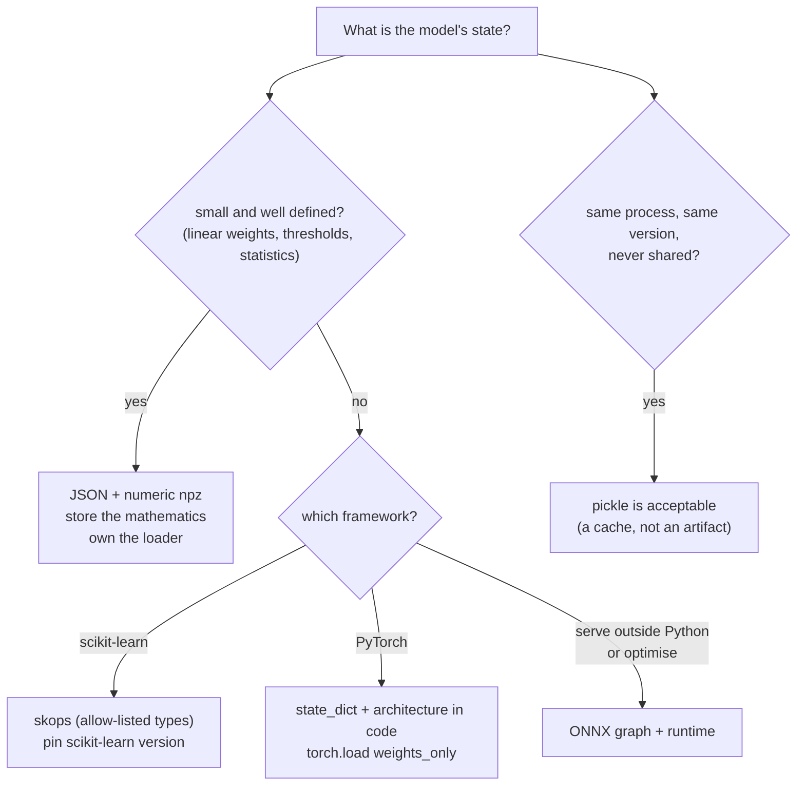
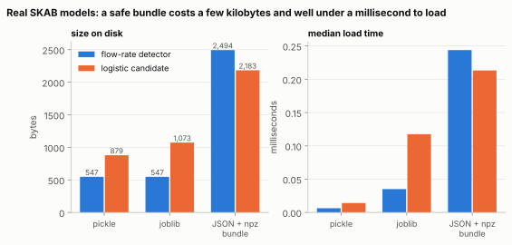
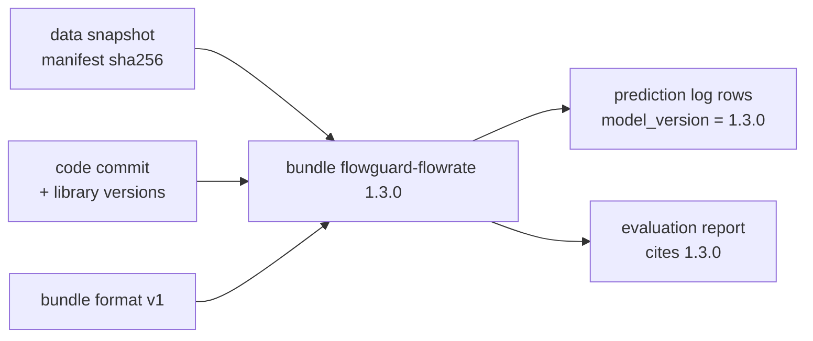

# H10.2 Model artifacts and versioning

Status: Reviewed (see "Sources and verification status"). Lesson: [w5d2](../../../labs/w5d2_artifacts_versioning/README.md).
Previous section: [H10.1 One pipeline for training and serving](h10_1_one_pipeline_for_training_and_serving.md).

## H10.2.1 Overview

A model artifact is the form in which a trained function leaves the process that trained it. It is
loaded later, elsewhere, by code its author does not control. It must therefore answer, by itself,
four questions:

1. *What function is this?* Parameters, preprocessing state, feature layout, threshold, input schema.
2. *Are these the bytes that were written?* Integrity.
3. *Can this code interpret them?* Format and version compatibility.
4. *Should this function be used, for what, and how good is it?* The model card, with lineage
   (data, code, library versions) and evaluation with uncertainty.

A **registry** adds two properties on top: versions that never change once registered, and a small,
replaceable pointer saying which version is live.

## H10.2.2 Contents of a trustworthy artifact

| Part | Contents | Why |
|---|---|---|
| Function definition | parameters, preprocessing statistics, feature names in order, post-processing, threshold, input schema | the weights alone cannot be served correctly (H10.1) |
| Auxiliary arrays | anything else serving or monitoring needs (reference statistics for drift checks) | keeps monitoring tied to the model version it describes |
| Model card | intended use, out-of-scope uses, limitations, training data identity, evaluation with intervals and the protocol, code commit, library versions, owner | the reader months later cannot ask the author |
| Integrity record | a digest per file, ideally signed | detects partial copies, edits, extra files |
| Format marker | format name and version | lets old loaders refuse new layouts instead of misreading them |

Lineage is what makes an artifact auditable: the data snapshot's hash (here, the split manifest's
SHA-256), the code commit (with a flag for uncommitted changes), and the versions of the libraries that
computed it. A release pipeline should refuse to publish from a dirty working tree; recording the flag
is the minimum.

## H10.2.3 Serialisation formats

*Figure H10.2-1. Choosing a format. Pickle appears only for caches that never cross a trust boundary.*

**Pickle is a program.** The pickle format is a sequence of instructions for a stack machine. The
`GLOBAL` / `STACK_GLOBAL` opcodes import any importable object by module and name; `REDUCE` calls it
with arguments from the stack. Rebuilding objects through `__reduce__` is how pickle supports arbitrary
classes, and it is also why the Python documentation warns never to unpickle untrusted data. `joblib`
files are pickles with efficient storage of large arrays: the same warning applies. NumPy's `.npy` and
`.npz` store object arrays as pickles; `numpy.load` refuses them unless `allow_pickle=True`, which is
why a loader must keep the default `False`.

**Version fragility.** A pickled scikit-learn estimator refers to private module paths and internal
attributes. scikit-learn documents that loading a model in a different version is unsupported and
warns when it happens. Storing the mathematics (for a linear model: coefficients, intercept and the
feature layout) removes the dependency altogether.

Measured on the course's real models (w5d2, Figure 4 of the lesson):

| Model | pickle | joblib | JSON + npz bundle (checksums verified on load) |
|---|---|---|---|
| flow-rate detector | 547 B, 0.006 ms | 547 B, 0.035 ms | 2,494 B, 0.24 ms |
| logistic candidate | 879 B, 0.014 ms | 1,073 B, 0.12 ms | 2,183 B, 0.21 ms |

The safe bundle costs about 2 kB and 0.2 ms, paid once when a service starts. Most of it is the model
card and the checksum verification.

*Figure H10.2-2 (real SKAB models; times host-dependent; generated by
`labs/w5d2_artifacts_versioning/figures/make_figures.py`).*

## H10.2.4 Integrity and authenticity

A SHA-256 digest per file, recorded at save time and recomputed at load time, detects any change to
the bytes, provided the digests themselves are trusted. When the digests live in the same directory
(`checksums.json`), they detect **accidents**: truncated uploads, sync conflicts, hand edits, a file
added by a script. They do not detect a **deliberate** change, because whoever edits a file can
recompute the digest. Against that:

* **sign** the digest file with a key the attacker does not hold (Sigstore/cosign, GPG) and verify the
  signature on load; or
* keep the digests **outside** the artifact, in a system the attacker cannot write (a registry
  database, an append-only log), and compare with those; and
* restrict who may register and promote.

Also check the *set* of files, not only the listed ones: an unlisted `model.pkl` next to the JSON is a
classic way to slip a second, different artifact into a bundle.

## H10.2.5 Compatibility

A loader checks, in this order, before interpreting anything:

1. integrity (bytes and file set);
2. format name and format version;
3. content contract: model kind, feature layout by name, array shapes, input schema.

**Format versioning.** If the format is versioned with a single integer, any change that old loaders
must not misread bumps it, and loaders accept only versions they know. A `MAJOR.MINOR` format version
allows additive changes: loaders accept the same MAJOR and any MINOR, and ignore fields they do not know.

**Library versions** are recorded always and enforced only where library code runs at load time
(pickle, skops, framework-specific checkpoints). Enforcing them for a JSON + npz bundle would refuse
artifacts for no reason.

## H10.2.6 Versioning models, data, code and formats

Semantic versioning (`MAJOR.MINOR.PATCH`) was defined for software APIs; applied to models, the "API"
is the contract with consumers: inputs, output meaning and scale, and the decisions taken on them.

| Change | Model version bump | Who must react |
|---|---|---|
| card text corrected, re-saved, identical scores | PATCH | nobody |
| retrained on new data; same features, inputs, score meaning | MINOR | monitoring (new baselines); consumers may re-check thresholds |
| new features or input schema, different score scale or meaning, new label definition | MAJOR | every consumer: callers, thresholds, dashboards |

Data, code and format have their own versions (manifest hash, commit, `format_version`). The model
card records all of them, so "model 1.3.0" can be traced to exactly one data snapshot and one commit.

*Figure H10.2-3. Lineage: a version links predictions and reports back to data and code.*

## H10.2.7 Registries

A registry is a namespace of models, each with immutable versions and one or more movable aliases.

* **Immutability.** Registering an existing version is refused. Logs, reports and audits that cite a
  version then refer to one function forever, and rollback restores exactly what ran before.
* **Aliases / stages.** `current` (or `production`, `staging`, `champion`) is a pointer. Promotion
  moves it after gates (offline comparison on frozen data, shadow or canary, H15.5); rollback moves it
  back. Write the pointer atomically (temporary file + `os.replace`), so a reader sees the old or the
  new value and never a partial file.
* **Resolution.** Services resolve an alias at start-up (or on a reload signal), log the resolved
  version with every prediction, and report it on a health endpoint (Week 5 day 4).
* **Ordering.** Sort versions numerically by component; lexical order puts 1.10.0 before 1.9.0.

Managed registries (MLflow Model Registry, SageMaker Model Registry, Vertex AI Model Registry)
implement the same concepts with a database, access control and UI. The local directory layout used in
the course is enough to learn the semantics and to run a small project.

## H10.2.8 Common failure modes

* `model.pkl` overwritten in place each week; no way to restore last week's model.
* Loading pickles from a shared location "because it is private".
* `numpy.load(..., allow_pickle=True)` on files from elsewhere.
* Checksums written but never verified on the load path.
* A format version recorded but not checked; a newer bundle is misread silently.
* Feature layout not stored, so a reordered training pipeline produces a bundle the server misreads
  (training/serving skew inside the artifact).
* The intercept, a scaler or the threshold left out of the artifact ("the weights are the model").
* `latest` logged instead of the resolved version.
* Versions sorted as strings.
* A model card that states a single number without an interval or the evaluation protocol.

## H10.2.9 Quick reference

* Bundle = function definition (JSON) + numeric arrays (`npz`, `allow_pickle=False`) + model card +
  checksums; format name and version in the definition.
* Load order: integrity (file set and digests) → format → content contract → build.
* No pickle across time, machines or trust boundaries; for frameworks use their restricted formats.
* Checksums catch accidents; signatures or external digests catch tampering.
* Versions: model (semver on the consumer contract), data (hash), code (commit), format (integer or MAJOR.MINOR).
* Registry: immutable `name/version/`; atomic `current` pointer; rollback = promote; log the resolved version.

## H10.2.10 Sources and verification status

Verified by execution in this repository (2026-11-22; Python 3.13.18, NumPy 2.5.3, scikit-learn 1.9.1,
joblib 1.6.0):
* the pickle demonstration (`STACK_GLOBAL` + `REDUCE` calling `print` and `open`), and
  `numpy.load(..., allow_pickle=False)` refusing an object array, in
  `labs/w5d2_artifacts_versioning/example/pickle_is_code.py`;
* all sizes and load times in H10.2.3, from the lesson's figure script;
* the round trips (score difference 0) of both real models through JSON + npz bundles.

From memory, not re-verified in this session:
* the Python documentation's warning on unpickling untrusted data (`pickle` module documentation);
* scikit-learn's model-persistence guidance (version mismatch unsupported, `InconsistentVersionWarning`)
  and the existence and purpose of skops;
* `torch.load(weights_only=True)` and its role as a restricted unpickler (PyTorch documentation);
* the ONNX description;
* M. Mitchell et al., "Model Cards for Model Reporting", FAT* 2019;
* Semantic Versioning 2.0.0 (semver.org);
* Sigstore/cosign as a signing tool; the feature sets of MLflow, SageMaker and Vertex AI registries;
* `os.replace` atomicity on POSIX when source and target are on the same file system.

The industry example in the lesson is an illustrative composite, not a documented incident.
