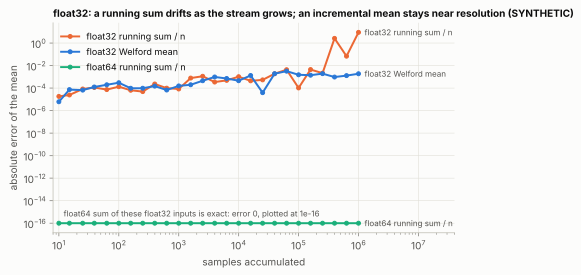
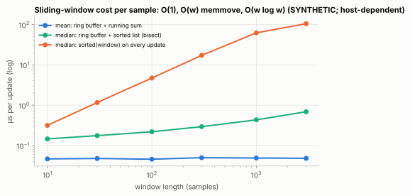
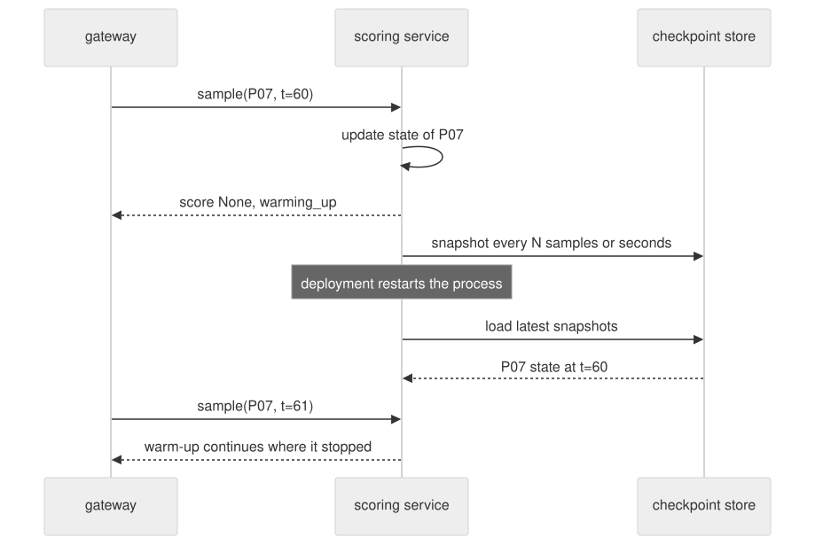

# H10.3 Stateful online inference

**Status: Reviewed** (sources and verification at the end). Used by lesson
[w5d3](../../../labs/w5d3_online_inference/README.md); continued in H11.2 (the same rules as HTTP
status codes) and H15 (monitoring).

## H10.3.1 Overview

A model evaluated offline is a function of a table. A model in production is often a function of a
*stream*: readings arrive one at a time, from many machines, over networks that delay, repeat and
reorder them, into processes that are restarted for every deployment. Turning the first into the second
means making explicit everything the table gave for free: what the model has seen so far (state), what
order things happened in, what to say when it does not yet know, and how to survive a restart. The
discipline that keeps the two from drifting apart is **parity testing**: the streaming implementation
must reproduce the batch implementation on recorded data, within a stated tolerance, and the test runs
in CI.

## H10.3.2 Batch functions and their streaming twins

Let a batch scorer be `y = f(x_1..x_T)`, one output per input row. A **causal** batch scorer has
`y_t = f_t(x_1..x_t)`: no output depends on later rows (w2d5 made every project feature causal). Every
causal scorer can be written as a state machine

```
(s_t, y_t) = g(s_{t-1}, x_t),     s_0 = initial state
```

and the engineering question is how small `s` can be. Three common cases:

| Batch computation | Minimal streaming state | Memory |
|---|---|---|
| statistics of a fixed prefix (burn-in calibration) | running accumulators until the prefix ends, then frozen parameters | O(1) |
| exponentially weighted statistics (EWMA, CUSUM) | the current weighted values | O(1) |
| statistics of the last `w` samples (rolling mean, median, max) | the last `w` samples in a ring buffer, plus an accumulator or an ordered structure | O(w) |
| anything over the whole history (e.g. global median) | the whole history, or a sketch (approximate quantiles) | O(T) exact, O(1/ε) approximate |

A non-causal batch computation (a centred window, a whole-recording normalisation, zero-phase
filtering) **has no exact streaming twin**. Either the batch version is changed to a causal one before
it is evaluated, or the streaming version is accepted as a different model and evaluated as such.



*Diagram H10.3-1. The offline numbers are evidence about the streaming service only if a parity test
ties the two code paths together.*

## H10.3.3 Numerics of running statistics

**Mean and variance.** The one-pass formula `var = Σx²/n - (Σx/n)²` suffers catastrophic cancellation
when `|μ| ≫ σ`: its relative error is at least of order `ε(μ/σ)²` (`ε ≈ 1.1e-16` in float64,
`≈ 6e-8` in float32) and grows with the number of terms. Welford's recurrence

```
n ← n + 1;   δ ← x − m;   m ← m + δ/n;   M2 ← M2 + δ·(x − m)
population variance = M2/n,   sample variance = M2/(n − 1)
```

subtracts only quantities of the size of a deviation. It is not immune: the mean is itself accumulated
with rounding error, so its accuracy degrades slowly as `|μ|/σ` grows (lesson w5d3 measures relative
variance errors of 1.7e-8 at `μ/σ = 2e9`, against 3.5e3 for the naive formula). Subtracting a constant
close to the mean (the first sample is a cheap choice) before accumulating removes most of what is
left. Two running summaries can also be merged exactly (Chan et al.'s parallel formula,
`M2 = M2_a + M2_b + δ²·n_a·n_b/n`), which is how distributed systems compute variances.

**Long streams in low precision.** A running *sum* in float32 loses information once the sum is so
large that a new term is below its resolution: with values near 1000, after 10⁶ samples the mean
computed as `sum/n` in float32 was off by 8.9 in the experiment of Figure H10.3-1, while an incremental
float32 mean stayed within 2e-3 (the resolution of float32 at 1000 is about 6e-5). Edge devices and GPU
kernels often accumulate in float32; accumulate in float64 or update means incrementally.



*Figure H10.3-1 (SYNTHETIC: 10⁶ samples, mean 1000, SD 1, generated in float64 and rounded to
float32). The float64 sum of float32 inputs is exact here because the partial sums never need more than
53 bits; the error is 0 and is plotted at 1e-16. Values in `../figures/h10_3/figure_data.csv`.*

**Tolerances.** A parity test needs a tolerance, and the tolerance needs a reason: the scale of the
scores, the condition of the computation, and the decision made from the score. Score parity within
`tol` does not imply decision parity: a score within `tol` of a threshold can fall on either side. A
complete parity test therefore compares (a) scores within a tolerance, (b) the positions of missing
scores exactly, and (c) the decisions, reporting the smallest distance from any score to the threshold.

## H10.3.4 Windows and ring buffers

A sliding window of length `w` needs the last `w` values, because each one must be removed when it
leaves the window. A **ring buffer** (`collections.deque(maxlen=w)` in Python; a fixed array with a
head index in C) stores them in O(w) memory with O(1) append and evict. What you keep *besides* the
buffer decides the cost per sample:

* sum, mean, variance: a running accumulator (add the new value, subtract the evicted one), O(1). The
  subtract-on-evict sum accumulates rounding error over very long streams; recompute it from the buffer
  every `k·w` samples if exactness matters.
* minimum/maximum: a monotonic deque of candidates, amortised O(1).
* median and quantiles: an ordered structure. A sorted Python list with `bisect` costs O(w) per update
  (memory moves) but has a tiny constant; two heaps with lazy deletion cost O(log w).



*Figure H10.3-2 (SYNTHETIC data; one host, values in `figure_data.csv`).* Recomputing `sorted(window)`
on every sample costs 104 µs at `w = 3000`, 150 times the incremental version (0.69 µs).

## H10.3.5 Delivery semantics: order, duplicates, gaps

Networks and message brokers offer **at-most-once** (may lose) or **at-least-once** (may repeat)
delivery; "exactly once" is achieved, where it is achieved, by an idempotent receiver. A streaming
scorer must therefore define, as part of its contract:

| Situation | Recommended rule | Why |
|---|---|---|
| invalid sample (missing, non-finite, wrong type) | reject, state unchanged | garbage in the state cannot be removed later |
| timestamp earlier than the last accepted | reject, state unchanged (or buffer until a watermark, if late data is common and latency allows) | out-of-order updates make state depend on arrival order |
| identical timestamp and value (a retry) | return the previous answer, state unchanged | idempotency: one copy or five, same state |
| same timestamp, different value | reject as a conflict | the service cannot know which is true |
| gap longer than a limit | flag; optionally reset calibration | a long stop may mean a restart at a new operating point |
| before enough data (warm-up) | no score, explicit status | a fabricated value is indistinguishable from a measurement |

Two invariants make these rules safe: **validate everything before mutating anything**, and **a
rejection never changes the state**. Then any rejected message can be retried, logged, or dropped
without corrupting the model's view of the machine.

## H10.3.6 Persistence, restarts and many streams

A service holds one state per stream (per machine, per user, per device), usually in a dictionary in
memory. Processes restart for deployments, crashes and scaling, so state must be **checkpointed**:
serialised to a durable store and restored on start. Practical rules:

* Snapshot to plain data (JSON, or a schema'd binary format), never by pickling objects: a snapshot
  outlives the code that wrote it, and unpickling runs code.
* Version snapshots, and refuse to restore one taken with a different model version: a calibration from
  model A combined with the threshold of model B is silent nonsense.
* Snapshot *everything* the next update reads, including warm-up accumulators: restoring only the final
  parameters works after the warm-up and fails during it, which is exactly when restarts cluster
  (start-up).
* Decide the checkpoint frequency from the cost of replay: if the raw stream is retained, a lost
  checkpoint can be rebuilt by replaying from the last one.
* Concurrency: two requests for the same machine must not update its state at the same time. Use one
  lock per stream (or route each stream to one worker); a global lock serialises the whole service.



*Diagram H10.3-2. A restart in the middle of a burn-in continues from the checkpoint instead of
silently starting a new calibration.*

## H10.3.7 Practical decisions and tradeoffs

* **One code path or two?** If the batch function can be written as a loop over the streaming update,
  do that (`hysteresis_batch` in the w5d3 challenge): parity then holds by construction, at the cost of
  batch speed. If batch must be vectorised for speed, keep both and test parity.
* **Exact or approximate state?** Exact quantiles over unbounded history need unbounded memory;
  quantile sketches (t-digest, KLL) trade a bounded error for bounded memory. Decide from the decision
  that uses the quantile.
* **Flag or reset at gaps?** A domain question. Make it a named parameter, evaluate offline with the
  batch definition that matches it, and log which policy is deployed.
* **Where does state live?** In-process (fast, lost on crash without checkpoints), in an external store
  such as Redis (shared by replicas, adds a network round trip per sample), or in a stream processor
  with built-in state and checkpoints (Flink, Kafka Streams) when the scale justifies operating one.

## H10.3.8 Common failure modes

* Fabricated warm-up values (`0.0`, the last score, the training mean).
* Sample instead of population SD, or any other difference between the calibration in training and in
  serving (the 0.5 % skew of the w5d3 mutant).
* Centred windows or whole-recording normalisation in the evaluated model, with a causal version in
  serving: the offline numbers describe a model nobody runs.
* Retries counted twice; out-of-order samples silently accepted.
* State that grows with the stream (lists of past values, unbounded dictionaries of machines never
  removed).
* Snapshots that omit warm-up accumulators, or that are restored into a different model version.
* A global lock around all streams, or no lock at all.
* Parity tested on a toy series only: test on recorded production-like data, including gaps, retries
  and a value range that stresses the numerics.

## H10.3.9 Quick reference

```python
# Welford, population variance
n += 1; d = x - mean; mean += d / n; m2 += d * (x - mean); var = m2 / n

# ring buffer
from collections import deque
buf = deque(maxlen=w); buf.append(x)          # evicts automatically when full

# parity test skeleton
batch = detector.score_batch(run)
stream = [scorer.update(r).score for r in run.to_dict("records")]
stream = np.array([np.nan if s is None else s for s in stream])
assert (np.isnan(batch) == np.isnan(stream)).all()
np.testing.assert_allclose(stream[~np.isnan(batch)], batch[~np.isnan(batch)], rtol=1e-9, atol=1e-9)
assert ((stream >= thr) == (batch >= thr))[~np.isnan(batch)].all()     # decisions, too
```

Contract checklist for a streaming scorer: warm-up status; invalid, late, duplicate and conflicting
samples; gap policy; snapshot format and version check; O(1) (or O(w)) state; per-stream locking.

## H10.3.10 Sources and verification status

* Welford, B. P. (1962), "Note on a method for calculating corrected sums of squares and products",
  *Technometrics* 4(3), 419-420. **From memory; not re-opened this session.** The recurrence and its
  behaviour were verified by execution (lesson w5d3 worked example; Figure H10.3-1).
* Chan, T. F., Golub, G. H., LeVeque, R. J. (1983), "Algorithms for computing the sample variance:
  analysis and recommendations", *The American Statistician* 37(3), 242-247: the merge formula and
  the error analysis of one-pass algorithms. **From memory.** The merge formula was checked numerically
  (300 + 500 SYNTHETIC values: merged variance equal to `np.var` of the concatenation to all printed digits).
* Higham, N. J., *Accuracy and Stability of Numerical Algorithms* (2nd ed., SIAM, 2002), chapter on
  summation: background for the cancellation and accumulation arguments. **From memory.**
* Delivery semantics (at-most-once, at-least-once; idempotent receivers), MQTT QoS levels, watermarks,
  and the stream processors named in H10.3.7 are described from general knowledge; **no documentation
  was opened for them this session**.
* `collections.deque(maxlen=...)` and `bisect.insort` behaviour: verified by execution (Figure
  H10.3-2 and the w5d3 interview-rep tests).
* All numbers in this section come from `handbook/figures/h10_3/make_figures.py` or from lesson w5d3
  scripts, executed on 2026-11-22 (Python 3.13.18, NumPy 2.5.3). Timings depend on the host.
