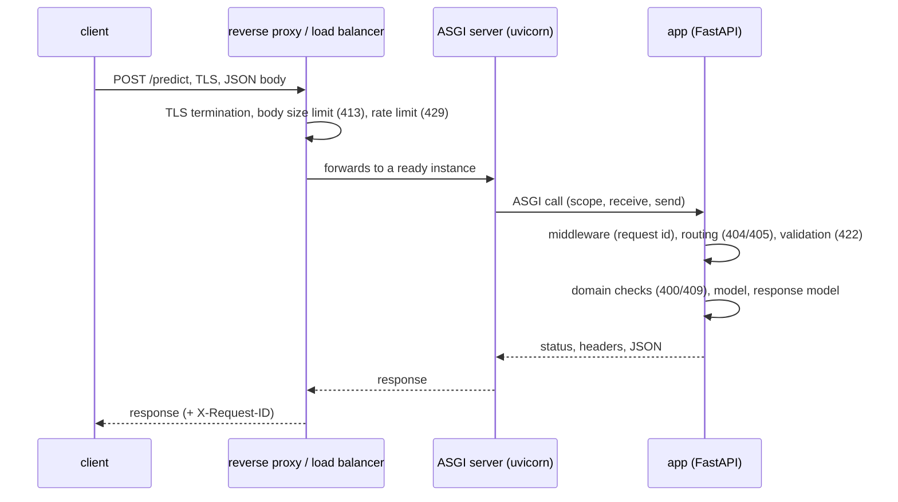
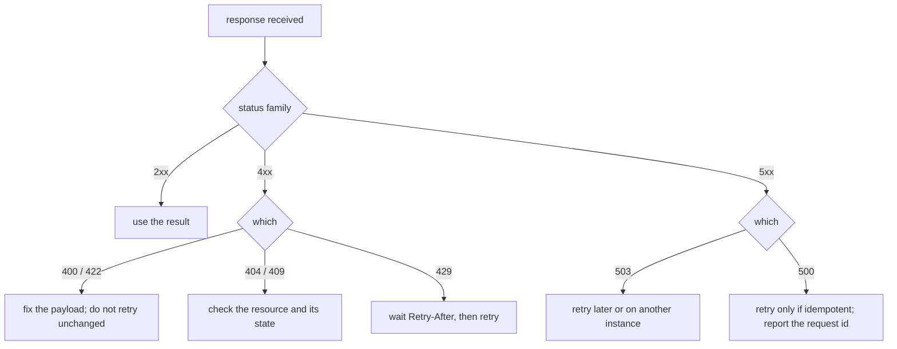

# H11.1 HTTP for ML engineers

**Status: Reviewed** (sources and verification at the end). Used by lesson
[w5d4](../../../labs/w5d4_fastapi_validation/README.md); schemas and validation continue in
[H11.2](h11_2_schemas_and_validation.md).

## H11.1.1 Overview

Most models in industry are reached over HTTP: a client sends a request with a method, a path, headers
and usually a JSON body; the service answers with a status code, headers and a body. Nothing in that
exchange is specific to machine learning, which is exactly why it matters: the client team will treat
your model like any other service, branch on your status codes, retry according to them, and cache,
log and monitor according to the headers. An ML engineer needs enough HTTP to make those defaults work
for the model instead of against it: the right method, status codes that tell the client what to do
next, one error format, health and readiness endpoints, request ids, and limits.

## H11.1.2 Anatomy of one prediction request



*Diagram H11.1-1. Several components can answer before your code runs; a 413 or 429 may never reach
your logs. That is why the request id should be generated as early as possible and echoed.*

Terms:

* **Method.** `GET` reads, `POST` submits data for processing, `PUT` creates or replaces a resource at
  a known URL, `DELETE` removes it, `PATCH` modifies part of it.
* **Safe** methods do not change server state (`GET`). **Idempotent** methods have the same effect
  whether applied once or many times (`GET`, `PUT`, `DELETE`). `POST` is neither in general.
  A prediction endpoint is usually `POST` because the input is a body that may be large and structured,
  not because it changes anything; if it is side-effect free, clients may retry it freely.
* **Headers** carry metadata: `Content-Type: application/json`, `X-Request-ID`, `Retry-After`,
  caching and authentication headers.
* **Body**: JSON for most ML APIs. JSON has no NaN or Infinity and no datetime type (ISO 8601 strings
  by convention), and its numbers have no declared precision.

## H11.1.3 Status codes as instructions to the client

A status code is a machine-readable instruction. Group them by what the client should do next:

| Family | Meaning | Client action | Codes an ML service commonly needs |
|---|---|---|---|
| 2xx | success | use the body | 200 OK, 201 Created, 204 No Content |
| 4xx | the request is wrong or not allowed now | fix the request, or the precondition, then resend; do not blindly retry | 400 Bad Request, 401/403 (auth), 404 Not Found, 405 Method Not Allowed, 409 Conflict, 413 Content Too Large, 422 Unprocessable Content, 429 Too Many Requests |
| 5xx | the server failed | retry with back-off if idempotent; report with the request id | 500 Internal Server Error, 502/504 (proxy could not reach or wait for the app), 503 Service Unavailable |

Distinctions that come up in every API review:

* **400 vs 422.** FastAPI uses 422 for every schema violation, with a list of field paths. 400 is then
  free for requests that match the schema but are unacceptable as a whole (a time series that is not in
  time order). Some teams use 400 for everything; consistency matters more than the choice.
* **404 vs 409.** 404: the named thing does not exist. 409: it exists, and the request conflicts with
  its current state (a sample older than the last accepted one; a resubmitted id with different content).
* **429 and 503** both mean "not now"; 429 is about this client's rate, 503 about the service. Both may
  carry `Retry-After`.
* **500** means the server has a bug or an unhandled condition. The body should say nothing about
  internals; the logs should say everything, keyed by the request id.



*Diagram H11.1-2. What a well-behaved client does with each answer. A service whose codes do not match
this table forces every client to special-case it.*

## H11.1.4 Liveness, readiness, version

Orchestrators (Kubernetes, ECS, a load balancer's target groups) probe services. Two questions, two
endpoints:

* **Liveness** (`/healthz`): can the process answer at all? If not, restart it. It must not depend on
  the model, a database or anything else that a restart does not fix, or a dependency outage turns into
  a restart storm.
* **Readiness** (`/readyz`): can it do its job now (model loaded, compatible, warm)? If not, stop
  sending it traffic, but do not restart it.
* **Version** (`/version`, or fields in every response): the API version, the package version, the
  model version. Every prediction response should name the model version that produced it; without it,
  a complaint about a prediction cannot be reproduced after the next deployment.

## H11.1.5 Request ids and error bodies

Every request gets an id (accept a well-formed incoming `X-Request-ID` so ids can span services,
otherwise generate one), the id is returned in a header and in every body, and every log line about the
request carries it. Every error uses one body shape, for example

```json
{"error": {"code": "validation_error", "message": "the request does not match the schema",
           "request_id": "3bcc38c7...", "details": [{"loc": ["body", "samples", 3, "flow_rate"],
           "type": "missing", "msg": "Field required"}]}}
```

with `code` a stable machine-readable string (clients branch on it), `message` for humans, `details`
for field-level problems. Do not echo the client's input back in errors (it may be large or
sensitive), and never put exception text or tracebacks in a 500.

## H11.1.6 Concurrency in an ASGI server

Uvicorn runs an event loop per worker process. FastAPI runs `async def` path operations on that loop
and plain `def` path operations in a thread pool. A CPU-bound model call inside `async def` blocks the
loop and with it every other request of that worker, health checks included; inside `def` it runs in a
thread, and the loop stays responsive. Because of Python's GIL, threads do not give parallel CPU work
in one process; throughput for CPU-bound models comes from several worker processes (or from models
that release the GIL in native code). Per-request work that awaits I/O (calling another service,
reading a store) is where `async def` pays off.

## H11.1.7 Practical decisions and tradeoffs

* **Batch endpoint or one sample per request?** Per-request overhead in the w5d4 measurements was about
  3 ms in process; per-sample cost about 10 µs above 1,000 samples. One sample per request is 300 times
  more expensive per sample, but it is what a streaming client naturally sends; offer both if both
  clients exist, and measure.
* **Limits.** Bound the body size (proxy or app), the number of items (schema), and per-client rate
  (proxy). Each protects something different: memory before parsing, CPU after parsing, fairness.
* **Versioning.** Put the API version in the path (`/v1/predict`) or a header once a second version
  exists; keep the model version in every response from the start.
* **Bind addresses.** `127.0.0.1` for local work; `0.0.0.0` only behind a network boundary you control,
  with authentication in front of anything reachable from outside.

## H11.1.8 Common failure modes

* 200 with an error message in the body; or 500 for a client's mistake.
* One health endpoint used for both liveness and readiness.
* Tracebacks, paths or SQL in error bodies.
* No model version in responses; no request id in logs.
* CPU-bound handlers declared `async def`.
* Two error formats (the framework's default 422 and your own for everything else).
* `POST` handlers with side effects and no idempotency, retried by clients after timeouts.

## H11.1.9 Quick reference

```text
2xx use it      200 OK   201 Created   204 No Content
4xx fix it      400 domain rule  404 unknown thing  405 wrong method  409 state conflict
                413 too large    422 schema violation  429 too many (Retry-After)
5xx not you     500 bug (report request id)  503 not ready / overloaded (retry)
/healthz  alive?  -> restart if no        /readyz  able?  -> stop routing if no
every response: X-Request-ID, model_version      every error: {"error": {code, message, request_id, details}}
CPU-bound handler: def (thread pool), not async def
```

## H11.1.10 Sources and verification status

Opened this session (source files on GitHub, 2026-11-22):
* FastAPI documentation: `advanced/events.md` (lifespan; startup/shutdown events deprecated in favour
  of lifespan), `tutorial/handling-errors.md` (`RequestValidationError`, overriding handlers,
  Starlette's `HTTPException`), `async.md` (plain `def` path operations run in an external thread pool),
  `advanced/request-body-limits.md` (`max_body_size`, 413), `tutorial/testing.md`,
  `advanced/testing-events.md`.
* Starlette documentation: `exceptions.md` (500 handlers, `debug=True` returns tracebacks),
  `testclient.md` (`raise_server_exceptions=False`), `lifespan.md`.
* Uvicorn documentation: `settings.md` (`--limit-concurrency` answers 503; no body-size option is listed).
Verified by execution: every status code produced by the lesson's reference app (30 checks), the 413 of
`FastAPI(max_body_size=1000)`, the thread-pool path in a traceback of FastAPI 0.165.

**Not opened (blocked from this environment):** RFC 9110 (HTTP Semantics). Status-code semantics, safe
and idempotent methods, and the name "422 Unprocessable Content" (as printed by uvicorn 0.54) are
stated from general knowledge and from server output; re-check against RFC 9110 sections 9 and 15.
Statements about orchestrator probes (Kubernetes liveness/readiness) are from general knowledge.
