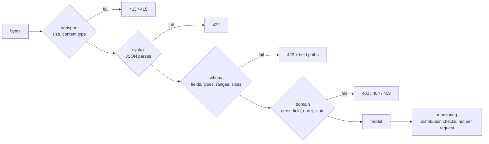
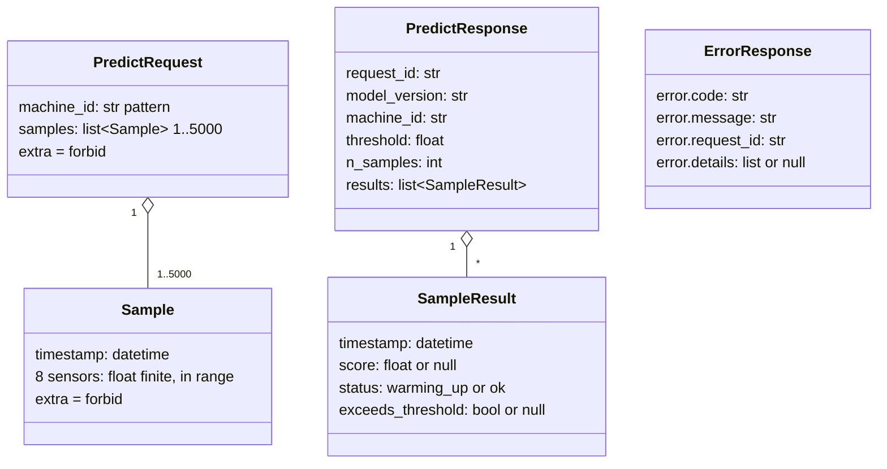

# H11.2 Schemas and validation

**Status: Reviewed** (sources and verification at the end). Used by lesson
[w5d4](../../../labs/w5d4_fastapi_validation/README.md); builds on
[H11.1](h11_1_http_for_ml_engineers.md) and on data-quality checks (H4.1).

## H11.2.1 Overview

A schema is a contract written as code: the fields a request must have, their types, their allowed
values, and what happens to anything else. With pydantic v2 and FastAPI, one class definition gives
three things at once: runtime validation with precise error paths, Python objects your code can trust,
and an OpenAPI document clients can read and generate code from. The engineering questions are which
constraints to write, which checks are *not* schema checks, and how strict to be.

## H11.2.2 Layers of validation



*Diagram H11.2-1. Each layer answers a different question and has a different failure answer. The last
one does not reject requests at all: whether inputs resemble the training data is a statistical
question over many requests (week 7), not a validation rule.*

| Layer | Question | Example rule | Where |
|---|---|---|---|
| transport | can we even read it? | body at most 4 MB | proxy or `FastAPI(max_body_size=...)` |
| syntax | is it JSON? | parses | framework |
| schema | is each field well-formed? | `flow_rate` finite, in [0, 500]; at most 5,000 samples; no unknown fields | pydantic model |
| domain | is the request meaningful as a whole, here and now? | timestamps strictly increasing; machine registered; sample not older than the last | endpoint code |
| distribution | do inputs still look like training data? | PSI of `flow_rate` over the last day | monitoring job |

## H11.2.3 Pydantic v2 essentials for ML inputs

```python
from datetime import datetime
from pydantic import BaseModel, ConfigDict, Field

class Sample(BaseModel):
    model_config = ConfigDict(extra="forbid")                 # unknown fields are errors
    timestamp: datetime                                       # ISO 8601 string -> datetime
    flow_rate: float = Field(ge=0, le=500, allow_inf_nan=False)

class PredictRequest(BaseModel):
    model_config = ConfigDict(extra="forbid")
    machine_id: str = Field(pattern=r"^[A-Za-z0-9][A-Za-z0-9_./-]{0,63}$")
    samples: list[Sample] = Field(min_length=1, max_length=5000)
```

* **`extra`.** The default is `"ignore"`: unknown fields are dropped silently. For an inference API,
  `"forbid"` is almost always right: a misspelled optional field or a field the client wrongly believes
  is used should be an error, not a no-op.
* **Numeric constraints.** `ge`, `le`, `gt`, `lt`, `multiple_of`. `allow_inf_nan=False` rejects NaN and
  ±infinity with error type `finite_number`. Ranges alone also reject NaN (every comparison with NaN is
  false) but report `less_than_equal`, which is misleading, and fields without ranges let NaN through.
* **Sizes and patterns.** `min_length`/`max_length` on lists and strings; `pattern` on strings.
* **Lax vs strict.** By default (lax mode) pydantic coerces compatible inputs: `"23.5"` to `23.5`,
  `1` to `1.0`. `ConfigDict(strict=True)` or `Field(strict=True)` refuses coercion. Lax is friendlier
  to clients in loosely typed languages; strict catches clients that send numbers as strings by
  accident. Choose and document.
* **Cross-field rules.** `@field_validator` checks one field with custom logic; `@model_validator(
  mode="after")` sees the whole object (e.g. "timestamps increasing"). A rule written there becomes a
  422 with the other schema errors; written in the endpoint it can be a 400. Either is consistent if
  documented.
* **Errors.** `ValidationError.errors()` gives one dict per problem with `loc` (the path, e.g.
  `("samples", 3, "flow_rate")`), `type` (stable, e.g. `missing`, `extra_forbidden`, `finite_number`,
  `less_than_equal`, `too_long`, `float_parsing`, `string_pattern_mismatch`), `msg` (human text that may
  change between versions) and `input` (the offending value). Clients and tests should rely on `loc` and
  `type`, not `msg`; servers should not echo `input` back.



*Diagram H11.2-2. The w5d4 contract. Request models constrain; response models document and filter
what is returned (FastAPI validates and filters return values against `response_model`).*

## H11.2.4 Choosing the constraints

* **Sanity limits, not training ranges.** Reject what cannot be a valid reading (negative flow, a
  voltage of 9,999, a sentinel such as -9999, NaN). Do not reject what is merely unusual: a real fault
  produces unusual values, and the detector exists to score them. In w5d4 the flow limit is [0, 500]
  L/min while training data never exceeded 134.
* **Units belong in the contract.** Name them in field descriptions (they appear in OpenAPI); if
  several units must be accepted, make the unit an explicit enum field, never an ignored extra.
* **Sizes from capacity.** The maximum batch follows from memory and latency budgets (w5d4 measured
  about 10 µs per sample, so 5,000 samples is about 50 ms), not from "big enough".
* **Identifiers.** Restrict the alphabet and length; ids end up in logs, file names, metrics labels and
  URLs.
* **Time.** Decide whether naive timestamps are allowed, and never mix naive and timezone-aware values
  in one comparison (Python raises `TypeError`, which becomes a 500 unless checked).

## H11.2.5 Response models and the published contract

Declaring the response model (`response_model=PredictResponse` or a return annotation) makes FastAPI
validate and filter what the endpoint returns, so an internal field added later does not leak, and it
puts the response shape into the OpenAPI document. `GET /openapi.json` is then a machine-readable
contract: field types, required fields, `minimum`/`maximum`, `maxItems`, `additionalProperties: false`.
Testing the contract (as the w5d4 checks do) catches a constraint that was deleted by accident even if
no request in the test suite happens to violate it.

## H11.2.6 Data validation is not model evaluation

Validation answers "is this input well-formed and admissible?" for one request, deterministically.
Model evaluation answers "how good are the predictions?" over many labelled examples, statistically.
Distribution monitoring answers "do the inputs still resemble the training data?" over many unlabelled
requests, statistically. A perfectly valid input can be far outside the training distribution, and a
model can be wrong on perfectly typical inputs. Keeping the three apart avoids two classic mistakes:
rejecting real anomalies at the API because they look unusual, and believing a model is fine because
no request failed validation.

## H11.2.7 Common failure modes

* Default `extra="ignore"`: misspelled or unsupported fields silently dropped.
* NaN accepted because no field rejects it explicitly; or rejected with a misleading message.
* Training-data ranges used as validation limits, so real faults become 422s.
* Validation messages (`msg`) asserted in tests; they change across pydantic versions.
* Errors that echo the full input back to the client.
* Cross-field rules implemented in two places with different behaviour.
* Response model not declared, so internal fields leak and the published contract is incomplete.

## H11.2.8 Quick reference

```python
model_config = ConfigDict(extra="forbid")                     # strict=True to refuse coercion
x: float = Field(ge=lo, le=hi, allow_inf_nan=False, description="unit ...")
items: list[Item] = Field(min_length=1, max_length=N)
name: str = Field(pattern=r"^[A-Za-z0-9_.-]{1,64}$")
@model_validator(mode="after")                                # whole-object rules
def check(self): ...; return self
try: Model.model_validate_json(text)
except ValidationError as e: [(d["loc"], d["type"]) for d in e.errors()]
```

## H11.2.9 Sources and verification status

Opened this session (source files on GitHub, 2026-11-22):
* pydantic documentation: `concepts/fields.md`, `concepts/config.md` (including `strict`),
  `concepts/validators.md` (`field_validator`, `model_validator`, modes).
* FastAPI documentation: `tutorial/body-fields.md`, `tutorial/extra-data-types.md` (datetime handling),
  `tutorial/response-model.md` (response models limit and filter output data),
  `tutorial/query-param-models.md` (forbidding extra fields), `tutorial/handling-errors.md`.
Verified by execution with pydantic 2.13.5 / FastAPI 0.165.0: the error types listed in H11.2.3
(`finite_number`, `less_than_equal` for NaN under a range, `extra_forbidden`, `too_long`, `too_short`,
`float_parsing`, `string_pattern_mismatch`, `missing`), lax coercion of `"23.5"`, the OpenAPI fields
(`maximum`, `maxItems`, `additionalProperties: false`), and the `TypeError` from comparing naive and
aware datetimes (it turned into a 400 only after an explicit check).
The pages above did not state `allow_inf_nan`; its behaviour was established by execution only.
From general knowledge, not re-opened: the population stability index (PSI) mentioned as a monitoring
example (treated in H15.3).
