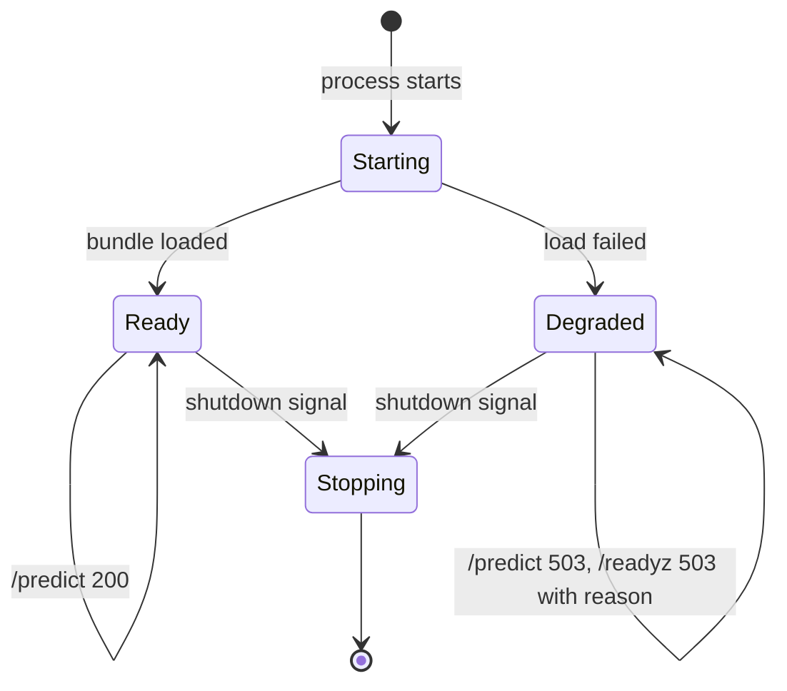
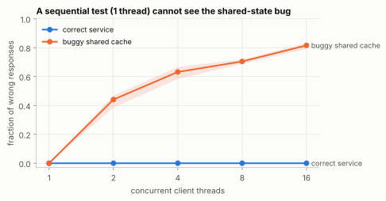

# H11.3 — Lifecycle and concurrency in a prediction service

**Chapter 11: FastAPI and input validation** · Section id `H11.3` · **Content status:** Reviewed
(FastAPI, Starlette and uvicorn statements checked against the documentation sources in §H11.3.8;
the lifecycle and race behaviour executed in lesson [w5d5](../../../labs/w5d5_api_testing/README.md)).

Used by: [w5d5](../../../labs/w5d5_api_testing/README.md), [w5d6](../../../labs/w5d6_project_milestone_2/README.md);
later w6d4 (latency) and w7d5 (reliability). Sections H11.1 (HTTP for ML engineers) and H11.2 (schemas
and validation) are written with lesson w5d4.

---

## H11.3.1 Overview

Two questions decide whether a prediction service behaves under real conditions: *when* does the model
exist inside the process, and *what* runs at the same time once requests arrive. Getting the first wrong
gives a service that reports "ready" while it can only fail; getting the second wrong gives answers that
are correct one at a time and wrong under load. Both are invisible to offline evaluation.

## H11.3.2 The lifespan

A FastAPI (Starlette) application can declare a lifespan: an async context manager whose code before
`yield` runs at startup, before the server accepts requests, and whose code after `yield` runs at
shutdown, after connections have closed.

```python
@asynccontextmanager
async def lifespan(app: FastAPI):
    try:
        app.state.model = load_bundle(model_dir)      # startup
    except BundleError as exc:
        app.state.model, app.state.load_error = None, str(exc)
    yield
    app.state.model = None                            # shutdown

app = FastAPI(lifespan=lifespan)
```

Why not load at import or in `create_app`? Import-time loading makes every `import` of the module slow
and failure-prone (tests, tooling, documentation builds), and binds the model path at import. Loading in
the lifespan ties the model to the running process, which is what readiness reports on.



**Liveness and readiness** are different questions. Liveness (`/healthz`): is the process able to answer at
all? If not, restart it. Readiness (`/readyz`): should it receive traffic now? If not, route elsewhere and
wait. A process whose model failed to load is alive and not ready. Restarting it will not fix a corrupt
bundle; routing traffic to it will only produce errors.

**Start degraded or crash?** Degraded start keeps the process observable and lets a rolling deployment
stall visibly while the old version keeps serving. Crashing makes a broken deployment fail fast. With an
orchestrator that honours readiness and an alert on "unready for more than N minutes", degraded start is
better; with a bare supervisor and no readiness checks, crash.

## H11.3.3 What runs concurrently

FastAPI runs a plain `def` path operation in an external thread pool, and awaits an `async def` one on the
event loop. Consequences for CPU-bound inference:

| Endpoint style | Where it runs | Effect of CPU-bound NumPy work |
|---|---|---|
| `def predict(...)` | thread-pool worker | other requests proceed in other threads; NumPy releases the GIL in many kernels |
| `async def predict(...)` | the event loop | blocks every other request of that process until it returns |
| several worker processes (`uvicorn --workers N`) | N independent processes | true parallelism; N copies of the model in memory; no shared Python state |

The GIL lets one thread execute Python bytecode at a time, but the interpreter switches threads between
bytecodes, and C extensions such as NumPy release the GIL inside many operations. "The GIL protects me"
is therefore false for any multi-step read-modify-write on shared state.

## H11.3.4 Shared state

State reachable from more than one request is shared: module globals, attributes of the app object, of
the model object, of a cached client. Reading immutable shared state (model parameters loaded once) is
safe. Writing shared state inside a request and reading it back later in the same request is a race:
another request can write in between.



*Figure H11.3-1 (w5d5 worked example, real runs).* The defective service is always right with one client
thread and wrong for 44-82 % of responses with 2-16 threads. Sequential tests cannot see this defect.

Rules that remove the class of defect instead of testing for it:

1. Keep request data in local variables only.
2. Load models once at startup; never mutate them inside a request.
3. If you need a cache, key it by the request's content, make it safe for concurrent use (a lock, or an
   immutable value per key), and test it under concurrency.
4. Per-process state (counters, rate limiters) does not aggregate across workers; use the metrics system
   or an external store for anything that must (w7d1).

## H11.3.5 Reload, workers and memory

`uvicorn --reload` restarts the server when source files change; it is a development convenience and is
mutually exclusive with `--workers`. Each worker process runs its own lifespan and loads its own copy of
the model; memory grows linearly with workers. For a 400-byte z-score model this is irrelevant; for a
2 GB model it decides the worker count. `--limit-concurrency` makes uvicorn answer 503 immediately above
a number of concurrent connections or tasks instead of queueing them (uvicorn settings documentation);
load shedding is discussed with latency in w6d4.

## H11.3.6 Common failure modes

* Model loaded at import time; tests and tools become slow and fail without the artifact.
* Readiness that reports the process, not the model (`/readyz` always 200).
* `async def` endpoints doing CPU-bound work, so one slow request stalls all others in the process.
* A "last request" cache or a reused NumPy buffer on a shared object.
* Assuming state is global when workers are separate processes (a counter that only counts one worker).
* Crash-looping a process on a corrupt artifact with no alert, or the opposite: a degraded process
  nobody alerts on.

## H11.3.7 Quick reference

```text
startup work         -> lifespan, before yield; failures recorded on app.state
liveness  /healthz   -> 200 if the process answers
readiness /readyz    -> 200 only when the model is loaded; 503 with a reason otherwise
CPU-bound endpoint   -> def (thread pool) or more worker processes; not async def
shared state         -> read-only after startup; request data in locals only
tests                -> with TestClient(app) as c  (runs lifespan);  ThreadPoolExecutor for concurrency
```

## H11.3.8 Sources and verification status

Opened in this session (documentation source files on GitHub, 2026-11-22): FastAPI
`docs/en/docs/advanced/events.md` (lifespan) and `docs/en/docs/async.md` (plain `def` path operations run
in an external thread pool); Starlette `docs/lifespan.md` (requests are not served until the lifespan has
run; lifespan state) and `docs/testclient.md`; uvicorn `docs/settings.md` (`--workers`, `--reload` and
their mutual exclusion, `--limit-concurrency`). Executed: the lifecycle and the race (lesson w5d5, FastAPI
0.165.0, Starlette 1.7.0). Not executed: multiple uvicorn workers; the statement that NumPy releases the
GIL in many operations is from general knowledge of NumPy, not re-checked in its documentation here.
