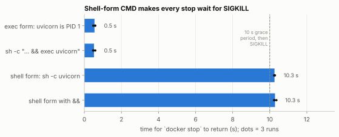



# H12.1 Images, layers and Dockerfiles

**Status: Reviewed** (claims checked against the sources in H12.1.9; the measurements quoted were
executed for lesson [w6d1](../../../labs/w6d1_docker_basics/README.md)).

## H12.1.1 Overview

A container image packages a filesystem and a default command so that one artifact runs the same way
on a laptop, a CI runner and a cloud host. For an ML service the image answers four questions that a
paper's methods section never had to: *what exactly is installed*, *what runs when it starts*, *as
whom and on which interface*, and *how it stops*. A Dockerfile is the recipe; each instruction adds a
cached layer; the order of instructions decides how fast you can iterate; the form of `CMD` decides
whether the service ever hears a stop request.

This section covers images, containers, layers, the build cache, the build context, the command and
signals, users, ports, configuration, health and the common failure modes. Reproducibility over time
(pinning, lockfiles, digests, multi-stage builds) is [H12.2](h12_2_pinning_multistage_smoke_tests.md).

## H12.1.2 What a container is, to the depth an engineer needs

A container is an ordinary Linux process with three kinds of isolation applied by the host kernel:

* **Namespaces** give it its own view of process IDs (it sees itself as PID 1), mounts (its own root
  filesystem), network interfaces (its own `eth0` and loopback), hostname, and user IDs.
* **cgroups** limit and account its CPU, memory and I/O. A container that exceeds its memory limit is
  killed by the kernel's OOM killer (exit code 137, the same code as `docker stop`'s SIGKILL).
* **A union (overlay) filesystem** stacks the image's read-only layers and adds one writable layer
  per container. Writes go to the writable layer and disappear with the container.

There is no second kernel. Consequences: start-up is a process start (milliseconds plus your own
initialisation), the container can only run binaries for the host's kernel and architecture, and
root inside the container is root on the shared kernel, held back only by namespaces and dropped
capabilities. That last point is why images should run as an unprivileged user.



## H12.1.3 Layers and the build cache

Each `RUN`, `COPY` and `ADD` creates a layer; `ENV`, `LABEL`, `USER`, `EXPOSE`, `CMD` and similar
instructions change only the image configuration. The builder reuses a cached result when:

* the instruction text is unchanged (after variable substitution), and
* every earlier step is unchanged, and
* for `COPY`/`ADD`: the checksums of the copied files are unchanged (modification times do not
  matter);
* for `RUN`: the build arguments in scope are unchanged. The Dockerfile reference states that every
  `RUN` after an `ARG` uses that argument implicitly as an environment variable, so a changed value
  is a cache miss for each later `RUN`. (Measured for w6d1: `ARG BUILD_DATE` after `FROM` re-ran
  `pip install` on every build while `COPY requirements.txt` stayed cached.)

`RUN` is cached on its *text*, not on what it fetches: `RUN pip install fastapi` stays cached even
after a new FastAPI is released, until something above it changes, and then silently picks up the
new version. This is the bridge to H12.2: caching hides drift until it suddenly does not.

**Cost of a rebuild.** If layer *i* costs *c<sub>i</sub>* to build and a change invalidates layer *k*,
the rebuild costs approximately

  *T*<sub>rebuild</sub> = Σ<sub>i ≥ k</sub> *c<sub>i</sub>*.

Order instructions by increasing change frequency so that *k* lies after the expensive steps for most
changes. For a Python service: base image, system packages, dependency file, dependency install,
code, model, metadata. Measured for w6d1: a code edit rebuilt in 1.7-2.0 s with requirements first and
in 20.2-21.4 s with `COPY . .` first.

**Image size** is the sum of all layer sizes, *including files that later layers delete*:

  *S*<sub>image</sub> = Σ<sub>i</sub> *s<sub>i</sub>*, with *s<sub>i</sub>* ≥ 0 for every layer.

A `RUN rm` cannot make an earlier layer smaller. To keep something out of the image, do not add it, or
add and remove it within one `RUN`, or produce it in another stage (H12.2).

## H12.1.4 The build context and `.dockerignore`

`docker build <dir>` makes `<dir>` the build context. Only files in it can be copied, and a
`.dockerignore` at its root removes paths before they are sent. The precise rules (docker/docs "Build
context", and the moby/patternmatcher source they point to):

1. Each line is a pattern; lines starting with `#` are comments; leading and trailing slashes are
   ignored; patterns are cleaned with Go's `filepath.Clean`.
2. Matching uses Go's `filepath.Match` (`*` and `?` never cross a `/`) **anchored at the context
   root**, plus `**`, which matches any number of directories, including zero.
3. A path is excluded if it, or any of its parent directories, matches. A `!pattern` re-includes.
   Patterns are applied in order and the last match wins.
4. The Dockerfile and `.dockerignore` are sent even if excluded, but cannot be copied.

So `__pycache__` excludes only the top-level directory, `**/__pycache__` excludes them at every depth,
and `*` followed by `!src` is an allow-list. The course's checker (`w6d1_dockerlint.DockerIgnore`) is
a line-by-line port of the matcher and agreed with a real build on a test tree.

With BuildKit, the builder requests only the paths that the Dockerfile's `COPY`/`ADD` instructions
reference. Measured for w6d1: with targeted copies, a directory with 344 MB of extra data sent 72 kB
without any `.dockerignore`; with `COPY . .` it sent 360 MB, and the compressed image grew from 90 MB to
450 MB. A `.dockerignore` is therefore both a speed measure and a safety measure: it is what keeps a
`.env`, an SSH key or a dataset out of the image on the day someone writes `COPY . .`.

## H12.1.5 The command, PID 1 and signals

`CMD` and `ENTRYPOINT` each have two forms. The exec form is a JSON array and runs the program
directly; the shell form is a string and runs `/bin/sh -c "<string>"`.

| `ENTRYPOINT` | `CMD` | What runs (PID 1) |
|---|---|---|
| none | `["uvicorn", "app:app"]` | `uvicorn app:app` |
| none | `uvicorn app:app` | `/bin/sh -c "uvicorn app:app"` |
| `["uvicorn"]` | `["app:app", "--port", "8000"]` | `uvicorn app:app --port 8000`; `docker run IMAGE other:app` replaces the CMD part |
| `uvicorn app:app` (shell form) | anything | `/bin/sh -c "uvicorn app:app"`; CMD and `docker run` arguments are ignored |

`docker stop` sends SIGTERM to PID 1, waits 10 s (`--time` / `--stop-timeout`), then sends SIGKILL.
Graceful shutdown therefore needs two things:

1. **The server is PID 1, or PID 1 forwards signals to it.** The shell in the shell form does not
   forward SIGTERM, and Debian's `dash` (the `/bin/sh` of the official Python images) does not replace
   itself with the last command. A shell wrapper is acceptable only if it ends with `exec program ...`.
2. **PID 1 handles SIGTERM.** The kernel does not apply default signal actions to a namespace's init
   process, so a program without a SIGTERM handler ignores the signal there, although the same
   program dies on SIGTERM outside a container. uvicorn and gunicorn install handlers; a hand-written
   server must (`signal.signal(signal.SIGTERM, ...)`). Alternatively `docker run --init` (or `tini` as
   the entrypoint) inserts a minimal init that forwards signals and reaps zombie processes.



*Measured for w6d1 (3 runs each): exec form and `sh -c "... && exec uvicorn"` stopped in 0.5 s with
exit code 0; shell forms took 10.2-10.4 s and exited with 137. A plain Python server in exec form but
without a SIGTERM handler also took 10.24 s.*

## H12.1.6 Users, ports, configuration, health

**User.** Create an unprivileged user with a fixed UID (`useradd --uid 10001 ...`) and switch to it with
`USER`. Copy code and model *before* switching and leave them owned by root: the server can read but
not modify them. A numeric `USER 10001` works without creating the user, but tools that look up the
name (and some Python libraries that need a home directory) behave better with a real account.

**Ports.** Inside the container the server binds `0.0.0.0`, all of the container's interfaces;
`127.0.0.1` there is the container's private loopback and is unreachable from the host. On the host,
`docker run -p HOST_IP:HOST_PORT:CONTAINER_PORT` decides exposure. Without `HOST_IP`, Docker listens on
all host interfaces, and Docker's install documentation warns that published ports bypass `ufw` and
`firewalld` rules. On a workstation, publish on `127.0.0.1`. `EXPOSE` only documents the port.

**Configuration** comes from the environment (`ENV` for defaults, `docker run -e` or an orchestrator
for per-environment values). **Secrets never enter the image**: every layer and every `ENV` is readable
by anyone who can pull it (`docker history`, `docker image inspect`). Pass secrets at run time from a
secret store; for build-time secrets BuildKit has `RUN --mount=type=secret`, which does not persist
them in a layer.

**Logs** go to stdout/stderr (`PYTHONUNBUFFERED=1` so they arrive immediately); Docker and every
orchestrator collect those streams. Writing log files inside the container loses them with the
container.

**Health.** `HEALTHCHECK [--interval --timeout --start-period --start-interval --retries] CMD ...` runs
a command inside the container; after `retries` consecutive failures the status is `unhealthy`. Probe
an endpoint that means "able to serve" (here `/readyz`, which is 200 only once the model is loaded).
Use a tool the image has: slim images have no `curl`, so a `curl` healthcheck fails forever. The check
runs inside the container and cannot detect a wrong `--host` or a wrong port mapping. Orchestrators
such as Kubernetes ignore `HEALTHCHECK` and use their own liveness/readiness probes (the same two
endpoints).



## H12.1.7 Practical decisions and tradeoffs

| Decision | Options | Guidance |
|---|---|---|
| Base image | `python:3.x` (Debian, ~1.6 GB with compilers), `python:3.x-slim` (~179 MB), `python:3.x-alpine` (musl), distroless | Start with `-slim`: glibc, so manylinux wheels install without compiling. Alpine's musl needs musllinux wheels, which many but not all scientific packages publish; check before choosing. Distroless images have no shell, which hardens them and complicates debugging. (Alpine and distroless details: from memory, not re-verified.) |
| Model location | baked in / mounted / downloaded at start | Bake small models (image tag = code + model); mount or download large or frequently changing ones, and report the model version in every response and log line. |
| Dependency installation | `requirements.txt` / `pip install .` / lockfile with hashes | Copy the dependency file alone first. Pin everything with hashes for production (H12.2). |
| Process manager | one uvicorn process / gunicorn with uvicorn workers / several containers | In an orchestrated deployment prefer one process per container and scale containers; multiple workers per container make sense on a single host (w6d4 measures it). |
| `--init` | none / `docker run --init` / `tini` entrypoint | Needed when PID 1 cannot handle signals or spawns children that may become zombies. |
| Healthcheck | in the image / only in the orchestrator | Both are fine; the endpoints are the contract. |

## H12.1.8 Common failure modes

| Failure | Symptom | Cause | Fix |
|---|---|---|---|
| Slow rebuilds | every commit reinstalls dependencies | `COPY . .` before `pip install`, or a changing `ARG` early | dependency file first; volatile args at the end |
| Huge image, leaked files | 1 GB images, `.env` found in a layer | no or `.gitignore`-style `.dockerignore`; `COPY . .` | root-anchored allow-list; targeted COPYs |
| Slow, ungraceful stops | 10 s per stop, exit 137, dropped requests | shell-form CMD; PID 1 without SIGTERM handler | exec form; handler; `--init` |
| Exits immediately | `Exited (1)` | wrong module path, missing PYTHONPATH, missing dependency | `docker logs`; run the command by hand with `--entrypoint sh` |
| Not reachable | reset by peer / empty reply | server bound to 127.0.0.1 in the container | `--host 0.0.0.0` |
| Exposed to the network | reachable from other machines | `-p 8000:8000` | `-p 127.0.0.1:8000:8000` on workstations |
| Never ready | `/readyz` 503 forever | model path wrong or model not copied | check the path inside the image (`docker exec ... ls`) |
| Always unhealthy | API works, status `unhealthy` | healthcheck uses a missing tool | python/urllib check, or install the tool |
| Root in production | security finding | no `USER` | create a user; keep code root-owned |
| OOM kill | exit 137 without `docker stop` | memory limit too low for the model | measure memory (w6d4); raise the limit or shrink the model |

## H12.1.9 Quick reference

```dockerfile
# syntax=docker/dockerfile:1
FROM python:3.12-slim
ENV PYTHONDONTWRITEBYTECODE=1 PYTHONUNBUFFERED=1 PIP_NO_CACHE_DIR=1
WORKDIR /app
COPY requirements.txt .
RUN pip install -r requirements.txt
COPY src/ ./src/
COPY models/ ./models/
RUN useradd --create-home --uid 10001 --shell /usr/sbin/nologin app
USER app
ENV PYTHONPATH=/app/src FLOWGUARD_MODEL_DIR=/app/models/flowguard-z/1.0.0
EXPOSE 8000
HEALTHCHECK CMD ["python", "-c", "import urllib.request; urllib.request.urlopen('http://127.0.0.1:8000/readyz', timeout=2)"]
CMD ["uvicorn", "--factory", "flowguard.api:create_app_from_env", "--host", "0.0.0.0", "--port", "8000"]
```

```bash
docker build -t flowguard:0.6.0 .                      # build (BuildKit)
docker run -d --rm --name fg -p 127.0.0.1:8000:8000 flowguard:0.6.0
docker ps -a                                           # including exited containers
docker logs fg                                         # stdout/stderr of PID 1
docker exec -it fg sh                                  # a shell inside (slim has sh, not bash)
docker exec fg cat /proc/1/cmdline | tr '\0' ' '       # what is PID 1?
docker inspect --format '{{.State.Health.Status}} {{.State.ExitCode}}' fg
docker history flowguard:0.6.0                         # layer sizes
docker image ls flowguard                              # DISK USAGE and CONTENT SIZE
time docker stop fg                                    # graceful? (< 1 s, exit 0)
docker run --rm -it --entrypoint sh flowguard:0.6.0    # debug an image that will not start
```

`.dockerignore` (allow-list): `*`, `!requirements.txt`, `!src`, `!models`, `**/__pycache__`.

## H12.1.10 Sources and verification status

Opened and read for this section (2026-11-22; the rendered docs site was not reachable, so the
documentation sources were read from GitHub):

* Dockerfile reference, `moby/buildkit` `frontend/dockerfile/docs/reference.md`: shell and exec form,
  CMD, ENTRYPOINT (shell-form example with `exec`), USER, HEALTHCHECK options and defaults, ARG
  "Impact on build caching".
* docker/docs `content/manuals/build/concepts/context.md`: build context, `.dockerignore` syntax and
  matching, `**`, negation, Dockerfile-specific ignore files.
* `moby/patternmatcher` `patternmatcher.go` and `ignorefile/ignorefile.go`: the exact matching
  algorithm ported for the course checks.
* docker/docs `content/manuals/build/building/best-practices.md` (pinning base images) and
  `content/manuals/engine/install/ubuntu.md` (apt repository install; derivative distributions "not
  officially supported (though it may work)"; published ports bypass ufw/firewalld).

Verified by execution (Docker Engine 29.10.0, BuildKit, `python:3.12-slim` = Python 3.12.16 on Debian
trixie): stop times and exit codes for exec, shell and `exec`-wrapper forms; PID 1 without a SIGTERM
handler ignoring `docker stop`; dash not replacing itself (PID 1 stays `/bin/sh -c ...`); rebuild times
for both layer orders; an `ARG` re-running a later `RUN` but not a `COPY`; context transfer with and
without `.dockerignore`; `.dockerignore` root anchoring against a real build; `127.0.0.1` binding
unreachable while the healthcheck reports healthy; `docker history` sizes.

From memory, not re-verified here: the namespace/cgroup description (standard Linux documentation);
the kernel rule that a PID namespace's init receives only signals it has handlers for (consistent with
the measurement above, which is what the lesson relies on); Alpine/musl wheel availability; distroless
images; Kubernetes probe behaviour; `--init` using tini; the OOM killer producing exit code 137.

