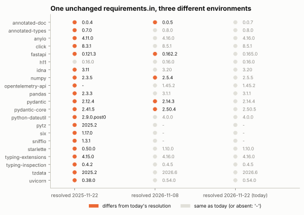
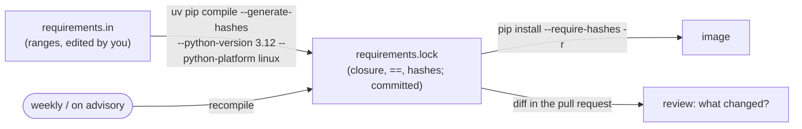
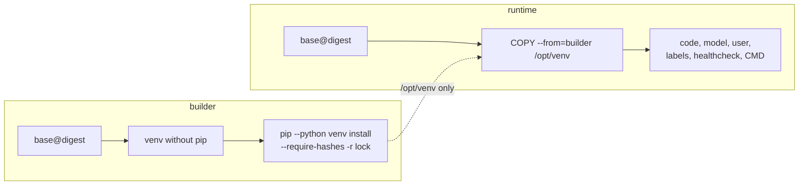
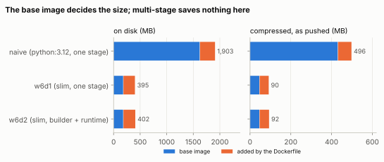



# H12.2 Pinning, multi-stage builds and smoke tests

**Status: Reviewed** (claims checked against the sources in H12.2.9; the measurements quoted were
executed for lesson [w6d2](../../../labs/w6d2_docker_reproducibility/README.md)).

## H12.2.1 Overview

An image built today from an unchanged Dockerfile can differ from the image built last month, because
a build reads two sources outside your repository: the base image behind a tag, and the package index
behind every version range. Reproducibility means turning both into content addresses (an image
digest; a lockfile with exact versions and file hashes for the whole dependency closure) and treating
every change of them as a reviewed, tested change. Multi-stage builds keep build-time material out of
the runtime image by construction. A smoke test checks that the built artifact starts, loads the
intended model and computes the recorded outputs, so that CI can reject a broken image before anyone
deploys it.

## H12.2.2 Where builds drift

| Input | Named by | Moves when | Pinned by |
|---|---|---|---|
| Base image | tag (`python:3.12-slim`) | the publisher rebuilds it (Python patch, Debian security update) | index digest `@sha256:...` |
| Direct dependencies | ranges in `requirements.in` | a new release inside the range appears | `==` in a lock |
| Transitive dependencies | nobody | any dependency's own ranges admit a new release | the full closure in the lock |
| The file for a version | `name==version` | a file is re-uploaded, a mirror is compromised, a private index shadows PyPI | `--hash=sha256:` per file |
| System packages | `apt-get install x` | Debian updates | version pins, or avoid; rebuild deliberately |
| Build cache | implicit | never, until it is cold | regular `--no-cache` builds in CI |

Measured for w6d2 with `uv pip compile --exclude-newer` (resolve using only files uploaded before a
date): the lab's five-line `requirements.in` resolves to 21 packages; between 2025-11-22 and
2026-11-22, 20 of them differ (pandas 2.3.3 to 3.1.1, starlette 0.50.0 to 1.10.0, three packages
dropped, one added); between 2026-11-08 and 2026-11-22, five differ.



The build cache makes this worse, not better: a cached `RUN pip install` layer keeps an old resolution
on one machine while a cold CI runner resolves afresh, so two "identical" builds of one commit differ.

## H12.2.3 Lockfiles and hash-checking mode

Keep two files. `requirements.in` is what you edit: the packages your code imports, with the ranges
it supports. `requirements.lock` is generated by a resolver and committed: every package of the
closure with `==` and the sha256 of every acceptable distribution file.



pip's hash-checking mode (pip documentation, "Secure installs"):

* it is all-or-nothing: a `--hash` on *any* requirement turns it on for the whole install, and
  `--require-hashes` forces it;
* every requirement must be pinned (`==`, a URL or a path), so a lock that forgot transitive
  dependencies fails instead of resolving them;
* every downloaded file's hash must be one of those listed, or nothing is installed.

The three refusals, as observed (pip 25):

```text
ERROR: Hashes are required in --require-hashes mode, but they are missing from some requirements. ...
ERROR: THESE PACKAGES DO NOT MATCH THE HASHES FROM THE REQUIREMENTS FILE. ...
       Expected sha256 c09a4c6e...  Got 693cc8c6...
ERROR: In --require-hashes mode, all requirements must have their versions pinned with ==. These do not:
```

Practical rules:

1. **Resolve for the target, not your laptop.** `--python-version` and `--python-platform` (uv), or run
   pip-compile with the image's Python. A lock compiled on macOS/Python 3.13 may pin versions or omit
   markers that do not fit Linux/Python 3.12.
2. **A lock records what was tested.** Compiling it again today gives today's versions. Upgrades are
   recompiles, reviewed as diffs, followed by the smoke test *and* an evaluation when numerical
   libraries change.
3. **Do not mix hashed and unhashed requirements in one install.** Hash-checking mode would demand
   hashes for the dev tools too; keep a separate dev requirements file (or a dev lock).
4. **`pip freeze` is not a lock**: it records your environment (including unrelated tools), for your
   platform, without hashes.

Alternatives: `uv lock` / `uv.lock` and Poetry's `poetry.lock` are project-level lockfiles with their
own formats; conda environments can be locked with conda-lock. The principle is the same. (These
formats were not exercised in this course.)

## H12.2.4 Pinning the base image

`docker buildx imagetools inspect python:3.12-slim` prints the digest of the multi-platform *index*
(here `sha256:5e2bdb1b...`) and the per-platform manifests beneath it. Pin the index digest:
`FROM python:3.12-slim@sha256:5e2b...`; every machine then pulls its own architecture of that exact
release. Keeping the tag in the reference (`3.12-slim@sha256:...`) is documentation for humans; with
a digest present, the digest decides. Docker's best-practices page recommends digest pinning for
supply-chain integrity and pairing it with a process that updates the digest regularly.

Declaring the base once in a global `ARG` before the first `FROM` lets every stage use the same
reference and lets CI substitute it (`--build-arg PYTHON_BASE=...`), for example to test an update.

## H12.2.5 Multi-stage builds

Each `FROM` starts a stage; `COPY --from=<stage>` copies selected paths from an earlier stage; only
the last stage (or `--target`) becomes the image. Everything else, including any compilers, headers,
caches and downloaded archives in earlier stages, is discarded.



Two constraints for Python: a virtual environment is not relocatable, so create it at the same path
in both stages; and the builder and runtime must use the same Python build (same base digest), because
the venv links to the base's interpreter.

**What it buys depends on the build.** Measured for w6d2, where every dependency is a wheel and the
builder installs nothing extra: single-stage slim 395 MB, multi-stage slim 402 MB (the runtime venv
lacks pip, about -7 MB, but the lock resolved a newer pandas, +8 MB), naive `FROM python:3.12` with
`COPY . .` 1,903 MB. The base image and the dependency list decide the size; multi-stage pays off
when building needs tools the runtime does not (compiling a package without wheels, a frontend build,
a model export, a secret for a private index mounted with `RUN --mount=type=secret`).



## H12.2.6 Provenance labels

OCI annotations in the image config record what the image was built from:
`org.opencontainers.image.version`, `.revision` (the commit), `.source`, `.created`, `.title`. Pass the
values as build arguments from CI (`--build-arg REVISION=$(git rev-parse HEAD)`) and declare the
`ARG`s in the runtime stage (an `ARG` is visible only in its own stage and stages based on it), after
the expensive steps (every later `RUN` sees an `ARG` as an environment variable, so a new commit hash
would invalidate its cache). `docker image inspect --format '{{json .Config.Labels}}'` reads them back.

## H12.2.7 Smoke tests

A smoke test runs the *built artifact* on a fixed input and compares the output with recorded values.
For a model service:

1. start the container (published on 127.0.0.1);
2. poll the readiness endpoint with a deadline (`time.monotonic()`), treating connection errors and
   503 as "not yet";
3. send a fixture request whose expected response was computed *outside* the container from the
   same model bundle;
4. compare the model version, every output within a stated tolerance, and the derived decisions;
5. exit with distinct codes: 0 pass, 1 wrong answer, 2 never ready.

Tolerance: compare relative to the expected magnitude, `|got - want| <= tol * max(1, |want|)`; here
1e-9, because the same code and the same library versions should agree to rounding. A looser tolerance
hides a changed dependency (the w6d2 challenge's library change shifted every score by 2.5 %).

A pass establishes packaging correctness: the image starts, loads the intended model and has a working
numerical stack. It does not establish model quality, behaviour under load, robustness to unusual
inputs or behaviour in the target environment; those need evaluation, load tests, API tests and
monitoring respectively.

## H12.2.8 Common failure modes

| Failure | Symptom | Cause | Fix |
|---|---|---|---|
| "Worked last month" | same commit, different behaviour | ranges resolved on build day; tag moved | lock + digest |
| Lock refused | `all requirements must have their versions pinned with ==` | closure incomplete | recompile from `requirements.in` |
| Hash mismatch | `THESE PACKAGES DO NOT MATCH THE HASHES` | wrong file, wrong platform's lock, or tampering | recompile for the target; investigate if unexpected |
| No matching distribution | build fails on a pinned version | lock compiled for another Python/platform | `--python-version`, `--python-platform` |
| Reproducibly wrong | lock compiled after the validation | lock records newest, not tested | lock at validation time; upgrade deliberately |
| Venv breaks in runtime | `ModuleNotFoundError` or bad interpreter | venv path or base differs between stages | same path, same base digest |
| Stale and pinned | old CVEs in production | pinning without an update process | scheduled, tested updates |
| Flaky smoke test | intermittent failures right after start | no readiness wait, or timeout below load time | poll with a deadline |
| Smoke test too lenient | passes after a dependency change | checks status and version only, or loose tolerance | compare every output tightly |

## H12.2.9 Quick reference

```bash
# lock
uv pip compile requirements.in --generate-hashes --python-version 3.12 --python-platform linux -o requirements.lock
pip-compile --generate-hashes --output-file requirements.lock requirements.in      # pip-tools alternative
uv pip compile requirements.in --exclude-newer 2026-11-08                          # "as of" a date
python -m pip hash some-1.0.0-py3-none-any.whl                                     # one file's hash
pip install --require-hashes -r requirements.lock                                  # hash-checking mode

# base digest
docker buildx imagetools inspect python:3.12-slim        # pin the top-level (index) Digest

# build with provenance, inspect
docker build --build-arg REVISION="$(git rev-parse --short HEAD)" -t flowguard:0.6.0 .
docker image inspect flowguard:0.6.0 --format '{{json .Config.Labels}}'
docker build --no-cache ...                              # surface drift hidden by the cache

# smoke test
docker run -d --rm --name fg -p 127.0.0.1:8000:8000 flowguard:0.6.0
python scripts/smoke_test.py --base-url http://127.0.0.1:8000 --timeout 60; echo "exit=$?"
```

## H12.2.10 Sources and verification status

Opened and read for this section (2026-11-22, from the documentation sources on GitHub):

* Dockerfile reference (`moby/buildkit` `frontend/dockerfile/docs/reference.md`): FROM with stages and
  `AS`, `COPY --from`, "Understand how ARG and FROM interact", ARG "Scope" and "Impact on build caching".
* docker/docs `content/manuals/build/building/multi-stage.md` and
  `content/manuals/build/building/best-practices.md` ("Pin base image versions": digests, updating them).
* pip `docs/html/topics/secure-installs.md` (hash-checking mode: all-or-nothing activation, pinning
  requirement, `--require-hashes`).
* uv `docs/pip/compile.md`, and `uv pip compile --help` (0.11.32) for `--generate-hashes`,
  `--python-version`, `--python-platform` and `--exclude-newer` ("uploaded prior to the given date").

Verified by execution: the three resolutions of section H12.2.2; the lock (18 packages, 294 hashes)
and its installation in hash-checking mode in the builder stage; pip's refusals of a top-level-only
lock, a lock without hashes, a wrong hash and a range; image sizes and the `du` breakdown; a venv
without pip in the runtime; the smoke test's three outcomes against containers; the drift challenge
(both wheels, the 0.97468 score ratio = sqrt(19/20)); rebuilt wheels having different hashes.

From memory, not re-verified here: Poetry/uv.lock/conda-lock formats; SBOM and scanning tools;
`SOURCE_DATE_EPOCH` for byte-reproducible builds; that venvs are not relocatable (standard Python
behaviour, consistent with the course's choice of identical paths).

