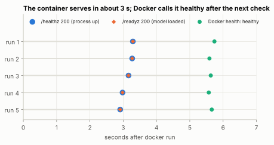

# H13.2 Registry and a container service on AWS

Used by lesson [w6d5](../../../labs/w6d5_cloud_deployment/README.md) · Content status: see [STATUS.md](../../guides/status.md)

## H13.2.1 Overview

Running one containerised model service on AWS needs five pieces: a **registry** that stores the image
(Amazon ECR), a **compute service** that keeps a container running and replaces it when unhealthy (Amazon
ECS on AWS Fargate here), a **log destination** (CloudWatch Logs), a **network rule** deciding who may
connect (a VPC security group), and an **execution role** that lets the platform pull the image and write
logs. This section explains each piece, the order in which they depend on each other, and how to remove
them; H13.1 covers identity, credentials and cost.

## H13.2.2 Choosing a route

| Route | What you manage | Fits a small HTTP model service? | Status in this course |
|---|---|---|---|
| **ECS on Fargate** (one service, one task) | task definition, service, security group, roles | yes: long-running container, health checks, logs | primary route; commands checked against the current CLI and API models |
| **AWS App Runner** | image and a few settings; it provides HTTPS and scaling | yes, and simpler | conditional: its current availability to new customers could not be verified when this was written; check the App Runner documentation before choosing it |
| **Lambda with a container image** | function, invocation model | only with an adapter: Lambda invokes a handler per event rather than running a server | not used |
| **EC2 instance with Docker** | the whole machine: OS updates, disk, restarts | possible, but you operate a server | not used |
| **EKS (Kubernetes)** | a cluster and its add-ons | far more than one service needs | not used |

The criterion behind the choice: the smallest managed service that runs *a container image as built*,
with a health check and logs, so the local container and the cloud container are the same artifact.

## H13.2.3 The registry: ECR

* **Repository per service.** `aws ecr create-repository --repository-name flowguard`.
* **Immutable tags.** `--image-tag-mutability IMMUTABLE` refuses to overwrite a tag. With the git SHA as the
  tag, a tag names one build forever (the API model lists `MUTABLE`, `IMMUTABLE` and two `..._WITH_EXCLUSION`
  variants).
* **Scan on push.** `--image-scanning-configuration scanOnPush=true` reports known vulnerabilities in OS and
  language packages of each pushed image.
* **Lifecycle policy.** Expire old images automatically (the lesson keeps the five most recent), because
  storage is billed per GB-month.
* **Authentication.** `aws ecr get-login-password | docker login --username AWS --password-stdin <registry>`
  gives Docker a short-lived token; the registry host is `<account>.dkr.ecr.<region>.amazonaws.com`.
* **Digest.** After the push, the image is addressable as `<registry>/<repo>@sha256:...`; ECS can be given
  either the tag or the digest. With immutable tags both are stable.

## H13.2.4 The service: ECS on Fargate



* **Task definition.** A versioned JSON document: one or more container definitions (image, port mappings,
  environment, health check, log configuration) plus task-level `cpu` and `memory` (required on Fargate, in
  fixed combinations), `networkMode: awsvpc`, `requiresCompatibilities: ["FARGATE"]` and the
  `executionRoleArn`. Each `register-task-definition` creates a new revision; old revisions stay until
  deregistered.
* **Health check.** `{"command": ["CMD-SHELL", "..."], "interval": 15, "timeout": 5, "retries": 3,
  "startPeriod": 20}`. The API model gives the ranges: interval 5-300 s (default 30), timeout 2-60 s
  (default 5), retries 1-10 (default 3), start period 0-300 s (off by default). Point it at readiness
  (`/readyz`), so a task whose model did not load is replaced rather than kept.
* **Logs.** `logDriver: awslogs` with `awslogs-group`, `awslogs-region` and, on Fargate, the required
  `awslogs-stream-prefix`. The JSON lines the service writes to stdout arrive as CloudWatch log events.
* **Service.** Keeps `desiredCount` tasks running from a task-definition family, registers health, and
  rolls out new revisions. `aws ecs wait services-stable` blocks until the deployment has settled.
* **Network.** In `awsvpc` mode each task gets its own network interface in the subnet you name, protected
  by the security groups you list. Reachability is decided by the security group's inbound rules.

> **Unresolved note on `assignPublicIp`.** A task in a public subnet needs a public IP to reach ECR and
> CloudWatch without a NAT gateway or VPC endpoints. The official CLI example for a Fargate
> `create-service` uses `assignPublicIp=ENABLED`. The current ECS API model's documentation for the field
> (read 2026-11-22) says: "When the service `deploymentController` is `ECS`, the value must be `DISABLED`."
> These conflict and could not be reconciled without the rendered documentation. If the call is rejected,
> the alternatives are private subnets with VPC endpoints (ECR API, ECR Docker, S3 for image layers,
> CloudWatch Logs) or a NAT gateway; both are billed per hour.

## H13.2.5 Order of creation and deletion



Deletion is not the reverse of the creation *lines*: it is the reverse of the *dependencies*. A cluster
cannot be deleted while it has an active service; a security group cannot be deleted while a network
interface uses it; a role with an attached managed policy cannot be deleted until the policy is detached; a
repository holding images needs `--force`. A teardown script with `set -euo pipefail` stops at the first
violation, which is why its order is part of its correctness. After it, verify independently: list
clusters, services, task definitions, repositories, log groups, security groups, network interfaces and
roles, and read the bill the next day.

## H13.2.6 The local equivalent

The same image, with the same environment variables, CPU and memory limits and the same health-check
command, runs locally with `docker run -p 127.0.0.1:8000:8000 --cpus 0.25 --memory 512m --health-cmd ...`.
Everything except AWS-specific behaviour (image pull, scheduling, IAM, CloudWatch) can be verified there for
free, which is why the course's deliverable does not require a cloud account.



*Five local runs with the task definition's settings (real, from the lesson): ready after about 3 s, marked
healthy at the next health check. Fargate adds image pull and scheduling time, not measured here.*

## H13.2.7 Practical decisions and trade-offs

| Decision | Choice here | Trade-off |
|---|---|---|
| Script versus infrastructure as code | a reviewed bash script printed by a planner | readable and gated, but not idempotent and hard to resume; IaC (CloudFormation, CDK, Terraform) is the next step for anything that lives longer than a lab |
| Public IP versus NAT/endpoints | public IP, no inbound rule by default | cheapest; exposure controlled only by the security group (and see the note above) |
| Load balancer | none | no TLS, no stable address, no health-based routing across tasks; fine for one task in a lab |
| Task size | 0.25 vCPU, 0.5 GB | the service idles at about 64 MiB (measured locally); size from load tests (w6d4), not guesses |
| Log retention | 7 days | enough to debug; longer retention costs storage |
| Tag versus digest in the task definition | immutable SHA tag | with mutable tags, use the digest |

## H13.2.8 Common failure modes

* **Health check on liveness** (`/healthz`): tasks that cannot predict count as healthy.
* **Missing `awslogs-stream-prefix`** on Fargate, or a log group that does not exist: the task fails to start
  and the reason is in the stopped task's details, not in your logs.
* **Execution role missing or without permissions:** image pull or log creation fails at task start.
* **`latest` tags:** the service runs whatever was pushed last; rollback has no target.
* **Teardown out of order** stops half-way and leaves billed resources.
* **Opening `0.0.0.0/0` "to test"** and forgetting to close it.

## H13.2.9 Quick reference

```bash
aws ecr create-repository --repository-name NAME --image-tag-mutability IMMUTABLE --image-scanning-configuration scanOnPush=true
aws ecr get-login-password | docker login --username AWS --password-stdin ACCOUNT.dkr.ecr.REGION.amazonaws.com
aws logs create-log-group --log-group-name /ecs/NAME && aws logs put-retention-policy --log-group-name /ecs/NAME --retention-in-days 7
aws ecs create-cluster --cluster-name NAME-cluster
aws ecs register-task-definition --cli-input-json file://taskdef.json
aws ecs create-service --cluster C --service-name S --task-definition NAME --desired-count 1 --launch-type FARGATE \
    --network-configuration "awsvpcConfiguration={subnets=[SUBNET],securityGroups=[SG],assignPublicIp=ENABLED}"
aws ecs wait services-stable --cluster C --services S
aws ecs update-service --cluster C --service S --desired-count 0 && aws ecs delete-service --cluster C --service S --force
```

## H13.2.10 Sources and verification status

Opened on 2026-11-22 (raw files on GitHub; the rendered AWS documentation and pricing sites returned HTTP
403 through the authoring environment's proxy):

* AWS CLI v2 example sources (`aws/aws-cli`, branch `v2`, `awscli/examples/`): `ecr/create-repository.rst`
  (immutability, scan on push), `ecr/put-lifecycle-policy.rst`, `ecr/get-login-password.rst`,
  `ecr/delete-repository.rst`, `ecs/create-cluster.rst`, `ecs/register-task-definition.rst`,
  `ecs/create-service.rst` (Fargate example with `assignPublicIp=ENABLED`), `ecs/update-service.rst`,
  `ecs/delete-service.rst` (`--force`), `ecs/delete-cluster.rst`, `ecs/deregister-task-definition.rst`,
  `logs/create-log-group.rst`, `logs/delete-log-group.rst`, `ec2/create-security-group.rst`,
  `ec2/authorize-security-group-ingress.rst`, `apprunner/create-service.rst`.
* botocore service models (`boto/botocore`, branch `develop`): `ecs/2014-11-13/service-2.json` (HealthCheck
  members and ranges, LogConfiguration and the `awslogs-*` options with stream prefix required on Fargate,
  `assignPublicIp` documentation quoted above, task-definition fields), `ecs/2014-11-13/waiters-2.json`
  (`ServicesStable`, `ServicesInactive`), `ecr/2015-09-21/service-2.json` (tag-mutability values,
  `DeleteRepository` `force`), `apprunner/2020-05-15/service-2.json` (`IngressConfiguration.IsPubliclyAccessible`),
  and the operation lists of the `logs`, `iam` and `ec2` models (every operation used here exists).

Not verified: App Runner's availability to new customers (no reachable source); whether `assignPublicIp=ENABLED`
is accepted for a standard ECS-controller Fargate service today (conflicting sources, above); every price;
Fargate's valid CPU/memory combinations (the model refers to the developer guide's "Task size" page, which was
unreachable; 256/512 is the smallest commonly documented combination, from memory); the VPC endpoints needed
for private-subnet tasks (listed from memory). Nothing in this section was executed against AWS.
