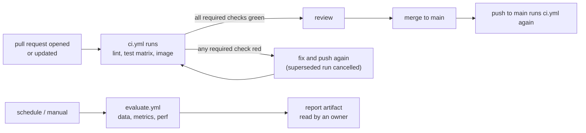
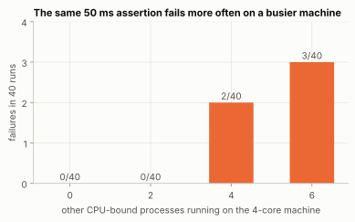



# H14.1 Continuous integration

Used by lesson [w6d3](../../../labs/w6d3_ci/README.md) · Content status: see [STATUS.md](../../guides/status.md)

## H14.1.1 Overview

Continuous integration (CI) is the practice of merging every change into a shared branch only after an
automated, versioned set of checks has passed on a clean machine. For an ML service the checks split
into two lanes with different purposes:

* the **per-push gate** answers "is this commit releasable software?": it lints, runs deterministic
  tests, builds the deployable image and smoke-tests it. It must be fast and must give the same answer
  every time for the same commit;
* the **scheduled lane** answers "is the shipped model still good, and is the service still fast?": it
  downloads data, evaluates, measures wall-clock performance and reports. It produces estimates and
  trends for a person to read, not pass/fail verdicts on commits.

Most failures of CI in ML teams come from mixing the two.

## H14.1.2 The machinery (GitHub Actions)

A **workflow** is a YAML file under `.github/workflows/`. An **event** (`on:`) starts it: `push`,
`pull_request`, `schedule` (cron, in UTC), `workflow_dispatch` (a button and an API call). A workflow
has **jobs**; each job runs on a fresh **runner** VM, and jobs run in parallel unless `needs:` orders
them. A job is a list of **steps**: `uses:` runs a versioned, reusable **action**; `run:` runs a shell
script in the checkout. A **matrix** expands one job definition into several (one per Python version,
for instance). **Expressions** `${{ ... }}` are evaluated by GitHub before the step starts.



The gate only blocks merges if the repository makes it: **branch protection** on `main` with the CI
jobs as **required status checks**. That is a repository setting, not part of the workflow file.

## H14.1.3 Determinism: the property that makes a gate useful

Let a check fail spuriously with probability $$p$$ per run, independently. Over $$k$$ runs (pushes,
matrix entries, re-runs), the probability that at least one run is spuriously red is

$$P(\text{at least one false red}) = 1 - (1 - p)^k .$$

With $$p = 0.05$$ and $$k = 20$$ runs a day, that is $$1 - 0.95^{20} \approx 0.64$$: on most days somebody
sees a red build that means nothing. Teams respond by re-running until green, after which a red build
no longer carries information. A gate is only worth its cost if $$p \approx 0$$, which rules out:

* **network-dependent steps** that can fail transiently (downloads of data, not of pinned packages
  from a cache-backed registry);
* **statistical thresholds**: a metric on a held-out set is an estimate with sampling variance (H6.6);
  a threshold placed near its typical value flips with the data, the seed or a refresh;
* **wall-clock assertions**: a hosted runner is a shared VM. In lesson w6d3 the same 50 ms assertion
  failed 0, 0, 2 and 3 times in 40 runs as competing CPU load on a 4-core machine increased
  (real runs):



*Figure H14.1-1. Same code, same assertion, different machine load (real runs, authoring machine).*

Each of these belongs in the scheduled lane, where a red run starts an investigation instead of
blocking a merge. A deterministic **proxy** can stay in the gate: "the model is loaded once, not per
request" is testable with a counter; "p95 latency under 100 ms" is not.

## H14.1.4 Security: permissions, secrets, pinning

**Token permissions.** Each job receives a `GITHUB_TOKEN`. Its permissions start from the enterprise,
organisation or repository default and are then adjusted by the workflow's top-level `permissions:` and
the job's `permissions:`. Declare `permissions: contents: read` at the top of every workflow and grant
more only in the job that needs it.

**Secrets.** Secrets are redacted from logs by the runner, mostly by exact matching of the value;
GitHub's documentation warns that transformed values (Base64, URL-encoded, embedded in structured
data) are not reliably redacted. Expressions are substituted into `run:` scripts before the shell runs,
so the documented pattern for untrusted input, and good practice for secrets, is an intermediate
environment variable:

```yaml
- name: Log in to the registry
  env:
    TOKEN: ${{ secrets.REGISTRY_TOKEN }}
  run: printf '%s' "$TOKEN" | docker login ghcr.io -u bot --password-stdin
```

**Forks.** With the exception of `GITHUB_TOKEN`, secrets are not passed to workflows triggered from a
forked repository, and write permissions are reduced to read for pull requests from forks (unless an
administrator enables "Send write tokens to workflows from pull requests"). Consequence: a gate that
needs secrets cannot check outside contributions. Keep secrets out of the gate.

**Pinning actions.** A tag such as `@v7` moves with the action's releases; a full commit SHA never
moves; a branch name such as `@main` moves on every push. GitHub's security guidance recommends
pinning to full-length commit SHAs, with a bot to propose updates. Major-version tags trade some of
that safety for readability and automatic patch releases.

## H14.1.5 Caching

A cache maps a **key** to a directory. A job restores the entry whose key matches (or the best
`restore-keys` prefix match) and saves a new entry at the end if there was no exact hit. A good key is a
function of exactly the inputs that determine the cached content:

```text
pip-${{ runner.os }}-${{ matrix.python-version }}-${{ hashFiles('pyproject.toml') }}
```

A key containing a per-run value (`github.sha`, `github.run_id`, `github.run_number`) never matches an
earlier save: every run misses and stores yet another entry. GitHub removes entries not accessed for
7 days and limits total cache size per repository (10 GB by default), so useless entries also evict
useful ones. `actions/setup-python` builds a correct pip key itself with `cache: pip`; by default it
hashes `requirements.txt` or `pyproject.toml`, and `cache-dependency-path` names the file. Measure
what the cache buys: for the lab project, a fresh install took 7.0-7.3 s with an empty pip cache and
4.3-4.8 s with a warm one (two runs each, authoring machine).

Docker builds have their own layer cache: `docker/build-push-action` with
`cache-from: type=gha` / `cache-to: type=gha,mode=max` stores layers in the same service. Layer caching
only works if the Dockerfile orders layers from least to most frequently changing (H12.1).

## H14.1.6 What a good ML-service workflow contains

| Element | Why |
|---|---|
| `on: push` (main) and `pull_request` | checks every proposed change and every merged state |
| `permissions: contents: read` | least privilege |
| `concurrency` with `cancel-in-progress` | stop paying for superseded commits |
| `timeout-minutes` per job | a hung job otherwise runs to the default of 360 minutes |
| Lint job | cheap, catches mistakes before tests |
| Test job on a **quoted** Python matrix with a pip cache | the versions you support, installed from scratch |
| Image job with `needs:` on tests | never build or publish code that fails its tests |
| Smoke test from the runner against the running container | proves the artifact, without test tools in the image |
| `docker logs` on failure | the evidence you need is gone when the VM is |
| Separate scheduled workflow for evaluation and perf, with `upload-artifact` `if: always()` | statistics and timing get read by a person, the report survives failures |

## H14.1.7 Practical decisions and trade-offs

* **Matrix breadth vs cost.** Every entry is a VM. Test the oldest and newest versions you support on
  every push; run the full matrix nightly.
* **Tags vs SHAs for actions.** Readability and automatic fixes vs exact reproducibility and supply-chain
  safety. Regulated settings: SHAs plus an update bot.
* **Serial vs parallel jobs.** `needs:` makes failing runs cheaper and green runs slower. Keep it for
  anything that produces an artifact.
* **Fixing a flaky test.** Make it deterministic if the property is deterministic; otherwise move it
  to the scheduled lane. Retrying automatically hides the problem and doubles the cost.
* **`act` and local runs.** Running workflows locally in Docker (`act`) helps with complex workflows;
  for most failures, re-running the job's `run:` commands locally (lesson w6d3's worked example) is
  enough and faster.

## H14.1.8 Common failure modes

| Symptom | Cause | Fix |
|---|---|---|
| "Version 3.1 was not found" | unquoted `3.10` read as a number by YAML | quote versions |
| Green tests, image job still runs after a test failure | no `needs:` | add `needs:` |
| Red on one matrix entry, green on re-run | wall-clock or order-dependent test | make it deterministic or move to the slow lane |
| "Cache not found" on every run | per-run value in the key | key on dependency files |
| `exit code 127` inside `docker exec` | tool absent from the image | check from the runner, or install deliberately |
| Works for maintainers, fails for outside pull requests | the gate needs secrets | remove secrets from the gate |
| Metric gate red after a data refresh, then threshold lowered | statistical check in the gate | scheduled evaluation with intervals and an owner |
| Scheduled job silently stopped | (from memory) GitHub disables scheduled workflows in public repositories after a period without activity | check the Actions tab; re-enable |

## H14.1.9 Quick reference

```yaml
name: ci
on: { push: { branches: [main] }, pull_request: {} }
permissions: { contents: read }
concurrency: { group: "ci-${{ github.workflow }}-${{ github.ref }}", cancel-in-progress: true }
jobs:
  test:
    runs-on: ubuntu-latest
    timeout-minutes: 15
    strategy: { fail-fast: false, matrix: { python-version: ["3.11", "3.12"] } }
    steps:
      - uses: actions/checkout@v7
      - uses: actions/setup-python@v7
        with: { python-version: "${{ matrix.python-version }}", cache: pip, cache-dependency-path: pyproject.toml }
      - run: python -m pip install -e ".[dev]"
      - run: python -m pytest -q
```

Gate or lane? *Could it be red on an unchanged commit?* Yes: scheduled lane. No: gate, if it is fast.

## H14.1.10 Sources and verification status

Opened on 2026-11-22 (raw files on GitHub, because the rendered documentation sites were not reachable
from the authoring environment):

* GitHub Docs source, `github/docs` repository: `content/actions/concepts/security/github_token.md`;
  `content/actions/reference/workflows-and-actions/workflow-syntax.md` (permissions calculation,
  permissions for forked repositories, `timeout-minutes` default 360); `content/actions/reference/security/secure-use.md`
  (redaction is not guaranteed for transformed values, intermediate environment variable pattern,
  pinning to full-length commit SHAs); `content/actions/reference/workflows-and-actions/dependency-caching.md`
  (7-day eviction, 10 GB default limit); `data/reusables/actions/forked-secrets.md` (secrets are not
  passed to workflows triggered from forks, except `GITHUB_TOKEN`); `data/reusables/actions/forked-write-permission.md`.
* Action README files (main branch): `actions/checkout` (v7), `actions/setup-python` (v7, and
  `docs/advanced-usage.md` on `cache-dependency-path`; the README states the default dependency files
  `requirements.txt` or `pyproject.toml`), `actions/upload-artifact` (v7), `actions/cache` (v6),
  `docker/build-push-action` (v7), `docker/setup-buildx-action` (v4).
* Executed: PyYAML 6.0.3 parsing of `3.10`, `on` and `NO`; actionlint 1.7.12 on the lesson's workflows;
  the measurements quoted above (`labs/w6d3_ci/figures/measure.py`).

From memory, not re-verified this session: that GitHub disables scheduled workflows in public
repositories after a period of repository inactivity (stated as 60 days in the past); that top-of-hour
cron schedules are delayed more often under load; the behaviour of `act`. None of the lesson's checks
depend on these.

