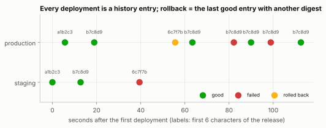



# H14.2 Delivery, promotion and rollback

Used by lesson [w6d6](../../../labs/w6d6_cd_ops_debugging/README.md) · Content status: see [STATUS.md](../../guides/status.md)

## H14.2.1 Overview

Continuous integration (H14.1) answers "is this commit releasable?". Delivery answers the next questions:
*which artifact* goes to an environment, *how* it moves from one environment to the next, *how do we know*
it worked, and *how do we undo it*. The practices in this section are few and mechanical:

1. **Build once** per commit; tag the image with the commit SHA; push it.
2. **Deploy by digest**, never by a movable name.
3. **Promote** the digest that succeeded in the previous environment; never rebuild for the next one.
4. **Keep configuration outside the image**, versioned and validated at startup.
5. **Record every deployment** in an append-only history: environment, release, digest, time, outcome.
6. **Roll back** by redeploying the previous good digest, and only when the image is what changed.

**Continuous delivery** means every change that passes the pipeline *could* be deployed with one routine,
reviewed step; **continuous deployment** means it *is* deployed automatically. The mechanics are the same.

## H14.2.2 Why build once: artifacts are not commits

A commit is source; an image is an artifact produced from source by a build that depends on more than the
source: base image tags, package index state at build time, build arguments, timestamps. In the w6d6
authoring run, three builds of the same unchanged service tree produced three different digests. Most such
differences are harmless metadata; occasionally one is a different dependency version. Either way, a test
result is evidence about one digest. Promotion moves the evidence with the artifact:



## H14.2.3 Tags, digests and immutability

* A **tag** is a mutable pointer in a repository (`flowguard:1a2b3c4d5e6f`, `flowguard:latest`). With an
  immutable repository (ECR's `IMMUTABLE` setting) a tag cannot be overwritten, which makes a SHA tag
  stable.
* A **digest** (`flowguard@sha256:...`) is the hash of the image manifest. Deploying `image@digest` runs
  exactly those bytes, on every registry and every machine.
* The release history should record the digest even when deployment uses an immutable tag: it is the value
  that answers "exactly what was running at 14:02?".

## H14.2.4 Configuration: one image, many environments

What differs between environments (model directory, log level, ports, feature-store endpoint, memory
limits) is configuration. It lives in version-controlled files or a configuration service, is injected at
start (environment variables, mounted files), and is **validated at startup**: unknown variable names,
malformed values and missing required values stop the process with a message that names the variable. What
depends on the state of the world (is the model file present and intact?) is reported through readiness, so
the platform withholds traffic while the process keeps logging.

The weak point of this split: "what is running" is now the pair *(digest, configuration)*. A complete
deployment record stores both, for example the digest and a hash of the rendered configuration. In the w6d6
lab the history stores only the digest, which is why configuration incidents needed `git diff` to find.

## H14.2.5 Deciding that a deployment is good

A deployment is good when the new version is ready, healthy and **stays** that way for a soak period long
enough for its likely failure modes to appear. One successful readiness probe is not enough: in w6d6's
memory incident the service answered `/readyz` with 200 for about 3 seconds before the kernel killed it.

$$
\text{soak} \;\ge\; \max\big(k \cdot \text{health-check interval},\; \text{time to first real traffic peak}\big),\quad k \ge 2
$$

Longer soaks catch more, and slow down both deployments and the detection of the need to roll back.
Progressive strategies (canary releases, blue-green switches; week 7) replace "soak, then switch everything"
with "switch a little, measure, switch more".

## H14.2.6 Rollback, and when it is the wrong fix

Rollback = redeploy the most recent earlier deployment of the same environment that was good **and runs a
different digest**. It is the fastest fix when the image changed: a code bug, a bad model bundle, a broken
dependency. It is the wrong fix when the image did not change:



*The w6d6 release history (real). The failed hotfix image was fixed by rollback; the two later failures ran
the same, previously good digest with broken configuration, where "roll back" would have deployed an older
image into the same broken configuration and removed a good release.*

Other limits: a rollback across a database schema migration, an API contract change, or a change in the
format of stored artifacts can fail or corrupt data; such releases need backward-compatible steps
(expand-then-contract migrations) so that the previous version can still run.

## H14.2.7 Practical decisions and trade-offs

| Decision | Recommended default | Trade-off |
|---|---|---|
| What triggers deployment to staging | every merge to the main branch | more deployments, each smaller and easier to diagnose |
| What triggers production | explicit promotion of a staging-good digest | slower than automatic, but a human checks the release notes |
| Configuration store | env files in the repository, validated at startup | simple and diffable; secrets need a separate secret store |
| History | append-only, with digest and configuration hash | needs discipline: every deploy, including manual fixes, goes through the tool |
| Rollback | a tool that selects the previous good digest | fast; must refuse when no different good digest exists |

## H14.2.8 Common failure modes

* **Rebuild per environment** ("prod build"): the tested artifact never reaches production.
* **`latest` or branch-name tags** in deployment manifests.
* **Promotion ignoring the source environment's result** (the w6d6 hotfix).
* **Configuration baked into images**: every configuration change becomes a rebuild; environments run
  different digests.
* **Manual fixes outside the tool**: the history no longer says what runs.
* **Rollback as reflex** for configuration or data incidents.

## H14.2.9 Quick reference

```bash
docker build -t REG/app:$(git rev-parse --short=12 HEAD) . && docker push REG/app:<sha>
docker image inspect -f '{{json .RepoDigests}}' REG/app:<sha>     # the digest to deploy
docker run ... REG/app@sha256:<digest>                            # deploy by digest
python ops/fgops.py promote --from staging --to production        # the lab's promotion
python ops/rollback.py production [--apply]                       # previous good, different digest
```

## H14.2.10 Sources and verification status

Executed in the w6d6 authoring run (2026-11-22): builds, pushes to a local `registry:3`, `RepoDigests`
inspection, deploys by digest, promotion, the three incidents, rollback, and the three different digests from
three builds of one tree.

From memory, not re-verified this session: the general definitions of continuous delivery versus continuous
deployment (as popularised by Humble and Farley, *Continuous Delivery*, 2010); expand-then-contract
migrations; canary and blue-green terminology (treated in week 7). The statement that rebuilds are not
byte-identical is an observation from this run with Docker BuildKit defaults; reproducible-build settings
(for example fixed `SOURCE_DATE_EPOCH`) can change it and were not tested.

