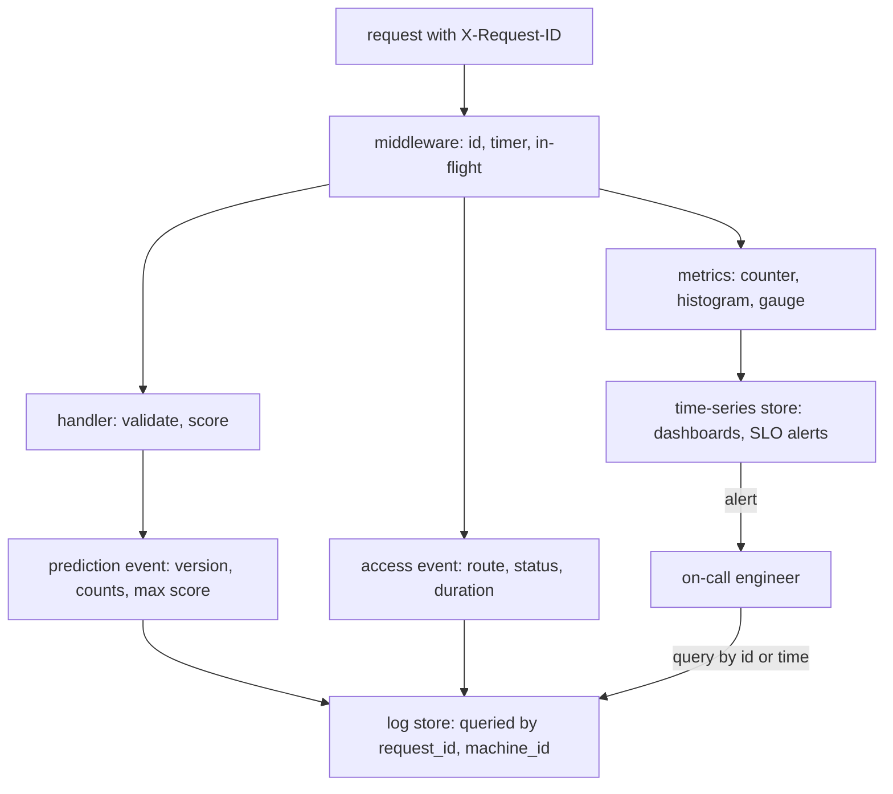
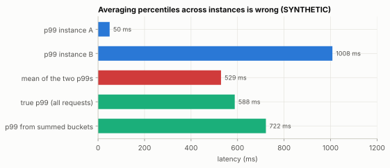
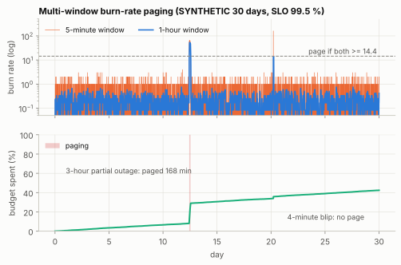

# H15.1 Service logs and metrics

Status: Reviewed (see H15.1.10). Lesson: [w7d1](../../../labs/w7d1_service_logging_metrics/README.md).
Related: [H15.2 Operational debugging](h15_2_operational_debugging.md), [H10.4 Latency and
throughput](../ch10_batch_online_inference/h10_4_latency_and_throughput.md), [H15.3 Input monitoring](h15_3_input_monitoring_drift.md).

## H15.1.1 Overview

A deployed model is observed through three kinds of telemetry. **Metrics** are numbers aggregated over
time (counts, sums, bucketed distributions, current values) with a few low-cardinality labels; they are
cheap to keep and are what alerts are written on. **Logs** are records of individual events; they answer
"what happened to this request" and grow with traffic. **Traces** follow one request across processes.
A correlation id (`X-Request-ID`) joins them. For ML services the telemetry must also describe the
model's behaviour (version, scores, decisions) without storing the payload.



## H15.1.2 Structured logging

A structured event is a flat JSON object with stable keys, one per line: `ts` (UTC, ISO 8601), `level`,
`logger`, `event` (a constant name such as `access`), then fields. Properties that matter:

* **Queryable by key.** `event == "access" and status >= 500 and route == "/predict"`. Free-text messages
  force regular expressions that break on rewording and cannot type-check numbers.
* **Single-line.** JSON serialisation escapes newlines, so multi-line exception text stays one record.
* **Correlated.** Every event of a request carries the same `request_id`; accept a well-formed incoming id
  (bounded length, safe characters) so callers can quote theirs, generate one otherwise, and return it.
* **Bounded content.** Log summaries (`n_samples`, time span, counts of outcomes, max score), never raw
  payloads or credentials. Payload capture for debugging or retraining is a separate, access-controlled,
  sampled pipeline with retention rules.

In Python, keep `logging` (loggers per module, handlers configured once at the entry point, H2.2) and
add a `Formatter` subclass that serialises `record.fields` passed via `extra=`. Libraries such as
`structlog` or `python-json-logger` do the same; the concept matters more than the tool.

**Levels and sampling.** Production usually runs at `INFO`; at high traffic, successful-request events
are sampled (for example 1 %) while errors are kept. Rates and counts must therefore come from metrics,
never from counting log lines.

## H15.1.3 Metric types

| Type | Semantics | Typical use | Query pattern |
|---|---|---|---|
| Counter | monotonically increasing; resets to 0 on restart | requests, errors, samples scored | rate over a window, e.g. `rate(x_total[5m])` |
| Gauge | arbitrary current value | in-flight requests, memory, model loaded | current value, max over window |
| Histogram | counts in cumulative buckets `le`, plus `_sum`, `_count` | latency, request size, score distribution | quantile estimate, share above a threshold, mean = sum/count |
| Summary | client-side quantiles | legacy; avoid when aggregating across instances | cannot be aggregated |

**Histogram semantics (Prometheus text format, verified).** `x_bucket{le="0.05"} 38` = 38 observations
`<= 0.05`. Buckets are cumulative, a `+Inf` bucket is mandatory and equals `x_count`. The content type of
the text format is `text/plain; version=0.0.4`. A quantile is estimated by finding the bucket containing
rank `q · count` and interpolating linearly inside it, assuming a uniform spread:

$$\hat{x}_q = l_i + (u_i - l_i)\,\frac{q N - C_{i-1}}{C_i - C_{i-1}}$$

where $$C_i$$ is the cumulative count at upper bound $$u_i$$ and $$l_i = u_{i-1}$$. The share of observations
above a threshold $$t$$ is exact when $$t$$ is a bucket edge: $$1 - C(t)/N$$. Hence: put bucket edges at SLO
thresholds.

**Aggregation.** Bucket counts from several instances or time windows can be summed before estimating;
percentiles cannot be averaged (the lesson's example: mean of two p99s 529 ms against a true combined p99
of 588 ms).



*SYNTHETIC; from the w7d1 worked example.*

## H15.1.4 Cardinality

Each distinct label-value combination is a time series. Total series for a metric is the product of the
label-value counts (times the bucket count for a histogram):

$$S = \prod_{\ell} |V_\ell| \;\; (\times\, (B+1) \text{ for a histogram with } B \text{ finite buckets})$$

A request counter with 6 routes, 3 methods and 8 status codes is at most 144 series; adding a
`machine_id` label for 120,000 machines makes it 17 million. Labels must come from small sets you could
list in advance: route *templates* (not raw paths; label unmatched routes as one value), status code,
method, model version, a handful of regions. Request ids, user ids, raw paths and free text belong in
logs.

## H15.1.5 Golden signals for an ML service

**Traffic, errors, latency, saturation** (the SRE book's four golden signals; recalled, not
re-verified). RED (rate, errors, duration) is the request-centric subset; USE (utilisation, saturation,
errors) is the resource-centric one. For a model service add:

* **which model is answering** (`model_info{model_version} 1`), so every graph can be split at a release;
* **what the model outputs** (score histogram, decision counts per version): the cheapest early warning
  of a broken feature or model, long before labels arrive;
* **input validity** (rejected requests by reason; [H15.3](h15_3_input_monitoring_drift.md) extends this to distribution shift).

Instrumentation pitfall specific to ASGI frameworks: an unhandled exception propagates out of the
middleware's `call_next` (Starlette's `Exception` handler is the outermost layer), so request accounting
must live in `try/finally`, or crashes disappear from the metrics.

## H15.1.6 SLIs, SLOs, error budgets and burn rates

An **SLI** is `good events / valid events`; an **SLO** is a target for it over a window; the **error
budget** is the allowed number of bad events:

$$\text{budget} = (1 - \text{target}) \times N_{\text{valid}}, \qquad \text{burn rate} = \frac{\text{bad}/\text{valid}}{1 - \text{target}}$$

Burn rate 1 spends the budget exactly over the window. Spending a fraction $$f$$ of a window $$W$$'s budget
in time $$w$$ corresponds to a burn rate $$f \cdot W / w$$: 2 % of 30 days in 1 hour is $$0.02 \times 720 = 14.4$$;
5 % in 6 hours is $$0.05 \times 120 = 6$$. A **multi-window** alert requires both a long window (enough
evidence) and a short window (still happening) above the factor, which avoids paging on brief blips and
stops paging soon after recovery.



*SYNTHETIC; from the w7d1 lesson.*

Validity decisions are the substance of an SLO: client errors (4xx) are not the service's fault and are
excluded from availability; "not ready" (503) is bad; latency is measured on successful requests only.

## H15.1.7 Practical decisions and trade-offs

| Decision | Option A | Option B | Guidance |
|---|---|---|---|
| Log format | free text | JSON with stable keys | JSON; human readers use a formatter or `jq` |
| Payloads | log them | log summaries | summaries; capture payloads only in a governed data pipeline |
| Error counting | count ERROR log lines | counter labelled by status | counter; logs may be sampled and levels change |
| Latency stat | mean | histogram, share under threshold | histogram with an edge at the SLO threshold |
| Per-entity breakdown | metric label | log field + query | log field unless the set is small and fixed |
| Library | hand-written exposition | `prometheus_client` | library in production (multiprocess mode for several workers); hand-written only for learning |
| Paging | single threshold | multi-window burn rate | burn rate on SLOs; separate pages for model-output anomalies |

## H15.1.8 Common failure modes

* Bookkeeping after `call_next` only: crashes are invisible, in-flight leaks.
* Raw path or id as a label: cardinality explosion, monitoring system rejects or bills.
* Non-cumulative buckets from a hand-written exporter: every quantile wrong.
* Averaging percentiles across instances or time windows.
* Counting what you did not mean: re-sent data counted again (the lesson's samples counter).
* Logging payloads "temporarily"; logging headers wholesale (credentials).
* Per-worker registries scraped as if they were the whole service.
* An SLO dashboard that is green while the model blocks every transaction (no model-output signal).

## H15.1.9 Quick reference

```text
log event      {"ts", "level", "logger", "event": <constant>, "request_id", ...fields}   one line, no payload
request id     accept ^[A-Za-z0-9._-]{1,64}$ from X-Request-ID, else uuid4; return in header and body
counter        x_total{method,route,status}        rate() over a window
histogram      x_bucket{le=...} cumulative; le="+Inf" == x_count; x_sum
gauge          in_flight (inc before call_next, dec in finally)
model info     x_model_info{model_version="..."} 1
content type   text/plain; version=0.0.4; charset=utf-8
cardinality    series = product of label-value counts (x buckets)
SLI            good / valid      budget = (1 - target) * valid      burn = (bad/valid) / (1 - target)
burn factor    fraction_of_budget * window / alert_window   (2 % of 30 d in 1 h -> 14.4)
```

## H15.1.10 Sources and verification status

Opened and checked this session (source files on GitHub):
* Prometheus documentation, `prometheus/docs` repository: `docs/instrumenting/exposition_formats.md`
  (text format, cumulative `le` buckets, `+Inf` equals `_count`, content type and version),
  `docs/practices/naming.md` (high-cardinality label warning), `docs/practices/histograms.md`
  (summaries cannot be aggregated; histograms can), `docs/concepts/metric_types.md`.
* `prometheus/prometheus` `docs/querying/functions.md` (`histogram_quantile` interpolates assuming a
  uniform distribution within a bucket).
* Starlette/FastAPI exception propagation through HTTP middleware: established by a direct experiment with
  FastAPI 0.165.0 / Starlette 1.7.0, not from documentation.

From memory, not re-verified: the four golden signals and the multi-window burn-rate factors (Google's
*Site Reliability Engineering* book and *The Site Reliability Workbook*); RED (Tom Wilkie) and USE (Brendan
Gregg) attributions; OpenTelemetry trace concepts; `prometheus_client` multiprocess mode. The burn-rate
arithmetic in H15.1.6 is derived here and does not depend on the attribution.
