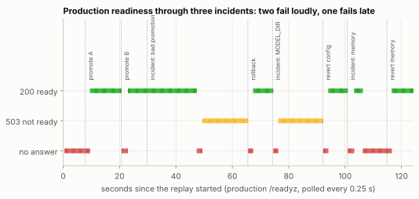



# H15.2 Operational debugging

Used by lesson [w6d6](../../../labs/w6d6_cd_ops_debugging/README.md) · Content status: see [STATUS.md](../../guides/status.md)

## H15.2.1 Overview

Operational debugging is finding out why a running system misbehaves, under time pressure, with partial
information, without making it worse. It is the experimental method applied to production: observe, form
competing hypotheses, run the test that discriminates between them, act, verify, record. What makes it a
skill rather than luck is mostly discipline about the first and last steps: reading the evidence that
already exists before changing anything, and writing down what happened so that the next person (often you)
starts further ahead.

## H15.2.2 The loop



Step 1 and step 6 are different. *Mitigation* stops the harm (roll back, route traffic away, disable a
feature) and may be done before the cause is known. *The fix* removes the cause. Rolling back an image is a
mitigation for an image change and a non-event for a configuration change.

## H15.2.3 Evidence and where it lives

| Evidence | What it can show | What it cannot |
|---|---|---|
| Deployment history | what changed and when; which digest is running | changes made outside the tool |
| Configuration diff (`git diff`) | configuration changes | live overrides not in version control |
| Application logs (structured) | what the process saw and decided: model loaded, validation errors, timeouts | events the process never saw: being killed, never starting |
| Platform state (`docker inspect`, ECS stopped-task reason, Kubernetes status) | exit codes, OOM kills, health status, restarts | why the application chose to do something |
| Metrics (rate, errors, latency, saturation; week 7) | when behaviour changed, how much, where | the reason |
| The prediction log | whether outputs changed, by release | whether the change is correct |

Two signals from the w6d6 incidents illustrate the table's last column:

* **Exit 137 and `OOMKilled=true`.** A container killed by the kernel's out-of-memory killer receives
  SIGKILL, which cannot be caught, so its last log line is whatever it logged before: in the lab, a normal
  "Uvicorn running" line. Exit codes above 128 encode the signal: $$137 = 128 + 9$$ (SIGKILL), $$143 = 128 + 15$$
  (SIGTERM, a normal stop).
* **`/healthz` 200 with `/readyz` 503.** The process lives; the model is not loaded. The reason is in the
  application log, which is why the service logs `model_not_loaded` with the error at ERROR level.

## H15.2.4 Structured logs make questions into queries

One JSON object per line, with a timestamp, level, logger, message, and the context that lets you split
behaviour: release, environment, request id, event name. Then "what is the first error after the deploy, and
in which release?" is a filter, not an archaeology project.

```json
{"ts": "2026-11-22T17:30:20.609+00:00", "level": "ERROR", "logger": "flowguard.api", "msg": "model not loaded: model directory not found: /models/flowguard-z/1.0.1", "env": "production", "release": "b7c8d9e0f1a2", "event": "model_not_loaded"}
```

Practical rules: one event per line; stable event names; the release on every line; no secrets or full
request bodies; access logs separable from application events (they dominate volume: in the w6d6 replay the
readiness poller produced most lines).



*Production `/readyz` in the w6d6 replay (real). Two incidents fail from the first second; one passes
readiness for about 3 s and then disappears. The shape of a symptom over time is evidence too.*

## H15.2.5 Hypotheses and discriminating tests

A good hypothesis predicts something the others do not. For "production not ready after a change":

| Hypothesis | Predicts | Discriminating test |
|---|---|---|
| The image is broken | the failure follows the digest | run the same digest in staging; compare with the previous digest |
| The configuration is wrong | the failure follows the configuration | same digest with the previous configuration |
| A dependency is down | failures in calls to it; independent of release | the dependency's own health; error messages naming it |
| Resources are insufficient | kills, throttling, latency growing with load | `OOMKilled`, CPU throttling counters, memory over time |

The test that separates hypotheses is worth more than three that confirm the favourite one. Changing one
thing at a time keeps the result interpretable.

## H15.2.6 Writing it down

A debugging log entry (w6d6 template): symptom, evidence (quoted), hypotheses, the test, root cause, fix,
verification, prevention. A **postmortem** for incidents with user impact adds impact measured from the
start of harm (not from detection), a timeline from records, contributing factors, what went well, and
action items with type (prevent, detect, mitigate, process), owner and due date. **Blameless** means the
analysis explains how the system made the mistake possible and invisible; "human error" is where an
analysis starts, not where it ends.

## H15.2.7 Practical decisions and trade-offs

| Decision | Default | Trade-off |
|---|---|---|
| Mitigate or diagnose first | mitigate when users are harmed and a safe mitigation exists | a mitigation can destroy evidence (a restarted container loses its state); capture state first if it takes seconds |
| Log level in production | INFO, errors with context | DEBUG floods storage and can leak data |
| Access logs | on, but separable | volume and cost versus the ability to reconstruct requests |
| Postmortem threshold | any user impact, any near miss worth learning from | time spent writing versus repeated incidents |

## H15.2.8 Common failure modes

* **Acting before reading**: restarting, redeploying or rolling back first, which removes evidence and may
  change nothing.
* **Confirmation bias**: testing only the favourite hypothesis.
* **Grepping for ERROR only**: kills and never-started processes log no error.
* **Several changes at once** during diagnosis: the result cannot be attributed.
* **"Service healthy" read as "model correct"**: operational signals say nothing about prediction quality.
* **No write-up**, so the same diagnosis is repeated next month.

## H15.2.9 Quick reference

```bash
python ops/fgops.py history production                                   # what changed, when
git diff -- ops/env                                                      # configuration changes
docker logs fgops-production 2>&1 | grep -v uvicorn.access | tail -20    # what the process saw
docker inspect -f '{{.State.Status}} oom={{.State.OOMKilled}} exit={{.State.ExitCode}}' fgops-production
docker stats --no-stream fgops-production                                # memory and CPU now
```

Exit codes: 0 normal; 1 application error; 2 configuration error (this course's convention); 137 SIGKILL
(often OOM); 143 SIGTERM.

## H15.2.10 Sources and verification status

Executed in the w6d6 authoring run (2026-11-22, Docker 29.10.0): the three incidents, their log lines and
container states; `--memory 64m` gave `OOMKilled=true`, exit 137 in three of three runs; the idle service used
63.7 MiB under a 96 MiB limit.

From memory, not re-verified this session: exit status 128 + signal number for signal-terminated processes
(standard POSIX shell convention); that Docker itself does not restart or stop unhealthy containers (only
orchestrators act on health status); blameless postmortem practice as described in the Google SRE book
(Beyer et al., *Site Reliability Engineering*, 2016, chapter on postmortem culture). The exit-code-2 convention
is this course's choice, not a standard.

