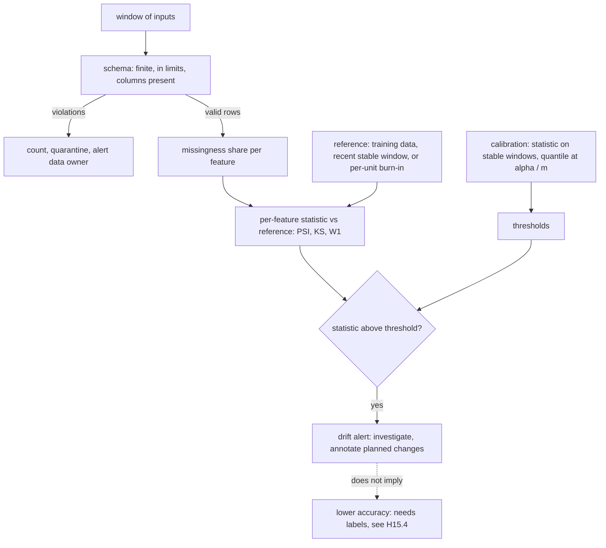
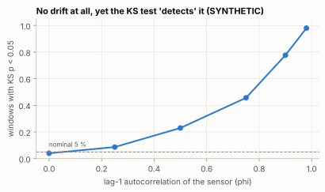
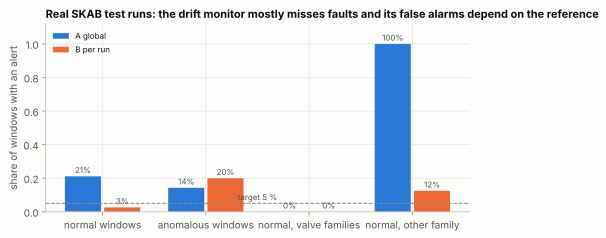

# H15.3 Input monitoring and drift statistics

Status: Reviewed (see H15.3.10). Lesson: [w7d2](../../../labs/w7d2_input_monitoring_drift/README.md).
Related: [H15.1 Service logs and metrics](h15_1_service_logs_and_metrics.md), H15.4 Drift versus
degradation (planned), [H6.6 Bootstrap and paired comparisons](../ch06_evaluation_leakage_uncertainty/h6_6_bootstrap_and_paired_comparisons.md).

## H15.3.1 Overview

Input monitoring asks whether the data a deployed model receives still resembles the data it was built
and validated on. It has three parts with different causes and owners: **schema** (is each value
well-formed and physically possible?), **missingness** (are values absent?), and **distribution shift**
(have the valid values moved?). Statistics such as PSI, KS and Wasserstein-1 quantify shift; thresholds
come from calibration on stable data, not from p-values or rules of thumb. A drift alarm is evidence of
change, not of lower model quality.



## H15.3.2 Definitions

Let $$R$$ be the reference sample (size $$m$$) and $$C$$ the current window (size $$n$$) of one feature, with
empirical CDFs $$F_R$$, $$F_C$$.

**Two-sample Kolmogorov-Smirnov statistic.**
$$D = \sup_x |F_R(x) - F_C(x)| \in [0, 1].$$
Distribution-free under the null for independent samples from a continuous distribution; invariant to
any strictly increasing transformation of the feature.

**Wasserstein-1 (earth mover's) distance.**
$$W_1 = \int_{-\infty}^{\infty} |F_R(x) - F_C(x)|\,dx = \int_0^1 |F_R^{-1}(u) - F_C^{-1}(u)|\,du.$$
In the feature's units; a shift by $$\delta$$ gives $$W_1 = |\delta|$$; scaling the feature by $$a$$ scales
$$W_1$$ by $$|a|$$. The quantile form shows why "mean absolute difference of sorted values" is right only
when $$m = n$$.

**Population Stability Index.** With $$k$$ bins cut at reference quantiles and shares $$p_i$$ (reference),
$$q_i$$ (current), floored at a small $$\epsilon$$:
$$\mathrm{PSI} = \sum_i (q_i - p_i)\ln\frac{q_i}{p_i} = \mathrm{KL}(q\|p) + \mathrm{KL}(p\|q).$$
Under no shift, $$E[\mathrm{PSI}] \approx (k-1)\left(\tfrac{1}{n} + \tfrac{1}{m}\right)$$ for large samples
(the binned shares behave like a chi-square statistic), so the null level depends on window size. The
floor $$\epsilon$$ makes an empty bin contribute a large finite amount instead of $$\infty$$.

**Computing exactly.** Evaluate both ECDFs on the sorted union of the samples (they only change there,
use right-continuous counts); $$D$$ is the maximum gap and $$W_1 = \sum_j |F_R(g_j) - F_C(g_j)|(g_{j+1} - g_j)$$.

## H15.3.3 Why p-values and fixed rules do not give false-alarm rates

* **Dependence.** Monitoring windows of time series contain autocorrelated samples; the effective sample
  size is roughly $$n(1-\rho)/(1+\rho)$$ for an AR(1) with lag-1 correlation $$\rho$$, so the KS null is far
  too narrow. With no drift, the w7d2 example finds 5.5 % of windows with $$p<0.05$$ at $$\rho = 0$$, 22 % at
  0.5, 75 % at 0.9, 98.5 % at 0.98.
* **Large samples.** With hundreds of thousands of rows every difference is significant (the example:
  $$p = 3\times 10^{-8}$$ for 0.01 °C). Report effect sizes in units instead.
* **Rules of thumb.** "PSI > 0.1 moderate, > 0.25 major" (credit-risk convention, recalled) ignores
  window size: 98 % of 30-sample and 0 % of 480-sample stable windows exceed 0.1 in the lesson's
  simulation.



*SYNTHETIC; from the w7d2 lesson.*

## H15.3.4 Calibration and multiple testing

Choose thresholds from the statistic's distribution on windows you consider stable, at a quantile set by
the false-alarm budget. With $$m$$ features each tested every window, the window-level false-alarm rate is
approximately $$1-(1-\alpha_f)^m \approx m\alpha_f$$ for independent features; Bonferroni sets
$$\alpha_f = \alpha/m$$, guaranteeing at most about $$\alpha$$ (conservative when features are correlated).
Then **measure** the rate on held-out stable data: with few calibration windows the tail quantile is
close to the maximum and the realised rate can differ from the target in either direction. In the
lesson's synthetic check with 4 features: 2.75 % of held-out windows alerted with the correction, 13 %
without.

## H15.3.5 Choosing the reference

| Reference | Answers | Noise source |
|---|---|---|
| Training/validation data | "Is the model used outside the domain it was validated on?" | legitimate new units and seasons |
| Recent stable window | "Did something change suddenly?" | slow trends; needs re-baselining policy |
| Per-unit baseline (burn-in) | "Did this unit's inputs change during operation?" | unrepresentative baselines |

On real SKAB (w7d2, 7 test runs, one-minute windows, W1, 8 sensors, 5 % target): a pooled development
reference alerted on 21 % of normal test windows (all in the two `other`-family runs) and 14 % of fault
windows; per-run references on 3 % and 20 %. A purpose-built fault detector caught 5 of 7 test faults.



*Real SKAB data; from the w7d2 replay.*

## H15.3.6 Expected drift: change calendars and re-baselining

Planned changes (price changes, firmware updates, new sensor models, new sites) produce real and harmless
shift. Record them in a change calendar; during a settling period label alerts on the affected features
as expected annotations; then replace the affected features' reference with post-change data and
recalibrate their thresholds, so later unplanned changes to the same features are caught. Never silence a
feature permanently.

## H15.3.7 Practical decisions and trade-offs

| Decision | Options | Guidance |
|---|---|---|
| Statistic | KS (unitless, robust to monotone transforms), W1 (units, interpretable), PSI (binned, common in finance) | W1 for sensors with known resolution; KS when scales are arbitrary; PSI if the organisation already reports it, calibrated |
| Window | short (fast, noisy) vs long (slow, stable) | match the decision cadence; check the effective sample size |
| Threshold | p-value, rule of thumb, calibrated quantile | calibrated quantile with a multiple-testing correction, measured on held-out stable data |
| Univariate vs multivariate | per-feature tests; Mahalanobis of window means; classifier two-sample test | per-feature for explanation, one multivariate check for joint changes |
| Violations | include, drop, quarantine | exclude from statistics, count, quarantine for the producer |
| Response | retrain automatically, investigate | investigate; retrain only with labels and an offline gate (H15.5) |

## H15.3.8 Common failure modes

* Using KS p-values on autocorrelated or very large samples.
* Fixed PSI thresholds across different window sizes.
* No multiple-testing correction across dozens of features: daily false alarms, ignored alerts.
* Sentinels and impossible values inside the statistics, reported as drift.
* NaNs dropped silently: a sensor outage invisible because the remaining values look normal.
* Re-baselining on any alert (the reference absorbs the bug) or never after planned changes.
* Treating a drift alert as proof of degraded accuracy, or its absence as proof of good accuracy.

## H15.3.9 Quick reference

```text
violation   ~finite or outside physical limits      -> count, exclude, quarantine
missing     NaN share per feature per window        -> separate alert
KS          max |F_R - F_C| on the union grid       (scipy.stats.ks_2samp(...).statistic)
W1          sum |F_R - F_C| * diff(grid)            (scipy.stats.wasserstein_distance), feature units
PSI         sum (q-p) ln(q/p), reference-decile bins, shares floored at 1e-4; null ~ (k-1)(1/n+1/m)
threshold   quantile of stable-window statistic at 1 - alpha/m (Bonferroni), "higher" interpolation
check       measured alert rate on HELD-OUT stable windows
calendar    planned change: annotate for a settling period, re-baseline, recalibrate, resume
```

## H15.3.10 Sources and verification status

Verified this session by execution: the KS and W1 implementations equal `scipy.stats.ks_2samp(...).statistic`
and `scipy.stats.wasserstein_distance` (SciPy 1.18.1) to 1e-12 for unequal sizes and ties; the PSI
Jeffreys-divergence identity; all numbers quoted from the w7d2 worked example, checks and real replay.

From memory, not re-verified: the origin of the PSI 0.1/0.25 convention in credit-risk scorecard
practice; the AR(1) effective-sample-size approximation (standard time-series result; consistent with
H6.6 and w3d5); the classifier two-sample test literature (Lopez-Paz and Oquab, 2017, recalled); the
large-sample approximation for the expected PSI under the null (consistent with the lesson's simulation:
median 0.152 at $$n=60$$, $$m=5000$$ against the formula's 0.152).
