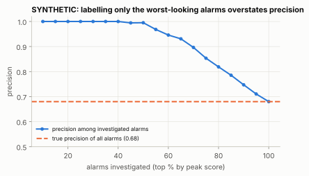
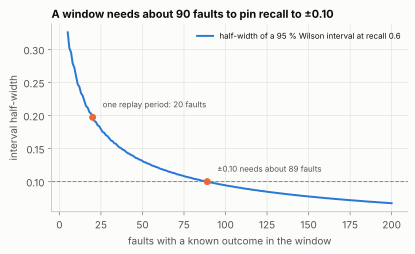

# H15.4 Drift versus degradation, delayed labels

**Status:** Reviewed (concepts) and Execution verified (every number quoted from the w7d3 runs).
**Used by:** [w7d3](../../../labs/w7d3_drift_vs_degradation/README.md), [w7d4](../../../labs/w7d4_model_updates_rollback/README.md).
**Builds on:** H15.3 (drift statistics), [H6.5](../ch06_evaluation_leakage_uncertainty/h6_5_point_vs_event_evaluation.md)
(event metrics), [H6.6](../ch06_evaluation_leakage_uncertainty/h6_6_bootstrap_and_paired_comparisons.md) (intervals).

## Overview

A deployed model raises three monitoring questions, each with its own evidence:

1. **Is the input valid?** Contract checks at the boundary, per request, immediately (H11.2).
2. **Has the input changed?** Drift statistics on inputs or scores against a reference, per window,
   without labels (H15.3).
3. **Is the model still good?** Labelled performance, which needs outcomes that arrive late, for only
   some predictions, chosen by a process that is rarely random.

The central claim of this section is that questions 2 and 3 are logically independent. Input drift can
leave performance untouched, and performance can collapse while every input statistic is still. A
monitoring design that infers one from the other will retrain working models and keep broken ones.



## Deeper explanation

### Four sources of change

* **Covariate shift**, $$P_t(x) \ne P_0(x)$$ with $$P_t(y \mid x) = P_0(y \mid x)$$. The Bayes-optimal
  classifier is unchanged. A model fitted well everywhere $$P_t(x)$$ puts mass keeps its accuracy; a model
  that extrapolates badly into the new region loses it. Per-unit normalisation, as in this project's
  burn-in z-score, makes the model invariant to whole families of covariate shift: the w7d3 replay moved
  the flow sensor by $$1.08x + 2.5$$ L/min, PSI rose from 0.24-0.42 to 6.1-8.9 against a threshold of
  0.66, and the detector caught exactly the same 11 of 20 faults.
* **Prior (label) shift**, $$P_t(y) \ne P_0(y)$$ with $$P_t(x \mid y) = P_0(x \mid y)$$. Recall and the ROC
  curve at a fixed threshold are unchanged; precision is not, because
  $$\text{precision} = \frac{\pi\,\text{TPR}}{\pi\,\text{TPR} + (1-\pi)\,\text{FPR}}$$ depends on prevalence
  $$\pi$$. A dashboard showing precision will report a "degradation" that is a change in the world.
* **Concept shift**, $$P_t(y \mid x) \ne P_0(y \mid x)$$. A new fault mechanism, a new fraud pattern, a
  changed definition of the label. The worked example in w7d3 halves fraud recall while the PSI of the
  score distribution stays at 0.001.
* **Pipeline change.** A configuration regression, a feature computed differently, a join that drops
  rows. Not a statistical shift at all, and the most common cause of production degradation in practice.
  The w7d3 replay's period C (threshold doubled by a release) cut recall from 11/20 to 4/20 on inputs
  identical to period A.

### How labels arrive

Write each prediction's label as arriving at $$t_{\text{pred}} + \Delta$$ with probability $$c$$ (coverage),
where $$\Delta$$ and $$c$$ may depend on the prediction and on the outcome. Three distortions follow.

* **Delay.** On day $$d$$ only labels with $$t_{\text{pred}} + \Delta \le d$$ exist. A metric "as of $$d$$"
  must use only those; a back-test that ignores this sees the future.
* **Incomplete coverage of negatives of the system.** Missed faults are learned only through a separate
  process (inspection, customer complaint, chargeback) with probability $$\rho < 1$$. Then
  $$\hat r = \frac{C}{C + M_{\text{rep}}}$$ with $$E[M_{\text{rep}}] = \rho M$$ overestimates recall. Before the
  delay has elapsed, $$M_{\text{rep}}$$ is smaller still. In the replay, period C's estimate read unknown on
  day 65, 0.67 on day 90 and 0.36 on day 150 against a true 0.20.
* **Verification bias.** If the labelled subset is chosen by a rule correlated with the outcome (operators
  investigate the worst-looking alarms), the metric on that subset estimates a conditional quantity. The
  classical fix is to label a random sample too and weight by inverse inclusion probability:
  $$\hat p_{\text{HT}} = \frac{\sum_{a} y_a / \pi_a}{\sum_a 1/\pi_a}$$ over labelled alarms $$a$$ with
  inclusion probability $$\pi_a$$.



*SYNTHETIC (w7d3 figure 2).* Measured precision is near 1.0 while half the alarms are investigated by
score, against a true 0.68.

### Power and window length

A monitoring window is useful only if it holds enough *labelled events* to detect the change you care
about. For a proportion near $$r$$ with $$n$$ labelled events the 95 % Wilson half-width is close to
$$1.96\sqrt{r(1-r)/n}$$; for a one-sided test of a drop $$\delta$$ at level $$\alpha$$ with power $$1-\beta$$,
$$n \approx (z_{1-\alpha} + z_{1-\beta})^2\, r(1-r) / \delta^2$$. At $$r = 0.6$$, $$\delta = 0.1$$, $$\alpha = 0.05$$,
$$1-\beta = 0.8$$: $$n \approx (1.645 + 0.842)^2 \cdot 0.24 / 0.01 \approx 148$$ events.



When the event rate is low, the honest conclusion is that labelled performance can confirm or refute a
change only slowly. Fast detection then rests on **proxies**: alert rate, the share of scores above the
action threshold, precision under a fixed alert budget (it falls when recall falls, because the budget
is filled by negatives), operator feedback. Each proxy has a failure mode, and the plan must say which.

### Estimating performance without labels

Methods exist that estimate accuracy from the model's own confidence on unlabelled data, or that
re-weight under an assumed label shift (black-box shift estimation). Each rests on an assumption: the
model stays calibrated under the shift, or only $$P(y)$$ changed. Under concept shift those assumptions
are precisely what fails. Use them as proxies with stated assumptions, never as a replacement for labels.

## Practical decisions and tradeoffs

| Decision | Options | Guidance |
|---|---|---|
| What the drift monitor watches | raw inputs; model features; scores | Scores are closest to the decision but are diluted when the positive class is rare (PSI 0.001 in the fraud example). Watch inputs to catch pipeline issues and scores to catch decision changes. |
| Drift threshold | folklore (PSI > 0.2); calibrated quantile on reference windows | Calibrated, with a stated false-alarm rate per window (H15.3). On SKAB, stable 5-day windows reach PSI 0.42. |
| Response to a drift flag | retrain; investigate | Investigate the source. Retrain only through the update gate (H15.5), and only with labelled evidence. |
| Window length | calendar-based; event-count-based | Derive from the label rate and the difference to detect; consider "every N labelled events". |
| Reporting below the minimum | 0; last value; unknown | Unknown, with pending counts and the date the labels are expected. |
| Labelling policy | top alarms only; random sample too | Add a random sample of uninvestigated alarms so precision can be re-weighted. |

## Common failure modes

* Retraining on every drift flag, and replacing a working model with one fitted to a transient.
* Monitoring precision at an operating point where it cannot move (zero false alarms on development
  data, as in w7d3: all 26 replay alarms were true faults in every period).
* Reading an early recall estimate as final; in the replay, period B read 0.85 on day 65 and 0.73 on
  day 150, against a true 0.55.
* Back-testing the monitor with every label, so it looks months faster than it can be.
* Joining labels by timestamp proximity instead of by an id the service logged, so corrections and
  duplicates land on the wrong prediction.
* Treating the absence of complaints as the absence of misses.

## Quick reference

```text
input valid?     per request, contract checks           -> reject/count
input changed?   calibrated drift statistic per window  -> investigate the input
model still ok?  labels known as of today, by event time window, with intervals:
                   insufficient           -> unknown (show pending counts)
                   interval below baseline-> no: escalate
                   lower end near baseline-> yes
                   otherwise              -> inconclusive: collect more
recall from inspections   = upper bound (coverage rho < 1)
precision on top alarms   = upper bound when investigation follows the score
events needed (Wilson ±0.10 at r = 0.6)      ~ 90
events needed (detect -0.10, 80 % power)     ~ 150
```

## Sources and verification status

* Numbers from lesson w7d3 (replay, worked example, figures) were produced by the scripts in that unit
  on 2026-11-22 and are copied from their output.
* The sample-size formula and the Wilson interval are standard; the Wilson values were computed with
  `flowguard.uncertainty.wilson_interval`. The 148-event figure is arithmetic from the stated formula.
* From memory, not re-opened in this session: Quiñonero-Candela, Sugiyama, Schwaighofer and Lawrence
  (eds.), *Dataset Shift in Machine Learning*, MIT Press, 2009 (the shift taxonomy); Moreno-Torres et al.,
  "A unifying view on dataset shift in classification", *Pattern Recognition*, 2012; Begg and Greenes,
  "Assessment of diagnostic tests when disease verification is subject to selection bias",
  *Biometrics*, 1983 (verification bias); Horvitz and Thompson, *JASA*, 1952 (inverse-probability
  weighting); Lipton, Wang and Smola, "Detecting and correcting for label shift with black box
  predictors", ICML 2018. Treat bibliographic details as unverified.
