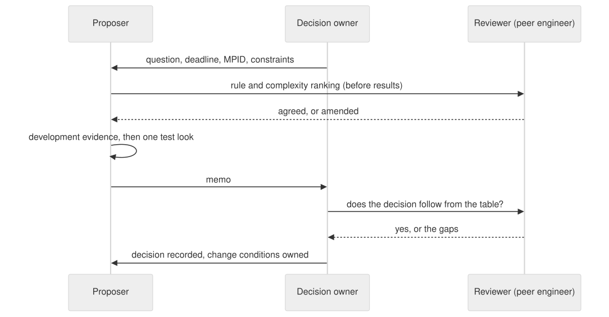

# H16.1 Decision memos

Status: Reviewed (see H16.1.8 for what was executed and what is from memory).
Used by: [w4d5](../../../labs/w4d5_model_choice/README.md), [w4d6](../../../labs/w4d6_project_milestone_1/README.md);
later H16.2 (reports and limitations) and H16.3 (system design). Related:
[H5.4 complexity versus evidence](../ch05_classical_ml_baselines/h5_4_complexity_versus_evidence.md),
[H6.6 bootstrap and paired comparisons](../ch06_evaluation_leakage_uncertainty/h6_6_bootstrap_and_paired_comparisons.md).

## H16.1.1 Overview

A decision memo is a one-page record of a choice: what was decided, by whom, on which evidence,
under which rule, with which risks. Its readers are the decision owner today, an engineer six months
from now who wonders why the system looks the way it does, and you in an interview.

A paper persuades a reviewer that a method is sound. A memo lets a reader *check* that a decision
followed from evidence that was available at the time. Three properties make that possible:

1. **Pre-commitment is visible.** The MPID, the hard constraints and the decision rule are stated
   as fixed before the results.
2. **The decision is predictable from the evidence table.** Someone who reads only the table and the
   rule should arrive at the same choice.
3. **Change conditions are measurable.** The memo says what new evidence would reverse it.

## H16.1.2 Structure

Six sections, in this order, on one page:



| Section | Must contain | Common weakness |
|---|---|---|
| Context | the question, the owner, and the parameters fixed before results (MPID, constraints, complexity ranking) | background prose; parameters stated after the table |
| Options | every serious option, the status quo, and a non-modelling option | only the proposer's two models |
| Evidence | one table; for each option the primary metric with an interval, the difference to the reference with its interval, the unit and number of independent clusters, costs, constraint status | point estimates; two unpaired intervals; test-set numbers used to choose |
| Decision | the choice, the rule, and the single confirmation on held-out data | a choice that does not follow from the table |
| Risks | three or more specific risks, each with a signal and preferably an owner | "the model might drift" |
| Change conditions | thresholds on future evidence; the cheapest experiment that would resolve the main uncertainty | "we will revisit if needed" |

## H16.1.3 Writing the evidence table

The table carries the argument, so build it before the prose.

* **Rows** are options, simplest first, so the eye moves along the complexity ranking.
* **Accuracy columns:**
  - the primary metric with its interval;
  - the difference to the reference with its interval;
  - the reading against the MPID (better, worse, equivalent, inconclusive).
* **Operating columns:** what the user of the output experiences, for example events caught at the
  alert budget, false alarms per hour, or offers changed.
* **Cost columns:** tail latency against its budget, size, retraining inputs, new dependencies.
* **Footnote:** the unit of resampling, the number of clusters, and what the intervals do not cover
  (retraining variation, other operating regimes).

Name the unit of resampling because the same data can support opposite headlines. In the w4d5
challenge case, a customer-level bootstrap gives an interval for B - A that excludes zero. The
region-level bootstrap, which matches how the data were generated, does not:

![Two intervals for AUC(B) - AUC(A) on the same synthetic churn data: customer-level [+0.001, +0.022] excludes zero, region-level [-0.005, +0.029] does not; both reach inside the ±0.02 MPID band](../figures/h16_1/intervals_by_unit.svg)

*Figure H16.1-1 (SYNTHETIC; `../figures/h16_1/intervals_by_unit.csv`).* The same 15,295
customers in 40 regions give a customer-level interval of [+0.001, +0.022] and a region-level
interval of [-0.005, +0.029]. A memo that omits the unit lets the reader assume the narrower one.

## H16.1.4 Writing the decision paragraph

Write it as rule plus application:

> "The rule fixed in advance was: among the options that meet the hard constraints, take the
> simplest one shown practically better than the reference; otherwise, the simplest one not shown
> worse. No option is shown practically better: B's gain, +0.011 [-0.006, +0.029], reaches below
> the MPID of +0.02, and B breaks the latency budget. We keep A."

Then the confirmation: one look at the held-out data for the chosen option, with its interval. Then
stop. If the confirmation disagrees badly with development evidence, that is a finding about the
evaluation (leakage? shift?) to investigate, not a licence to pick another option on test data.

## H16.1.5 The review conversation



Sending the rule to a reviewer *before* the results is the cheapest guard against fitting the rule
to the outcome. In a research group this is a pre-registration; in a company it is usually a short
message in the design channel with a timestamp.

## H16.1.6 Common failure modes

* The memo argues for the proposer's option instead of recording a choice among options.
* Intervals present but unpaired, or on the wrong unit.
* "Significant" used as if it meant "worth it".
* Risks that could apply to any project.
* No change conditions, so the decision is relitigated whenever someone has a new idea.
* Over a page: the reader skims, and the evidence table is lost in prose.
* Numbers typed by hand that no longer match the code that produced them. Generate the table (w4d6).

## H16.1.7 Quick reference

```text
Title · author · date · owner · status
## Context                         question, owner, fixed-in-advance parameters
## Options                         simplest first; status quo; a non-modelling option
## Evidence                        one table + footnote (unit, clusters, what intervals omit)
## Decision                        rule, application, one confirmation look
## Risks                           >= 3, specific, each with a signal
## What would change the decision  measurable thresholds; cheapest resolving experiment
One page. Every number traceable to a command.
```

## H16.1.8 Sources and verification status

Executed in the authoring session (2026-11-22): Figure H16.1-1 by
`handbook/figures/h16_1/make_figures.py` (SYNTHETIC case from
`labs/w4d5_model_choice/challenge/make_case.py`, 1,000 bootstrap replicates; numbers in the CSV).
The quoted decision paragraph uses the reference analysis of that case (2,000 replicates:
+0.0114 [-0.0055, +0.0294]).

From memory, not re-verified this session:

* The memo structure is a synthesis of common engineering practice: architecture decision records,
  and "design docs" as described in public engineering writing by several companies. No single
  source was consulted, and none is quoted.
* Nygard, M. (2011), "Documenting architecture decisions" (blog post): the architecture decision
  record format of context, decision and consequences.
* Pre-registration as a guard against analytic flexibility: Nosek, B. A. et al. (2018), "The
  preregistration revolution", *PNAS*.
