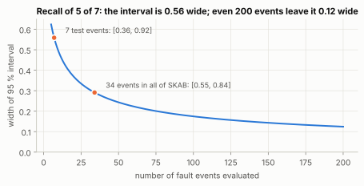

# H16.2 Reports and limitations

Status: Reviewed (sources below) · Lesson: [w8d2](../../../labs/w8d2_report_limitations/README.md) ·
Related: [H16.1 Decision memos](h16_1_decision_memos.md),
[H6.6 Bootstrap and paired comparisons](../ch06_evaluation_leakage_uncertainty/h6_6_bootstrap_and_paired_comparisons.md),
[H8.3 Clean-clone reproduction](../ch08_reproducible_experiments/h8_3_clean_clone_reproduction.md)

## H16.2.1 Overview

A technical report for an ML system exists so that someone who did not do the work can decide what to do with it.
It succeeds when that reader knows what the system is for, how it was evaluated, how good it is *with what
uncertainty*, what was decided and why, how it runs, what not to use it for, and how to check every number. Four
pages suffice for a small system when tables carry the numbers and prose carries the reasoning.

## H16.2.2 Results without self-deception

**Estimates with intervals and their unit.** A point estimate invites the reader to over-read the last decimal.
State the interval, the level, the method and the unit of resampling ("95 % cluster bootstrap over 7 test
recordings, 2000 replicates"); the unit is a claim about what the estimate generalises over.

**Differences, paired.** To compare models A and B evaluated on the same units, estimate the distribution of
$$\Delta = m(A) - m(B)$$ by resampling units and computing both metrics on each resample. Two marginal intervals
overlapping is not evidence of equivalence; non-overlap is a conservative test. Fix a minimum practically
important difference $$\delta$$ in advance and read the paired interval $$[L, U]$$ against it:
$$L > \delta$$ (better, practically), $$U < -\delta$$ (worse), $$[L, U] \subset (-\delta, \delta)$$ (equivalent within
$$\delta$$), otherwise inconclusive.

**Proportions from few events.** Use the Wilson interval for a proportion $$k/n$$:

$$\frac{\hat p + \frac{z^2}{2n}}{1 + \frac{z^2}{n}} \pm \frac{z}{1+\frac{z^2}{n}}\sqrt{\frac{\hat p (1-\hat p)}{n} + \frac{z^2}{4n^2}}.$$

For 5 of 7 it gives [0.36, 0.92].

*Computed in the w8d2 lesson. The width falls roughly as $$1/\sqrt{n}$$; halving it needs about four times the events.*

**Absence of events.** Zero false alarms in $$T$$ hours is consistent with any rate $$\lambda$$ for which
$$e^{-\lambda T}$$ is not small; the approximate 95 % upper bound is $$3/T$$ ("rule of three"). With $$T = 1.2$$ h that
is about 2.5 per hour: zero observed false alarms says almost nothing about a budget of one per 8 hours.

**Words with a technical meaning.** "Significant" (a test), "accurate" (accuracy, misleading under imbalance),
"robust" (to what?), "validated" (on what data, for what use), "causes" (needs an intervention or a causal design).
Use them only in their technical sense, with their evidence attached.

**Negative and null results.** Report them in the same table as the positive ones: they calibrate the reader's
trust in everything else.

## H16.2.3 Limitations

Each limitation has three parts:

* **the fact** (specific to this project, quantified where possible);
* **the impact**: what a reader must not conclude or do because of it;
* **the mitigation**: what was done, or what would be required.

Good limitations bound the claims along the dimensions a reader will try to extend them: sample size (how sure),
population (to which data, machines, customers), time (does it stay true), labels (how right is the ground truth),
and operations (how failure would be noticed). Poor limitations are generic ("more data could improve results"),
defensive, or about methods that were not used.

Claims that reviewers reject on sight: real-world or clinical validity from a benchmark; causal conclusions from
feature importance; superiority from overlapping or unpaired intervals; accuracy on rare classes; thresholds or
hyperparameters tuned on the test set; generalisation to a population or period not evaluated.

## H16.2.4 Model cards

A model card is a one-page projection of the report for users of the model: purpose, intended and out-of-scope
uses, training and evaluation data, performance with intervals (and by relevant slice), inputs and outputs, known
failure modes, monitoring and update policy, and ethical and practical considerations. Its numbers come from the
same results file as the report. Mitchell et al. (2019) introduced the format; most organisations adapt the fields.

## H16.2.5 Making reports mechanically checkable

Generate rather than type: tables and figures from the results file (w4d6, w7d6), prose from templates or scripts
where numbers appear (w8d2 worked example). Then lint: required sections, every number traceable at its written
precision, every interval with its method in the same block, "significant" with a test, limitation items with
impact and mitigation. A linter catches typos, stale numbers and missing caveats; it cannot judge whether the
unit of resampling was right or whether a limitation is the important one.

## H16.2.6 Decisions and tradeoffs

* **Length vs completeness.** Put details in appendices or linked reports (the milestone reports); keep the main
  text to the claims and their evidence.
* **One test look.** The report must say how many times the test set was used. If more than once, say so and
  treat the test numbers as optimistic.
* **Audience.** The same results become a report (reviewers), a model card (users), a decision memo (H16.1) and a
  runbook (operators). Keep one source of numbers for all four.

## H16.2.7 Failure modes

| Symptom | Cause |
|---|---|
| Text and table disagree | numbers typed; text not regenerated |
| "Significantly better" with 0.71 vs 0.69 | no paired comparison; marginal estimates compared |
| No limitations, or generic ones | written last, under time pressure, by the author |
| Claims beyond the evaluation (new market, causal advice) | the report written to persuade, not to inform |
| Accuracy reported on a 6 % positive class | metric chosen by habit, not by the decision |

## H16.2.8 Quick reference

* Structure: problem · data · protocol · results · error analysis · decision · serving and monitoring ·
  limitations · reproducibility.
* Every number from a file; every interval with level, method, unit; differences paired; decision rule stated.
* Limitation = fact + "Impact:" + "Mitigation:".
* `python labs/w8d2_report_limitations/lab/report/check_report.py REPORT.md --results results.json`

## H16.2.9 Sources and verification status

* Wilson interval: formula as implemented and executed in w3d5 and in this lesson's figure script; the original
  reference (Wilson 1927) is cited **from memory**.
* "Rule of three" for zero events (approximate 95 % upper bound $$3/n$$ or $$3/T$$): standard result stated **from
  memory**; the value $$e^{-0.15} \approx 0.86$$ in the w8d2 answers was computed.
* Model cards: Mitchell, M. et al. (2019), "Model Cards for Model Reporting", FAT* conference, cited **from memory**,
  not re-opened this session.
* Paired cluster bootstrap and the MPID reading: as defined and executed in w3d5 and w4d5 (H6.6, H16.1).
* The flowguard numbers quoted here are from `solutions/labs/w8d2_report_limitations/reference/results.json`,
  assembled from committed course outputs by `build_results.py`.
