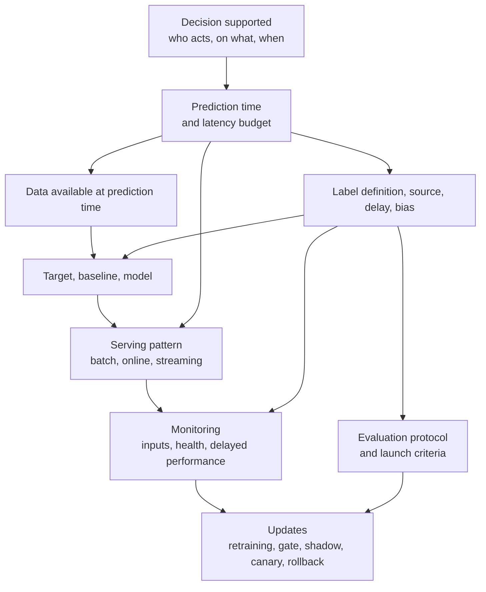
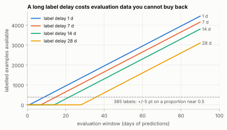
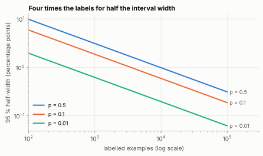

# H16.3 System design structure

**Status:** Reviewed (see H16.3.9). Used by lesson [w8d3](../../../labs/w8d3_system_design/README.md);
builds on [H10.1](../ch10_batch_online_inference/h10_1_one_pipeline_for_training_and_serving.md),
[H10.4](../ch10_batch_online_inference/h10_4_latency_and_throughput.md),
[H15.4](../ch15_logging_monitoring_updates/h15_4_drift_vs_degradation_delayed_labels.md) and
[H15.5](../ch15_logging_monitoring_updates/h15_5_updates_and_rollback.md).

## H16.3.1 Overview

An ML system design is a chain of decisions, each constrained by the one before: the **decision** the
prediction supports fixes the **prediction time**; the prediction time fixes which **data** exist and
when **labels** arrive; labels fix how the system can be **evaluated** and **updated**; traffic and the
latency budget fix the **serving** pattern; everything fixes what must be **monitored**. A design is
judged by whether the links in this chain are explicit and consistent, not by the sophistication of any
single link. This section gives a structure, the arithmetic that supports it, the main choices with
their trade-offs, and the ways designs (and candidates) typically fail.



## H16.3.2 The structure in detail

**1. Requirements (3-5 minutes).** Ask questions whose answers change the design: what decision is
made with the output and by whom; what happens when the prediction is wrong in each direction and what
it costs; latency and its percentile; peak volume; who must not see what (privacy, permissions);
whether decisions must be explained or reproduced later; whether a simple rule exists today (it is
your baseline and your fallback). State assumptions for everything else and move on.

**2. Estimates (3-5 minutes).** One small table: peak rate, latency headroom for the model, replicas,
storage for logs or features, labels per evaluation window. The purpose is to discover which constraint
binds. Typical findings: throughput is trivial but latency is tight; labels are too slow for weekly
evaluation; storing raw inputs is the dominant cost.

**3. Data and labels (5-7 minutes).** For each input, the event that creates it and whether it exists at
prediction time (the leakage audit of [H6.1](../ch06_evaluation_leakage_uncertainty/h6_1_leakage_taxonomy.md)).
For the label: its definition, source, delay, coverage (selective labels: only approved loans, only
flagged listings, only clicked results), and noise. Training rows must be reconstructed
**point-in-time**: features as they were when the prediction would have been made.

**4. Target, baseline and model (4-6 minutes).** Name the target precisely (a class, a quantile, a
ranking), a baseline (the current rule, a simple model), and one model family with a reason. Choose the
loss from the decision: asymmetric costs choose a quantile; ranking objectives for ranking; calibrated
probabilities when a threshold or price is set downstream.

**5. Evaluation (5-7 minutes).** An offline protocol that matches deployment (time-based and grouped
splits; [H6.3](../ch06_evaluation_leakage_uncertainty/h6_3_group_and_temporal_validation.md)), metrics
that reflect the decision, slices with enough data, uncertainty ([H6.6](../ch06_evaluation_leakage_uncertainty/h6_6_bootstrap_and_paired_comparisons.md)),
and **launch criteria** set in advance: offline gate, shadow, online test with guardrails.

**6. Serving (5-7 minutes).** Batch, online or streaming (H16.3.4); where features come from; the
request path with its latency budget; what happens when a dependency is slow or down (timeouts,
fallbacks, explicit degraded responses; [H15.6](../ch15_logging_monitoring_updates/h15_6_reliability_patterns.md)).

**7. Monitoring (3-5 minutes).** Service health (traffic, errors, latency, saturation), input validity and
drift, prediction distribution, and performance when labels arrive; who is alerted and what they do
([H15.1](../ch15_logging_monitoring_updates/h15_1_service_logs_and_metrics.md), [H15.3](../ch15_logging_monitoring_updates/h15_3_input_monitoring_drift.md)).

**8. Iteration (2-4 minutes).** Retraining cadence or triggers, the gate, shadow and canary, rollback, and
the first improvements you would try after launch, in order.

## H16.3.3 Estimation with worked numbers

| Relation | Formula | Example |
|---|---|---|
| Peak rate | $$N_{\text{day}}/86{,}400 \times r$$ | 3 M requests/day, $$r=3$$: ≈ 104 /s |
| Busy servers (Little's law) | $$\lambda W$$ | 104 /s × 25 ms ≈ 2.6 busy cores |
| Replicas | $$\lceil \lambda W / (c\,u) \rceil$$ | 2.6 / (2 × 0.6) → 3; then ≥ 2 zones |
| Latency headroom | $$B - \sum t_i$$ | 150 − (20 + 15 + 5 + 10) = 100 ms |
| Storage | events/day × bytes × retention × copies | 4,000 × 8,640 × 100 B × 365 × 3 ≈ 3.8 TB |
| Labels in window | $$n\rho\max(0, w-d)$$ | 10,000/day, 5 %, delay 14 d, window 30 d: 8,000 |
| Labels for precision | $$1.96^2 p(1-p)/h^2$$ | $$p=0.75$$, $$h=0.01$$: ≈ 7,200 |

Two habits make estimates useful rather than decorative. Write units on every quantity, and after each
number say what it implies ("12 queries a second, so throughput is not the issue; latency is").



*Label delay shifts the whole curve right: the first `d` days of any window are unlabelled (planning
arithmetic, figure from lesson w8d3).*

## H16.3.4 Choosing a serving pattern

| Pattern | Use when | Costs and risks |
|---|---|---|
| **Batch** | consumer does not wait; schedule is fresh enough (recommendations e-mail, staffing forecast) | stale for new entities; needs a lookup path and a default for unseen keys |
| **Online** | a request waits and carries the inputs (fraud at authorisation, ETA at checkout) | latency budget, capacity planning, dependency failures on the request path |
| **Streaming** | reaction to events within seconds or minutes; state over windows (machine health, session features) | ordering, late events, state checkpoints, replay for training parity |
| **Hybrid** | heavy features precomputed, light model online (most production systems) | two code paths for features: training/serving skew ([H10.1](../ch10_batch_online_inference/h10_1_one_pipeline_for_training_and_serving.md)) |

**Feature stores, conceptually.** A feature store gives one definition of each feature with two
execution paths: an offline store that produces point-in-time correct training rows, and an online store
that serves current values within milliseconds. The guarantees worth asking for are *point-in-time
joins*, *freshness metadata* and *the same transformation code in both paths*. Whether a product is
used is secondary; a shared library plus a daily parity check (log the online values that were served,
recompute them offline, compare) delivers most of the benefit.

## H16.3.5 Evaluation and launch criteria

Offline evaluation answers "is it better on history, measured the way it will be used"; launch criteria
answer "what evidence will make us replace the incumbent, decided before we see the result". A complete
set has three layers:

1. **Offline gate** on a frozen, deployment-matched test set, paired against the incumbent, with a
   non-inferiority margin and slice guardrails ([H15.5](../ch15_logging_monitoring_updates/h15_5_updates_and_rollback.md)).
2. **Shadow** scoring on live traffic: checks operational behaviour (latency, errors, input coverage) and
   disagreement with the incumbent, without affecting users.
3. **Online test** (A/B or interleaving for rankings) on a business metric the model was *not* trained
   on, with guardrails and a stopping rule.

Including a metric the model was not optimised for is what protects against Goodhart effects: a ranking
model trained on clicks is launched on task success, an ETA model trained on pinball loss is launched on
late-order rate and conversion.

## H16.3.6 Monitoring and retraining

Labels decide the monitoring design. With fast labels (delivery times, within an hour) performance can be
monitored almost in real time. With slow or selective labels (defaults after months; only investigated
alarms) monitoring relies on inputs, service health and proxies, and performance is measured on delayed
windows with honest uncertainty ([H15.4](../ch15_logging_monitoring_updates/h15_4_drift_vs_degradation_delayed_labels.md)).
Retraining triggers should be scheduled or performance-based; drift alone is a weak trigger. Every
retrain passes the same gate as the first model.

## H16.3.7 Trade-offs: saying them well

A trade-off statement names both options, the quantity that differs, the evidence, and what would change
the choice: *"Precomputing image embeddings at upload removes 90 ms from the request path at the cost of
a few seconds of delay before a listing is scored; I'd take that because the budget is tight and a short
hold is acceptable; if listings must go live instantly I'd shrink the embedding model instead."*
Avoid one-sided statements ("we use streaming because it's real-time") and unmeasurable ones ("this is
more scalable").

## H16.3.8 Common failure modes (designs and candidates)

| Failure | Why it fails | Instead |
|---|---|---|
| Jumping to the model | The model is chosen before the target, metric and latency are known | Requirements and a baseline first |
| No metric, or the wrong one | Accuracy with a dominant class; MAE when costs are asymmetric | Metric from the decision; launch on a business metric |
| No data or label story | Leakage and selective labels go unnoticed; evaluation is meaningless | Feature-availability audit; label definition, delay, coverage |
| Random split for a temporal or grouped problem | Optimistic offline numbers that do not survive launch | Time-based and grouped splits matching deployment |
| No numbers | Architecture choices have no basis; latency overruns unseen | One estimation table, with units |
| Ignoring failure and cost | The system breaks on the first dependency outage; costs explode | Timeouts, fallbacks, degraded mode; cost per request |
| Monitoring = accuracy dashboard | Labels are late, so problems are found weeks later | Inputs, health, proxies now; performance on delayed windows |
| Monologue | The interviewer cannot steer toward what they want to assess | State the plan, check in, follow interruptions |



*Why evaluation plans need label counts: halving an interval costs four times the labels (formula,
figure from lesson w8d3).*

## H16.3.9 Quick reference

```text
OPEN      "I'll clarify requirements, estimate, then data and labels, evaluation, serving, monitoring."
ASK       decision & actor · error costs each way · latency pXX · peak volume · permissions/audit · current rule
ESTIMATE  peak = N/86,400 x r · busy = rate x service time · replicas = ceil(busy/(cores x util)) >= 2
          headroom = budget - sum(hops) · labels = n x rate x max(0, window - delay) · n = 1.96^2 p(1-p)/h^2
LABELS    definition · source · delay · coverage/selection · noise · point-in-time rows
EVAL      split matches deployment · metric from decision · slices · intervals · launch criteria (gate, shadow, online)
SERVE     batch / online / streaming / hybrid · feature parity · timeouts · fallback · degraded flag
MONITOR   health · inputs · predictions · delayed performance · alerts with owners
ITERATE   retrain cadence/trigger · same gate · shadow · canary · rollback
```

## H16.3.10 Sources and verification status

* The structure, time allocation and rubric are this course's synthesis of the preceding chapters; they
  are not taken from a single source.
* Little's law ($$L = \lambda W$$), the normal-approximation interval for a proportion and the
  cost-ratio quantile for asymmetric linear costs (the newsvendor result) are standard results stated
  from memory; the arithmetic in the tables was executed with the reference worksheet of lesson w8d3.
* Product names (feature stores) are deliberately omitted; the concepts described are product-neutral.
* No external pages were opened for this section.
