# Applied ML Engineering
{: .fs-9 }

An eight-week, hands-on program. Take a model from a research script to a reliable service: package it,
test it, evaluate it honestly, serve it, containerise and deploy it, then monitor it and explain it.
{: .fs-6 .fw-300 }

[Start with Week 1](weeks/week-1.html){: .btn .btn-primary .mr-2 }
[Browse the notebooks](notebooks/){: .btn .mr-2 }
[Get the code](https://github.com/berdakh/mlengineering-){: .btn }

All 48 notebooks are **readable on this site** and open in Google Colab with one click: no install and no
GPU to get started.

New to the vocabulary? The [glossary](guides/glossary.html#in-plain-terms) opens with an everyday picture for
every term: a group split is testing a doctor on patients they have never met; drift is the river moving
while the boat may be fine.

---

## What you will be able to do

1. **Translate** a practical problem into an ML task: unit of prediction, labels, costs, constraints.
2. **Build a reproducible data pipeline** with schema and quality checks that fail loudly.
3. **Establish meaningful baselines** and choose metrics from the decision being supported.
4. **Train, compare and analyse models correctly**: no leakage, honest validation, intervals, error analysis.
5. **Package preprocessing and inference** once, and prove training/serving parity.
6. **Write useful tests** and maintainable code: packages, configuration, logging, CI.
7. **Expose predictions through a validated API** with FastAPI.
8. **Containerise and deploy** a small service, behind an explicit cost gate.
9. **Measure latency, failures and model behaviour**, and tell input drift from real degradation.
10. **Explain decisions, limitations and tradeoffs** in a report, a walkthrough and system-design interviews.

## How it is organised

| | |
|---|---|
| [**Weekly plan**](weeks/) | Eight weeks; six core days of about 2 hours and a review day each |
| [**Notebooks**](notebooks/) | One per core day: concepts, a worked example you run, a lab with automated checks, a challenge, hints, an assessment |
| [**Handbook**](handbook/) | 55 sections of background reading with equations, tradeoffs, failure modes and sources |
| [**Guides**](guides/) | Setup, Colab, cheat sheet, troubleshooting, glossary, the project, interview practice |

## The project

One real time-series project runs through all eight weeks: **`flowguard`**, fault detection on the
[SKAB](guides/project.html) water-circulation testbed recordings. You build its data pipeline, evaluation,
model choice, API, container, deployment and monitoring yourself, and finish with a technical report and a
reproduction audit from a clean clone.

## Honest by design

Passing the supplied checks is *guided practice*, not mastery. Every check suite is verified to accept the
reference solution and to reject plausible wrong submissions, and real-data results are reported as found,
including the ones that went against expectations. What was and was not verified is on the
[status page](guides/status.html).
